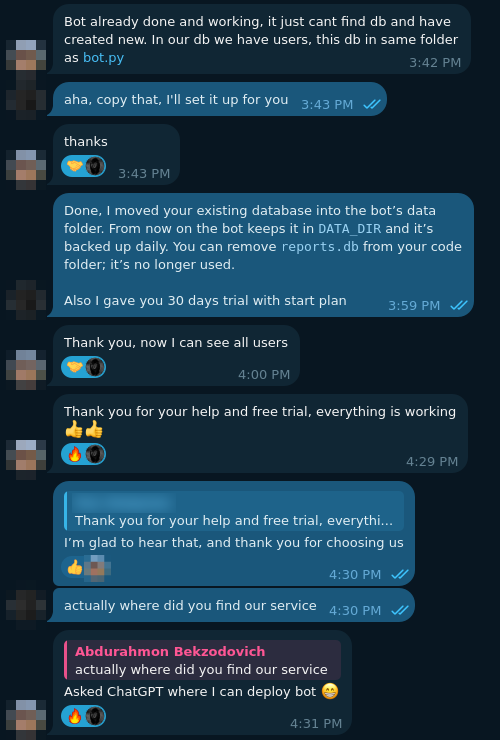

[Botxona](/lab/ideas/botxona) hasn't launched. No post, no ads, no "we're live"
anywhere. So the first real user wasn't someone I reached. **She asked ChatGPT
where she could deploy a bot, and it sent her to us.**

## Who came before her

The first people who did write weren't bot owners. They were 1xbet / 1win-style
schemes: bots that route winnings to bank cards for players who can't withdraw
the money themselves. That's the traffic a cheap host with Uzbek payments
attracts first. We turned all of it down. A hosting platform
is only as good as what it agrees to run.

## Her bot

A daily-report bot for a team at a retail chain. Every evening each employee
taps one button and fills in a checklist, problems, risks and a 🟢/🟡/🔴 status;
at 18:10 the managers get a summary and an Excel file. Ten people had been using
it for two weeks. Not a demo — a tool a team depends on.

She uploaded it, the checks came back green, it started. And every user was gone.

## "It just can't find the db"

Her bug report was one message, and it was exactly right:

The bot kept its SQLite file, `reports.db`, next to `bot.py`. On Botxona a bot's
filesystem is read-only; the only place it can write is `DATA_DIR`, a volume of
its own that survives restarts and gets backed up every night. Her code already
followed that rule — `DB_PATH = DATA_DIR / "reports.db"` — so it opened
`/data/reports.db`, found nothing, and created an empty one. The real database
was still there, baked into the image next to the code, where nothing would ever
read it again.

The bot was right. The platform was right. The data was on the wrong side of the
line, and she had no way to move it across.

## The fix

Small, and boring on purpose:

1. **Look before touching.** Find the file in the image, open both databases
   read-only and compare. The "empty" one wasn't empty: she had registered again
   and filed a test report in the meantime.
2. **Snapshot** her volume.
3. In a throwaway container — no network, her user, only her volume mounted —
   copy the original in, add the new rows on top with `INSERT OR IGNORE`, and
   keep the empty one renamed instead of deleted.

Ten users and every report were back. I also read her code top to bottom — the
first stranger's code running on the platform should get that — and it was
exactly what it said: `python-telegram-bot`, `openpyxl`, SQLite, nothing else.

She got a month on Start for being first. Her reply: *"Thank you for your help
and free trial, everything is working 👍👍"*.

## What it changes

- **Data has to be able to come in.** Right now there's no way for a user to put
  a file into `DATA_DIR`. Every bot that arrives with its data — a SQLite file, a
  JSON store, a session file — loses it on the first deploy and starts empty. The
  checks already read the zip; they can notice a `*.db` in it and offer to seed
  `DATA_DIR` with it once. That's the next thing on the list.
- **AI is a distribution channel.** I wrote the docs and the
  [prompt library](https://botxona.uz/prompts) for AIs to read, so that
  AI-written bots pass the checks on the first try. I didn't expect AI to also be
  how people *find* the platform. The first user came through it before any
  person did.
- **The first user is worth doing by hand.** Fixing it took an evening of careful
  steps. It was a good evening — I learned more about Botxona from one real bot
  than from a week of my own test bots.

Related: [Botxona](/lab/ideas/botxona), [Telegram](/lab/skills/telegram),
[AI agents](/lab/skills/ai-agents).
