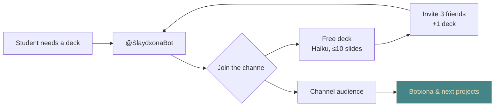

**Status: live.** [umbra.uz](https://umbra.uz), with the bot at
[@SlaydxonaBot](https://t.me/SlaydxonaBot). A student types a topic and gets
back a `.pptx` that's ready for class: a proper university title slide,
correct Uzbek (oʻ gʻ), short text and real sources.

## Why it exists

Here's the honest part: **Slaydxona is an audience machine.** I didn't build it
because the world needs one more slide generator. Every student in Uzbekistan
has to make a *mustaqil ish* or *taqdimot* every few weeks. That's a huge,
repeating need, and it lives entirely in Telegram.

So it works like this:

The bot asks you to join the channel before the first deck. Referrals only count
when the friend is new, joins the channel and actually generates a deck. The
channel is the asset. When I have something new to show,
[Botxona](/lab/ideas/botxona) first, those people already follow me.

## Why Haiku makes it work

The free deck runs on **Claude Haiku**. It's fast, it handles structured JSON
well, and it's cheap enough that a free deck costs me close to nothing. So
"one free presentation" is a marketing budget I can actually pay. Sonnet is
only used for paid Premium decks (speaker notes plus defense Q&A).

What keeps the cost flat:

- **Images cost nothing.** The model only returns an `image_query`; code fetches
  from Pexels, Pixabay and Wikimedia Commons. No AI image generation, which
  also keeps the decks from looking AI-made.
- **Prompt caching** on the system prompt and layout catalogue, and no thinking
  mode for slide text.
- **One router, three providers.** Haiku first, then GPT and Gemini as fallbacks
  behind the same JSON schema, so a 429 never turns into a failed deck.
- **A daily spend cap** set in the admin. When it's reached, new decks are
  refused without using a credit, and I get alerts at 80% and 100%.
- Every request logs its tokens, cost and latency, so the admin shows **cost per
  deck**, not a guess.

Paid tiers are about 5 000 so'm (Standard) and 9 000 so'm (Premium). They're paid
by card transfer with a screenshot, the same flow as Botxona. Prices live in the
admin, not in code.

## Not AI slop

Students and teachers can spot an AI deck immediately: same layout on every
slide, walls of text, a purple gradient. Before I designed a single template, I
collected and analysed **201 real student decks** (2 361 slides) from Uzbek
universities and schools. I looked at how long they are, how many words go on a
slide, what the title slide looks like and how they cite sources.

From that came **50+ master `.pptx` templates** built on 25 real archetypes. The
fonts are ones every student's Office already has, so nothing shifts when they
open the file. Sources follow the local academic style, and the title slide
fills itself from your profile (university, group, "Bajardi", "Qabul qildi").

**Users don't pick a template.** Out of 52 designs students chose badly (loud
templates for law, chalkboard for medicine), so the AI classifies the topic and
picks one. If you don't like it, "Boshqa dizayn" re-renders the same content in
another design, with no extra LLM call and no extra credit.

## The admin is the real product

I spent as much time on the admin as on generation, because that's where I
actually learn. In one place I see:

- **Errors**: every failed generation, with provider, model, fallback and
  latency.
- **Feedback**: what users write back, tied to the deck it's about.
- **Analytics**: users, decks, referrals, spend per day, payments queue.
- **Broadcasts**: segments with live counts, media, buttons, scheduling,
  pause/resume. It resumes after a restart, and nobody gets a message twice.

I don't add features on a hunch. I read what broke and what people complain
about, fix that, and ship it.

## How it's built (and kept)

Built in two days, **10–11 October 2026**, with Claude Code, running the
[spec-first](/lab/spec-first) setup I keep improving:

- A `CLAUDE.md` with the decisions table. Anything in it doesn't get
  re-argued without me.
- A `STATUS.md` handoff file plus `/handoff` and `/resume` commands, so any
  session can pick up exactly where the last one stopped.
- **Subagents by cost**: Haiku to explore and run QA, Sonnet to implement,
  Opus only for architecture review. The main session coordinates and doesn't
  read big files itself.
- **733 tests**, plus a template QA script that renders every template in Uzbek,
  Russian and English and checks glyphs and overflow.

Stack: aiogram 3, FastAPI, an arq worker, Postgres and React. It runs on the
same box as Botxona with hard memory limits on the render worker, so it can't
starve its older sibling.

## Results

{/* TODO: fill in real numbers from the admin before merging */}
- **Most users are satisfied.** The feedback in the admin is mostly positive,
  and the complaints are specific enough to fix.
- **The channel grows by itself.** Every free deck means one more channel member,
  and every referral means three.
- **It's paying for itself as marketing.** Haiku keeps the cost per free deck tiny,
  and in exchange I get an audience of students and young developers, which
  is exactly who [Botxona](/lab/ideas/botxona) is for.

| | |
|---|---|
| Users | — |
| Decks generated | — |
| Channel members | — |
| Avg. AI cost per free deck | — |

Related: [Ideas](/lab/ideas), [Botxona](/lab/ideas/botxona),
[Telegram](/lab/skills/telegram), [AI agents](/lab/skills/ai-agents),
[Spec-first delivery](/lab/spec-first).
