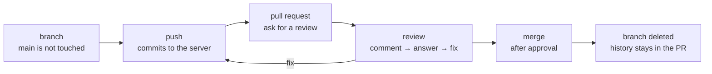

<div lang="en">

🌐 [Oʻzbekcha](/lab/youtube/git/git-1-03) · [Русский](/lab/youtube/git/git-1-03/ru) · **English**  
Lesson GIT-1.03 · [Git va GitHub: 0 → Pro](/lab/youtube/git#git-1-03) · ▶️ video coming soon · 💻 [GitHub](https://github.com/abdurahmon27/go-backend-uz/tree/main/lessons/git-03-github-flow)

> This is the full written version of the video lesson: you can learn from it without watching (or hearing) the video. The video itself is in Uzbek.

## What you will learn

A colleague left one comment on your pull request:

```text
✗  Bu kod noto'g'ri.
```

("This code is wrong.") Wrong where? Why? What should you do? None of that is said. The same finding can be
written differently:

```text
✓  issue (blocking): foiz 100 dan oshsa, narx manfiy.
   go run . 150  →  non: -1500 so'm
   Foizni 0..100 oralig'ida tekshirib, shu holatga
   test qo'shsak bo'ladimi?
```

("issue (blocking): if the percent is over 100, the price is negative. `go run . 150 → non: -1500 so'm`. Could we
check that the percent is in 0..100 and add a test for this case?") It starts with a label: `issue` means a problem,
`(blocking)` means it must be fixed before merge. Then a concrete example: at 150 % the price comes out as −1500 som.
At the end there is a suggestion and a question, not an order. Today we go through GitHub flow from start to finish
and learn to write comments like this.

**The one idea:** a pull request is a branch, a diff and a conversation between people. A good comment is about the
code, not the person, and comes with an example and a reason. A good answer fixes the code.

By the end of the lesson you will be able to:

- go through the six steps of GitHub flow (branch → push → pull request → review → merge → delete the branch) with
  real git commands;
- explain why a PR page shows `git diff main...branch` (three dots) and not `git diff main..branch`;
- choose a review decision (Comment, Approve, Request changes) and write a comment with an `issue`, `nit`,
  `question` or `praise` label;
- answer a review comment politely and push the fix to the same branch.

Today's three core new words:

| Word | Plain meaning | English term |
|---|---|---|
| pull request (PR) | a request "please look at my branch before it goes into `main`": a GitHub feature, not a git command | pull request |
| review comment | a written remark about the code in a PR; it starts with a label: `issue`, `nit`, `question`, `praise` | code review comment |
| three-dot diff | the difference counted from the point where the branches split (the common ancestor, **merge base**): only what the PR brings | three-dot diff |

Helper words get one plain sentence where they first appear: **bare repo** (a repo with no working files, only
history), **upstream** (the server branch a local branch is linked to), **merge commit** (a commit with two parents),
**draft** (an unfinished PR).

## Before you start

- [GIT-1.01 · git: a commit is a snapshot, a branch is one hash in a file](/lab/youtube/git/git-1-01/en): a branch is a ref that
  holds one commit hash; a fast-forward merge moves that ref forward; `git revert` undoes a mistake with a new commit.
  In that lesson the buggy `chegirma` ("discount") went straight into `main`. Today we look at a workflow that does
  not let that happen.
- [GIT-1.02 · Pushed your `.env`? The key is no longer only yours](/lab/youtube/git/git-1-02/en): the previous Git lesson. Today
  only one question comes from it (in "Check yourself").
- [SYS-0.02 · Processes and the environment: `ps`, `kill`, `$PATH` and env variables](/lab/youtube/sys/sys-0-02/en): the **exit code**
  and an environment variable set with `export`. That is how we pin the commit time (`vaqt.sh`).
- The Go code in the exercise is small. Its `go test` and table-driven test are covered in
  [GO-1.07 · Don't guess, measure: your first test and benchmark](/lab/youtube/go/go-1-07/en); returning `(int, error)` from a
  function, and errors as values instead of `try/catch`, in
  [GO-X.03 · No try/catch: error values and defer](/lab/youtube/go/go-x-03/en). Here they get one sentence each.

**How to run the code.** You need `git` 2.29 or newer, `bash` and Go 1.22 or newer. A GitHub account is **not
needed**: nothing is sent to GitHub, the "server" is `server.git` in the same folder. Download the course repository
and go to the lesson folder (`cd` changes the terminal's current folder):

```bash
git clone https://github.com/abdurahmon27/go-backend-uz
cd go-backend-uz/lessons/git-03-github-flow
```

The commands on this page are written as in the video and the README: each one starts **from the lesson folder**. So
most of them start with `cd lola && …` (the author) or `cd aziz && …` (the reviewer). If you run each command in its
own `bash -c '…'`, the `cd` does not carry over to the next command. In a normal terminal the `cd` stays: if you are
already inside `lola`, run `cd ..` first. Run the commands in the order of the page: each one continues from the state
the previous one left. To start over, run `./qur.sh` again.

A commit hash is computed from the author, the time and the content (GIT-1.01). `qur.sh` and `vaqt.sh` pin the name
and the time, so every hash on this page should match yours character for character. Only the `go test` time
(`0.002s`) changes a little each run.

First, a question from GIT-1.01. After the `chegirma` branch was created, nobody added commits to `main`. What does
`git merge chegirma` do?

**A)** creates a merge commit with two parents · **B)** moves the `main` ref to the hash of `chegirma`
(fast-forward) · **C)** copies the commits from `chegirma` and adds them to `main` with new hashes

<details>
<summary>Answer</summary>

**B.** The last commit of `main` is an ancestor of `chegirma`, so there is nothing to combine: git just moves the
`main` file forward. That is a **fast-forward**. "A" is the case where both branches have new commits. Today we get
exactly that case: Aziz adds a README line to `main`, while Lola works on `chegirma`. One more new thing: GitHub's
merge button creates a merge commit even when a fast-forward is possible (section "Merge").

</details>

## GitHub flow: six steps

In GIT-1.01 the bug went straight into `main`, and we reverted it later. Teams use **GitHub flow** to avoid that.
The order in the GitHub documentation is simple:

| # | Step | Who | What happens |
|---|---|---|---|
| 1 | branch | author | work starts on a separate branch; `main` is not touched |
| 2 | commit and push | author | the commits go to the server together with that branch |
| 3 | pull request | author | colleagues are asked to look at the change |
| 4 | review | reviewer ↔ author | comment → answer → fix, several times if needed |
| 5 | merge | reviewer or author | after approval the branch is added to `main` |
| 6 | delete the branch | author | the branch is no longer needed; the PR and the commits stay in history |



A **pull request** is not a git command but a GitHub feature. The GitHub documentation calls it "GitHub's key
collaboration feature". The `git help -a` list has no `pull-request` command. But a PR is built on the same branch and
merge from GIT-1.01: a PR is the question "shall we merge this branch into `main`?" and the conversation around it.

Git itself has a related command: `git request-pull`. It writes a summary of the changes, and the summary is sent by
email. Linux kernel maintainers send their pull requests this way. GitHub turned the same idea into a web page,
comments and buttons.

## The exercise: a local server instead of GitHub

You do not need a GitHub account for the exercise. The `qur.sh` ("build") script makes three repos:

```text
            server.git  (instead of GitHub: a bare repo, history only)
              ▲     ▲
     push/fetch     push/fetch
              │     │
   lola/  (author)      aziz/  (reviewer)
```

- `server.git` is a **bare repo**: it has no working files, only history (`objects`, `refs`). A repo on a GitHub
  server works the same way: nobody edits files there, people only push to it and fetch from it.
- `lola` (Lola) is the author who writes the code.
- `aziz` (Aziz) is the colleague who does the review. He has already added a README update to `main`. Lola has not
  got it yet. This difference matters in the "Review" section.

The full script:

```bash filename="qur.sh" showLineNumbers
#!/usr/bin/env bash
# GitHub flow mashqi uchun uchta repo'ni noldan quradi. git >= 2.29.
#   server.git/  GitHub o'rnida turgan bare repo (ishchi fayllarsiz, faqat tarix)
#   aziz/        reviewer: main'ni boshlagan, keyin README'ni yangilagan
#   lola/        muallif: README yangilanishidan oldin clone qilgan
# Muallif va vaqt qat'iy (vaqt.sh): hash'lar hamma joyda bir xil.
set -e; cd "$(dirname "$0")"; rm -rf server.git lola aziz
rf=--ref-format=files; git init -h 2>&1 | grep -q ref-format || rf=   # eski git'da bu bayroq yo'q
git init -q --bare --template= -b main --object-format=sha1 $rf server.git
sozla() {   # $1 ism, $2 email: imzo, hook, rang va global sozlamalar natijani o'zgartirmasin
  git config user.name "$1"; git config user.email "$2"; git config commit.gpgsign false
  git config core.hooksPath /dev/null; git config core.pager cat; git config color.ui false
  git config core.abbrev 7; git config core.autocrlf false; git config core.excludesFile /dev/null
  git config core.attributesFile /dev/null; git config log.decorate false; git config branch.sort refname
  git config pull.ff only; git config merge.stat true; git config push.default simple
  git config advice.detachedHead false; git remote set-url origin ../server.git 2>/dev/null || true; }

# aziz main'ni boshlaydi va serverga push qiladi
mkdir aziz; cd aziz; git init -q --template= -b main --object-format=sha1 $rf
git remote add origin ../server.git; sozla Aziz aziz@example.com
cp ../fayllar/README.md README.md; cp ../fayllar/v0/main.go main.go; printf 'module narx\n\ngo 1.22\n' > go.mod
git add .; . ../vaqt.sh; git commit -q -m "narx dasturi"
git push -q -u origin main 2>/dev/null; cd ..

# lola shu holatda clone qiladi
git clone -q --template= server.git lola; (cd lola; sozla Lola lola@example.com)

# aziz keyin main'da README'ni yangilaydi (lola buni hali fetch qilmagan)
cd aziz; cp ../fayllar/README.aziz.md README.md
git add README.md; . ../vaqt.sh; git commit -q -m "README: ishga tushirish"
git push -q origin main 2>/dev/null; cd ..
echo "tayyor: server.git/ (GitHub o'rnida), lola/ (muallif), aziz/ (reviewer)"
```

| Line | Code | What it does |
|---|---|---|
| 1–6 | comments | what the three folders are; author and time are pinned so the hashes are the same everywhere |
| 7 | `set -e; cd …; rm -rf server.git lola aziz` | stop at the first error; go to the script's folder; delete the old repos |
| 8 | `rf=--ref-format=files … \|\| rf=` | on git 2.45+ keep refs in plain files (as in GIT-1.01); on an older git the flag is empty |
| 9 | `git init -q --bare … server.git` | `--bare` is a repo without working files; `-b main` makes `main` the first branch; SHA-1 hashes |
| 10–16 | `sozla() { … }` | a shell function ("configure"): name and email (`$1`, `$2`), turns off signing, hooks, colour and global settings. `pull.ff only` makes `git pull` fast-forward only; `git remote set-url origin ../server.git` sets the address of `origin` (the server) |
| 19–20 | `mkdir aziz; … git init …; git remote add origin ../server.git; sozla Aziz …` | Aziz's repo, `origin` is `../server.git` |
| 21–23 | `cp …; printf 'module narx…' > go.mod; git add .; … git commit …; git push -q -u origin main` | the first commit "narx dasturi" ("price program", `v0`), pushed to the server |
| 26 | `git clone -q --template= server.git lola; (cd lola; sozla Lola …)` | Lola clones the server: one commit so far |
| 29–31 | `cp ../fayllar/README.aziz.md README.md; … git commit …; git push …` | Aziz adds two lines to the README and pushes to the server. Lola has not fetched this |
| 32 | `echo "tayyor: …"` | the final message ("ready") |

`2>/dev/null` hides the push messages that go to stderr. The commit time comes from `vaqt.sh` ("time";
`. ../vaqt.sh` runs the script in the current shell, as in SYS-0.02 and GIT-1.01):

```bash filename="vaqt.sh" showLineNumbers
# Manba qiling: `. ../vaqt.sh` (lola/ yoki aziz/ ichidan). Commit vaqtini qat'iy qiladi:
# 2026-03-02 10:00 (+05:00) va repo'da ko'rinadigan har bir commit uchun +10 daqiqa.
# Shuning uchun commit hash'lari sizda ham, bizda ham bir xil chiqadi.
# muallif repo sozlamasidan olinsin (user.name/email), muhitdagi qiymatdan emas
unset GIT_AUTHOR_NAME GIT_AUTHOR_EMAIL GIT_COMMITTER_NAME GIT_COMMITTER_EMAIL
n=$(git rev-list --all --count 2>/dev/null || echo 0)
t=$((1772427600 + n * 600))
export GIT_AUTHOR_DATE="@$t +0500" GIT_COMMITTER_DATE="@$t +0500"
```

- Line 5: removes variables like `GIT_AUTHOR_NAME` from the environment, so the name comes from the repo settings.
- Line 6: the number of commits visible in the repo, `n` (`--all` means from all refs, including those from the
  server).
- Line 7: `1772427600` is 2026-03-02 10:00 Tashkent time in Unix seconds; +600 seconds per commit.
- Line 8: git takes the time from these two environment variables.

You need none of this in your own repo. Let's run it:

```console
$ ./qur.sh
tayyor: server.git/ (GitHub o'rnida), lola/ (muallif), aziz/ (reviewer)
```

```console
$ ls -C server.git lola
lola:
go.mod	main.go  README.md

server.git:
config	HEAD  objects  refs
```

`lola` has files: `go.mod`, `main.go`, `README.md`. `server.git` has only git's internal folders: `config`, `HEAD`,
`objects`, `refs`. In a normal repo they sit inside `.git`; in a bare repo they sit in the folder itself. Now the
history of both local repos (`git -C <folder>` runs the command in that folder):

```console
$ for r in aziz lola; do echo "$r:"; git -C $r log --oneline; done
aziz:
9c274de README: ishga tushirish
3644e95 narx dasturi
lola:
3644e95 narx dasturi
```

Aziz has two commits, Lola has one. The program on `main` has no discount yet:

```go filename="fayllar/v0/main.go" showLineNumbers
// narx: non narxini chiqaradi. main'dagi boshlang'ich versiya.
package main

import "fmt"

const non = 3000 // so'm

func main() {
	fmt.Printf("non: %d so'm\n", non)
}
```

`go run .` → `non: 3000 so'm` ("bread: 3000 som"). `const non = 3000` is a constant; `%d` is the slot for an
integer.

## Branch and push

Lola starts the work on a new branch. The name is short and clear: `chegirma` ("discount"). The GitHub documentation
also recommends a short name that describes the work (their example: `increase-test-timeout`). `git switch -c`
creates a new branch and switches to it:

```console
$ cd lola && git switch -c chegirma
Switched to a new branch 'chegirma'
```

The code comes from `fayllar/v1/`. Three files. The first one is the calculation itself:

```go filename="fayllar/v1/chegirma.go" showLineNumbers
package main

func chegirma(narx, foiz int) int {
	return narx - narx*foiz/100
}
```

`chegirma(narx, foiz int) int` takes two `int`s (`narx` is "price", `foiz` is "percent") and returns one `int` (in Go
the type comes after the name; in `narx, foiz int` both are `int`). `narx*foiz/100` is integer division: the
fraction is dropped. 3000 and 10 → `3000 - 300 = 2700`.

The second one is the test:

```go filename="fayllar/v1/chegirma_test.go" showLineNumbers
package main

import "testing"

func TestChegirma(t *testing.T) {
	holatlar := []struct{ narx, foiz, kutilgan int }{
		{3000, 0, 3000},
		{3000, 10, 2700},
	}
	for _, h := range holatlar {
		if got := chegirma(h.narx, h.foiz); got != h.kutilgan {
			t.Errorf("chegirma(%d, %d) = %d, kutilgan %d", h.narx, h.foiz, got, h.kutilgan)
		}
	}
}
```

| Line | What it does |
|---|---|
| 1, 3 | the file name ends in `_test.go`, the `testing` package: `go test` finds these files |
| 5 | `TestChegirma(t *testing.T)` is a test function; it starts with `Test` (`*` is a pointer, see GO-1.07) |
| 6–9 | `holatlar` ("cases") is a table: each row has a price, a percent and the expected result (`kutilgan`). Two cases: 0 % and 10 % |
| 10 | `for _, h := range holatlar` loops over the table (like `for (const h of holatlar)` in JS) |
| 11–13 | if the result differs from the expected one, `t.Errorf` marks the test as failed and prints why |

It is the same idea as `test.each([...])` in Jest: one check, many rows of data. The test has only 0 and 10 percent.
Remember that.

The third one is `main.go`; it takes the percent from the command line:

```go filename="fayllar/v1/main.go" showLineNumbers
// narx: non narxini chegirma bilan chiqaradi. Foiz birinchi argument: go run . 10
package main

import (
	"fmt"
	"os"
	"strconv"
)

const non = 3000 // so'm

func main() {
	foiz := 0
	if len(os.Args) > 1 {
		f, err := strconv.Atoi(os.Args[1])
		if err != nil {
			fmt.Println("foiz butun son bo'lishi kerak:", err)
			os.Exit(2)
		}
		foiz = f
	}
	fmt.Printf("non: %d so'm\n", chegirma(non, foiz))
}
```

| Line | What it does |
|---|---|
| 13 | `foiz := 0`: no argument means no discount |
| 14 | `os.Args` holds the command-line arguments (`process.argv` in Node, `sys.argv` in Python); `[0]` is the program name, `[1]` the first argument |
| 15 | `strconv.Atoi` turns a string into an integer; it returns two values: the number and an error (`err`) |
| 16–19 | for a bad argument like `"abc"` it prints a message and ends with `os.Exit(2)`, exit code 2 |
| 22 | prints the result of `chegirma(non, foiz)` |

Run the tests:

```console
$ cd lola && cp ../fayllar/v1/*.go . && go test
PASS
ok  	narx	0.002s
```

`PASS` means all tests passed; `narx` is the module name (`module narx` in `go.mod`). Commit and push the branch to
the server:

```console
$ cd lola && git add . && . ../vaqt.sh && git commit -q -m "chegirma: foiz bilan narx" && git push -u origin chegirma
To ../server.git
 * [new branch]      chegirma -> chegirma
branch 'chegirma' set up to track 'origin/chegirma'.
```

- `To ../server.git`: which server it went to.
- `* [new branch] chegirma -> chegirma`: a new branch was created on the server.
- `-u` (`--set-upstream`) links the local `chegirma` to `chegirma` on the server; the last line says so. The linked
  server branch is called the **upstream**. From now on, `git push` and `git pull` on this branch know where to go
  without arguments.

In a real terminal you will also see progress lines like `Enumerating objects…` and `Writing objects…` before these
lines. When the output goes to a pipe or a file, git does not print them.

What changed on the server? Make a guess:

**A)** Lola's commit was added to `main` · **B)** a new `chegirma` branch appeared, `main` stayed where it was
· **C)** nothing: you have to open a pull request first

<details>
<summary>Answer</summary>

**B.** The push sent only the `chegirma` ref. If you chose "A", you mixed up push and merge: nobody has touched
`main` yet. "C": a PR is opened **after** the push, because a PR shows a branch on the server.

</details>

```console
$ git -C server.git branch
  chegirma
* main
```

The server has two branches: the new `chegirma` and the untouched `main` (`*` marks the bare repo's `HEAD`).

## Opening a pull request: title and description

Now Lola opens a pull request. You open it on the GitHub page or with the `gh pr create` command. Keep the title
short, and let the description answer three questions: **what** changed, **why** it is needed and **how** it was
tested. Also tell the reviewer **where** to start. A sample description:

```text filename="fayllar/pr.md" showLineNumbers
chegirma: foiz bilan narx

## Nima
`go run . 10` narxni 10 foiz chegirma bilan chiqaradi.

## Nega
Aksiyalar uchun chegirma kerak. Closes #1

## Qanday tekshirdim
- go test: 0 va 10 foiz
- go run . 10  →  non: 2700 so'm

## Qayerga qarash kerak
chegirma.go: hisob shu yerda.
```

| Line | What |
|---|---|
| 1 | the title: short, like a commit message ("discount: price with a percent") |
| 3–4 | **Nima** ("What"): the change in one sentence |
| 6–7 | **Nega** ("Why"): the reason. `Closes #1` links the PR to issue number 1 (in this example, the task that asked for a discount): when the PR is merged into the default branch, the issue closes by itself. The words `fixes` and `resolves` work too |
| 9–11 | **Qanday tekshirdim** ("How I tested"): which test and which command. This is where the reviewer sees what was *not* tested |
| 13–14 | **Qayerga qarash kerak** ("Where to look"): a starting point for the reviewer |

Two more habits:

- If the work is not finished, open the PR as a **draft**. A draft PR cannot be merged, but colleagues can give early
  feedback.
- Before you send it, read the diff once yourself. The GitHub documentation also says "review your own pull request
  first": it is better that you find a forgotten `console.log` or debug line, not the reviewer.

## `gh` commands: on the real GitHub

On the real GitHub the whole cycle can also be done with `gh` (GitHub CLI) commands. In this lesson we **do not run**
them, we only show them (the flags were checked against the `--help` text of `gh` 2.102.0):

```bash filename="fayllar/gh.sh" showLineNumbers
# Haqiqiy GitHub'da (bu darsda ishga tushirmaymiz)
gh pr create --base main --title "chegirma: foiz bilan narx" \
  --body-file pr.md --reviewer aziz     # PR #2 ochiladi
gh pr checkout 2                        # reviewer PR'ni oladi
gh pr review 2 --request-changes --body-file izoh.md
gh pr review 2 --approve --body "Rahmat, tayyor!"
gh pr merge 2 --merge --delete-branch   # merge commit
git fetch origin pull/2/head:pr-2       # PR ham ref
```

| Line | What it does |
|---|---|
| 2–3 | `gh pr create` opens a PR: into which branch (`--base main`), the title, the description file (`--body-file pr.md`) and the reviewer. `\` continues the command on the next line |
| 4 | `gh pr checkout 2`: the reviewer fetches the branch of PR 2 and switches to it |
| 5 | `gh pr review 2 --request-changes` sends an overall review with the decision "changes needed". A comment on a specific line of code is written on the web page |
| 6 | `--approve`: approval |
| 7 | `gh pr merge 2 --merge --delete-branch` merges with a merge commit and deletes the branch (there are also `--squash` and `--rebase`: [GIT-4.06](/lab/youtube/git#git-4-06)) |
| 8 | `git fetch origin pull/2/head:pr-2` is a plain git command |

The last line is interesting. GitHub creates a separate ref for every PR: `refs/pull/2/head`. Like the branch in
GIT-1.01, it is a name that points to a commit hash. You can fetch it and write it to a local branch `pr-2`. These
refs are read-only: you cannot push to them.

## Review: two dots and three dots

Aziz starts the review with `git fetch`: the new commits and branches from the server come into his repo, but his
`main` and his files do not change. The server's `chegirma` shows up in Aziz's repo as `origin/chegirma` (a local
copy-ref of the server branch). Then he looks at the PR's commits:

```console
$ cd aziz && git fetch -q && git log --oneline main..origin/chegirma
360db8f chegirma: foiz bilan narx
```

`main..origin/chegirma` means "commits reachable from `origin/chegirma` but not from `main`", that is, the PR's
commits. One so far.

Now the diff. Lola changed only three Go files and did not touch `README.md`. Will `README.md` be in the list of
`git diff --stat main..origin/chegirma` (two dots)?

**A)** no, Lola did not touch it · **B)** yes, as if two lines were deleted from it · **C)** the command fails

<details>
<summary>Answer</summary>

**B.** In a diff, `..` does not mean what it means in `log`. `git diff A..B` is just `git diff A B`: it compares the
**current** state of `main` with the state of `origin/chegirma`. Aziz added README lines to `main`, and Lola's branch
does not have them. So the diff says "Lola deleted them". If you chose "A", you thought a diff shows "what the branch
changed": the three-dot form gives you that.

</details>

```console
$ cd aziz && git diff --stat main..origin/chegirma
 README.md        |  2 --
 chegirma.go      |  5 +++++
 chegirma_test.go | 15 +++++++++++++++
 main.go          | 19 ++++++++++++++++---
 4 files changed, 36 insertions(+), 5 deletions(-)
```

`--stat` gives a short count per file: `+` for added lines, `-` for deleted ones. `README.md | 2 --` means two lines
"deleted". But Lola did not touch the README: Aziz added these lines to `main` himself. This is not in the video, but
we ran it in the same state — the README diff itself:

```console
$ cd aziz && git diff main..origin/chegirma -- README.md
diff --git a/README.md b/README.md
index fcaacc0..6d0eeb3 100644
--- a/README.md
+++ b/README.md
@@ -1,5 +1,3 @@
 # narx
 
 Non narxini hisoblaydigan kichik dastur.
-
-Ishga tushirish: `go run .`
```

The empty line and the `Ishga tushirish` ("How to run") line are Aziz's README commit. The three-dot diff, in
contrast, compares from the point where the branches split, that is, from the **common ancestor** (merge base):

```console
$ cd aziz && git diff --stat main...origin/chegirma
 chegirma.go      |  5 +++++
 chegirma_test.go | 15 +++++++++++++++
 main.go          | 19 ++++++++++++++++---
 3 files changed, 36 insertions(+), 3 deletions(-)
```

Only Lola's three files are left. The GitHub PR page shows exactly this **three-dot diff**. On the graph (`--graph`
draws the commit tree, `--all` includes all refs; this command is not in the video either, we ran it in the same
state):

```console
$ cd aziz && git log --graph --oneline --all
* 9c274de README: ishga tushirish
| * 360db8f chegirma: foiz bilan narx
|/  
* 3644e95 narx dasturi
```

```text
        main ──► 9c274de  README: ishga tushirish
                    │
 merge base ──►  3644e95  narx dasturi
                    │
origin/chegirma ──► 360db8f  chegirma: foiz bilan narx   (parent: 3644e95)

 git diff main..origin/chegirma    = difference of 9c274de  and 360db8f  → README included
 git diff main...origin/chegirma   = difference of 3644e95  and 360db8f  → only Lola's work
```

| | Two dots `A..B` | Three dots `A...B` |
|---|---|---|
| from | the current state of `A` | the common ancestor of `A` and `B` (`git merge-base A B`) |
| to | `B` | `B` |
| here | 4 files, 36 `+`, 5 `-` (README too) | 3 files, 36 `+`, 3 `-` |
| used by | when you need the current difference between `main` and the branch | the GitHub PR page: "what the PR brings" |

The `git diff` documentation writes this as one equation: `git diff A...B` = `git diff $(git merge-base A B) B`. You
will check it yourself in the homework. Note: in `git log` two dots gave the right result, but in `git diff` you need
three. This is one of the most confusing parts of git.

To reduce the confusion, GitHub advises merging `main` into your branch often and finishing PRs quickly.

Look at the size too: 36 lines added, 3 deleted. According to Google's code review guide, 100 lines is usually a
reasonable size and 1000 lines is usually too large (the reviewer has the final say). A small PR gets a fast and
careful review.

## Reading the diff is not enough: run the code

You also have to run the code. Aziz switches to Lola's branch. Aziz had no local `chegirma`: `git switch` creates it
from `origin/chegirma` and links it to the upstream (`-q` means quiet).

```console
$ cd aziz && git switch -q chegirma && go test && go run . 10
PASS
ok  	narx	0.002s
non: 2700 so'm
```

The tests pass, and 10 percent is right too: 2700 som. In the description Lola wrote that she tested only 0 and 10
percent. Aziz tries a case that is not listed: 150 percent.

```console
$ cd aziz && go run . 150
non: -1500 so'm
```

The price is −1500 som: `3000 - 3000*150/100 = 3000 - 4500`. The shop gives away the bread and pays the customer on
top. The tests did not catch it, because the table has no percent above 100. However carefully you read a diff, a bug
like this is found by trying a case the description does not mention.

## The review decision: Comment, Approve or Request changes

The pause question from the video. On GitHub a review is sent with one of three decisions. Which decision does Aziz
send his review with?

**A)** Comment · **B)** Approve · **C)** Request changes

<details>
<summary>Answer</summary>

**C — Request changes**, that is, ask for fixes. A negative price is a real bug: it must be fixed before merge. If
you chose "B", you thought passing tests were enough: tests only check the cases that were written. "A" is general
feedback; it does not stop the merge, and this bug should.

</details>

| Decision | Meaning (GitHub documentation) | When |
|---|---|---|
| 💬 Comment | general feedback: neither approval nor rejection | a question, an opinion, no decision yet |
| ✅ Approve | the change is ready to merge | it clearly improves the code |
| 🛑 Request changes | must be fixed before merge | a real bug: wrong result, security, data loss |

But do not block a PR over small matters of taste. Google's guide says: there is no perfect code, only better code.
If the change clearly improves the code, approve it even if it is not perfect. And do not delay: Google's rule is that
answering a review request should take one business day at most.

## A good review comment

Now let's see how to write the comment itself. Aziz's comments:

```text filename="fayllar/izoh.md" showLineNumbers
issue (blocking): foiz 100 dan oshsa, narx manfiy.
  go run . 150  →  non: -1500 so'm
  Xaridorga pul qaytib ketadi. Foizni 0..100
  oralig'ida tekshirib, xato qaytarsak va shu
  holatga test qo'shsak bo'ladimi?

nit (non-blocking): chegirma'ga doc comment
  yozsak, go doc'da ko'rinadi.

question: 12.5 foiz ham kerak bo'ladimi?

praise: jadvalli test juda tushunarli, rahmat!
```

(Translation: "issue (blocking): if the percent is over 100, the price is negative. `go run . 150 → non: -1500 so'm`.
Money goes back to the customer. Could we check the percent is in 0..100, return an error and add a test for this
case? — nit (non-blocking): if we write a doc comment for `chegirma`, it will show in `go doc`. — question: will we
need 12.5 percent too? — praise: the table test is very clear, thank you!")

Four rules (from Google's guide and the Conventional Comments format):

1. **Write about the code, not the person.** Do not say "you made a mistake"; say what the code does: "if the
   percent is over 100, the price is negative". Google's bad example: "Why did **you** use threads here…" — the
   sentence is aimed at a person.
2. **Give a concrete example and say why it matters.** Line 2 is the example (`go run . 150 → non: -1500 so'm`),
   line 3 is the reason (money goes back to the customer). An example the reviewer can re-run ends the argument.
3. **Usually write the solution as a suggestion or a question** (lines 3–5: "…could we add…?"). Fixing is the
   author's job. But give a direct instruction or code when it helps: Google advises a balance between pointing out
   the problem and giving a ready solution.
4. **Put a label at the start.** The author may read a comment without a label as mandatory.

| Label | Meaning | Blocks the PR? |
|---|---|---|
| `issue (blocking):` | a problem; `(blocking)` means it must be fixed before merge | yes |
| `nit (non-blocking):` | a small point (Google's "Nit:" prefix; Conventional Comments calls it `nitpick:`) | no |
| `question:` | you have a doubt but are not sure: ask | usually no |
| `praise:` | name a good part: sincerely, no false praise | no |

In Conventional Comments `issue` is not mandatory by itself: a **decoration** in brackets (`blocking` or
`non-blocking`) says whether it is. That is why we write `issue (blocking)`. A familiar parallel from the frontend:
the `"error"` and `"warn"` levels of an ESLint rule. `"error"` fails CI (`blocking`); `"warn"` only warns
(`non-blocking`). The difference: ESLint takes the level from the config, while in a review you write the level on
each comment yourself.

GitHub has one more convenience: the **suggestion** block. When you comment on a line of code, you put the proposed
code in an ordinary Markdown code block, with `suggestion` in place of the language name: the block opens
with a `` ```suggestion `` line and closes with `` ``` ``. Inside goes the new version of the line, for
example for Aziz's `nit`:

```text
// chegirma narxdan foiz ulushini ayiradi. foiz 0 dan 100 gacha bo'lishi kerak.
```

The author accepts it as one commit with the "Commit suggestion" button, and the person who suggested it becomes a
co-author of that commit. (This example is not in the course folder: it is GitHub web page syntax.)

## The fix: a new commit on the same branch

Lola reads the comments and fixes the code first. If the percent is not between 0 and 100, the function returns an
error; a doc comment was added too:

```go filename="fayllar/v2/chegirma.go" showLineNumbers
package main

import "fmt"

// chegirma narxdan foiz ulushini ayiradi. foiz 0 dan 100 gacha bo'lishi kerak.
func chegirma(narx, foiz int) (int, error) {
	if foiz < 0 || foiz > 100 {
		return 0, fmt.Errorf("foiz 0..100 oralig'ida bo'lishi kerak, berildi: %d", foiz)
	}
	return narx - narx*foiz/100, nil
}
```

| Line | What changed |
|---|---|
| 3 | `fmt`, to build the error text |
| 5 | a **doc comment**: a comment that starts with the function name; `go doc` shows it (Aziz's `nit`) |
| 6 | `(int, error)`: now two values come back, the price and an error. Go has no `throw`: an error is an ordinary value ([GO-X.03](/lab/youtube/go/go-x-03/en)) |
| 7 | `foiz < 0 \|\| foiz > 100`: `\|\|` means "or" |
| 8 | `fmt.Errorf` builds an error from a formatted string ("percent must be in 0..100, given: …"); `0` instead of a price |
| 10 | in the valid case the error is `nil` (no error) |

In JS this function would `throw new RangeError(...)`, in Python `raise ValueError(...)`. In both, the caller can
forget the `try`. In Go `err` is visible as a return value, and ignoring it shows.

The test gets cases for 100, 150 and −5 percent:

```go filename="fayllar/v2/chegirma_test.go" showLineNumbers
package main

import "testing"

func TestChegirma(t *testing.T) {
	holatlar := []struct {
		narx, foiz, kutilgan int
		xato                 bool
	}{
		{3000, 0, 3000, false},
		{3000, 10, 2700, false},
		{3000, 100, 0, false},
		{3000, 150, 0, true},
		{3000, -5, 0, true},
	}
	for _, h := range holatlar {
		got, err := chegirma(h.narx, h.foiz)
		if (err != nil) != h.xato || got != h.kutilgan {
			t.Errorf("chegirma(%d, %d) = %d, %v; kutilgan %d, xato=%v", h.narx, h.foiz, got, err, h.kutilgan, h.xato)
		}
	}
}
```

- Lines 6–9: the table row gets an `xato bool` ("error") column: is an error expected in this case.
- Lines 12–14: new cases — the boundary (100 % → 0), 150 % and −5 % (an error is expected).
- Line 18: `(err != nil) != h.xato` — if "did an error happen" does not match the expectation, the test fails.

In `main.go` only the end changed:

```go filename="fayllar/v2/main.go" showLineNumbers
// narx: non narxini chegirma bilan chiqaradi. Foiz birinchi argument: go run . 10
package main

import (
	"fmt"
	"os"
	"strconv"
)

const non = 3000 // so'm

func main() {
	foiz := 0
	if len(os.Args) > 1 {
		f, err := strconv.Atoi(os.Args[1])
		if err != nil {
			fmt.Println("foiz butun son bo'lishi kerak:", err)
			os.Exit(2)
		}
		foiz = f
	}
	narx, err := chegirma(non, foiz)
	if err != nil {
		fmt.Println("xato:", err)
		os.Exit(2)
	}
	fmt.Printf("non: %d so'm\n", narx)
}
```

Lines 22–27: `chegirma` now returns two values; on an error the program prints `xato: …` ("error: …") and ends with
`os.Exit(2)`. Let's run it. What does `go run . 150` print?

**A)** `non: -1500 so'm` · **B)** `non: 0 so'm` · **C)** `xato: …`, and the program ends with exit code 2

<details>
<summary>Answer</summary>

**C.** 150 > 100, so `chegirma` returns an error, and `main` prints it and calls `os.Exit(2)`. If you chose "B", you
took the `0` returned with the error for the price: `main` does not use the price when there is an error.

</details>

```console
$ cd lola && cp ../fayllar/v2/*.go . && go test && go run . 150
PASS
ok  	narx	0.002s
xato: foiz 0..100 oralig'ida bo'lishi kerak, berildi: 150
exit status 2
```

The tests pass, and 150 percent now gives a clear error. The bottom line `exit status 2` is the **exit code** from
SYS-0.02: the program ended with an error. This line is printed by `go run`, not by the program.

The new commit is pushed to the same branch (`-a` adds changed files to the commit without `git add`; there is an
upstream already, so a plain `git push`):

```console
$ cd lola && . ../vaqt.sh && git commit -qam "chegirma: foiz 0..100 oralig'ida" && git push
To ../server.git
   360db8f..39feca2  chegirma -> chegirma
```

`360db8f..39feca2`: `chegirma` on the server moved from `360db8f` to `39feca2`. There is no need to open a new PR:
according to the GitHub documentation, the PR updates itself when commits are pushed to its branch. Lola asks for a
review again with the "Re-request review" button. Aziz pulls and checks the fix (`--ff-only` means fast-forward only;
he has no commits of his own, so that is what happens):

```console
$ cd aziz && git pull -q --ff-only && go run . 150
xato: foiz 0..100 oralig'ida bo'lishi kerak, berildi: 150
exit status 2
```

Aziz gets the error too: the fix works.

## Answering review comments

Answers need good manners too. Lola's answers:

```text filename="fayllar/javob.md" showLineNumbers
> issue: foiz 100 dan oshsa, narx manfiy chiqadi.
Rahmat, to'g'ri topdingiz! Tuzatdim: 39feca2.
0..100 dan tashqarida xato qaytadi; 150 va -5
uchun test qo'shdim.

> nit: chegirma'ga doc comment
Qo'shdim, o'sha commit'da.

> question: 12.5 foiz ham kerak bo'ladimi?
Hozircha yo'q: aksiyalar butun foizda, narx
butun so'mda. Kerak bo'lsa, alohida issue ochaman.
Siz boshqacha o'ylaysizmi?
```

(Translation: "Thanks, good catch! Fixed: 39feca2. Outside 0..100 an error is returned; I added tests for 150 and
−5. — Added, in the same commit. — Not for now: promotions use whole percents and the price is in whole som. If
needed, I will open a separate issue. Do you see it differently?")

From Google's "How to handle reviewer comments" guide:

- **Don't take the comment as a personal attack.** It is about the code, not about you.
- **Never respond in anger.** Google: such an answer "will live forever in the code review tool".
- **Clarify an unclear part in the code, not in a comment.** If the reviewer asked, the next reader will ask the same
  question: make the code clearer with a name, a comment or the structure.
- **After a fix, write briefly** what you did and in which commit (lines 1–4: `Tuzatdim: 39feca2` — "Fixed: 39feca2").
- **If you disagree, give your reason and ask for the reviewer's view** (lines 9–12: "Not for now: … Do you see it
  differently?").
- **For a suggestion outside the PR's scope, open a separate issue** (line 11). Do not let the PR grow beyond its
  task.

Once a point is settled, the **Resolve conversation** button closes the thread: it collapses and is marked as
resolved.

## Merge: `--no-ff` and deleting the branch

Now everything is in order, and Aziz clicks **Approve**. On a protected branch (branch protection), a number of
approvals and passing CI checks (a server that runs the tests automatically on every push) may be required before
merge. That is [GIT-4.07](/lab/youtube/git#git-4-07).

GitHub's default "Merge pull request" button runs `git merge` with the `--no-ff` flag: a **merge commit** is always
created, even when a fast-forward is possible. The button also closes the PR and the issue named in `Closes #1`. We
do only the git part by hand, with the same message GitHub uses:

```console
$ cd aziz && git switch -q main && . ../vaqt.sh && git merge -q --no-ff -m "Merge pull request #2 from lola/chegirma" origin/chegirma && git log --graph --oneline main~2..main
*   26b4804 Merge pull request #2 from lola/chegirma
|\  
| * 39feca2 chegirma: foiz 0..100 oralig'ida
| * 360db8f chegirma: foiz bilan narx
* 9c274de README: ishga tushirish
```

- `26b4804` is the merge commit; it has two **parents** (`|\` is where the graph splits in two).
- On one side are Lola's two commits: `360db8f` and the fix `39feca2`.
- On the other side is Aziz's README commit `9c274de`.
- `main~2..main` means commits reachable from `main` but not from the ancestor two steps back (`3644e95`): it keeps
  the graph short.

Here `main` already had Aziz's commit, so a fast-forward was impossible anyway. But `--no-ff` would create a merge
commit even without Aziz's commit: the history keeps a point that says "PR 2 was added here".

The server branch is no longer needed. Send `main` to the server and delete `chegirma` on the server (`--delete`):

```console
$ cd aziz && git push -q origin main && git push origin --delete chegirma
To ../server.git
 - [deleted]         chegirma
```

Even after the branch is deleted, the PR and its commits stay on GitHub: they are in the history of `main`, through
the merge commit's second parent. Lola pulls `main` and deletes her own branch:

```console
$ cd lola && git switch -q main && git pull -q --ff-only && git branch -d chegirma
Deleted branch chegirma (was 39feca2).
```

`git branch -d` deletes only a merged branch (`-D` deletes an unmerged one). `(was 39feca2)` is the commit the branch
last pointed to: that commit stays in the history of `main`.

How the refs changed during the cycle:

| Ref | After `qur.sh` | After Lola's push | After the fix | After merge and delete |
|---|---|---|---|---|
| server `main` | `9c274de` | `9c274de` | `9c274de` | `26b4804` |
| server `chegirma` | — | `360db8f` | `39feca2` | — (deleted) |
| Lola `main` | `3644e95` | `3644e95` | `3644e95` | `26b4804` |
| Lola `chegirma` | — | `360db8f` | `39feca2` | — (deleted) |

The squash and rebase buttons write history differently. We compare them in module four:
[GIT-4.06](/lab/youtube/git#git-4-06).

## The whole cycle in one table

| Step | On GitHub | In the exercise (git) |
|---|---|---|
| branch | — | `git switch -c chegirma` |
| push | — | `git push -u origin chegirma` |
| pull request | the web page or `gh pr create` | (`fayllar/pr.md` is the description) |
| review | the diff on the PR page (three dots), comments, decision | `git fetch`, `git diff main...origin/chegirma`, `go run . 150` |
| fix | the PR updates itself, "Re-request review" | `git commit` + `git push` to the same branch |
| merge | "Merge pull request" (`--no-ff`), the PR and the issue close | `git merge --no-ff -m "Merge pull request #2 …"` |
| delete | delete the branch on the PR page | `git push origin --delete chegirma`, `git branch -d chegirma` |

## Common mistakes

Examples 2–4 in this section are not in the video: we ran them in the same exercise repos, in the state given before
each one.

### 1. "This code is wrong": a comment with no label, no example, aimed at the person

The most common mistake. Such a comment does not tell the author what to do and usually reads as personal. Fix:
write about the code, add a label (`issue (blocking):`), give an example that can be re-run and a reason, and suggest
or ask about the solution (section "A good review comment").

### 2. Working directly on `main`

State: after `./qur.sh`. Lola does not create a branch, commits on `main` and pushes:

```console
$ cd lola && cp ../fayllar/v1/*.go . && git add . && . ../vaqt.sh && git commit -q -m "chegirma: foiz bilan narx" && git push
To ../server.git
 ! [rejected]        main -> main (fetch first)
error: failed to push some refs to '../server.git'
hint: Updates were rejected because the remote contains work that you do not
hint: have locally. This is usually caused by another repository pushing to
hint: the same ref. If you want to integrate the remote changes, use
hint: 'git pull' before pushing again.
hint: See the 'Note about fast-forwards' in 'git push --help' for details.
```

How to read it: `! [rejected] main -> main (fetch first)` means "rejected, fetch first". The `hint:` lines say the
server has work you do not have (Aziz's README commit), usually because another repo pushed to the same ref. The
server moves `main` only by fast-forward, and Lola's commit does not contain Aziz's. In a team, pushing to a
protected `main` may be forbidden altogether. Fix: GitHub flow — work on a branch (`git switch -c chegirma`), then a
PR. If the commit is already on `main`, create a branch from it and move your local `main` back to the server's
(`git reset`, [GIT-3.01](/lab/youtube/git#git-3-01)).

### 3. Pushing a new branch without `-u`

State: after `./qur.sh` and `cd lola && git switch -c chegirma`. A commit and a plain `git push`:

```console
$ cd lola && cp ../fayllar/v1/*.go . && git add . && . ../vaqt.sh && git commit -q -m "chegirma: foiz bilan narx" && git push
fatal: The current branch chegirma has no upstream branch.
To push the current branch and set the remote as upstream, use

    git push --set-upstream origin chegirma

To have this happen automatically for branches without a tracking
upstream, see 'push.autoSetupRemote' in 'git help config'.
```

`fatal: The current branch chegirma has no upstream branch`: git does not know which server to send to and under
which name. Git tells you the fix itself: `git push --set-upstream origin chegirma` (short form `-u`). Once, on the
branch's first push, is enough. If you want this to happen automatically:
`git config --global push.autoSetupRemote true`.

### 4. Reviewing without `fetch`

State: Lola has pushed `chegirma`; Aziz has not run `git fetch` yet:

```console
$ cd aziz && git diff --stat main...origin/chegirma
fatal: ambiguous argument 'main...origin/chegirma': unknown revision or path not in the working tree.
Use '--' to separate paths from revisions, like this:
'git <command> [<revision>...] -- [<file>...]'
```

"Ambiguous argument `main...origin/chegirma`: there is no such revision (commit name) and no such path in the working
files." Aziz's repo does not know about the new server branch yet: `origin/chegirma` appears only after `git fetch`.
Fix: run `git fetch` first. One more hidden risk: if you review an old `origin/chegirma` without fetching, there is
no error, but you will not see Lola's new commits.

### 5. Reading a PR with a two-dot diff

No error, but a wrong conclusion: `git diff main..branch` also shows files the author never touched as "changed" (in
our case, two README lines). What the PR brings is `git diff main...branch` (three dots), and that is what GitHub
shows (section "Review: two dots and three dots").

### 6. Opening a new PR for the fix

After Request changes you do not need a new branch and a new PR: the comments and the conversation stay in the old
PR, and the reviewer loses the history. Commit the fix to the same branch and push; the PR updates itself (section
"The fix").

### 7. Blocking a PR over taste, or answering in anger

Request changes over a `nit` holds a PR for days: a `nit` is `non-blocking`. On the author's side, an answer written
in anger stays in the review history forever. Fix: approve a PR that improves the code; if you disagree, write your
reason and a question (sections "The review decision" and "Answering review comments").

## Check yourself

1. Name the six steps of GitHub flow in order. Which one is not a git command?

<details>
<summary>Answer</summary>

branch → commit and push → pull request → review (comment, answer, fix) → merge → delete the branch. A pull request
is a GitHub feature, not a git command; it is built on branch and merge.

</details>

2. What does this command print in Aziz's repo after `git fetch` (Lola has not fixed the code yet)?

```text
cd aziz && git merge-base main origin/chegirma
```

<details>
<summary>Answer</summary>

The common ancestor, `3644e95` ("narx dasturi"): Lola branched from this commit, and Aziz added the README on top of
it. `git merge-base` prints the full hash:

```console
$ cd aziz && git merge-base main origin/chegirma
3644e95e077777bf6a51cd2873fa46f2387a5e59
```

The three-dot diff is computed from exactly this commit.

</details>

3. You are the reviewer. In the PR a variable is called `h`; `holat` ("case") would be easier to read. Which label
   and which decision?

<details>
<summary>Answer</summary>

`nit (non-blocking): if we write holat instead of h, it will be easier to read.` The decision is Approve, if there is
no other problem. A name is a matter of taste; it does not block the PR. Google: there is no perfect code, only better
code.

</details>

4. Rewrite this comment: "You forgot the test again, this doesn't work."

<details>
<summary>Answer</summary>

For example:

```text
issue (blocking): chegirma'ning 100 dan katta foiz uchun testi yo'q.
  go run . 150  →  non: -1500 so'm
  {3000, 150, ...} holatini jadvalga qo'shsak bo'ladimi?
```

("issue (blocking): `chegirma` has no test for a percent above 100. … Could we add the case `{3000, 150, ...}` to the
table?") No "you": the comment is about the code. It has a label, an example that can be re-run and a suggestion in
the form of a question.

</details>

5. From GIT-1.01: would the `git merge` in this lesson have created a merge commit even without `--no-ff`? Why?

<details>
<summary>Answer</summary>

Yes. After Lola created her branch, Aziz's README commit (`9c274de`) was added to `main`: both branches have new
commits, so `main` cannot simply be moved forward. `--no-ff` only makes a difference where a fast-forward *is*
possible: it creates a merge commit even then.

</details>

6. From GIT-1.02: during a review you see a `.env` file with a real key in the PR diff. The branch is not merged yet.
   What do you do first?

<details>
<summary>Answer</summary>

Revoke the key at once and replace it with a new one (rotate). A pushed key is no longer only the author's: the
branch is on the server, and the fact that it is not merged does not help. Write it as `issue (blocking):` in the
comment, then add `.env` to `.gitignore` and discuss cleaning the history (GIT-1.02).

</details>

## Homework

Course folder: [lessons/git-03-github-flow](https://github.com/abdurahmon27/go-backend-uz/tree/main/lessons/git-03-github-flow).

1. 🟢 **Easy.** Starting from `./qur.sh`, repeat the commands from this page and get the merge commit in
   `git log --graph --oneline`.
2. 🟡 **Medium.** Find the common ancestor with `git merge-base main origin/chegirma`. Check that
   `git diff <ancestor> origin/chegirma` is the same as the three-dot `git diff main...origin/chegirma`.
3. 🟠 **Hard.** Open a real PR in your own GitHub repo (`gh pr create` or the web page) and try to approve it
   yourself. What happens?
4. 🔴 **Guru.** Repeat GitHub's "Squash and merge" button with `git merge --squash` + `git commit`. How do the graph
   and the number of parents differ from the `--no-ff` merge? Are the files the same?

The answers script:
[homework/javoblar.sh](https://github.com/abdurahmon27/go-backend-uz/blob/main/lessons/git-03-github-flow/homework/javoblar.sh)
(`bash homework/javoblar.sh`, from the lesson folder). It builds the repos from scratch, repeats the steps from the
video and shows the answers. It sends nothing to GitHub. Try it yourself first.

<details>
<summary>Answer</summary>

```console
$ bash homework/javoblar.sh
== O'rta: merge-base = uch nuqtali diff'ning boshlanish nuqtasi
umumiy ajdod: 3644e95 narx dasturi
git diff $(merge-base) origin/chegirma  -> 5a24ca4c0c59320755e67421cdf02912246b0a4c
git diff main...origin/chegirma          -> 5a24ca4c0c59320755e67421cdf02912246b0a4c
bir xil: A...B = merge-base(A,B)..B

== Oson: GitHub'ning 'Create a merge commit' tugmasi (--no-ff)
*   26b4804 Merge pull request #2 from lola/chegirma
|\  
| * 39feca2 chegirma: foiz 0..100 oralig'ida
| * 360db8f chegirma: foiz bilan narx
* | 9c274de README: ishga tushirish
|/  
* 3644e95 narx dasturi
parent'lar: 9c274de 39feca2

== Guru: 'Squash and merge' (git merge --squash + commit)
* 92daa53 chegirma: foiz bilan narx (#2)
* 9c274de README: ishga tushirish
* 3644e95 narx dasturi
parent'lar: 9c274de  (bitta: merge commit emas)
ikki tugma natijasi bir xil fayllarmi? ha

== Qiyin: o'z PR'ingizni approve qilish
Bo'lmaydi. GitHub Docs: "Pull request authors cannot approve their own pull requests."
O'z PR'ingizga faqat Comment qoldira olasiz. Repo'da majburiy approve yoqilgan bo'lsa (branch protection),
merge uchun boshqa odamning tasdig'i kerak: review aynan shuning uchun bor.
```

🟢 The graph shows the merge commit `26b4804` with two parents: `9c274de` (Aziz's README) and `39feca2` (Lola's fix).
`* |` and `|/` show the two lines meeting at `3644e95`: that is the common ancestor.

🟡 The script takes the hash of both diff texts with `git hash-object --stdin` (GIT-1.01): both are `5a24ca4…`, so
the diffs are identical byte for byte. `A...B` = from `merge-base(A, B)` to `B`.

🟠 You can't. GitHub documentation: "Pull request authors cannot approve their own pull requests." On your own PR you
can only leave a Comment. In a repo where approval is required, merging needs another person's approval: that is
exactly why review exists.

🔴 Squash creates one ordinary commit `92daa53` with a single parent (`9c274de`): it is not a merge commit, and
Lola's two commits are not visible in the history of `main`. The files are the same with both methods
(`git diff --quiet` found no difference → `ha`, "yes"). GitHub documentation: squash works best for short-lived
branches; on a long-lived branch, later PRs may bring back commits that were already squashed. More in
[GIT-4.06](/lab/youtube/git#git-4-06).

</details>

## Sources

- GitHub Docs: [GitHub flow](https://docs.github.com/en/get-started/using-github/github-flow) ·
  [About pull requests (draft, PR refs)](https://docs.github.com/en/pull-requests/collaborating-with-pull-requests/proposing-changes-to-your-work-with-pull-requests/about-pull-requests) ·
  [Helping others review your changes](https://docs.github.com/en/pull-requests/collaborating-with-pull-requests/getting-started/helping-others-review-your-changes) ·
  [Linking a pull request to an issue](https://docs.github.com/en/issues/tracking-your-work-with-issues/using-issues/linking-a-pull-request-to-an-issue)
- GitHub Docs: [About comparing branches (three-dot diff)](https://docs.github.com/en/pull-requests/collaborating-with-pull-requests/proposing-changes-to-your-work-with-pull-requests/about-comparing-branches-in-pull-requests) ·
  [About pull request reviews](https://docs.github.com/en/pull-requests/collaborating-with-pull-requests/reviewing-changes-in-pull-requests/about-pull-request-reviews) ·
  [Reviewing proposed changes](https://docs.github.com/en/pull-requests/collaborating-with-pull-requests/reviewing-changes-in-pull-requests/reviewing-proposed-changes-in-a-pull-request) ·
  [Commenting on a pull request](https://docs.github.com/en/pull-requests/collaborating-with-pull-requests/reviewing-changes-in-pull-requests/commenting-on-a-pull-request) ·
  [Incorporating feedback](https://docs.github.com/en/pull-requests/collaborating-with-pull-requests/reviewing-changes-in-pull-requests/incorporating-feedback-in-your-pull-request) ·
  [Checking out pull requests locally](https://docs.github.com/en/pull-requests/collaborating-with-pull-requests/reviewing-changes-in-pull-requests/checking-out-pull-requests-locally)
- GitHub Docs: [About pull request merges (`--no-ff`, squash)](https://docs.github.com/en/pull-requests/collaborating-with-pull-requests/incorporating-changes-from-a-pull-request/about-pull-request-merges) ·
  [About protected branches](https://docs.github.com/en/repositories/configuring-branches-and-merges-in-your-repository/managing-protected-branches/about-protected-branches)
- Google Engineering Practices: [How to write code review comments](https://google.github.io/eng-practices/review/reviewer/comments.html) ·
  [The Standard of Code Review](https://google.github.io/eng-practices/review/reviewer/standard.html) ·
  [Speed of code reviews](https://google.github.io/eng-practices/review/reviewer/speed.html) ·
  [Small CLs](https://google.github.io/eng-practices/review/developer/small-cls.html) ·
  [How to handle reviewer comments](https://google.github.io/eng-practices/review/developer/handling-comments.html)
- [Conventional Comments](https://conventionalcomments.org/) (labels and the `blocking` / `non-blocking` decorations)
- Git manual: [git-push (`-u`)](https://git-scm.com/docs/git-push) · [git-diff (`A...B`)](https://git-scm.com/docs/git-diff) ·
  [git-merge (`--no-ff`)](https://git-scm.com/docs/git-merge) · [git-request-pull](https://git-scm.com/docs/git-request-pull) ·
  [Linux kernel: pull requests](https://docs.kernel.org/maintainer/pull-requests.html) ·
  [Pro Git 4.2: bare repo](https://git-scm.com/book/en/v2/Git-on-the-Server-Getting-Git-on-a-Server)
- [GitHub CLI manual: gh pr](https://cli.github.com/manual/gh_pr)
- ESLint: [Configure rules (`"error"` / `"warn"`)](https://eslint.org/docs/latest/use/configure/rules)
- Course folder and README: [lessons/git-03-github-flow](https://github.com/abdurahmon27/go-backend-uz/tree/main/lessons/git-03-github-flow)
- All results were taken on git 2.54.0 and `go1.26.8 linux/amd64`, on Linux, on 2026-11-26. The `gh` commands were
  not run: they were checked against the `--help` text of `gh` 2.102.0 (research, 2026-11-25).

## Video and code

▶️ The video is coming soon. This page teaches the whole lesson, so you don't have to wait for it.

💻 [Code and homework answers on GitHub](https://github.com/abdurahmon27/go-backend-uz/tree/main/lessons/git-03-github-flow)

---

← Previous lesson: [GIT-1.05](/lab/youtube/git#git-1-05) · Next lesson: [GIT-2.01](/lab/youtube/git#git-2-01) → · [All lessons](/lab/youtube/git)

</div>
