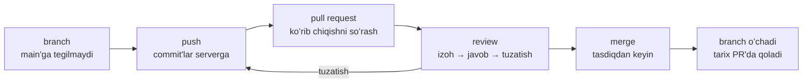

<div lang="uz">

🌐 **Oʻzbekcha** · [Русский](/lab/youtube/git/git-1-03/ru) · [English](/lab/youtube/git/git-1-03/en)  
Dars GIT-1.03 · [Git va GitHub: 0 → Pro](/lab/youtube/git#git-1-03) · ▶️ video tez orada · 💻 [GitHub](https://github.com/abdurahmon27/go-backend-uz/tree/main/lessons/git-03-github-flow)

> Bu sahifa videodagi darsning toʻliq yozma shakli: videoni koʻrmasdan (yoki eshitmasdan) ham shu yerdan oʻrganish mumkin.

## Nimani oʻrganasiz

Hamkasbingiz pull request'ingizga bitta izoh qoldirdi:

```text
✗  Bu kod noto'g'ri.
```

Qayeri notoʻgʻri? Nega? Nima qilish kerak? Hech biri aytilmagan. Xuddi shu topilmani boshqacha yozish mumkin:

```text
✓  issue (blocking): foiz 100 dan oshsa, narx manfiy.
   go run . 150  →  non: -1500 so'm
   Foizni 0..100 oralig'ida tekshirib, shu holatga
   test qo'shsak bo'ladimi?
```

Boshida belgi turadi: `issue` — muammo, `(blocking)` — merge'dan oldin tuzatish shart. Keyin aniq misol: foiz
150 boʻlsa, narx −1500 soʻm chiqadi. Oxirida buyruq emas, taklif va savol. Bugun GitHub flow'ni boshidan oxirigacha
oʻtamiz va shunday izoh yozishni oʻrganamiz.

**Bitta gʻoya:** pull request — bu branch, diff va odamlar orasidagi suhbat. Yaxshi izoh odam haqida emas, kod
haqida boʻladi va misol hamda sabab bilan yoziladi. Yaxshi javob esa kodni tuzatadi.

Dars oxirida siz:

- GitHub flow'ning oltita qadamini (branch → push → pull request → review → merge → branch'ni oʻchirish) haqiqiy git
  buyruqlari bilan oʻtasiz;
- PR sahifasi nega `git diff main..branch` emas, `git diff main...branch` (uch nuqta) koʻrsatishini tushuntira olasiz;
- review qarorini (Comment, Approve, Request changes) tanlab, `issue`, `nit`, `question`, `praise` belgili izoh
  yozasiz;
- olingan izohga xushmuomala javob berib, tuzatishni xuddi shu branch'ga push qilasiz.

Bugungi uchta asosiy yangi soʻz:

| Soʻz | Oddiy maʼnosi | Inglizcha |
|---|---|---|
| pull request (PR) | «mening branch'imni `main`ga qoʻshishdan oldin koʻrib chiqing» degan soʻrov: GitHub xizmati, git buyrugʻi emas | pull request |
| review izohi | PR'dagi kod haqidagi yozma fikr; boshida belgi turadi: `issue`, `nit`, `question`, `praise` | code review comment |
| uch nuqtali diff | branch'lar ajralgan joydan (umumiy ajdod, **merge base**) boshlab hisoblangan farq: faqat PR olib kelgan oʻzgarish | three-dot diff |

Yordamchi soʻzlar matnda birinchi uchraganda bitta gap bilan tushuntiriladi: **bare repo** (ishchi fayllarsiz,
faqat tarixdan iborat repo), **upstream** (lokal branch bogʻlangan serverdagi branch), **merge commit** (ikki
parent'li commit), **draft** (qoralama PR).

## Oldin bilish kerak

- [GIT-1.01 · git: commit — bu snapshot, branch — faylga yozilgan bitta hash](/lab/youtube/git/git-1-01): branch — ichida
  bitta commit hash'i yozilgan ref; fast-forward merge shu ref'ni oldinga suradi; `git revert` xatoni yangi commit
  bilan qaytaradi. Oʻsha darsda xatoli `chegirma` toʻgʻridan-toʻgʻri `main`ga tushib ketgan edi. Bugun bunga yoʻl
  qoʻymaydigan tartibni koʻramiz.
- [GIT-1.02 · `.env`ni push qildingizmi? Kalit endi faqat sizniki emas](/lab/youtube/git/git-1-02): oldingi Git darsi.
  Bugun undan faqat bitta savol bor («Oʻzingizni tekshiring»).
- [SYS-0.02 · Jarayon va muhit: `ps`, `kill`, `$PATH` va env oʻzgaruvchilar](/lab/youtube/sys/sys-0-02): **chiqish kodi**
  (exit code) va `export` qilingan muhit oʻzgaruvchisi. Commit vaqtini shu yoʻl bilan qatʼiy qilamiz (`vaqt.sh`).
- Mashqdagi Go kodi kichik. Undagi `go test` va jadvalli test —
  [GO-1.07 · Taxmin qilmang, oʻlchang: birinchi test va benchmark](/lab/youtube/go/go-1-07); funksiyadan `(int, error)`
  qaytarish va `try/catch` oʻrniga xato qiymati —
  [GO-X.03 · try/catch yoʻq: error qiymat va defer](/lab/youtube/go/go-x-03). Bu darsda ular bir gap bilan izohlanadi.

**Kodni qanday ishga tushirish.** Sizga `git` 2.29 yoki yangisi, `bash` va Go 1.22 yoki yangisi kerak. GitHub hisobi
**shart emas**: hech narsa GitHub'ga yuborilmaydi, «server» — shu papkadagi `server.git`. Kurs repository'sini yuklab
oling va dars papkasiga oʻting (`cd` — terminalning joriy papkasini oʻzgartiradi):

```bash
git clone https://github.com/abdurahmon27/go-backend-uz
cd go-backend-uz/lessons/git-03-github-flow
```

Sahifadagi buyruqlar video va README'dagidek yozilgan: har biri **dars papkasidan** boshlanadi. Shuning uchun
koʻpchiligi `cd lola && …` (muallif) yoki `cd aziz && …` (reviewer) bilan boshlanadi. Har bir buyruqni alohida
`bash -c '…'` ichida ishga tushirsangiz, `cd` keyingi buyruqqa oʻtmaydi. Oddiy terminalda esa `cd` saqlanib qoladi:
`lola` ichida turgan boʻlsangiz, avval `cd ..` qiling. Buyruqlarni sahifadagi tartibda bajaring: har biri oldingisi
qoldirgan holatdan davom etadi. Boshidan boshlash uchun `./qur.sh` ni qayta ishga tushiring.

Commit hash'i muallif, vaqt va mazmundan hisoblanadi (GIT-1.01). `qur.sh` va `vaqt.sh` ism va vaqtni qatʼiy qiladi,
shuning uchun sahifadagi hamma hash sizda ham harfma-harf bir xil chiqishi kerak. Faqat `go test` vaqti
(`0.002s`) har safar biroz farq qiladi.

Avval GIT-1.01 dan bitta savol. `chegirma` branch'ini ochgandan keyin `main`ga hech kim commit qoʻshmagan.
`git merge chegirma` nima qiladi?

**A)** ikki parent'li merge commit yaratadi · **B)** `main` ref'ini `chegirma`ning hash'iga suradi (fast-forward)
· **C)** `chegirma`dagi commit'larni nusxalab, yangi hash bilan `main`ga qoʻshadi

<details>
<summary>Javob</summary>

**B.** `main`ning oxirgi commit'i `chegirma`ning ajdodi, birlashtiradigan narsa yoʻq: git `main` faylini oldinga
suradi. Bu **fast-forward**. «A» — ikkala branch'da yangi commit boʻlgan holat. Bugun aynan shunday holat boʻladi:
Aziz `main`ga README qatorini qoʻshadi, Lola esa `chegirma`da ishlaydi. Yana bir yangilik: GitHub'ning merge tugmasi
fast-forward mumkin boʻlsa ham merge commit yaratadi («Merge» boʻlimi).

</details>

## GitHub flow: oltita qadam

GIT-1.01 da xato `main`ga toʻgʻridan-toʻgʻri tushdi, keyin uni revert qildik. Jamoada bunga yoʻl qoʻymaslik uchun
**GitHub flow** bor. GitHub hujjatidagi tartib oddiy:

| # | Qadam | Kim | Nima boʻladi |
|---|---|---|---|
| 1 | branch | muallif | ish alohida branch'da boshlanadi, `main`ga tegilmaydi |
| 2 | commit va push | muallif | commit'lar shu branch bilan serverga yuboriladi |
| 3 | pull request | muallif | hamkasblardan oʻzgarishni koʻrib chiqish soʻraladi |
| 4 | review | reviewer ↔ muallif | izoh → javob → tuzatish, kerak boʻlsa bir necha marta |
| 5 | merge | reviewer yoki muallif | tasdiqdan keyin branch `main`ga qoʻshiladi |
| 6 | branch'ni oʻchirish | muallif | branch kerak emas; PR va commit'lar tarixda qoladi |



**Pull request** — git buyrugʻi emas, GitHub xizmati. GitHub hujjati uni «asosiy hamkorlik vositasi» deydi.
`git help -a` roʻyxatida `pull-request` degan buyruq yoʻq. Lekin PR GIT-1.01 dagi oʻsha branch va merge ustiga
qurilgan: PR — «shu branch'ni `main`ga merge qilaylikmi?» degan savol va uning atrofidagi suhbat.

Git'ning oʻzida yaqin buyruq bor: `git request-pull`. U oʻzgarishlar xulosasini yozib beradi, xulosa esa email bilan
yuboriladi. Linux yadrosi maintainer'lari pull request'ni shunday yuboradi. GitHub shu gʻoyani veb sahifa,
izohlar va tugmalarga aylantirgan.

## Mashq: GitHub oʻrnida lokal server

Mashq uchun GitHub hisobi kerak emas. `qur.sh` skripti uchta repo yasaydi:

```text
            server.git  (GitHub oʻrnida: bare repo, faqat tarix)
              ▲     ▲
     push/fetch     push/fetch
              │     │
   lola/  (muallif)     aziz/  (reviewer)
```

- `server.git` — **bare repo**: unda ishchi fayllar yoʻq, faqat tarix bor (`objects`, `refs`). GitHub serveridagi
  repo ham shunday: u yerda hech kim fayllarni tahrir qilmaydi, faqat push va fetch qilinadi.
- `lola` — kodni yozadigan muallif.
- `aziz` — review qiladigan hamkasb. U `main`ga README yangilanishini qoʻshib boʻlgan. Lola esa uni hali olmagan.
  Bu farq «Review» boʻlimida kerak boʻladi.

Skriptning toʻliq matni:

```bash filename="qur.sh" showLineNumbers
#!/usr/bin/env bash
# GitHub flow mashqi uchun uchta repo'ni noldan quradi. git >= 2.29.
#   server.git/  GitHub o'rnida turgan bare repo (ishchi fayllarsiz, faqat tarix)
#   aziz/        reviewer: main'ni boshlagan, keyin README'ni yangilagan
#   lola/        muallif: README yangilanishidan oldin clone qilgan
# Muallif va vaqt qat'iy (vaqt.sh): hash'lar hamma joyda bir xil.
set -e; cd "$(dirname "$0")"; rm -rf server.git lola aziz
rf=--ref-format=files; git init -h 2>&1 | grep -q ref-format || rf=   # eski git'da bu bayroq yo'q
git init -q --bare --template= -b main --object-format=sha1 $rf server.git
sozla() {   # $1 ism, $2 email: imzo, hook, rang va global sozlamalar natijani o'zgartirmasin
  git config user.name "$1"; git config user.email "$2"; git config commit.gpgsign false
  git config core.hooksPath /dev/null; git config core.pager cat; git config color.ui false
  git config core.abbrev 7; git config core.autocrlf false; git config core.excludesFile /dev/null
  git config core.attributesFile /dev/null; git config log.decorate false; git config branch.sort refname
  git config pull.ff only; git config merge.stat true; git config push.default simple
  git config advice.detachedHead false; git remote set-url origin ../server.git 2>/dev/null || true; }

# aziz main'ni boshlaydi va serverga push qiladi
mkdir aziz; cd aziz; git init -q --template= -b main --object-format=sha1 $rf
git remote add origin ../server.git; sozla Aziz aziz@example.com
cp ../fayllar/README.md README.md; cp ../fayllar/v0/main.go main.go; printf 'module narx\n\ngo 1.22\n' > go.mod
git add .; . ../vaqt.sh; git commit -q -m "narx dasturi"
git push -q -u origin main 2>/dev/null; cd ..

# lola shu holatda clone qiladi
git clone -q --template= server.git lola; (cd lola; sozla Lola lola@example.com)

# aziz keyin main'da README'ni yangilaydi (lola buni hali fetch qilmagan)
cd aziz; cp ../fayllar/README.aziz.md README.md
git add README.md; . ../vaqt.sh; git commit -q -m "README: ishga tushirish"
git push -q origin main 2>/dev/null; cd ..
echo "tayyor: server.git/ (GitHub o'rnida), lola/ (muallif), aziz/ (reviewer)"
```

| Qator | Kod | Nima qiladi |
|---|---|---|
| 1–6 | izohlar | uchta papka nima ekani; hash'lar hamma joyda bir xil chiqishi uchun muallif va vaqt qatʼiy |
| 7 | `set -e; cd …; rm -rf server.git lola aziz` | birinchi xatoda toʻxtaydi; skript papkasiga oʻtadi; eski repo'larni oʻchiradi |
| 8 | `rf=--ref-format=files … \|\| rf=` | git 2.45+ boʻlsa ref'lar oddiy fayllarda saqlansin (GIT-1.01 dagi kabi); eski git'da bayroq boʻsh |
| 9 | `git init -q --bare … server.git` | `--bare` — ishchi fayllarsiz repo; `-b main` — birinchi branch `main`; hash SHA-1 |
| 10–16 | `sozla() { … }` | shell funksiyasi: ism va email (`$1`, `$2`), imzo, hook, rang va global sozlamalarni oʻchiradi. `pull.ff only` — `git pull` faqat fast-forward qiladi; `git remote set-url origin ../server.git` — `origin` (server) manzili |
| 19–20 | `mkdir aziz; … git init …; git remote add origin ../server.git; sozla Aziz …` | Azizning repo'si, `origin` — `../server.git` |
| 21–23 | `cp …; printf 'module narx…' > go.mod; git add .; … git commit …; git push -q -u origin main` | birinchi commit «narx dasturi» (`v0`), serverga push |
| 26 | `git clone -q --template= server.git lola; (cd lola; sozla Lola …)` | Lola serverdan nusxa oladi: hozircha bitta commit |
| 29–31 | `cp ../fayllar/README.aziz.md README.md; … git commit …; git push …` | Aziz README'ga ikki qator qoʻshib, serverga push qiladi. Lola buni fetch qilmagan |
| 32 | `echo "tayyor: …"` | yakuniy xabar |

`2>/dev/null` — push'ning stderr'ga yozadigan xabarlarini yashiradi. Commit vaqtini `vaqt.sh` beradi (`. ../vaqt.sh`
— skriptni joriy shell'da bajarish, SYS-0.02 va GIT-1.01 dagi kabi):

```bash filename="vaqt.sh" showLineNumbers
# Manba qiling: `. ../vaqt.sh` (lola/ yoki aziz/ ichidan). Commit vaqtini qat'iy qiladi:
# 2026-03-02 10:00 (+05:00) va repo'da ko'rinadigan har bir commit uchun +10 daqiqa.
# Shuning uchun commit hash'lari sizda ham, bizda ham bir xil chiqadi.
# muallif repo sozlamasidan olinsin (user.name/email), muhitdagi qiymatdan emas
unset GIT_AUTHOR_NAME GIT_AUTHOR_EMAIL GIT_COMMITTER_NAME GIT_COMMITTER_EMAIL
n=$(git rev-list --all --count 2>/dev/null || echo 0)
t=$((1772427600 + n * 600))
export GIT_AUTHOR_DATE="@$t +0500" GIT_COMMITTER_DATE="@$t +0500"
```

- 5-qator: muhitdagi `GIT_AUTHOR_NAME` kabi oʻzgaruvchilarni olib tashlaydi: ism repo sozlamasidan olinadi.
- 6-qator: repo'da koʻrinadigan commit'lar soni `n` (`--all` — hamma ref'lardan, server'dan kelganlari ham).
- 7-qator: `1772427600` — 2026-03-02 10:00 Toshkent vaqti, Unix soniyalarida; har commit uchun +600 soniya.
- 8-qator: git vaqtni shu ikki muhit oʻzgaruvchisidan oladi.

Oʻz repo'ngizda bularning hech biri kerak emas. Ishga tushiramiz:

```console
$ ./qur.sh
tayyor: server.git/ (GitHub o'rnida), lola/ (muallif), aziz/ (reviewer)
```

```console
$ ls -C server.git lola
lola:
go.mod	main.go  README.md

server.git:
config	HEAD  objects  refs
```

`lola`da fayllar bor: `go.mod`, `main.go`, `README.md`. `server.git`da esa faqat git'ning ichki papkalari: `config`,
`HEAD`, `objects`, `refs`. Oddiy repo'da ular `.git` ichida turadi, bare repo'da esa papkaning oʻzida. Ikkala
mahalliy repo tarixini koʻramiz (`git -C <papka>` — buyruqni oʻsha papkada bajaradi):

```console
$ for r in aziz lola; do echo "$r:"; git -C $r log --oneline; done
aziz:
9c274de README: ishga tushirish
3644e95 narx dasturi
lola:
3644e95 narx dasturi
```

Azizda ikkita commit, Lola'da bitta. `main`dagi dastur hozircha chegirmasiz:

```go filename="fayllar/v0/main.go" showLineNumbers
// narx: non narxini chiqaradi. main'dagi boshlang'ich versiya.
package main

import "fmt"

const non = 3000 // so'm

func main() {
	fmt.Printf("non: %d so'm\n", non)
}
```

`go run .` → `non: 3000 so'm`. `const non = 3000` — oʻzgarmas, `%d` — butun sonni qoʻyish joyi.

## Branch va push

Lola ishni yangi branch'da boshlaydi. Nomi qisqa va tushunarli: `chegirma`. GitHub hujjati ham ishni koʻrsatadigan
qisqa nom tavsiya qiladi (ularning misoli: `increase-test-timeout`). `git switch -c` — yangi branch yaratib, unga
oʻtadi:

```console
$ cd lola && git switch -c chegirma
Switched to a new branch 'chegirma'
```

Kodni `fayllar/v1/` dan oladi. Uchta fayl. Birinchisi — hisobning oʻzi:

```go filename="fayllar/v1/chegirma.go" showLineNumbers
package main

func chegirma(narx, foiz int) int {
	return narx - narx*foiz/100
}
```

`chegirma(narx, foiz int) int` — ikkita `int` oladi, bitta `int` qaytaradi (Go'da tur nomdan keyin yoziladi,
`narx, foiz int` — ikkalasi ham `int`). `narx*foiz/100` — butun sonlar boʻlinmasi, kasr qismi tashlanadi.
3000 va 10 → `3000 - 300 = 2700`.

Ikkinchisi — test:

```go filename="fayllar/v1/chegirma_test.go" showLineNumbers
package main

import "testing"

func TestChegirma(t *testing.T) {
	holatlar := []struct{ narx, foiz, kutilgan int }{
		{3000, 0, 3000},
		{3000, 10, 2700},
	}
	for _, h := range holatlar {
		if got := chegirma(h.narx, h.foiz); got != h.kutilgan {
			t.Errorf("chegirma(%d, %d) = %d, kutilgan %d", h.narx, h.foiz, got, h.kutilgan)
		}
	}
}
```

| Qator | Nima qiladi |
|---|---|
| 1, 3 | fayl nomi `_test.go` bilan tugaydi, `testing` paketi: `go test` shu fayllarni topadi |
| 5 | `TestChegirma(t *testing.T)` — test funksiyasi, `Test` bilan boshlanadi (`*` — koʻrsatkich, GO-1.07 da) |
| 6–9 | `holatlar` — jadval: har qatorda narx, foiz va kutilgan natija. Ikki holat: 0 % va 10 % |
| 10 | `for _, h := range holatlar` — jadval boʻylab sikl (JS'dagi `for (const h of holatlar)`) |
| 11–13 | natija kutilganidan farq qilsa, `t.Errorf` testni muvaffaqiyatsiz deb belgilaydi va sababini yozadi |

Jestdagi `test.each([...])` bilan bir xil gʻoya: bitta tekshiruv, koʻp qator maʼlumot. Testda faqat 0 va 10 foiz bor.
Buni eslab qoling.

Uchinchisi — `main.go`, foizni buyruq qatoridan oladi:

```go filename="fayllar/v1/main.go" showLineNumbers
// narx: non narxini chegirma bilan chiqaradi. Foiz birinchi argument: go run . 10
package main

import (
	"fmt"
	"os"
	"strconv"
)

const non = 3000 // so'm

func main() {
	foiz := 0
	if len(os.Args) > 1 {
		f, err := strconv.Atoi(os.Args[1])
		if err != nil {
			fmt.Println("foiz butun son bo'lishi kerak:", err)
			os.Exit(2)
		}
		foiz = f
	}
	fmt.Printf("non: %d so'm\n", chegirma(non, foiz))
}
```

| Qator | Nima qiladi |
|---|---|
| 13 | `foiz := 0` — argument berilmasa, chegirma yoʻq |
| 14 | `os.Args` — buyruq qatori argumentlari (Node'dagi `process.argv`, Python'dagi `sys.argv`); `[0]` — dastur nomi, `[1]` — birinchi argument |
| 15 | `strconv.Atoi` — matnni butun songa aylantiradi; ikki qiymat qaytaradi: son va xato (`err`) |
| 16–19 | `"abc"` kabi notoʻgʻri argumentda xabar chiqaradi va `os.Exit(2)` — 2 chiqish kodi bilan tugaydi |
| 22 | `chegirma(non, foiz)` natijasini chiqaradi |

Testlarni ishga tushiramiz:

```console
$ cd lola && cp ../fayllar/v1/*.go . && go test
PASS
ok  	narx	0.002s
```

`PASS` — hamma test oʻtdi; `narx` — modul nomi (`go.mod`dagi `module narx`). Commit qilib, branch'ni serverga
push qilamiz:

```console
$ cd lola && git add . && . ../vaqt.sh && git commit -q -m "chegirma: foiz bilan narx" && git push -u origin chegirma
To ../server.git
 * [new branch]      chegirma -> chegirma
branch 'chegirma' set up to track 'origin/chegirma'.
```

- `To ../server.git` — qaysi serverga yuborildi.
- `* [new branch] chegirma -> chegirma` — serverda yangi branch yaratildi.
- `-u` (`--set-upstream`) lokal `chegirma`ni serverdagi `chegirma`ga bogʻlaydi: oxirgi qator shuni aytadi. Bogʻlangan
  serverdagi branch **upstream** deyiladi. Endi bu branch'da argumentsiz `git push` va `git pull` qayerga
  borishni biladi.

Haqiqiy terminalda bu qatorlardan oldin `Enumerating objects…`, `Writing objects…` kabi jarayon qatorlari ham
chiqadi. Natija pipe'ga yoki faylga ketganda git ularni yozmaydi.

Serverda nima oʻzgardi? Taxmin qiling:

**A)** `main`ga Lolaning commit'i qoʻshildi · **B)** yangi `chegirma` branch'i paydo boʻldi, `main` joyida
· **C)** hech narsa: avval pull request ochish kerak

<details>
<summary>Javob</summary>

**B.** Push faqat `chegirma` ref'ini yubordi. «A» ni tanlagan boʻlsangiz, push'ni merge bilan adashtirdingiz:
`main`ga hali hech kim tegmadi. «C» — PR push'dan **keyin** ochiladi, chunki PR serverdagi branch'ni koʻrsatadi.

</details>

```console
$ git -C server.git branch
  chegirma
* main
```

Serverda ikki branch: yangi `chegirma` va joyida turgan `main` (`*` — bare repo'ning `HEAD`i).

## Pull request ochish: sarlavha va tavsif

Endi Lola pull request ochadi. Uni GitHub sahifasida yoki `gh pr create` buyrugʻi
bilan ochasiz. Sarlavha qisqa boʻlsin, tavsif esa uch savolga javob bersin: **nima** oʻzgardi, **nega** kerak va
**qanday** tekshirildi. Reviewer'ga **qayerdan** boshlashni ham ayting. Namuna tavsif:

```text filename="fayllar/pr.md" showLineNumbers
chegirma: foiz bilan narx

## Nima
`go run . 10` narxni 10 foiz chegirma bilan chiqaradi.

## Nega
Aksiyalar uchun chegirma kerak. Closes #1

## Qanday tekshirdim
- go test: 0 va 10 foiz
- go run . 10  →  non: 2700 so'm

## Qayerga qarash kerak
chegirma.go: hisob shu yerda.
```

| Qator | Nima |
|---|---|
| 1 | sarlavha: commit xabari kabi qisqa |
| 3–4 | **Nima**: oʻzgarish bir gapda |
| 6–7 | **Nega**: sabab. `Closes #1` — 1-raqamli issue'ga (bu misolda chegirma soʻralgan vazifa) bogʻlaydi: PR default branch'ga merge qilinganda issue oʻzi yopiladi. `fixes`, `resolves` soʻzlari ham ishlaydi |
| 9–11 | **Qanday tekshirdim**: qaysi test va qaysi buyruq. Reviewer nima tekshirilmaganini shu yerdan koʻradi |
| 13–14 | **Qayerga qarash kerak**: reviewer'ga boshlanish nuqtasi |

Yana ikki odat:

- Ish hali tugamagan boʻlsa, PR'ni **draft**, yaʼni qoralama qilib oching. Draft PR'ni merge qilib boʻlmaydi, lekin
  hamkasblar erta fikr bildira oladi.
- Yuborishdan oldin diff'ni oʻzingiz bir marta oʻqib chiqing. GitHub hujjati ham «avval oʻz PR'ingizni review
  qiling» deydi: unutilgan `console.log` yoki debug qatorini reviewer emas, siz topganingiz yaxshi.

## `gh` buyruqlari: haqiqiy GitHub'da

Haqiqiy GitHub'da butun sikl `gh` (GitHub CLI) buyruqlari bilan ham oʻtadi. Bu darsda ularni **ishga tushirmaymiz**,
faqat koʻrsatamiz (bayroqlar `gh` 2.102.0 ning `--help` matni boʻyicha tekshirilgan):

```bash filename="fayllar/gh.sh" showLineNumbers
# Haqiqiy GitHub'da (bu darsda ishga tushirmaymiz)
gh pr create --base main --title "chegirma: foiz bilan narx" \
  --body-file pr.md --reviewer aziz     # PR #2 ochiladi
gh pr checkout 2                        # reviewer PR'ni oladi
gh pr review 2 --request-changes --body-file izoh.md
gh pr review 2 --approve --body "Rahmat, tayyor!"
gh pr merge 2 --merge --delete-branch   # merge commit
git fetch origin pull/2/head:pr-2       # PR ham ref
```

| Qator | Nima qiladi |
|---|---|
| 2–3 | `gh pr create` — PR ochadi: qaysi branch'ga (`--base main`), sarlavha, tavsif fayli (`--body-file pr.md`) va reviewer. `\` — buyruq keyingi qatorda davom etadi |
| 4 | `gh pr checkout 2` — reviewer 2-PR'ning branch'ini oʻz kompyuteriga oladi va unga oʻtadi |
| 5 | `gh pr review 2 --request-changes` — «tuzatish kerak» qarori bilan umumiy review yuboradi. Kodning aniq qatoriga izoh esa veb sahifada yoziladi |
| 6 | `--approve` — tasdiq |
| 7 | `gh pr merge 2 --merge --delete-branch` — merge commit bilan birlashtiradi va branch'ni oʻchiradi (`--squash`, `--rebase` ham bor: [GIT-4.06](/lab/youtube/git#git-4-06)) |
| 8 | `git fetch origin pull/2/head:pr-2` — oddiy git buyrugʻi |

Oxirgi qator qiziq. GitHub har bir PR uchun alohida ref yaratadi: `refs/pull/2/head`. GIT-1.01 dagi branch kabi,
bu ham commit hash'iga ishora qiluvchi nom. Uni fetch qilib, lokal `pr-2` branch'iga yozish mumkin. Bu ref'lar faqat
oʻqish uchun: ularga push qilib boʻlmaydi.

## Review: ikki nuqta va uch nuqta

Aziz review'ni `git fetch` bilan boshlaydi: serverdagi yangi commit'lar va branch'lar uning repo'siga keladi, lekin
uning `main`i va fayllari oʻzgarmaydi. Serverdagi `chegirma` Azizda `origin/chegirma` nomi bilan koʻrinadi
(serverdagi branch'ning lokal nusxa-ref'i). Keyin PR'dagi commit'larni koʻradi:

```console
$ cd aziz && git fetch -q && git log --oneline main..origin/chegirma
360db8f chegirma: foiz bilan narx
```

`main..origin/chegirma` — «`origin/chegirma`dan yetib boriladigan, lekin `main`dan yetib borilmaydigan commit'lar»,
yaʼni PR'ning commit'lari. Hozircha bitta.

Endi diff. Lola faqat uchta Go faylini oʻzgartirdi, `README.md`ga tegmadi. `git diff --stat main..origin/chegirma`
(ikki nuqta) roʻyxatida `README.md` boʻladimi?

**A)** yoʻq, Lola unga tegmagan · **B)** ha, ikki qatori oʻchirilgandek koʻrinadi · **C)** buyruq xato beradi

<details>
<summary>Javob</summary>

**B.** Diff'da `log` dagi `..` maʼnosi yoʻq. `git diff A..B` — oddiy `git diff A B`: `main`ning **hozirgi** holati
bilan `origin/chegirma`ning holatini solishtiradi. Aziz `main`ga README qatorlarini qoʻshgan, Lolaning branch'ida esa
ular yoʻq. Natijada diff «Lola ularni oʻchirdi» deydi. «A» ni tanlagan boʻlsangiz, diff'ni «branch nima oʻzgartirdi»
deb oʻyladingiz: buni uch nuqta beradi.

</details>

```console
$ cd aziz && git diff --stat main..origin/chegirma
 README.md        |  2 --
 chegirma.go      |  5 +++++
 chegirma_test.go | 15 +++++++++++++++
 main.go          | 19 ++++++++++++++++---
 4 files changed, 36 insertions(+), 5 deletions(-)
```

`--stat` — har fayl uchun qisqa hisob: `+` — qoʻshilgan, `-` — oʻchirilgan qatorlar. `README.md | 2 --` — ikki
qator «oʻchirilgan». Lekin Lola README'ga tegmagan: bu qatorlarni Aziz oʻzi `main`ga qoʻshgan edi. Videoda
koʻrsatilmagan, lekin shu holatda ishga tushirib koʻrdik — README diff'ining oʻzi:

```console
$ cd aziz && git diff main..origin/chegirma -- README.md
diff --git a/README.md b/README.md
index fcaacc0..6d0eeb3 100644
--- a/README.md
+++ b/README.md
@@ -1,5 +1,3 @@
 # narx
 
 Non narxini hisoblaydigan kichik dastur.
-
-Ishga tushirish: `go run .`
```

Boʻsh qator va `Ishga tushirish` qatori — Azizning README commit'i. Uch nuqtali diff esa branch'lar ajralgan joydan,
yaʼni **umumiy ajdod**dan (merge base) boshlab solishtiradi:

```console
$ cd aziz && git diff --stat main...origin/chegirma
 chegirma.go      |  5 +++++
 chegirma_test.go | 15 +++++++++++++++
 main.go          | 19 ++++++++++++++++---
 3 files changed, 36 insertions(+), 3 deletions(-)
```

Faqat Lolaning uchta fayli qoldi. GitHub PR sahifasi aynan **uch nuqtali diff**ni koʻrsatadi. Grafikda
(`--graph` — commit'lar daraxti, `--all` — hamma ref'lar; bu buyruq ham videoda yoʻq, shu holatda ishga tushirdik):

```console
$ cd aziz && git log --graph --oneline --all
* 9c274de README: ishga tushirish
| * 360db8f chegirma: foiz bilan narx
|/  
* 3644e95 narx dasturi
```

```text
        main ──► 9c274de  README: ishga tushirish
                    │
 merge base ──►  3644e95  narx dasturi
                    │
origin/chegirma ──► 360db8f  chegirma: foiz bilan narx   (parent: 3644e95)

 git diff main..origin/chegirma    = 9c274de  bilan 360db8f  farqi  → README ham kiradi
 git diff main...origin/chegirma   = 3644e95  bilan 360db8f  farqi  → faqat Lolaning ishi
```

| | Ikki nuqta `A..B` | Uch nuqta `A...B` |
|---|---|---|
| nimadan | `A`ning hozirgi holatidan | `A` va `B`ning umumiy ajdodidan (`git merge-base A B`) |
| nimagacha | `B` | `B` |
| bizda | 4 fayl, 36 `+`, 5 `-` (README ham) | 3 fayl, 36 `+`, 3 `-` |
| kim ishlatadi | `main` va branch'ning hozirgi farqi kerak boʻlganda | GitHub PR sahifasi: «PR nima olib keldi» |

`git diff` hujjati buni bitta tenglik bilan yozadi: `git diff A...B` = `git diff $(git merge-base A B) B`. Uy
vazifasida buni oʻzingiz tekshirasiz. Diqqat: `git log` da ikki nuqta toʻgʻri natija berdi, `git diff` da esa uch
nuqta kerak. Bu git'ning eng chalkash joylaridan biri.

Chalkashlik kamroq boʻlishi uchun GitHub `main`ni branch'ingizga tez-tez merge qilishni va PR'ni tez yakunlashni
maslahat beradi.

Hajmiga ham qarang: 36 qator qoʻshilgan, 3 qator oʻchgan. Google'ning code review qoʻllanmasiga koʻra, 100 qator
odatda yaxshi oʻlcham, 1000 qator esa odatda juda katta (oxirgi soʻz reviewer'niki). Kichik PR tez va puxta koʻriladi.

## Diff'ni oʻqish yetmaydi: kodni ishga tushiring

Kodni ishga tushirib koʻrish ham kerak. Aziz Lolaning branch'iga oʻtadi. Azizda lokal `chegirma` yoʻq edi:
`git switch` uni `origin/chegirma` asosida yaratadi va upstream'ga bogʻlaydi (`-q` — jim).

```console
$ cd aziz && git switch -q chegirma && go test && go run . 10
PASS
ok  	narx	0.002s
non: 2700 so'm
```

Testlar oʻtdi, 10 foiz ham toʻgʻri: 2700 soʻm. Lola tavsifda faqat 0 va 10 foizni tekshirganini yozgan edi. Aziz
yozilmagan holatni sinaydi: 150 foiz.

```console
$ cd aziz && go run . 150
non: -1500 so'm
```

Narx −1500 soʻm: `3000 - 3000*150/100 = 3000 - 4500`. Doʻkon non berib, ustiga pul ham qaytaradi. Testlar buni
ushlamadi, chunki jadvalda 100 dan katta foiz yoʻq. Diff'ni qancha diqqat bilan oʻqisangiz ham, bunday xatoni
tavsifda yozilmagan holatni sinab topasiz.

## Review qarori: Comment, Approve yoki Request changes

Videodagi pauza savoli. GitHub'da review uchta qarordan biri bilan yuboriladi. Aziz review'ni qaysi qaror bilan
yuboradi?

**A)** Comment · **B)** Approve · **C)** Request changes

<details>
<summary>Javob</summary>

**C — Request changes**, yaʼni tuzatishni soʻrash. Manfiy narx haqiqiy xato: merge'dan oldin tuzatilishi kerak.
«B» ni tanlagan boʻlsangiz, testlar oʻtgani yetarli deb oʻyladingiz: testlar faqat yozilgan holatlarni tekshiradi.
«A» — umumiy fikr, u merge'ni toʻxtatmaydi, bu xato esa toʻxtatishi kerak.

</details>

| Qaror | Maʼnosi (GitHub hujjati) | Qachon |
|---|---|---|
| 💬 Comment | umumiy fikr: tasdiq ham, rad ham emas | savol, fikr, hali qaror yoʻq |
| ✅ Approve | oʻzgarish merge'ga tayyor | kod sogʻligʻini aniq yaxshilaydi |
| 🛑 Request changes | merge'dan oldin tuzatish kerak | haqiqiy xato: notoʻgʻri natija, xavfsizlik, maʼlumot yoʻqolishi |

Lekin mayda did masalasi uchun PR'ni toʻxtatmang. Google qoʻllanmasi aytadi: mukammal kod yoʻq, faqat yaxshiroq kod
bor. Oʻzgarish kodni aniq yaxshilasa, mukammal boʻlmasa ham tasdiqlang. Kechiktirmang ham: Google qoidasida review
soʻroviga javob bir ish kunidan oshmasligi kerak.

## Yaxshi review izohi

Endi izohning oʻzini qanday yozishni koʻramiz. Azizning izohlari:

```text filename="fayllar/izoh.md" showLineNumbers
issue (blocking): foiz 100 dan oshsa, narx manfiy.
  go run . 150  →  non: -1500 so'm
  Xaridorga pul qaytib ketadi. Foizni 0..100
  oralig'ida tekshirib, xato qaytarsak va shu
  holatga test qo'shsak bo'ladimi?

nit (non-blocking): chegirma'ga doc comment
  yozsak, go doc'da ko'rinadi.

question: 12.5 foiz ham kerak bo'ladimi?

praise: jadvalli test juda tushunarli, rahmat!
```

Toʻrtta qoida (Google qoʻllanmasi va Conventional Comments formatidan):

1. **Odam haqida emas, kod haqida yozing.** «Siz xato qildingiz» demang, kod nima qilayotganini ayting: «foiz 100 dan
   oshsa, narx manfiy». Google'ning yomon misoli: «Why did **you** use threads here…» — gap odamga qaratilgan.
2. **Aniq misol va nega muhimligini bering.** 2-qator — misol (`go run . 150 → non: -1500 so'm`), 3-qator — sabab
   (xaridorga pul qaytib ketadi). Reviewer qayta ishga tushirib koʻra oladigan misol bahsni tugatadi.
3. **Yechimni odatda taklif yoki savol qilib yozing** (3–5-qatorlar: «…qoʻshsak boʻladimi?»). Tuzatish — muallifning
   ishi. Lekin kerak boʻlsa aniq koʻrsatma yoki kod ham bering: Google muammoni koʻrsatish va aniq yechim berish
   orasida muvozanatni maslahat beradi.
4. **Boshiga belgi qoʻying.** Belgisiz izohni muallif majburiy deb oʻqishi mumkin.

| Belgi | Maʼnosi | PR'ni toʻxtatadimi? |
|---|---|---|
| `issue (blocking):` | muammo; `(blocking)` — merge'dan oldin tuzatish shart | ha |
| `nit (non-blocking):` | mayda gap (Google'ning «Nit:» prefiksi; Conventional Comments'da `nitpick:`) | yoʻq |
| `question:` | shubha bor, lekin ishonch yoʻq: soʻrash | odatda yoʻq |
| `praise:` | yaxshi joyni ayting: samimiy, yolgʻon maqtov emas | yoʻq |

Conventional Comments'da `issue` oʻzi majburiy emas: majburiylikni qavsdagi **bezak** (`blocking` yoki `non-blocking`)
aytadi. Shuning uchun `issue (blocking)` deb yozamiz. Frontend'dan tanish oʻxshashi: ESLint qoidasining `"error"` va
`"warn"` darajasi. `"error"` CI'ni toʻxtatadi (`blocking`), `"warn"` esa faqat eslatadi (`non-blocking`). Farqi:
ESLint darajani konfiguratsiyadan oladi, review'da esa darajani siz har izohga oʻzingiz yozasiz.

GitHub'da yana bir qulaylik bor: **suggestion** bloki. Kod qatoriga izoh yozayotganda taklif qilingan kodni
oddiy Markdown kod blokiga qoʻyasiz, faqat til nomi oʻrnida `suggestion` yoziladi: blok `` ```suggestion `` qatori
bilan ochiladi va `` ``` `` bilan yopiladi. Ichida — qatorning yangi koʻrinishi, masalan Azizning `nit`i uchun:

```text
// chegirma narxdan foiz ulushini ayiradi. foiz 0 dan 100 gacha bo'lishi kerak.
```

Muallif uni «Commit suggestion» tugmasi bilan bitta commit qilib qabul qiladi, taklif qilgan odam esa shu commit'ga
co-author (hammuallif) boʻladi. (Bu misol kurs papkasida yoʻq: GitHub veb sahifasining sintaksisi.)

## Tuzatish: shu branch'ga yangi commit

Lola izohlarni oʻqib, avval kodni tuzatadi. Foiz 0 dan 100 gacha boʻlmasa, funksiya xato qaytaradi, doc comment ham
qoʻshildi:

```go filename="fayllar/v2/chegirma.go" showLineNumbers
package main

import "fmt"

// chegirma narxdan foiz ulushini ayiradi. foiz 0 dan 100 gacha bo'lishi kerak.
func chegirma(narx, foiz int) (int, error) {
	if foiz < 0 || foiz > 100 {
		return 0, fmt.Errorf("foiz 0..100 oralig'ida bo'lishi kerak, berildi: %d", foiz)
	}
	return narx - narx*foiz/100, nil
}
```

| Qator | Nima oʻzgardi |
|---|---|
| 3 | `fmt` — xato matnini yasash uchun |
| 5 | **doc comment**: funksiya nomi bilan boshlanadigan izoh, `go doc` uni koʻrsatadi (Azizning `nit`i) |
| 6 | `(int, error)` — endi ikki qiymat qaytadi: narx va xato. Go'da `throw` yoʻq: xato oddiy qiymat ([GO-X.03](/lab/youtube/go/go-x-03)) |
| 7 | `foiz < 0 \|\| foiz > 100` — `\|\|` — «yoki» |
| 8 | `fmt.Errorf` — formatlangan matndan xato yasaydi; narx oʻrniga `0` |
| 10 | toʻgʻri holatda xato `nil` (yoʻq) |

JS'da shu funksiya `throw new RangeError(...)` qilardi, Python'da `raise ValueError(...)`. Ikkalasida chaqiruvchi
`try` yozishni unutishi mumkin. Go'da `err` qaytgan qiymat sifatida koʻrinib turadi, uni eʼtiborsiz qoldirish
koʻzga tashlanadi.

Testga 100, 150 va −5 foiz holatlari qoʻshildi:

```go filename="fayllar/v2/chegirma_test.go" showLineNumbers
package main

import "testing"

func TestChegirma(t *testing.T) {
	holatlar := []struct {
		narx, foiz, kutilgan int
		xato                 bool
	}{
		{3000, 0, 3000, false},
		{3000, 10, 2700, false},
		{3000, 100, 0, false},
		{3000, 150, 0, true},
		{3000, -5, 0, true},
	}
	for _, h := range holatlar {
		got, err := chegirma(h.narx, h.foiz)
		if (err != nil) != h.xato || got != h.kutilgan {
			t.Errorf("chegirma(%d, %d) = %d, %v; kutilgan %d, xato=%v", h.narx, h.foiz, got, err, h.kutilgan, h.xato)
		}
	}
}
```

- 6–9-qatorlar: jadval qatoriga `xato bool` ustuni qoʻshildi: shu holatda xato kutilyaptimi.
- 12–14-qatorlar: yangi holatlar — chegara (100 % → 0), 150 % va −5 % (xato kutiladi).
- 18-qator: `(err != nil) != h.xato` — «xato boʻldimi» kutilganiga mos kelmasa, test yiqiladi.

`main.go`da faqat oxiri oʻzgardi:

```go filename="fayllar/v2/main.go" showLineNumbers
// narx: non narxini chegirma bilan chiqaradi. Foiz birinchi argument: go run . 10
package main

import (
	"fmt"
	"os"
	"strconv"
)

const non = 3000 // so'm

func main() {
	foiz := 0
	if len(os.Args) > 1 {
		f, err := strconv.Atoi(os.Args[1])
		if err != nil {
			fmt.Println("foiz butun son bo'lishi kerak:", err)
			os.Exit(2)
		}
		foiz = f
	}
	narx, err := chegirma(non, foiz)
	if err != nil {
		fmt.Println("xato:", err)
		os.Exit(2)
	}
	fmt.Printf("non: %d so'm\n", narx)
}
```

22–27-qatorlar: `chegirma` endi ikki qiymat qaytaradi; xato boʻlsa, `xato: …` chiqadi va dastur `os.Exit(2)` bilan
tugaydi. Ishga tushiramiz. `go run . 150` nima chiqaradi?

**A)** `non: -1500 so'm` · **B)** `non: 0 so'm` · **C)** `xato: …` va dastur 2 chiqish kodi bilan tugaydi

<details>
<summary>Javob</summary>

**C.** 150 > 100, `chegirma` xato qaytaradi, `main` uni chiqarib, `os.Exit(2)` qiladi. «B» ni tanlagan boʻlsangiz,
xato bilan birga qaytgan `0`ni narx deb oʻyladingiz: `main` xato boʻlganda narxni ishlatmaydi.

</details>

```console
$ cd lola && cp ../fayllar/v2/*.go . && go test && go run . 150
PASS
ok  	narx	0.002s
xato: foiz 0..100 oralig'ida bo'lishi kerak, berildi: 150
exit status 2
```

Testlar oʻtdi, 150 foiz endi aniq xato beradi. Pastdagi `exit status 2` — SYS-0.02 dagi **chiqish kodi**: dastur
xato bilan tugadi. Bu qatorni dastur emas, `go run` yozadi.

Yangi commit xuddi shu branch'ga push qilinadi (`-a` — oʻzgargan fayllarni `git add` siz commit'ga qoʻshadi;
upstream bor, shuning uchun oddiy `git push`):

```console
$ cd lola && . ../vaqt.sh && git commit -qam "chegirma: foiz 0..100 oralig'ida" && git push
To ../server.git
   360db8f..39feca2  chegirma -> chegirma
```

`360db8f..39feca2` — serverdagi `chegirma` `360db8f` dan `39feca2` ga surildi. Yangi PR ochish shart emas:
GitHub hujjatiga koʻra, branch'ga push qilingan commit'lar bilan PR oʻzi yangilanadi. Lola «Re-request review»
tugmasi bilan review'ni qayta soʻraydi. Aziz pull qilib, tuzatishni tekshiradi (`--ff-only` — faqat fast-forward,
oʻz commit'i boʻlmagani uchun shunday boʻladi):

```console
$ cd aziz && git pull -q --ff-only && go run . 150
xato: foiz 0..100 oralig'ida bo'lishi kerak, berildi: 150
exit status 2
```

Azizda ham xato chiqdi: tuzatish ishlayapti.

## Izohga javob berish

Javob yozishda ham odob kerak. Lolaning javoblari:

```text filename="fayllar/javob.md" showLineNumbers
> issue: foiz 100 dan oshsa, narx manfiy chiqadi.
Rahmat, to'g'ri topdingiz! Tuzatdim: 39feca2.
0..100 dan tashqarida xato qaytadi; 150 va -5
uchun test qo'shdim.

> nit: chegirma'ga doc comment
Qo'shdim, o'sha commit'da.

> question: 12.5 foiz ham kerak bo'ladimi?
Hozircha yo'q: aksiyalar butun foizda, narx
butun so'mda. Kerak bo'lsa, alohida issue ochaman.
Siz boshqacha o'ylaysizmi?
```

Google'ning «How to handle reviewer comments» qoʻllanmasidan:

- **Izohni shaxsiy hujum deb qabul qilmang.** Izoh kod haqida, siz haqingizda emas.
- **Hech qachon jahl bilan javob yozmang.** Google: bunday javob «review tarixida abadiy qoladi».
- **Tushunarsiz joyni izohda emas, kodda aniqlang.** Reviewer savol bergan boʻlsa, keyingi oʻquvchi ham shu
  savolni beradi: nom, izoh yoki struktura bilan kodni aniqroq qiling.
- **Tuzatgach, qisqa yozing**: nima qildingiz va qaysi commit'da (1–4-qatorlar: `Tuzatdim: 39feca2`).
- **Rozi boʻlmasangiz, sababini ayting va reviewer fikrini soʻrang** (9–12-qatorlar: «Hozircha yoʻq: … Siz boshqacha
  oʻylaysizmi?»).
- **PR'dan tashqari taklif uchun alohida issue oching** (11-qator). PR oʻz vazifasidan kattalashmasin.

Gap hal boʻlgach, **Resolve conversation** tugmasi suhbatni yopadi: u yigʻilib, «hal qilingan» deb belgilanadi.

## Merge: `--no-ff` va branch'ni oʻchirish

Endi hammasi joyida, Aziz **Approve** qiladi. Himoyalangan branch'da (branch protection) merge'dan oldin maʼlum
sondagi tasdiq va oʻtgan CI tekshiruvlari (testlarni har push'da avtomatik ishga tushiradigan server) talab
qilinishi mumkin. Bu — [GIT-4.07](/lab/youtube/git#git-4-07).

GitHub'ning odatiy «Merge pull request» tugmasi `git merge`ni `--no-ff` bayrogʻi bilan ishlatadi: fast-forward
mumkin boʻlsa ham, har doim **merge commit** yaratiladi. Tugma PR'ni va `Closes #1` yozilgan issue'ni ham yopadi. Biz
faqat git qismini qoʻlda qilamiz, xabari GitHub'nikidek:

```console
$ cd aziz && git switch -q main && . ../vaqt.sh && git merge -q --no-ff -m "Merge pull request #2 from lola/chegirma" origin/chegirma && git log --graph --oneline main~2..main
*   26b4804 Merge pull request #2 from lola/chegirma
|\  
| * 39feca2 chegirma: foiz 0..100 oralig'ida
| * 360db8f chegirma: foiz bilan narx
* 9c274de README: ishga tushirish
```

- `26b4804` — merge commit, ikki **parent**'i bor (`|\` — grafik shu yerda ikkiga ajraladi).
- Bir tomonda Lolaning ikki commit'i: `360db8f` va tuzatish `39feca2`.
- Boshqa tomonda Azizning README commit'i `9c274de`.
- `main~2..main` — `main`dan yetib boriladigan, lekin `main`ning ikki qadam orqadagi ajdodidan (`3644e95`) yetib
  borilmaydigan commit'lar: grafik qisqa boʻlsin deb.

Bizda `main`da Azizning commit'i bor edi, shuning uchun bu holatda fast-forward baribir mumkin emas edi. `--no-ff`
esa Azizning commit'i boʻlmaganda ham merge commit yaratardi: tarixda «bu yerda 2-PR qoʻshildi» degan nuqta qoladi.

Serverdagi branch endi kerak emas. `main`ni serverga yuboramiz va server'dagi `chegirma`ni oʻchiramiz
(`--delete`):

```console
$ cd aziz && git push -q origin main && git push origin --delete chegirma
To ../server.git
 - [deleted]         chegirma
```

Branch oʻchsa ham, GitHub'da PR va uning commit'lari qoladi: ular `main` tarixida, merge commit'ning ikkinchi
parent'i orqali. Lola `main`ni pull qiladi va oʻzidagi branch'ni ham oʻchiradi:

```console
$ cd lola && git switch -q main && git pull -q --ff-only && git branch -d chegirma
Deleted branch chegirma (was 39feca2).
```

`git branch -d` faqat merge qilingan branch'ni oʻchiradi (merge qilinmaganini `-D`). `(was 39feca2)` — branch
oxirgi marta qaysi commit'da edi: u commit `main` tarixida qoldi.

Sikl davomida ref'lar qanday oʻzgardi:

| Ref | `qur.sh` dan keyin | Lola push qilgach | Tuzatishdan keyin | Merge va oʻchirishdan keyin |
|---|---|---|---|---|
| server `main` | `9c274de` | `9c274de` | `9c274de` | `26b4804` |
| server `chegirma` | — | `360db8f` | `39feca2` | — (oʻchirildi) |
| Lola `main` | `3644e95` | `3644e95` | `3644e95` | `26b4804` |
| Lola `chegirma` | — | `360db8f` | `39feca2` | — (oʻchirildi) |

Squash va rebase tugmalari tarixni boshqacha yozadi. Ularni toʻrtinchi modulda solishtiramiz:
[GIT-4.06](/lab/youtube/git#git-4-06).

## Butun sikl bitta jadvalda

| Qadam | GitHub'da | Mashqda (git) |
|---|---|---|
| branch | — | `git switch -c chegirma` |
| push | — | `git push -u origin chegirma` |
| pull request | veb sahifa yoki `gh pr create` | (`fayllar/pr.md` — tavsif) |
| review | PR sahifasidagi diff (uch nuqta), izohlar, qaror | `git fetch`, `git diff main...origin/chegirma`, `go run . 150` |
| tuzatish | PR oʻzi yangilanadi, «Re-request review» | shu branch'ga `git commit` + `git push` |
| merge | «Merge pull request» (`--no-ff`), PR va issue yopiladi | `git merge --no-ff -m "Merge pull request #2 …"` |
| oʻchirish | PR sahifasida branch'ni oʻchirish | `git push origin --delete chegirma`, `git branch -d chegirma` |

## Koʻp uchraydigan xatolar

Bu boʻlimdagi 2–4-misollar videoda yoʻq: biz ularni oʻsha mashq repo'larida, oldidan yozilgan holatda ishga
tushirdik.

### 1. «Bu kod notoʻgʻri»: belgisiz, misolsiz, odamga qaratilgan izoh

Eng koʻp uchraydigan xato. Bunday izoh muallifga nima qilishni aytmaydi va odatda shaxsiy deb oʻqiladi. Tuzatish:
kod haqida yozing, belgi qoʻying (`issue (blocking):`), qayta ishga tushirsa boʻladigan misol va sabab bering,
yechimni taklif yoki savol qiling («Yaxshi review izohi» boʻlimi).

### 2. Toʻgʻridan-toʻgʻri `main`da ishlash

Holat: `./qur.sh` dan keyin. Lola branch ochmay, `main`da commit qilib, push qiladi:

```console
$ cd lola && cp ../fayllar/v1/*.go . && git add . && . ../vaqt.sh && git commit -q -m "chegirma: foiz bilan narx" && git push
To ../server.git
 ! [rejected]        main -> main (fetch first)
error: failed to push some refs to '../server.git'
hint: Updates were rejected because the remote contains work that you do not
hint: have locally. This is usually caused by another repository pushing to
hint: the same ref. If you want to integrate the remote changes, use
hint: 'git pull' before pushing again.
hint: See the 'Note about fast-forwards' in 'git push --help' for details.
```

Qanday oʻqiladi: `! [rejected] main -> main (fetch first)` — «rad etildi, avval fetch qiling». `hint:` qatorlari:
«serverda sizda yoʻq ish bor (Azizning README commit'i), odatda boshqa repo xuddi shu ref'ga push qilgani
sababli». Server `main`ni faqat fast-forward bilan suradi, Lolaning commit'i esa Aziznikini oʻz ichiga olmaydi.
Jamoada himoyalangan `main`ga push umuman taqiqlangan boʻlishi ham mumkin. Tuzatish: GitHub flow — ishni branch'da
qiling (`git switch -c chegirma`), keyin PR. Agar commit allaqachon `main`da boʻlsa, undan branch yarating va lokal
`main`ni serverdagisiga qaytaring (`git reset`, [GIT-3.01](/lab/youtube/git#git-3-01)).

### 3. Yangi branch'ni `-u`siz push qilish

Holat: `./qur.sh` dan keyin, `cd lola && git switch -c chegirma`. Commit qilib, oddiy `git push`:

```console
$ cd lola && cp ../fayllar/v1/*.go . && git add . && . ../vaqt.sh && git commit -q -m "chegirma: foiz bilan narx" && git push
fatal: The current branch chegirma has no upstream branch.
To push the current branch and set the remote as upstream, use

    git push --set-upstream origin chegirma

To have this happen automatically for branches without a tracking
upstream, see 'push.autoSetupRemote' in 'git help config'.
```

`fatal: The current branch chegirma has no upstream branch` — «joriy `chegirma` branch'ining upstream'i yoʻq»: git
qaysi serverga va qaysi nom bilan yuborishni bilmaydi. Git yechimni oʻzi aytyapti: `git push --set-upstream origin
chegirma` (qisqasi `-u`). Branch'ning birinchi push'ida bir marta yetarli. Har safar avtomatik boʻlishini xohlasangiz:
`git config --global push.autoSetupRemote true`.

### 4. `fetch`siz review

Holat: Lola `chegirma`ni push qilgan, Aziz hali `git fetch` qilmagan:

```console
$ cd aziz && git diff --stat main...origin/chegirma
fatal: ambiguous argument 'main...origin/chegirma': unknown revision or path not in the working tree.
Use '--' to separate paths from revisions, like this:
'git <command> [<revision>...] -- [<file>...]'
```

«`main...origin/chegirma` noaniq argument: bunday revision (commit nomi) ham, ishchi fayllarda bunday yoʻl ham yoʻq».
Azizning repo'si serverdagi yangi branch haqida hali bilmaydi: `origin/chegirma` faqat `git fetch` dan keyin
paydo boʻladi. Tuzatish: avval `git fetch`. Yana bir yashirin xavf: fetch'siz eski `origin/chegirma` bilan review
qilsangiz, xato bermaydi, lekin Lolaning yangi commit'larini koʻrmaysiz.

### 5. PR'ni ikki nuqtali diff bilan oʻqish

Xato bermaydi, lekin notoʻgʻri xulosa beradi: `git diff main..branch` muallif tegmagan fayllarni ham «oʻzgargan»
deb koʻrsatadi (bizda README'ning ikki qatori). PR olib kelgan oʻzgarish — `git diff main...branch` (uch nuqta),
GitHub ham shuni koʻrsatadi («Review: ikki nuqta va uch nuqta» boʻlimi).

### 6. Tuzatish uchun yangi PR ochish

Request changes'dan keyin yangi branch va yangi PR shart emas: izohlar va suhbat eski PR'da qoladi, reviewer
tarixni yoʻqotadi. Tuzatishni xuddi shu branch'ga commit qilib push qiling, PR oʻzi yangilanadi («Tuzatish» boʻlimi).

### 7. Mayda did uchun PR'ni toʻxtatish yoki jahl bilan javob

`nit` uchun Request changes bosish PR'ni kunlab ushlab turadi: `nit` — `non-blocking`. Muallif tomonida esa jahl
bilan yozilgan javob review tarixida abadiy qoladi. Tuzatish: kod sogʻligʻini yaxshilayotgan PR'ni tasdiqlang;
rozi boʻlmasangiz, sabab va savol yozing («Review qarori» va «Izohga javob berish» boʻlimlari).

## Oʻzingizni tekshiring

1. GitHub flow'ning oltita qadamini tartib bilan ayting. Qaysi biri git buyrugʻi emas?

<details>
<summary>Javob</summary>

branch → commit va push → pull request → review (izoh, javob, tuzatish) → merge → branch'ni oʻchirish. Pull request —
GitHub xizmati, git buyrugʻi emas; u branch va merge ustiga qurilgan.

</details>

2. Aziz `git fetch` qilgandan keyin (Lola hali tuzatish qilmagan) bu buyruq nima chiqaradi?

```text
cd aziz && git merge-base main origin/chegirma
```

<details>
<summary>Javob</summary>

Umumiy ajdod — `3644e95` («narx dasturi»): Lola shu commit'dan branch ochgan, Aziz esa shu commit ustiga README
qoʻshgan. `git merge-base` toʻliq hash chiqaradi:

```console
$ cd aziz && git merge-base main origin/chegirma
3644e95e077777bf6a51cd2873fa46f2387a5e59
```

Uch nuqtali diff aynan shu commit'dan boshlab hisoblanadi.

</details>

3. Siz reviewer'siz. PR'da oʻzgaruvchi nomi `h` — `holat` boʻlsa oʻqish osonroq boʻlardi. Qaysi belgi va qaysi
   qaror?

<details>
<summary>Javob</summary>

`nit (non-blocking): h oʻrniga holat deb yozsak, oʻqish osonroq boʻladi.` Qaror — boshqa muammo boʻlmasa, Approve.
Nom — did masalasi, PR'ni toʻxtatmaydi. Google: mukammal kod yoʻq, faqat yaxshiroq kod bor.

</details>

4. Bu izohni qayta yozing: «Sen yana testni unutibsan, bunday ishlamaydi.»

<details>
<summary>Javob</summary>

Masalan:

```text
issue (blocking): chegirma'ning 100 dan katta foiz uchun testi yo'q.
  go run . 150  →  non: -1500 so'm
  {3000, 150, ...} holatini jadvalga qo'shsak bo'ladimi?
```

«Sen» yoʻq: izoh kod haqida. Belgi, qayta ishga tushirsa boʻladigan misol va savol koʻrinishidagi taklif bor.

</details>

5. GIT-1.01 dan: bu darsdagi `git merge` `--no-ff`siz yozilganida ham merge commit yaratardimi? Nega?

<details>
<summary>Javob</summary>

Ha. Lola branch ochgandan keyin `main`ga Azizning README commit'i (`9c274de`) qoʻshilgan: ikkala branch'da yangi
commit bor, `main`ni shunchaki oldinga surib boʻlmaydi. `--no-ff` faqat fast-forward *mumkin* boʻlgan holatda farq
qiladi: unda ham merge commit yaratadi.

</details>

6. GIT-1.02 dan: review paytida PR diff'ida `.env` fayli va undagi haqiqiy kalitni koʻrdingiz. Branch hali merge
   qilinmagan. Birinchi navbatda nima qilish kerak?

<details>
<summary>Javob</summary>

Kalitni darhol bekor qilish va yangisiga almashtirish (rotate). Push qilingan kalit endi faqat muallifniki emas:
branch serverda turibdi, merge qilinmagani yordam bermaydi. Izohda `issue (blocking):` bilan yozing, keyin `.env`ni
`.gitignore`ga qoʻshib, tarixni tozalash haqida gaplashing (GIT-1.02).

</details>

## Uy vazifasi

Kurs papkasi: [lessons/git-03-github-flow](https://github.com/abdurahmon27/go-backend-uz/tree/main/lessons/git-03-github-flow).

1. 🟢 **Oson.** `./qur.sh` dan boshlab sahifadagi buyruqlarni takrorlang va `git log --graph --oneline`da merge
   commit'ni oling.
2. 🟡 **Oʻrta.** `git merge-base main origin/chegirma` bilan umumiy ajdodni toping. `git diff <ajdod> origin/chegirma`
   uch nuqtali `git diff main...origin/chegirma` bilan bir xil ekanini tekshiring.
3. 🟠 **Qiyin.** Oʻz GitHub repo'ngizda haqiqiy PR oching (`gh pr create` yoki veb sahifa) va uni oʻzingiz approve
   qilib koʻring. Nima boʻladi?
4. 🔴 **Guru.** GitHub'ning «Squash and merge» tugmasini `git merge --squash` + `git commit` bilan takrorlang. Grafik
   va parent'lar soni `--no-ff` merge'dan qanday farq qiladi? Fayllar bir xilmi?

Javoblar skripti:
[homework/javoblar.sh](https://github.com/abdurahmon27/go-backend-uz/blob/main/lessons/git-03-github-flow/homework/javoblar.sh)
(`bash homework/javoblar.sh`, dars papkasidan). U repo'larni noldan quradi, videodagi qadamlarni takrorlaydi va
javoblarni koʻrsatadi. GitHub'ga hech narsa yubormaydi. Avval oʻzingiz urinib koʻring.

<details>
<summary>Javob</summary>

```console
$ bash homework/javoblar.sh
== O'rta: merge-base = uch nuqtali diff'ning boshlanish nuqtasi
umumiy ajdod: 3644e95 narx dasturi
git diff $(merge-base) origin/chegirma  -> 5a24ca4c0c59320755e67421cdf02912246b0a4c
git diff main...origin/chegirma          -> 5a24ca4c0c59320755e67421cdf02912246b0a4c
bir xil: A...B = merge-base(A,B)..B

== Oson: GitHub'ning 'Create a merge commit' tugmasi (--no-ff)
*   26b4804 Merge pull request #2 from lola/chegirma
|\  
| * 39feca2 chegirma: foiz 0..100 oralig'ida
| * 360db8f chegirma: foiz bilan narx
* | 9c274de README: ishga tushirish
|/  
* 3644e95 narx dasturi
parent'lar: 9c274de 39feca2

== Guru: 'Squash and merge' (git merge --squash + commit)
* 92daa53 chegirma: foiz bilan narx (#2)
* 9c274de README: ishga tushirish
* 3644e95 narx dasturi
parent'lar: 9c274de  (bitta: merge commit emas)
ikki tugma natijasi bir xil fayllarmi? ha

== Qiyin: o'z PR'ingizni approve qilish
Bo'lmaydi. GitHub Docs: "Pull request authors cannot approve their own pull requests."
O'z PR'ingizga faqat Comment qoldira olasiz. Repo'da majburiy approve yoqilgan bo'lsa (branch protection),
merge uchun boshqa odamning tasdig'i kerak: review aynan shuning uchun bor.
```

🟢 Grafikda merge commit `26b4804`, uning ikki parent'i: `9c274de` (Azizning README'si) va `39feca2` (Lolaning
tuzatishi). `* |` va `|/` — ikki chiziq `3644e95` da qoʻshiladi: u umumiy ajdod.

🟡 Skript ikkala diff matnining hash'ini `git hash-object --stdin` bilan oladi (GIT-1.01): ikkalasi ham `5a24ca4…`,
demak diff'lar bayt-bayt bir xil. `A...B` = `merge-base(A, B)` dan `B` gacha.

🟠 Boʻlmaydi. GitHub hujjati: «Pull request authors cannot approve their own pull requests» — PR muallifi oʻz PR'ini
tasdiqlay olmaydi. Oʻz PR'ingizga faqat Comment qoldira olasiz. Majburiy approve yoqilgan repo'da merge uchun boshqa
odamning tasdigʻi kerak: review aynan shuning uchun bor.

🔴 Squash bitta oddiy commit `92daa53` yaratadi, uning parent'i bitta (`9c274de`): bu merge commit emas, Lolaning ikki
commit'i `main` tarixida koʻrinmaydi. Fayllar ikkala usulda bir xil (`git diff --quiet` farq topmadi → `ha`). GitHub
hujjati: squash qisqa umrli branch'lar uchun yaxshi; uzoq yashaydigan branch'da keyingi PR'lar allaqachon squash
qilingan commit'larni qayta olib kelishi mumkin. Batafsil — [GIT-4.06](/lab/youtube/git#git-4-06).

</details>

## Manbalar

- GitHub Docs: [GitHub flow](https://docs.github.com/en/get-started/using-github/github-flow) ·
  [About pull requests (draft, PR ref'lari)](https://docs.github.com/en/pull-requests/collaborating-with-pull-requests/proposing-changes-to-your-work-with-pull-requests/about-pull-requests) ·
  [Helping others review your changes](https://docs.github.com/en/pull-requests/collaborating-with-pull-requests/getting-started/helping-others-review-your-changes) ·
  [Linking a pull request to an issue](https://docs.github.com/en/issues/tracking-your-work-with-issues/using-issues/linking-a-pull-request-to-an-issue)
- GitHub Docs: [About comparing branches (three-dot diff)](https://docs.github.com/en/pull-requests/collaborating-with-pull-requests/proposing-changes-to-your-work-with-pull-requests/about-comparing-branches-in-pull-requests) ·
  [About pull request reviews](https://docs.github.com/en/pull-requests/collaborating-with-pull-requests/reviewing-changes-in-pull-requests/about-pull-request-reviews) ·
  [Reviewing proposed changes](https://docs.github.com/en/pull-requests/collaborating-with-pull-requests/reviewing-changes-in-pull-requests/reviewing-proposed-changes-in-a-pull-request) ·
  [Commenting on a pull request](https://docs.github.com/en/pull-requests/collaborating-with-pull-requests/reviewing-changes-in-pull-requests/commenting-on-a-pull-request) ·
  [Incorporating feedback](https://docs.github.com/en/pull-requests/collaborating-with-pull-requests/reviewing-changes-in-pull-requests/incorporating-feedback-in-your-pull-request) ·
  [Checking out pull requests locally](https://docs.github.com/en/pull-requests/collaborating-with-pull-requests/reviewing-changes-in-pull-requests/checking-out-pull-requests-locally)
- GitHub Docs: [About pull request merges (`--no-ff`, squash)](https://docs.github.com/en/pull-requests/collaborating-with-pull-requests/incorporating-changes-from-a-pull-request/about-pull-request-merges) ·
  [About protected branches](https://docs.github.com/en/repositories/configuring-branches-and-merges-in-your-repository/managing-protected-branches/about-protected-branches)
- Google Engineering Practices: [How to write code review comments](https://google.github.io/eng-practices/review/reviewer/comments.html) ·
  [The Standard of Code Review](https://google.github.io/eng-practices/review/reviewer/standard.html) ·
  [Speed of code reviews](https://google.github.io/eng-practices/review/reviewer/speed.html) ·
  [Small CLs](https://google.github.io/eng-practices/review/developer/small-cls.html) ·
  [How to handle reviewer comments](https://google.github.io/eng-practices/review/developer/handling-comments.html)
- [Conventional Comments](https://conventionalcomments.org/) (belgilar va `blocking` / `non-blocking` bezaklari)
- Git qoʻllanmasi: [git-push (`-u`)](https://git-scm.com/docs/git-push) · [git-diff (`A...B`)](https://git-scm.com/docs/git-diff) ·
  [git-merge (`--no-ff`)](https://git-scm.com/docs/git-merge) · [git-request-pull](https://git-scm.com/docs/git-request-pull) ·
  [Linux kernel: pull requests](https://docs.kernel.org/maintainer/pull-requests.html) ·
  [Pro Git 4.2: bare repo](https://git-scm.com/book/en/v2/Git-on-the-Server-Getting-Git-on-a-Server)
- [GitHub CLI manual: gh pr](https://cli.github.com/manual/gh_pr)
- ESLint: [Configure rules (`"error"` / `"warn"`)](https://eslint.org/docs/latest/use/configure/rules)
- Kurs papkasi va README: [lessons/git-03-github-flow](https://github.com/abdurahmon27/go-backend-uz/tree/main/lessons/git-03-github-flow)
- Hamma natijalar git 2.54.0 va `go1.26.8 linux/amd64` da, Linux'da, 2026-11-26 kuni olingan. `gh` buyruqlari
  ishga tushirilmagan: ular `gh` 2.102.0 ning `--help` matni boʻyicha tekshirilgan (research, 2026-11-25).

## Video va kod

▶️ Video tez orada chiqadi. Bu sahifa darsni toʻliq oʻrgatadi, videoni kutish shart emas.

💻 [Kod va uy vazifasi javoblari GitHub'da](https://github.com/abdurahmon27/go-backend-uz/tree/main/lessons/git-03-github-flow)

---

← Oldingi dars: [GIT-1.05](/lab/youtube/git#git-1-05) · Keyingi dars: [GIT-2.01](/lab/youtube/git#git-2-01) → · [Barcha darslar](/lab/youtube/git)

</div>
