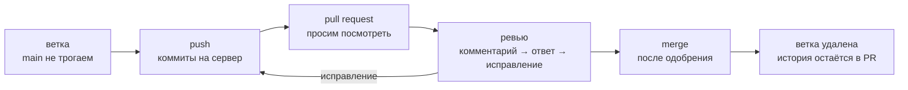

<div lang="ru">

🌐 [Oʻzbekcha](/lab/youtube/git/git-1-03) · **Русский** · [English](/lab/youtube/git/git-1-03/en)  
Урок GIT-1.03 · [Git va GitHub: 0 → Pro](/lab/youtube/git#git-1-03) · ▶️ видео скоро · 💻 [GitHub](https://github.com/abdurahmon27/go-backend-uz/tree/main/lessons/git-03-github-flow)

> Это полная письменная версия видеоурока: по ней можно учиться, не смотря (и не слушая) видео. Само видео на узбекском языке.

## Что вы узнаете

Коллега оставил в вашем pull request один комментарий:

```text
✗  Bu kod noto'g'ri.
```

(«Этот код неправильный».) Что именно неправильно? Почему? Что делать? Ничего из этого не сказано. Ту же находку
можно написать иначе:

```text
✓  issue (blocking): foiz 100 dan oshsa, narx manfiy.
   go run . 150  →  non: -1500 so'm
   Foizni 0..100 oralig'ida tekshirib, shu holatga
   test qo'shsak bo'ladimi?
```

(«issue (blocking): если процент больше 100, цена отрицательная. `go run . 150 → non: -1500 so'm`. Может, проверим,
что процент в диапазоне 0..100, и добавим тест на этот случай?») В начале стоит метка: `issue` — проблема,
`(blocking)` — исправить обязательно до merge. Потом конкретный пример: при скидке 150 % цена получается −1500 сумов.
В конце не приказ, а предложение и вопрос. Сегодня пройдём GitHub flow от начала до конца и научимся писать такие
комментарии.

**Одна идея:** pull request — это ветка, diff и разговор между людьми. Хороший комментарий говорит о коде, а не о
человеке, и приводит пример и причину. А хороший ответ исправляет код.

После урока вы сможете:

- пройти шесть шагов GitHub flow (ветка → push → pull request → ревью → merge → удаление ветки) настоящими
  командами git;
- объяснить, почему страница PR показывает не `git diff main..branch`, а `git diff main...branch` (три точки);
- выбрать решение ревью (Comment, Approve, Request changes) и написать комментарий с меткой `issue`, `nit`,
  `question`, `praise`;
- вежливо ответить на полученный комментарий и запушить исправление в ту же ветку.

Три главных новых слова урока:

| Слово | Простой смысл | По-английски |
|---|---|---|
| pull request (PR) | запрос «посмотрите мою ветку, прежде чем её добавят в `main`»: функция GitHub, а не команда git | pull request |
| комментарий ревью | письменное замечание о коде в PR; в начале стоит метка: `issue`, `nit`, `question`, `praise` | code review comment |
| трёхточечный diff | разница, посчитанная от места, где ветки разошлись (общий предок, **merge base**): только то, что принёс PR | three-dot diff |

Вспомогательные слова объясняются одной фразой там, где встречаются впервые: **bare-репозиторий** (репозиторий без
рабочих файлов, только история), **upstream** (ветка на сервере, к которой привязана локальная ветка),
**merge-коммит** (коммит с двумя parent), **draft** (черновик PR).

## Что нужно знать заранее

- [GIT-1.01 · git: коммит — это снимок (snapshot), ветка — один хеш в файле](/lab/youtube/git/git-1-01/ru): ветка — ref, в
  котором записан хеш одного коммита; fast-forward merge сдвигает этот ref вперёд; `git revert` отменяет ошибку новым
  коммитом. В том уроке ошибочная `chegirma` («скидка») попала прямо в `main`. Сегодня разберём порядок работы,
  который этого не допускает.
- [GIT-1.02 · Запушили `.env`? Ключ больше не только ваш](/lab/youtube/git/git-1-02/ru): предыдущий урок по Git. Сегодня из него
  только один вопрос (в «Проверьте себя»).
- [SYS-0.02 · Процесс и окружение: `ps`, `kill`, `$PATH` и переменные окружения](/lab/youtube/sys/sys-0-02/ru): **код выхода**
  (exit code) и переменная окружения через `export`. Так мы фиксируем время коммита (`vaqt.sh`).
- Код на Go в упражнении маленький. `go test` и табличный тест в нём —
  [GO-1.07 · Не гадайте, измеряйте: первый тест и бенчмарк](/lab/youtube/go/go-1-07/ru); возврат `(int, error)` из функции и
  значение ошибки вместо `try/catch` —
  [GO-X.03 · Без try/catch: значение ошибки и defer](/lab/youtube/go/go-x-03/ru). Здесь они объясняются одной фразой.

**Как запускать код.** Нужны `git` 2.29 или новее, `bash` и Go 1.22 или новее. Аккаунт GitHub **не нужен**: на
GitHub ничего не отправляется, «сервер» — это `server.git` в той же папке. Скачайте репозиторий курса и перейдите в
папку урока (`cd` меняет текущую папку терминала):

```bash
git clone https://github.com/abdurahmon27/go-backend-uz
cd go-backend-uz/lessons/git-03-github-flow
```

Команды на странице записаны как в видео и README: каждая начинается **из папки урока**. Поэтому большинство
начинается с `cd lola && …` (автор) или `cd aziz && …` (ревьюер). Если запускать каждую команду отдельно в
`bash -c '…'`, `cd` не переходит в следующую команду. В обычном терминале `cd` сохраняется: если вы уже внутри
`lola`, сначала сделайте `cd ..`. Выполняйте команды в порядке страницы: каждая продолжает с того состояния, которое
оставила предыдущая. Чтобы начать сначала, снова запустите `./qur.sh`.

Хеш коммита вычисляется из автора, времени и содержимого (GIT-1.01). `qur.sh` и `vaqt.sh` фиксируют имя и время,
поэтому все хеши на странице должны совпасть у вас символ в символ. Только время `go test` (`0.002s`) каждый раз
немного отличается.

Сначала вопрос из GIT-1.01. После создания ветки `chegirma` никто не добавлял коммитов в `main`. Что сделает
`git merge chegirma`?

**A)** создаст merge-коммит с двумя parent · **B)** сдвинет ref `main` на хеш `chegirma` (fast-forward)
· **C)** скопирует коммиты из `chegirma` и добавит их в `main` с новыми хешами

<details>
<summary>Ответ</summary>

**B.** Последний коммит `main` — предок `chegirma`, объединять нечего: git просто сдвигает файл `main` вперёд. Это
**fast-forward**. «A» — случай, когда новые коммиты есть в обеих ветках. Сегодня будет именно так: Азиз добавит в
`main` строку README, а Лола будет работать в `chegirma`. И ещё новость: кнопка merge на GitHub создаёт merge-коммит,
даже когда fast-forward возможен (раздел «Merge»).

</details>

## GitHub flow: шесть шагов

В GIT-1.01 ошибка попала прямо в `main`, потом мы её откатили через revert. Чтобы в команде такого не было, есть
**GitHub flow**. Порядок из документации GitHub простой:

| # | Шаг | Кто | Что происходит |
|---|---|---|---|
| 1 | ветка | автор | работа начинается в отдельной ветке, `main` не трогаем |
| 2 | коммит и push | автор | коммиты отправляются на сервер вместе с этой веткой |
| 3 | pull request | автор | коллег просят посмотреть изменение |
| 4 | ревью | ревьюер ↔ автор | комментарий → ответ → исправление, при необходимости несколько раз |
| 5 | merge | ревьюер или автор | после одобрения ветка добавляется в `main` |
| 6 | удаление ветки | автор | ветка больше не нужна; PR и коммиты остаются в истории |



**Pull request** — не команда git, а функция GitHub. Документация GitHub называет его «ключевой функцией для
совместной работы». В списке `git help -a` команды `pull-request` нет. Но PR построен на тех же ветке и merge из
GIT-1.01: PR — это вопрос «сольём эту ветку в `main`?» и разговор вокруг него.

В самом git есть близкая команда: `git request-pull`. Она пишет сводку изменений, а сводку отправляют по email.
Мейнтейнеры ядра Linux отправляют pull request именно так. GitHub превратил ту же идею в веб-страницу, комментарии и
кнопки.

## Упражнение: локальный сервер вместо GitHub

Для упражнения аккаунт GitHub не нужен. Скрипт `qur.sh` («собрать») создаёт три репозитория:

```text
            server.git  (вместо GitHub: bare-репозиторий, только история)
              ▲     ▲
     push/fetch     push/fetch
              │     │
   lola/  (автор)       aziz/  (ревьюер)
```

- `server.git` — **bare-репозиторий**: в нём нет рабочих файлов, только история (`objects`, `refs`). Репозиторий на
  сервере GitHub устроен так же: там никто не редактирует файлы, туда только пушат и оттуда делают fetch.
- `lola` (Лола) — автор, который пишет код.
- `aziz` (Азиз) — коллега, который делает ревью. Он уже добавил в `main` обновление README. А Лола его ещё не
  получила. Эта разница понадобится в разделе «Ревью».

Полный текст скрипта:

```bash filename="qur.sh" showLineNumbers
#!/usr/bin/env bash
# GitHub flow mashqi uchun uchta repo'ni noldan quradi. git >= 2.29.
#   server.git/  GitHub o'rnida turgan bare repo (ishchi fayllarsiz, faqat tarix)
#   aziz/        reviewer: main'ni boshlagan, keyin README'ni yangilagan
#   lola/        muallif: README yangilanishidan oldin clone qilgan
# Muallif va vaqt qat'iy (vaqt.sh): hash'lar hamma joyda bir xil.
set -e; cd "$(dirname "$0")"; rm -rf server.git lola aziz
rf=--ref-format=files; git init -h 2>&1 | grep -q ref-format || rf=   # eski git'da bu bayroq yo'q
git init -q --bare --template= -b main --object-format=sha1 $rf server.git
sozla() {   # $1 ism, $2 email: imzo, hook, rang va global sozlamalar natijani o'zgartirmasin
  git config user.name "$1"; git config user.email "$2"; git config commit.gpgsign false
  git config core.hooksPath /dev/null; git config core.pager cat; git config color.ui false
  git config core.abbrev 7; git config core.autocrlf false; git config core.excludesFile /dev/null
  git config core.attributesFile /dev/null; git config log.decorate false; git config branch.sort refname
  git config pull.ff only; git config merge.stat true; git config push.default simple
  git config advice.detachedHead false; git remote set-url origin ../server.git 2>/dev/null || true; }

# aziz main'ni boshlaydi va serverga push qiladi
mkdir aziz; cd aziz; git init -q --template= -b main --object-format=sha1 $rf
git remote add origin ../server.git; sozla Aziz aziz@example.com
cp ../fayllar/README.md README.md; cp ../fayllar/v0/main.go main.go; printf 'module narx\n\ngo 1.22\n' > go.mod
git add .; . ../vaqt.sh; git commit -q -m "narx dasturi"
git push -q -u origin main 2>/dev/null; cd ..

# lola shu holatda clone qiladi
git clone -q --template= server.git lola; (cd lola; sozla Lola lola@example.com)

# aziz keyin main'da README'ni yangilaydi (lola buni hali fetch qilmagan)
cd aziz; cp ../fayllar/README.aziz.md README.md
git add README.md; . ../vaqt.sh; git commit -q -m "README: ishga tushirish"
git push -q origin main 2>/dev/null; cd ..
echo "tayyor: server.git/ (GitHub o'rnida), lola/ (muallif), aziz/ (reviewer)"
```

| Строка | Код | Что делает |
|---|---|---|
| 1–6 | комментарии | что за три папки; автор и время фиксированы, чтобы хеши везде совпадали |
| 7 | `set -e; cd …; rm -rf server.git lola aziz` | остановиться на первой ошибке; перейти в папку скрипта; удалить старые репозитории |
| 8 | `rf=--ref-format=files … \|\| rf=` | в git 2.45+ хранить ref'ы в обычных файлах (как в GIT-1.01); в старом git флаг пустой |
| 9 | `git init -q --bare … server.git` | `--bare` — репозиторий без рабочих файлов; `-b main` — первая ветка `main`; хеш SHA-1 |
| 10–16 | `sozla() { … }` | функция shell («настроить»): имя и email (`$1`, `$2`), отключает подпись, хуки, цвет и глобальные настройки. `pull.ff only` — `git pull` делает только fast-forward; `git remote set-url origin ../server.git` — адрес `origin` (сервера) |
| 19–20 | `mkdir aziz; … git init …; git remote add origin ../server.git; sozla Aziz …` | репозиторий Азиза, `origin` — `../server.git` |
| 21–23 | `cp …; printf 'module narx…' > go.mod; git add .; … git commit …; git push -q -u origin main` | первый коммит «narx dasturi» («программа цены», `v0`), push на сервер |
| 26 | `git clone -q --template= server.git lola; (cd lola; sozla Lola …)` | Лола клонирует сервер: пока один коммит |
| 29–31 | `cp ../fayllar/README.aziz.md README.md; … git commit …; git push …` | Азиз добавляет в README две строки и пушит на сервер. Лола этого не fetch'ила |
| 32 | `echo "tayyor: …"` | итоговое сообщение («готово») |

`2>/dev/null` скрывает сообщения push, которые идут в stderr. Время коммита задаёт `vaqt.sh` («время»; `. ../vaqt.sh`
— выполнить скрипт в текущем shell, как в SYS-0.02 и GIT-1.01):

```bash filename="vaqt.sh" showLineNumbers
# Manba qiling: `. ../vaqt.sh` (lola/ yoki aziz/ ichidan). Commit vaqtini qat'iy qiladi:
# 2026-03-02 10:00 (+05:00) va repo'da ko'rinadigan har bir commit uchun +10 daqiqa.
# Shuning uchun commit hash'lari sizda ham, bizda ham bir xil chiqadi.
# muallif repo sozlamasidan olinsin (user.name/email), muhitdagi qiymatdan emas
unset GIT_AUTHOR_NAME GIT_AUTHOR_EMAIL GIT_COMMITTER_NAME GIT_COMMITTER_EMAIL
n=$(git rev-list --all --count 2>/dev/null || echo 0)
t=$((1772427600 + n * 600))
export GIT_AUTHOR_DATE="@$t +0500" GIT_COMMITTER_DATE="@$t +0500"
```

- Строка 5: убирает из окружения переменные вроде `GIT_AUTHOR_NAME`: имя берётся из настроек репозитория.
- Строка 6: число видимых в репозитории коммитов `n` (`--all` — из всех ref'ов, включая пришедшие с сервера).
- Строка 7: `1772427600` — 2026-03-02 10:00 по Ташкенту в секундах Unix; +600 секунд на каждый коммит.
- Строка 8: git берёт время из этих двух переменных окружения.

В вашем собственном репозитории ничего этого не нужно. Запускаем:

```console
$ ./qur.sh
tayyor: server.git/ (GitHub o'rnida), lola/ (muallif), aziz/ (reviewer)
```

```console
$ ls -C server.git lola
lola:
go.mod	main.go  README.md

server.git:
config	HEAD  objects  refs
```

В `lola` есть файлы: `go.mod`, `main.go`, `README.md`. В `server.git` — только внутренние папки git: `config`,
`HEAD`, `objects`, `refs`. В обычном репозитории они лежат внутри `.git`, в bare-репозитории — прямо в папке.
Смотрим историю обоих локальных репозиториев (`git -C <папка>` выполняет команду в этой папке):

```console
$ for r in aziz lola; do echo "$r:"; git -C $r log --oneline; done
aziz:
9c274de README: ishga tushirish
3644e95 narx dasturi
lola:
3644e95 narx dasturi
```

У Азиза два коммита, у Лолы один. Программа в `main` пока без скидки:

```go filename="fayllar/v0/main.go" showLineNumbers
// narx: non narxini chiqaradi. main'dagi boshlang'ich versiya.
package main

import "fmt"

const non = 3000 // so'm

func main() {
	fmt.Printf("non: %d so'm\n", non)
}
```

`go run .` → `non: 3000 so'm` («хлеб: 3000 сумов»). `const non = 3000` — константа, `%d` — место для целого числа.

## Ветка и push

Лола начинает работу в новой ветке. Имя короткое и понятное: `chegirma` («скидка»). Документация GitHub тоже
советует короткое имя, которое описывает работу (их пример: `increase-test-timeout`). `git switch -c` создаёт новую
ветку и переходит в неё:

```console
$ cd lola && git switch -c chegirma
Switched to a new branch 'chegirma'
```

Код берётся из `fayllar/v1/`. Три файла. Первый — сам расчёт:

```go filename="fayllar/v1/chegirma.go" showLineNumbers
package main

func chegirma(narx, foiz int) int {
	return narx - narx*foiz/100
}
```

`chegirma(narx, foiz int) int` принимает два `int` (`narx` — «цена», `foiz` — «процент») и возвращает один `int`
(в Go тип пишется после имени, `narx, foiz int` — оба `int`). `narx*foiz/100` — целочисленное деление, дробная часть
отбрасывается. 3000 и 10 → `3000 - 300 = 2700`.

Второй — тест:

```go filename="fayllar/v1/chegirma_test.go" showLineNumbers
package main

import "testing"

func TestChegirma(t *testing.T) {
	holatlar := []struct{ narx, foiz, kutilgan int }{
		{3000, 0, 3000},
		{3000, 10, 2700},
	}
	for _, h := range holatlar {
		if got := chegirma(h.narx, h.foiz); got != h.kutilgan {
			t.Errorf("chegirma(%d, %d) = %d, kutilgan %d", h.narx, h.foiz, got, h.kutilgan)
		}
	}
}
```

| Строка | Что делает |
|---|---|
| 1, 3 | имя файла заканчивается на `_test.go`, пакет `testing`: `go test` находит такие файлы |
| 5 | `TestChegirma(t *testing.T)` — тестовая функция, начинается с `Test` (`*` — указатель, в GO-1.07) |
| 6–9 | `holatlar` («случаи») — таблица: в каждой строке цена, процент и ожидаемый результат (`kutilgan`). Два случая: 0 % и 10 % |
| 10 | `for _, h := range holatlar` — цикл по таблице |
| 11–13 | если результат не совпал с ожидаемым, `t.Errorf` помечает тест как упавший и пишет причину |

Та же идея, что `test.each([...])` в Jest: одна проверка, много строк данных. В тесте только 0 и 10 процентов.
Запомните это.

Третий — `main.go`, процент берётся из командной строки:

```go filename="fayllar/v1/main.go" showLineNumbers
// narx: non narxini chegirma bilan chiqaradi. Foiz birinchi argument: go run . 10
package main

import (
	"fmt"
	"os"
	"strconv"
)

const non = 3000 // so'm

func main() {
	foiz := 0
	if len(os.Args) > 1 {
		f, err := strconv.Atoi(os.Args[1])
		if err != nil {
			fmt.Println("foiz butun son bo'lishi kerak:", err)
			os.Exit(2)
		}
		foiz = f
	}
	fmt.Printf("non: %d so'm\n", chegirma(non, foiz))
}
```

| Строка | Что делает |
|---|---|
| 13 | `foiz := 0` — без аргумента скидки нет |
| 14 | `os.Args` — аргументы командной строки; `[0]` — имя программы, `[1]` — первый аргумент |
| 15 | `strconv.Atoi` переводит строку в целое число; возвращает два значения: число и ошибку (`err`) |
| 16–19 | при неверном аргументе вроде `"abc"` печатает сообщение и завершается через `os.Exit(2)` с кодом выхода 2 |
| 22 | печатает результат `chegirma(non, foiz)` |

Запускаем тесты:

```console
$ cd lola && cp ../fayllar/v1/*.go . && go test
PASS
ok  	narx	0.002s
```

`PASS` — все тесты прошли; `narx` — имя модуля (`module narx` в `go.mod`). Коммитим и пушим ветку на сервер:

```console
$ cd lola && git add . && . ../vaqt.sh && git commit -q -m "chegirma: foiz bilan narx" && git push -u origin chegirma
To ../server.git
 * [new branch]      chegirma -> chegirma
branch 'chegirma' set up to track 'origin/chegirma'.
```

- `To ../server.git` — на какой сервер отправлено.
- `* [new branch] chegirma -> chegirma` — на сервере создана новая ветка.
- `-u` (`--set-upstream`) привязывает локальную `chegirma` к `chegirma` на сервере: об этом последняя строка.
  Привязанная ветка на сервере называется **upstream**. Теперь в этой ветке `git push` и `git pull` без аргументов
  знают, куда идти.

В настоящем терминале перед этими строками появятся ещё строки прогресса вроде `Enumerating objects…`,
`Writing objects…`. Когда вывод идёт в pipe или файл, git их не пишет.

Что изменилось на сервере? Попробуйте угадать:

**A)** в `main` добавился коммит Лолы · **B)** появилась новая ветка `chegirma`, `main` на месте
· **C)** ничего: сначала нужно открыть pull request

<details>
<summary>Ответ</summary>

**B.** Push отправил только ref `chegirma`. Если вы выбрали «A», вы спутали push с merge: `main` пока никто не
трогал. «C» — PR открывают **после** push, потому что PR показывает ветку на сервере.

</details>

```console
$ git -C server.git branch
  chegirma
* main
```

На сервере две ветки: новая `chegirma` и нетронутая `main` (`*` — `HEAD` bare-репозитория).

## Открываем pull request: заголовок и описание

Теперь Лола открывает pull request. Его открывают на странице GitHub или командой `gh pr create`. Заголовок
короткий, а описание отвечает на три вопроса: **что** изменилось, **зачем** это нужно и **как** проверено. Скажите
ревьюеру и **с чего** начать. Пример описания:

```text filename="fayllar/pr.md" showLineNumbers
chegirma: foiz bilan narx

## Nima
`go run . 10` narxni 10 foiz chegirma bilan chiqaradi.

## Nega
Aksiyalar uchun chegirma kerak. Closes #1

## Qanday tekshirdim
- go test: 0 va 10 foiz
- go run . 10  →  non: 2700 so'm

## Qayerga qarash kerak
chegirma.go: hisob shu yerda.
```

| Строка | Что |
|---|---|
| 1 | заголовок: короткий, как сообщение коммита («скидка: цена с процентом») |
| 3–4 | **Nima** («Что»): изменение одной фразой |
| 6–7 | **Nega** («Зачем»): причина. `Closes #1` привязывает PR к issue номер 1 (в этом примере — задача, в которой просили скидку): когда PR сольют в ветку по умолчанию, issue закроется сам. Слова `fixes`, `resolves` тоже работают |
| 9–11 | **Qanday tekshirdim** («Как я проверил»): какой тест и какая команда. Отсюда ревьюер видит, что не проверялось |
| 13–14 | **Qayerga qarash kerak** («Куда смотреть»): точка входа для ревьюера |

Ещё две привычки:

- Если работа не закончена, откройте PR как **draft**, то есть черновик. Draft PR нельзя слить, но коллеги могут дать
  ранний отзыв.
- Перед отправкой сами один раз прочитайте diff. Документация GitHub тоже говорит «сначала сделайте ревью своего
  PR»: забытый отладочный `fmt.Println` лучше найти вам, а не ревьюеру.

## Команды `gh`: на настоящем GitHub

На настоящем GitHub весь цикл можно пройти и командами `gh` (GitHub CLI). В этом уроке мы их **не запускаем**,
только показываем (флаги проверены по тексту `--help` `gh` 2.102.0):

```bash filename="fayllar/gh.sh" showLineNumbers
# Haqiqiy GitHub'da (bu darsda ishga tushirmaymiz)
gh pr create --base main --title "chegirma: foiz bilan narx" \
  --body-file pr.md --reviewer aziz     # PR #2 ochiladi
gh pr checkout 2                        # reviewer PR'ni oladi
gh pr review 2 --request-changes --body-file izoh.md
gh pr review 2 --approve --body "Rahmat, tayyor!"
gh pr merge 2 --merge --delete-branch   # merge commit
git fetch origin pull/2/head:pr-2       # PR ham ref
```

| Строка | Что делает |
|---|---|
| 2–3 | `gh pr create` открывает PR: в какую ветку (`--base main`), заголовок, файл описания (`--body-file pr.md`) и ревьюер. `\` — команда продолжается на следующей строке |
| 4 | `gh pr checkout 2` — ревьюер забирает ветку PR номер 2 к себе и переключается на неё |
| 5 | `gh pr review 2 --request-changes` отправляет общее ревью с решением «нужны исправления». Комментарий к конкретной строке кода пишут на веб-странице |
| 6 | `--approve` — одобрение |
| 7 | `gh pr merge 2 --merge --delete-branch` сливает через merge-коммит и удаляет ветку (есть ещё `--squash` и `--rebase`: [GIT-4.06](/lab/youtube/git#git-4-06)) |
| 8 | `git fetch origin pull/2/head:pr-2` — обычная команда git |

Последняя строка интересная. GitHub создаёт для каждого PR отдельный ref: `refs/pull/2/head`. Как ветка из GIT-1.01,
это имя, указывающее на хеш коммита. Его можно fetch'нуть и записать в локальную ветку `pr-2`. Эти ref'ы только для
чтения: пушить в них нельзя.

## Ревью: две точки и три точки

Азиз начинает ревью с `git fetch`: новые коммиты и ветки с сервера приходят в его репозиторий, но его `main` и
файлы не меняются. `chegirma` с сервера видна у Азиза под именем `origin/chegirma` (локальная копия-ref ветки на
сервере). Затем он смотрит коммиты PR:

```console
$ cd aziz && git fetch -q && git log --oneline main..origin/chegirma
360db8f chegirma: foiz bilan narx
```

`main..origin/chegirma` — «коммиты, достижимые из `origin/chegirma`, но не из `main`», то есть коммиты PR. Пока
один.

Теперь diff. Лола изменила только три файла Go и не трогала `README.md`. Будет ли `README.md` в списке
`git diff --stat main..origin/chegirma` (две точки)?

**A)** нет, Лола его не трогала · **B)** да, будто из него удалены две строки · **C)** команда выдаст ошибку

<details>
<summary>Ответ</summary>

**B.** В diff у `..` нет того смысла, что в `log`. `git diff A..B` — это обычный `git diff A B`: он сравнивает
**текущее** состояние `main` с состоянием `origin/chegirma`. Азиз добавил строки README в `main`, а в ветке Лолы их
нет. В итоге diff говорит «Лола их удалила». Если вы выбрали «A», вы решили, что diff показывает «что изменила
ветка»: это даёт трёхточечный вариант.

</details>

```console
$ cd aziz && git diff --stat main..origin/chegirma
 README.md        |  2 --
 chegirma.go      |  5 +++++
 chegirma_test.go | 15 +++++++++++++++
 main.go          | 19 ++++++++++++++++---
 4 files changed, 36 insertions(+), 5 deletions(-)
```

`--stat` — краткая сводка по каждому файлу: `+` — добавленные, `-` — удалённые строки. `README.md | 2 --` — две
строки «удалены». Но Лола README не трогала: эти строки Азиз сам добавил в `main`. В видео этого нет, но мы
запустили в том же состоянии — сам diff README:

```console
$ cd aziz && git diff main..origin/chegirma -- README.md
diff --git a/README.md b/README.md
index fcaacc0..6d0eeb3 100644
--- a/README.md
+++ b/README.md
@@ -1,5 +1,3 @@
 # narx
 
 Non narxini hisoblaydigan kichik dastur.
-
-Ishga tushirish: `go run .`
```

Пустая строка и строка `Ishga tushirish` («Запуск») — это коммит README Азиза. А трёхточечный diff сравнивает от
места, где ветки разошлись, то есть от **общего предка** (merge base):

```console
$ cd aziz && git diff --stat main...origin/chegirma
 chegirma.go      |  5 +++++
 chegirma_test.go | 15 +++++++++++++++
 main.go          | 19 ++++++++++++++++---
 3 files changed, 36 insertions(+), 3 deletions(-)
```

Остались только три файла Лолы. Страница PR на GitHub показывает именно **трёхточечный diff**. На графе
(`--graph` — дерево коммитов, `--all` — все ref'ы; этой команды тоже нет в видео, мы запустили её в том же
состоянии):

```console
$ cd aziz && git log --graph --oneline --all
* 9c274de README: ishga tushirish
| * 360db8f chegirma: foiz bilan narx
|/  
* 3644e95 narx dasturi
```

```text
        main ──► 9c274de  README: ishga tushirish
                    │
 merge base ──►  3644e95  narx dasturi
                    │
origin/chegirma ──► 360db8f  chegirma: foiz bilan narx   (parent: 3644e95)

 git diff main..origin/chegirma    = разница 9c274de  и 360db8f  → README тоже попадает
 git diff main...origin/chegirma   = разница 3644e95  и 360db8f  → только работа Лолы
```

| | Две точки `A..B` | Три точки `A...B` |
|---|---|---|
| от чего | от текущего состояния `A` | от общего предка `A` и `B` (`git merge-base A B`) |
| до чего | `B` | `B` |
| у нас | 4 файла, 36 `+`, 5 `-` (и README) | 3 файла, 36 `+`, 3 `-` |
| кто использует | когда нужна текущая разница `main` и ветки | страница PR на GitHub: «что принёс PR» |

Документация `git diff` записывает это одним равенством: `git diff A...B` = `git diff $(git merge-base A B) B`. В
домашнем задании вы проверите это сами. Обратите внимание: в `git log` правильный результат дали две точки, а в
`git diff` нужны три. Это одно из самых запутанных мест git.

Чтобы путаницы было меньше, GitHub советует почаще сливать `main` в вашу ветку и быстро завершать PR.

Посмотрите и на размер: добавлено 36 строк, удалено 3. По руководству Google по code review, 100 строк — обычно
нормальный размер, а 1000 строк — обычно слишком много (последнее слово за ревьюером). Маленький PR смотрят быстро и
внимательно.

## Читать diff мало: запустите код

Код нужно ещё и запустить. Азиз переходит на ветку Лолы. Локальной `chegirma` у Азиза не было: `git switch` создаёт
её на основе `origin/chegirma` и привязывает к upstream (`-q` — тихо).

```console
$ cd aziz && git switch -q chegirma && go test && go run . 10
PASS
ok  	narx	0.002s
non: 2700 so'm
```

Тесты прошли, 10 процентов тоже верно: 2700 сумов. В описании Лола написала, что проверила только 0 и 10 процентов.
Азиз пробует непроверенный случай: 150 процентов.

```console
$ cd aziz && go run . 150
non: -1500 so'm
```

Цена −1500 сумов: `3000 - 3000*150/100 = 3000 - 4500`. Магазин отдаёт хлеб и ещё доплачивает. Тесты этого не
поймали, потому что в таблице нет процента больше 100. Как бы внимательно вы ни читали diff, такую ошибку находят,
пробуя случай, который не указан в описании.

## Решение ревью: Comment, Approve или Request changes

Вопрос-пауза из видео. На GitHub ревью отправляется с одним из трёх решений. С каким решением Азиз отправит ревью?

**A)** Comment · **B)** Approve · **C)** Request changes

<details>
<summary>Ответ</summary>

**C — Request changes**, то есть запросить исправления. Отрицательная цена — настоящая ошибка: её нужно исправить до
merge. Если вы выбрали «B», вы решили, что раз тесты прошли, этого достаточно: тесты проверяют только записанные
случаи. «A» — общий отзыв, он не останавливает merge, а эта ошибка должна остановить.

</details>

| Решение | Смысл (документация GitHub) | Когда |
|---|---|---|
| 💬 Comment | общий отзыв: ни одобрение, ни отказ | вопрос, мнение, решения пока нет |
| ✅ Approve | изменение готово к merge | код явно становится лучше |
| 🛑 Request changes | до merge нужно исправить | настоящая ошибка: неверный результат, безопасность, потеря данных |

Но не останавливайте PR из-за мелочей вкуса. Руководство Google говорит: идеального кода нет, есть только код лучше.
Если изменение явно улучшает код, одобряйте, даже если оно не идеально. И не тяните: по правилу Google ответ на
запрос ревью не должен занимать больше одного рабочего дня.

## Хороший комментарий ревью

Теперь посмотрим, как писать сам комментарий. Комментарии Азиза:

```text filename="fayllar/izoh.md" showLineNumbers
issue (blocking): foiz 100 dan oshsa, narx manfiy.
  go run . 150  →  non: -1500 so'm
  Xaridorga pul qaytib ketadi. Foizni 0..100
  oralig'ida tekshirib, xato qaytarsak va shu
  holatga test qo'shsak bo'ladimi?

nit (non-blocking): chegirma'ga doc comment
  yozsak, go doc'da ko'rinadi.

question: 12.5 foiz ham kerak bo'ladimi?

praise: jadvalli test juda tushunarli, rahmat!
```

(Перевод: «issue (blocking): если процент больше 100, цена отрицательная. `go run . 150 → non: -1500 so'm`.
Покупателю уходят деньги. Может, проверим процент на 0..100, вернём ошибку и добавим тест на этот случай? —
nit (non-blocking): если написать doc comment к `chegirma`, он будет виден в `go doc`. — question: а 12.5 процента
тоже понадобится? — praise: табличный тест очень понятный, спасибо!»)

Четыре правила (из руководства Google и формата Conventional Comments):

1. **Пишите о коде, а не о человеке.** Не «вы ошиблись», а что делает код: «если процент больше 100, цена
   отрицательная». Плохой пример из Google: «Why did **you** use threads here…» — фраза обращена к человеку.
2. **Дайте конкретный пример и объясните, почему это важно.** Строка 2 — пример (`go run . 150 → non: -1500 so'm`),
   строка 3 — причина (покупателю уходят деньги). Пример, который ревьюер может перезапустить, заканчивает спор.
3. **Решение обычно пишите как предложение или вопрос** (строки 3–5: «…может, добавим?»). Исправлять — работа
   автора. Но при необходимости дайте и прямое указание или код: Google советует баланс между указанием на проблему
   и готовым решением.
4. **Ставьте в начале метку.** Комментарий без метки автор может прочитать как обязательный.

| Метка | Смысл | Останавливает PR? |
|---|---|---|
| `issue (blocking):` | проблема; `(blocking)` — исправить до merge обязательно | да |
| `nit (non-blocking):` | мелочь (префикс «Nit:» из Google; в Conventional Comments — `nitpick:`) | нет |
| `question:` | есть сомнение, но нет уверенности: спросить | обычно нет |
| `praise:` | отметьте удачное место: искренне, без ложной похвалы | нет |

В Conventional Comments `issue` сам по себе не обязательный: обязательность задаёт **украшение** (decoration) в
скобках (`blocking` или `non-blocking`). Поэтому пишем `issue (blocking)`. Комментарий `blocking` должен быть решён до
слияния изменения; `non-blocking` — совет, который автор может принять или нет. Уровень вы сами пишете у каждого
комментария.

На GitHub есть ещё одно удобство: блок **suggestion**. Когда вы комментируете строку кода, предлагаемый код кладёте
в обычный блок кода Markdown, только вместо названия языка пишете `suggestion`: блок открывается
строкой `` ```suggestion `` и закрывается `` ``` ``. Внутри — новый вид строки, например для `nit` Азиза:

```text
// chegirma narxdan foiz ulushini ayiradi. foiz 0 dan 100 gacha bo'lishi kerak.
```

Автор принимает его одним коммитом по кнопке «Commit suggestion», а предложивший становится co-author (соавтором)
этого коммита. (Этого примера нет в папке курса: это синтаксис веб-страницы GitHub.)

## Исправление: новый коммит в ту же ветку

Лола читает комментарии и сначала исправляет код. Если процент не от 0 до 100, функция возвращает ошибку; добавлен и
doc comment:

```go filename="fayllar/v2/chegirma.go" showLineNumbers
package main

import "fmt"

// chegirma narxdan foiz ulushini ayiradi. foiz 0 dan 100 gacha bo'lishi kerak.
func chegirma(narx, foiz int) (int, error) {
	if foiz < 0 || foiz > 100 {
		return 0, fmt.Errorf("foiz 0..100 oralig'ida bo'lishi kerak, berildi: %d", foiz)
	}
	return narx - narx*foiz/100, nil
}
```

| Строка | Что изменилось |
|---|---|
| 3 | `fmt` — чтобы собрать текст ошибки |
| 5 | **doc comment**: комментарий, который начинается с имени функции; `go doc` его показывает (`nit` Азиза) |
| 6 | `(int, error)` — теперь возвращаются два значения: цена и ошибка. В Go нет `throw`: ошибка — обычное значение ([GO-X.03](/lab/youtube/go/go-x-03/ru)) |
| 7 | `foiz < 0 \|\| foiz > 100` — `\|\|` значит «или» |
| 8 | `fmt.Errorf` создаёт ошибку из форматированной строки («процент должен быть в диапазоне 0..100, передано: …»); вместо цены `0` |
| 10 | в правильном случае ошибка `nil` (нет ошибки) |

В Go `err` виден как возвращаемое значение: вызывающий получает его вместе с ценой, и игнорирование заметно в коде.

В тест добавлены случаи 100, 150 и −5 процентов:

```go filename="fayllar/v2/chegirma_test.go" showLineNumbers
package main

import "testing"

func TestChegirma(t *testing.T) {
	holatlar := []struct {
		narx, foiz, kutilgan int
		xato                 bool
	}{
		{3000, 0, 3000, false},
		{3000, 10, 2700, false},
		{3000, 100, 0, false},
		{3000, 150, 0, true},
		{3000, -5, 0, true},
	}
	for _, h := range holatlar {
		got, err := chegirma(h.narx, h.foiz)
		if (err != nil) != h.xato || got != h.kutilgan {
			t.Errorf("chegirma(%d, %d) = %d, %v; kutilgan %d, xato=%v", h.narx, h.foiz, got, err, h.kutilgan, h.xato)
		}
	}
}
```

- Строки 6–9: в строку таблицы добавлен столбец `xato bool` («ошибка»): ждём ли ошибку в этом случае.
- Строки 12–14: новые случаи — граница (100 % → 0), 150 % и −5 % (ждём ошибку).
- Строка 18: `(err != nil) != h.xato` — если «была ли ошибка» не совпало с ожидаемым, тест падает.

В `main.go` изменился только конец:

```go filename="fayllar/v2/main.go" showLineNumbers
// narx: non narxini chegirma bilan chiqaradi. Foiz birinchi argument: go run . 10
package main

import (
	"fmt"
	"os"
	"strconv"
)

const non = 3000 // so'm

func main() {
	foiz := 0
	if len(os.Args) > 1 {
		f, err := strconv.Atoi(os.Args[1])
		if err != nil {
			fmt.Println("foiz butun son bo'lishi kerak:", err)
			os.Exit(2)
		}
		foiz = f
	}
	narx, err := chegirma(non, foiz)
	if err != nil {
		fmt.Println("xato:", err)
		os.Exit(2)
	}
	fmt.Printf("non: %d so'm\n", narx)
}
```

Строки 22–27: `chegirma` теперь возвращает два значения; при ошибке печатается `xato: …` («ошибка: …»), и программа
завершается через `os.Exit(2)`. Запускаем. Что выведет `go run . 150`?

**A)** `non: -1500 so'm` · **B)** `non: 0 so'm` · **C)** `xato: …`, и программа завершится с кодом выхода 2

<details>
<summary>Ответ</summary>

**C.** 150 > 100, `chegirma` возвращает ошибку, `main` печатает её и делает `os.Exit(2)`. Если вы выбрали «B», вы
приняли `0`, вернувшийся вместе с ошибкой, за цену: при ошибке `main` цену не использует.

</details>

```console
$ cd lola && cp ../fayllar/v2/*.go . && go test && go run . 150
PASS
ok  	narx	0.002s
xato: foiz 0..100 oralig'ida bo'lishi kerak, berildi: 150
exit status 2
```

Тесты прошли, 150 процентов теперь дают понятную ошибку. Нижняя строка `exit status 2` — это **код выхода** из
SYS-0.02: программа завершилась с ошибкой. Эту строку пишет не программа, а `go run`.

Новый коммит пушится в ту же ветку (`-a` добавляет изменённые файлы в коммит без `git add`; upstream уже есть,
поэтому просто `git push`):

```console
$ cd lola && . ../vaqt.sh && git commit -qam "chegirma: foiz 0..100 oralig'ida" && git push
To ../server.git
   360db8f..39feca2  chegirma -> chegirma
```

`360db8f..39feca2` — `chegirma` на сервере сдвинулась с `360db8f` на `39feca2`. Новый PR открывать не нужно: по
документации GitHub PR обновляется сам, когда в ветку пушат коммиты. Лола снова запрашивает ревью кнопкой
«Re-request review». Азиз делает pull и проверяет исправление (`--ff-only` — только fast-forward, своих коммитов у него
нет, поэтому так и будет):

```console
$ cd aziz && git pull -q --ff-only && go run . 150
xato: foiz 0..100 oralig'ida bo'lishi kerak, berildi: 150
exit status 2
```

У Азиза тоже ошибка: исправление работает.

## Как отвечать на комментарии

В ответе тоже нужна вежливость. Ответы Лолы:

```text filename="fayllar/javob.md" showLineNumbers
> issue: foiz 100 dan oshsa, narx manfiy chiqadi.
Rahmat, to'g'ri topdingiz! Tuzatdim: 39feca2.
0..100 dan tashqarida xato qaytadi; 150 va -5
uchun test qo'shdim.

> nit: chegirma'ga doc comment
Qo'shdim, o'sha commit'da.

> question: 12.5 foiz ham kerak bo'ladimi?
Hozircha yo'q: aksiyalar butun foizda, narx
butun so'mda. Kerak bo'lsa, alohida issue ochaman.
Siz boshqacha o'ylaysizmi?
```

(Перевод: «Спасибо, верно подметили! Исправил: 39feca2. Вне 0..100 возвращается ошибка; добавил тесты для 150 и −5.
— Добавил, в том же коммите. — Пока нет: акции в целых процентах, цена в целых сумах. Если понадобится, открою
отдельный issue. Вы думаете иначе?»)

Из руководства Google «How to handle reviewer comments»:

- **Не принимайте комментарий как личный выпад.** Комментарий о коде, а не о вас.
- **Никогда не отвечайте в гневе.** Google: такой ответ «навсегда останется в истории ревью».
- **Неясное место проясняйте в коде, а не в комментарии.** Если ревьюер задал вопрос, следующий читатель задаст его
  же: сделайте код понятнее именем, комментарием или структурой.
- **Исправив, напишите коротко**: что сделали и в каком коммите (строки 1–4: `Tuzatdim: 39feca2` — «Исправил: 39feca2»).
- **Если не согласны, назовите причину и спросите мнение ревьюера** (строки 9–12: «Пока нет: … Вы думаете иначе?»).
- **Для предложения вне рамок PR откройте отдельный issue** (строка 11). PR не должен разрастаться сверх своей задачи.

Когда вопрос решён, кнопка **Resolve conversation** закрывает обсуждение: оно сворачивается и помечается как
решённое.

## Merge: `--no-ff` и удаление ветки

Теперь всё в порядке, Азиз нажимает **Approve**. В защищённой ветке (branch protection) перед merge могут требовать
определённое число одобрений и прошедшие проверки CI (сервер, который автоматически запускает тесты на каждый push).
Это — [GIT-4.07](/lab/youtube/git#git-4-07).

Обычная кнопка GitHub «Merge pull request» запускает `git merge` с флагом `--no-ff`: даже если fast-forward возможен,
всегда создаётся **merge-коммит**. Кнопка также закрывает PR и issue, указанный в `Closes #1`. Мы делаем вручную
только часть git, сообщение — как у GitHub:

```console
$ cd aziz && git switch -q main && . ../vaqt.sh && git merge -q --no-ff -m "Merge pull request #2 from lola/chegirma" origin/chegirma && git log --graph --oneline main~2..main
*   26b4804 Merge pull request #2 from lola/chegirma
|\  
| * 39feca2 chegirma: foiz 0..100 oralig'ida
| * 360db8f chegirma: foiz bilan narx
* 9c274de README: ishga tushirish
```

- `26b4804` — merge-коммит, у него два **parent** (`|\` — здесь граф расходится надвое).
- С одной стороны два коммита Лолы: `360db8f` и исправление `39feca2`.
- С другой стороны коммит README Азиза `9c274de`.
- `main~2..main` — коммиты, достижимые из `main`, но не из предка `main` на два шага назад (`3644e95`): чтобы граф
  был коротким.

У нас в `main` был коммит Азиза, поэтому здесь fast-forward и так был невозможен. А `--no-ff` создал бы merge-коммит
даже без коммита Азиза: в истории остаётся точка «здесь добавлен PR номер 2».

Ветка на сервере больше не нужна. Отправляем `main` на сервер и удаляем `chegirma` на сервере (`--delete`):

```console
$ cd aziz && git push -q origin main && git push origin --delete chegirma
To ../server.git
 - [deleted]         chegirma
```

Даже после удаления ветки PR и его коммиты на GitHub остаются: они в истории `main`, через второго parent
merge-коммита. Лола делает pull `main` и удаляет свою ветку:

```console
$ cd lola && git switch -q main && git pull -q --ff-only && git branch -d chegirma
Deleted branch chegirma (was 39feca2).
```

`git branch -d` удаляет только слитую ветку (неслитую удаляет `-D`). `(was 39feca2)` — на каком коммите ветка была в
последний раз: этот коммит остался в истории `main`.

Как менялись ref'ы за цикл:

| Ref | После `qur.sh` | После push Лолы | После исправления | После merge и удаления |
|---|---|---|---|---|
| сервер `main` | `9c274de` | `9c274de` | `9c274de` | `26b4804` |
| сервер `chegirma` | — | `360db8f` | `39feca2` | — (удалена) |
| Лола `main` | `3644e95` | `3644e95` | `3644e95` | `26b4804` |
| Лола `chegirma` | — | `360db8f` | `39feca2` | — (удалена) |

Кнопки squash и rebase пишут историю иначе. Сравним их в четвёртом модуле: [GIT-4.06](/lab/youtube/git#git-4-06).

## Весь цикл в одной таблице

| Шаг | На GitHub | В упражнении (git) |
|---|---|---|
| ветка | — | `git switch -c chegirma` |
| push | — | `git push -u origin chegirma` |
| pull request | веб-страница или `gh pr create` | (`fayllar/pr.md` — описание) |
| ревью | diff на странице PR (три точки), комментарии, решение | `git fetch`, `git diff main...origin/chegirma`, `go run . 150` |
| исправление | PR обновляется сам, «Re-request review» | `git commit` + `git push` в ту же ветку |
| merge | «Merge pull request» (`--no-ff`), PR и issue закрываются | `git merge --no-ff -m "Merge pull request #2 …"` |
| удаление | удалить ветку на странице PR | `git push origin --delete chegirma`, `git branch -d chegirma` |

## Частые ошибки

Примеров 2–4 из этого раздела нет в видео: мы запустили их в тех же учебных репозиториях, в состоянии, указанном
перед каждым.

### 1. «Этот код неправильный»: комментарий без метки, без примера, обращённый к человеку

Самая частая ошибка. Такой комментарий не говорит автору, что делать, и обычно читается как личный. Исправление:
пишите о коде, ставьте метку (`issue (blocking):`), дайте пример, который можно перезапустить, и причину, а решение
предложите или спросите (раздел «Хороший комментарий ревью»).

### 2. Работа прямо в `main`

Состояние: после `./qur.sh`. Лола не создаёт ветку, коммитит в `main` и пушит:

```console
$ cd lola && cp ../fayllar/v1/*.go . && git add . && . ../vaqt.sh && git commit -q -m "chegirma: foiz bilan narx" && git push
To ../server.git
 ! [rejected]        main -> main (fetch first)
error: failed to push some refs to '../server.git'
hint: Updates were rejected because the remote contains work that you do not
hint: have locally. This is usually caused by another repository pushing to
hint: the same ref. If you want to integrate the remote changes, use
hint: 'git pull' before pushing again.
hint: See the 'Note about fast-forwards' in 'git push --help' for details.
```

Как читать: `! [rejected] main -> main (fetch first)` — «отклонено, сначала сделайте fetch». Строки `hint:`: «на
сервере есть работа, которой у вас нет (коммит README Азиза); обычно потому, что другой репозиторий запушил в тот же
ref». Сервер сдвигает `main` только fast-forward'ом, а коммит Лолы не содержит коммита Азиза. В команде push в
защищённую `main` может быть вообще запрещён. Исправление: GitHub flow — работайте в ветке (`git switch -c chegirma`),
потом PR. Если коммит уже в `main`, создайте из него ветку и верните локальную `main` к серверной (`git reset`,
[GIT-3.01](/lab/youtube/git#git-3-01)).

### 3. Push новой ветки без `-u`

Состояние: после `./qur.sh` и `cd lola && git switch -c chegirma`. Коммит и обычный `git push`:

```console
$ cd lola && cp ../fayllar/v1/*.go . && git add . && . ../vaqt.sh && git commit -q -m "chegirma: foiz bilan narx" && git push
fatal: The current branch chegirma has no upstream branch.
To push the current branch and set the remote as upstream, use

    git push --set-upstream origin chegirma

To have this happen automatically for branches without a tracking
upstream, see 'push.autoSetupRemote' in 'git help config'.
```

`fatal: The current branch chegirma has no upstream branch` — «у текущей ветки `chegirma` нет upstream»: git не
знает, на какой сервер и под каким именем отправлять. Git сам подсказывает решение: `git push --set-upstream origin
chegirma` (коротко `-u`). Достаточно один раз, при первом push ветки. Если хотите, чтобы это происходило
автоматически: `git config --global push.autoSetupRemote true`.

### 4. Ревью без `fetch`

Состояние: Лола запушила `chegirma`, Азиз ещё не сделал `git fetch`:

```console
$ cd aziz && git diff --stat main...origin/chegirma
fatal: ambiguous argument 'main...origin/chegirma': unknown revision or path not in the working tree.
Use '--' to separate paths from revisions, like this:
'git <command> [<revision>...] -- [<file>...]'
```

«Неоднозначный аргумент `main...origin/chegirma`: нет ни такой ревизии (имени коммита), ни такого пути в рабочих
файлах». Репозиторий Азиза ещё не знает о новой ветке на сервере: `origin/chegirma` появляется только после
`git fetch`. Исправление: сначала `git fetch`. Ещё одна скрытая опасность: если делать ревью со старой
`origin/chegirma` без fetch, ошибки не будет, но новых коммитов Лолы вы не увидите.

### 5. Читать PR двухточечным diff

Ошибки нет, но вывод неверный: `git diff main..branch` показывает «изменёнными» и файлы, которые автор не трогал (у
нас две строки README). То, что принёс PR, — это `git diff main...branch` (три точки), GitHub показывает именно его
(раздел «Ревью: две точки и три точки»).

### 6. Открывать новый PR ради исправления

После Request changes новая ветка и новый PR не нужны: комментарии и обсуждение остаются в старом PR, ревьюер теряет
историю. Закоммитьте исправление в ту же ветку и запушьте, PR обновится сам (раздел «Исправление»).

### 7. Останавливать PR из-за вкуса или отвечать в гневе

Request changes из-за `nit` держит PR днями: `nit` — это `non-blocking`. А со стороны автора ответ, написанный в
гневе, навсегда остаётся в истории ревью. Исправление: одобряйте PR, который улучшает код; если не согласны, пишите
причину и вопрос (разделы «Решение ревью» и «Как отвечать на комментарии»).

## Проверьте себя

1. Назовите по порядку шесть шагов GitHub flow. Какой из них — не команда git?

<details>
<summary>Ответ</summary>

ветка → коммит и push → pull request → ревью (комментарий, ответ, исправление) → merge → удаление ветки. Pull request —
функция GitHub, а не команда git; он построен на ветке и merge.

</details>

2. Что выведет эта команда после `git fetch` у Азиза (Лола ещё не исправила код)?

```text
cd aziz && git merge-base main origin/chegirma
```

<details>
<summary>Ответ</summary>

Общий предок — `3644e95` («narx dasturi»): от этого коммита Лола создала ветку, а Азиз поверх него добавил README.
`git merge-base` печатает полный хеш:

```console
$ cd aziz && git merge-base main origin/chegirma
3644e95e077777bf6a51cd2873fa46f2387a5e59
```

Трёхточечный diff считается именно от этого коммита.

</details>

3. Вы ревьюер. В PR переменная называется `h`, а `holat` («случай») читалась бы легче. Какая метка и какое решение?

<details>
<summary>Ответ</summary>

`nit (non-blocking): если вместо h написать holat, читать будет легче.` Решение — Approve, если других проблем нет.
Имя — вопрос вкуса, PR оно не останавливает. Google: идеального кода нет, есть только код лучше.

</details>

4. Перепишите этот комментарий: «Ты опять забыл тест, так не работает».

<details>
<summary>Ответ</summary>

Например:

```text
issue (blocking): chegirma'ning 100 dan katta foiz uchun testi yo'q.
  go run . 150  →  non: -1500 so'm
  {3000, 150, ...} holatini jadvalga qo'shsak bo'ladimi?
```

(«issue (blocking): у `chegirma` нет теста для процента больше 100. … Может, добавим случай `{3000, 150, ...}` в
таблицу?») Нет «ты»: комментарий о коде. Есть метка, пример, который можно перезапустить, и предложение в виде
вопроса.

</details>

5. Из GIT-1.01: создал бы `git merge` в этом уроке merge-коммит и без `--no-ff`? Почему?

<details>
<summary>Ответ</summary>

Да. После того как Лола создала ветку, в `main` добавился коммит README Азиза (`9c274de`): новые коммиты есть в обеих
ветках, просто сдвинуть `main` вперёд нельзя. `--no-ff` меняет что-то только там, где fast-forward *возможен*: и тогда
создаёт merge-коммит.

</details>

6. Из GIT-1.02: на ревью вы увидели в diff PR файл `.env` с настоящим ключом. Ветка ещё не слита. Что делать в первую
   очередь?

<details>
<summary>Ответ</summary>

Немедленно отозвать ключ и заменить его новым (rotate). Запушенный ключ уже не только автора: ветка лежит на
сервере, и то, что она не слита, не помогает. Напишите в комментарии `issue (blocking):`, потом добавьте `.env` в
`.gitignore` и обсудите очистку истории (GIT-1.02).

</details>

## Домашнее задание

Папка курса: [lessons/git-03-github-flow](https://github.com/abdurahmon27/go-backend-uz/tree/main/lessons/git-03-github-flow).

1. 🟢 **Легко.** Начиная с `./qur.sh`, повторите команды со страницы и получите merge-коммит в
   `git log --graph --oneline`.
2. 🟡 **Средне.** Найдите общего предка через `git merge-base main origin/chegirma`. Проверьте, что
   `git diff <предок> origin/chegirma` совпадает с трёхточечным `git diff main...origin/chegirma`.
3. 🟠 **Сложно.** Откройте настоящий PR в своём репозитории на GitHub (`gh pr create` или веб-страница) и попробуйте
   сами его одобрить. Что произойдёт?
4. 🔴 **Гуру.** Повторите кнопку GitHub «Squash and merge» через `git merge --squash` + `git commit`. Чем граф и число
   parent отличаются от merge с `--no-ff`? Файлы одинаковые?

Скрипт с ответами:
[homework/javoblar.sh](https://github.com/abdurahmon27/go-backend-uz/blob/main/lessons/git-03-github-flow/homework/javoblar.sh)
(`bash homework/javoblar.sh`, из папки урока). Он собирает репозитории с нуля, повторяет шаги из видео и показывает
ответы. На GitHub ничего не отправляет. Сначала попробуйте сами.

<details>
<summary>Ответ</summary>

```console
$ bash homework/javoblar.sh
== O'rta: merge-base = uch nuqtali diff'ning boshlanish nuqtasi
umumiy ajdod: 3644e95 narx dasturi
git diff $(merge-base) origin/chegirma  -> 5a24ca4c0c59320755e67421cdf02912246b0a4c
git diff main...origin/chegirma          -> 5a24ca4c0c59320755e67421cdf02912246b0a4c
bir xil: A...B = merge-base(A,B)..B

== Oson: GitHub'ning 'Create a merge commit' tugmasi (--no-ff)
*   26b4804 Merge pull request #2 from lola/chegirma
|\  
| * 39feca2 chegirma: foiz 0..100 oralig'ida
| * 360db8f chegirma: foiz bilan narx
* | 9c274de README: ishga tushirish
|/  
* 3644e95 narx dasturi
parent'lar: 9c274de 39feca2

== Guru: 'Squash and merge' (git merge --squash + commit)
* 92daa53 chegirma: foiz bilan narx (#2)
* 9c274de README: ishga tushirish
* 3644e95 narx dasturi
parent'lar: 9c274de  (bitta: merge commit emas)
ikki tugma natijasi bir xil fayllarmi? ha

== Qiyin: o'z PR'ingizni approve qilish
Bo'lmaydi. GitHub Docs: "Pull request authors cannot approve their own pull requests."
O'z PR'ingizga faqat Comment qoldira olasiz. Repo'da majburiy approve yoqilgan bo'lsa (branch protection),
merge uchun boshqa odamning tasdig'i kerak: review aynan shuning uchun bor.
```

🟢 На графе merge-коммит `26b4804`, у него два parent: `9c274de` (README Азиза) и `39feca2` (исправление Лолы).
`* |` и `|/` — две линии сходятся в `3644e95`: это общий предок.

🟡 Скрипт берёт хеш текста обоих diff через `git hash-object --stdin` (GIT-1.01): оба `5a24ca4…`, значит diff'ы
совпадают байт в байт. `A...B` = от `merge-base(A, B)` до `B`.

🟠 Не получится. Документация GitHub: «Pull request authors cannot approve their own pull requests» — автор PR не
может одобрить свой PR. В свой PR можно оставить только Comment. В репозитории с обязательным одобрением для merge
нужно одобрение другого человека: ревью для этого и существует.

🔴 Squash создаёт один обычный коммит `92daa53` с одним parent (`9c274de`): это не merge-коммит, два коммита Лолы в
истории `main` не видны. Файлы в обоих способах одинаковые (`git diff --quiet` не нашёл разницы → `ha`, «да»).
Документация GitHub: squash хорош для короткоживущих веток; в долгоживущей ветке следующие PR могут снова принести
уже сплющенные коммиты. Подробнее — [GIT-4.06](/lab/youtube/git#git-4-06).

</details>

## Источники

- GitHub Docs: [GitHub flow](https://docs.github.com/en/get-started/using-github/github-flow) ·
  [About pull requests (draft, ref'ы PR)](https://docs.github.com/en/pull-requests/collaborating-with-pull-requests/proposing-changes-to-your-work-with-pull-requests/about-pull-requests) ·
  [Helping others review your changes](https://docs.github.com/en/pull-requests/collaborating-with-pull-requests/getting-started/helping-others-review-your-changes) ·
  [Linking a pull request to an issue](https://docs.github.com/en/issues/tracking-your-work-with-issues/using-issues/linking-a-pull-request-to-an-issue)
- GitHub Docs: [About comparing branches (three-dot diff)](https://docs.github.com/en/pull-requests/collaborating-with-pull-requests/proposing-changes-to-your-work-with-pull-requests/about-comparing-branches-in-pull-requests) ·
  [About pull request reviews](https://docs.github.com/en/pull-requests/collaborating-with-pull-requests/reviewing-changes-in-pull-requests/about-pull-request-reviews) ·
  [Reviewing proposed changes](https://docs.github.com/en/pull-requests/collaborating-with-pull-requests/reviewing-changes-in-pull-requests/reviewing-proposed-changes-in-a-pull-request) ·
  [Commenting on a pull request](https://docs.github.com/en/pull-requests/collaborating-with-pull-requests/reviewing-changes-in-pull-requests/commenting-on-a-pull-request) ·
  [Incorporating feedback](https://docs.github.com/en/pull-requests/collaborating-with-pull-requests/reviewing-changes-in-pull-requests/incorporating-feedback-in-your-pull-request) ·
  [Checking out pull requests locally](https://docs.github.com/en/pull-requests/collaborating-with-pull-requests/reviewing-changes-in-pull-requests/checking-out-pull-requests-locally)
- GitHub Docs: [About pull request merges (`--no-ff`, squash)](https://docs.github.com/en/pull-requests/collaborating-with-pull-requests/incorporating-changes-from-a-pull-request/about-pull-request-merges) ·
  [About protected branches](https://docs.github.com/en/repositories/configuring-branches-and-merges-in-your-repository/managing-protected-branches/about-protected-branches)
- Google Engineering Practices: [How to write code review comments](https://google.github.io/eng-practices/review/reviewer/comments.html) ·
  [The Standard of Code Review](https://google.github.io/eng-practices/review/reviewer/standard.html) ·
  [Speed of code reviews](https://google.github.io/eng-practices/review/reviewer/speed.html) ·
  [Small CLs](https://google.github.io/eng-practices/review/developer/small-cls.html) ·
  [How to handle reviewer comments](https://google.github.io/eng-practices/review/developer/handling-comments.html)
- [Conventional Comments](https://conventionalcomments.org/) (метки и украшения `blocking` / `non-blocking`)
- Документация git: [git-push (`-u`)](https://git-scm.com/docs/git-push) · [git-diff (`A...B`)](https://git-scm.com/docs/git-diff) ·
  [git-merge (`--no-ff`)](https://git-scm.com/docs/git-merge) · [git-request-pull](https://git-scm.com/docs/git-request-pull) ·
  [Linux kernel: pull requests](https://docs.kernel.org/maintainer/pull-requests.html) ·
  [Pro Git 4.2: bare repo](https://git-scm.com/book/en/v2/Git-on-the-Server-Getting-Git-on-a-Server)
- [GitHub CLI manual: gh pr](https://cli.github.com/manual/gh_pr)
- Папка курса и README: [lessons/git-03-github-flow](https://github.com/abdurahmon27/go-backend-uz/tree/main/lessons/git-03-github-flow)
- Все результаты получены на git 2.54.0 и `go1.26.8 linux/amd64`, в Linux, 2026-11-26. Команды `gh` не запускались:
  они проверены по тексту `--help` `gh` 2.102.0 (research, 2026-11-25).

## Видео и код

▶️ Видео скоро выйдет. Эта страница объясняет урок полностью, ждать видео не обязательно.

💻 [Код и ответы к домашнему заданию на GitHub](https://github.com/abdurahmon27/go-backend-uz/tree/main/lessons/git-03-github-flow)

---

← Предыдущий урок: [GIT-1.05](/lab/youtube/git#git-1-05) · Следующий урок: [GIT-2.01](/lab/youtube/git#git-2-01) → · [Все уроки](/lab/youtube/git)

</div>
