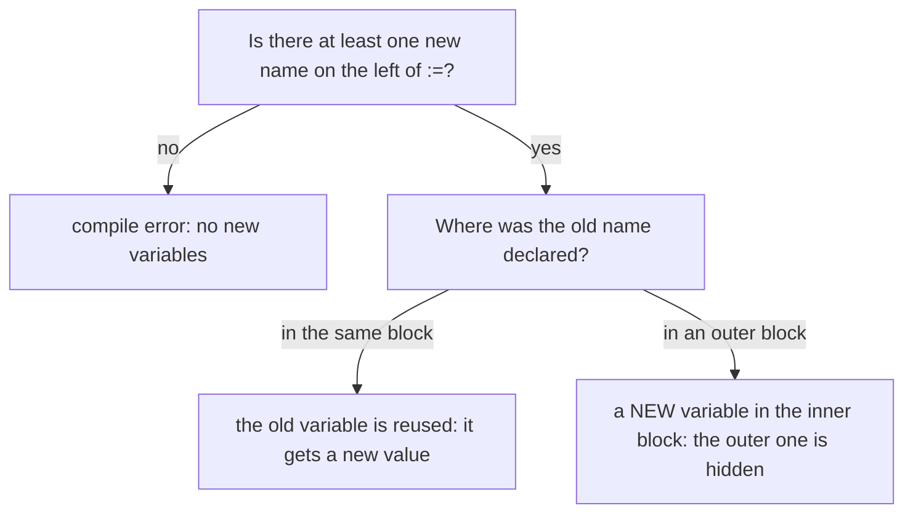

<div lang="en">

🌐 [Oʻzbekcha](/lab/youtube/go/go-1-06) · [Русский](/lab/youtube/go/go-1-06/ru) · **English**  
Lesson GO-1.06 · [Go: 0 → Guru](/lab/youtube/go#go-1-06) · ▶️ video coming soon · 💻 [GitHub](https://github.com/abdurahmon27/go-backend-uz/tree/main/lessons/006-functions)

> This is the full written version of the video lesson: you can learn from it without watching (or hearing) the video. The video itself is in Uzbek.

## What you will learn

We told a program: "run on port 9000". The program printed "sozlandi: 9000" ("configured: 9000"). The next line
said "server ishga tushdi: 8080" ("server started: 8080"). The compiler said nothing, and Go's code checker
`go vet` said nothing either. How can one program have two different ports at the same time? At the end of the
lesson we find the cause and use a tool that catches it.

**The one idea:** in Go, a function returns several values and is a value itself. Always ask "which variable is
this?": a closure holds the variable itself, not a copy of it, and `:=` in an inner block creates a new variable.

By the end of the lesson you will be able to:

- write a function that returns a result together with an error, and call it;
- pass a function to another function and explain what a closure holds on to;
- write a variadic function and know why a slice passed with `slice...` gets changed;
- read the `:=` shadowing bug, find it with the `shadow` checker, and fix it.

Three core new words today:

| Word | Plain meaning | Term |
|---|---|---|
| closure | a function that carries an outside variable "in its pocket" | closure |
| variadic function | a function that takes any number of arguments: `...int` | variadic function |
| shadowing | a new variable in an inner block hides an outer variable with the same name | shadowing |

Two helper words also come up on the way: **error value** (`error`: a value that carries a text saying "what
went wrong"; `nil` means "no error") and **anonymous function** (a function with no name, written right where it
is used). We explain both where they are needed.

## Before you start

- [GO-0.01 · What is a program?](/lab/youtube/go/go-0-01/en): `func main`, `fmt.Println`, a group inside curly braces `{ }`.
- [GO-0.02 · A variable is a label stuck to a value](/lab/youtube/go/go-0-02/en): `:=` creates a new variable, `=` assigns a
  value; the errors `undefined`, `no new variables` and `declared and not used`.
- [GO-0.03 · Numbers and text](/lab/youtube/go/go-0-03/en): `int` and `string`; `strconv.Itoa` turns a number into text.
- [GO-0.04 · if: the program makes a decision](/lab/youtube/go/go-0-04/en): `if`, `==`, `!=` ("is it not equal?").
- [GO-1.05 · Go has no while: one for](/lab/youtube/go/go-1-05/en): `for` and `range`, slices (`[]int{…}`), `append`, `var`,
  the `go` line in `go.mod`, a new loop variable on every iteration since Go 1.22, `go vet`.
- You can copy small programs into [go.dev/play](https://go.dev/play) and run them with **Run**. But the programs
  that use `PORT=9000`, the `eski/` folder (it has its own `go.mod` file) and the `shadow` checker need the course
  folder.
- If you downloaded the course code, open a terminal in the lesson folder (`lessons/006-functions`): the commands
  below run from there. `go run ./ikki` runs the program in the `ikki` folder.

First, let's recall the previous lesson. Does this code change the `narxlar` ("prices") slice?

```go
narxlar := []int{100, 200, 300}
for _, n := range narxlar {
	n *= 2
}
```

<details>
<summary>Answer</summary>

**No.** On each step `range` writes a **copy** of the element into `n`. We doubled the copy; the original values
in the slice stay `[100 200 300]`. To change an element you need its index: `narxlar[i] *= 2`. Today the
question "a copy or the thing itself?" comes up three more times.

</details>

## The puzzle: PORT=9000, but the server is on 8080

A server is a program that waits for requests from other computers. A **port** is the server's "door number": a
request arrives at exactly that numbered door. Our program does not open a real server; it only prints which port
it would start on.

We don't write the port inside the program; we give it from outside, from the terminal. For this there is the
**environment variable**: a `NAME=value` setting written before a command. With `PORT=9000 go run ./port`,
`PORT` is `9000` for this one command only.

```console
$ PORT=9000 go run ./port
sozlandi: 9000
server ishga tushdi: 8080
```

The first line says 9000, the second says 8080. What does the code checker say?

```console
$ go vet ./port
```

`go vet` printed nothing: it found no problem. The compiler also translated the program without complaint. To
understand this bug we first look at functions, and then return to exactly this code in the "Shadowing" section.

## Functions: returning several values

When a calculation is needed in many places of a program, we don't write it again every time. We write it once and
give it a name. It is like a recipe card with a name: you give it ingredients, it gives back a ready dish. In
programming this is a **function**. `main` is a function too; Go calls it by itself.

The ingredients a recipe takes are called **parameters**. The actual values you give when you call it are
**arguments**. The value the function gives back with `return` when it finishes is its **return value**.

In many languages a function returns one value. In Go a function can return **several** values. The most common
pair is a result and an error. For example, you can't divide 10 by 0: the function must say "something went wrong".

Go has no `try` and `catch`. Ordinary errors come back as an **error value**: its type is `error`, and it usually
stands in the last place. When everything is fine, `nil` comes back in the error's place. `nil` means "nothing",
that is, no error. Go also has `panic`, but only for truly exceptional situations ([GO-1.15](/lab/youtube/go/go-1-15/en)).

This is `ikki/main.go` (*ikki* means "two"):

```go filename="ikki/main.go" showLineNumbers
package main

import (
	"errors"
	"fmt"
	"strconv"
)

func bolish(a, b int) (int, error) {
	if b == 0 {
		return 0, errors.New("nolga boʻlib boʻlmaydi")
	}
	return a / b, nil
}

func main() {
	q, err := bolish(10, 3)
	fmt.Println(q, err)
	_, err = bolish(1, 0) // birinchi qiymat kerak emas: _
	fmt.Println(err)
	n, err := strconv.Atoi("12a")
	fmt.Println(n, err)
}
```

| Line | Code | What it does |
|---|---|---|
| 3–7 | `import ( … )` | brings in three packages: `errors` (to make errors), `fmt` (printing), `strconv` (number ↔ text) |
| 9 | `func bolish(a, b int) (int, error) {` | the function `bolish` ("divide"). Parameters: `a` and `b`, both `int`. `(int, error)` in parentheses lists the types of the two return values |
| 10 | `if b == 0 {` | is the divisor zero? |
| 11 | `return 0, errors.New("…")` | if yes, the function ends here and returns two values: `0` and a new error. `errors.New` makes an error value with the given text ("you can't divide by zero") |
| 13 | `return a / b, nil` | otherwise the quotient and `nil` (no error) |
| 17 | `q, err := bolish(10, 3)` | calls the function (arguments 10 and 3); the two return values go into two new variables, `q` and `err` |
| 18 | `fmt.Println(q, err)` | prints both |
| 19 | `_, err = bolish(1, 0)` | we don't need the first value, so `_` (underscore) stands in its place. `err` already exists, so `=` |
| 20 | `fmt.Println(err)` | prints the error's text |
| 21 | `n, err := strconv.Atoi("12a")` | `strconv.Atoi` makes a number from text, and it also returns a number and an error |
| 22 | `fmt.Println(n, err)` | prints the number and the error |

Look at line 21. `n` is new, but `err` is the old variable created on line 17. Still, `:=` worked and **reused**
`err`; it did not create a new one. The reason: the left side of `:=` has at least one new name (`n`), and `err`
was declared **in the same block**. We come back to this rule at the end of the lesson.

Think before you run it: what is the first line? **A)** `3.3333333333333335 <nil>` · **B)** `3 <nil>` ·
**C)** `3`

<details>
<summary>Answer</summary>

**B: `3 <nil>`.** `a` and `b` are `int`; when whole numbers are divided, the fraction is dropped: 10 / 3 = 3
(integer division). `err` is `nil`, and `Println` prints it as `<nil>`. If you chose "A", you expected a
fractional number: that would need `float64`. If you chose "C", you forgot that `Println` got two values.

</details>

```console
$ go run ./ikki
3 <nil>
nolga boʻlib boʻlmaydi
0 strconv.Atoi: parsing "12a": invalid syntax
```

| Call | 1st value | 2nd value (error) | Printed |
|---|---|---|---|
| `bolish(10, 3)` | 3 | `nil` | `3 <nil>` |
| `bolish(1, 0)` | 0 (thrown away with `_`) | "nolga boʻlib boʻlmaydi" | only the error text |
| `strconv.Atoi("12a")` | 0 | `parsing "12a": invalid syntax` | `0 strconv.Atoi: …` |

`"12a"` is not a number, so `Atoi` returned 0 and an error. The error text *parsing "12a": invalid syntax* means
"while reading "12a": it is not written correctly". We learn to work with errors fully in [GO-1.14](/lab/youtube/go/go-1-14/en).

## A function is a value too

In Go a function is a **value**, like a number or a string. You can store it in a variable, pass it to another
function as an argument, and return it from a function. In the recipe picture: you say "do **this job** to every
fruit" and hand over the job itself.

A function also has a **type**. `func(string) string` means "a function that takes one `string` and returns a
`string`". This is `qiymat/main.go` (*qiymat* means "value"):

```go filename="qiymat/main.go" showLineNumbers
package main

import (
	"fmt"
	"strings"
)

func hammasiga(sozlar []string, f func(string) string) []string {
	var natija []string
	for _, s := range sozlar {
		natija = append(natija, f(s))
	}
	return natija
}

func main() {
	sozlar := []string{"olma", "nok", "uzum"}
	fmt.Println(hammasiga(sozlar, strings.ToUpper))

	qavs := func(s string) string { return "[" + s + "]" }
	fmt.Println(hammasiga(sozlar, qavs))
	fmt.Printf("%T\n", qavs)
}
```

| Line | Code | What it does |
|---|---|---|
| 8 | `func hammasiga(sozlar []string, f func(string) string) []string {` | `hammasiga` ("to all of them") takes two parameters: `sozlar` ("words", a slice of strings) and `f`, a **function** of type `func(string) string`. It returns a new slice |
| 9 | `var natija []string` | the result slice (`natija`), empty for now |
| 10 | `for _, s := range sozlar {` | walks over each word |
| 11 | `natija = append(natija, f(s))` | applies the given `f` to the word and adds its answer to the end of `natija` |
| 13 | `return natija` | returns the finished slice |
| 17 | `sozlar := []string{"olma", "nok", "uzum"}` | three words: apple, pear, grape |
| 18 | `hammasiga(sozlar, strings.ToUpper)` | we pass the standard function `strings.ToUpper` ("to upper case") **without parentheses**: we don't call it, we pass the function itself |
| 20 | `qavs := func(s string) string { … }` | an **anonymous function**: there is no name after `func`; it is written right here and stored in the variable `qavs` ("bracket"). It puts the word in square brackets (`+` joins strings) |
| 21 | `hammasiga(sozlar, qavs)` | now we pass our own function |
| 22 | `fmt.Printf("%T\n", qavs)` | `Printf` prints by a template: `%T` is replaced by the **type** of the value, `\n` is a new line |

Guess: what is the second line? **A)** `[olma] [nok] [uzum]` · **B)** `[[olma] [nok] [uzum]]` ·
**C)** `[olma nok uzum]`

<details>
<summary>Answer</summary>

**B.** `qavs` put each word in brackets: `[olma]`, `[nok]`, `[uzum]`. `hammasiga` returns a slice, and `Println`
prints a slice inside square brackets again. So we get brackets inside brackets. If you chose "A", you forgot the
slice's own brackets. "C" would come from a function that does nothing.

</details>

```console
$ go run ./qiymat
[OLMA NOK UZUM]
[[olma] [nok] [uzum]]
func(string) string
```

The last line is the type: a function that takes a `string` and returns a `string`. This type is in the parameter
list of `hammasiga`. That is why you can pass exactly such a function to `hammasiga`, and no other kind.

In backend code you see this every day. For example, `http.HandleFunc` in Go's web server package `net/http` takes
a function as its second argument: `func(ResponseWriter, *Request)`. When a request arrives, the server calls that
function.

## Closure: a function that holds on to a variable

An anonymous function can use the variables of the place where it is written. Think of a tally counter: each press
adds one, and it remembers the previous number. This is `hisob/main.go` (*hisob* means "count"):

```go filename="hisob/main.go" showLineNumbers
package main

import "fmt"

func hisoblagich() func() int {
	n := 0
	return func() int {
		n++ // tashqi n'ni oʻzgartiradi
		return n
	}
}

func main() {
	a := hisoblagich()
	b := hisoblagich()
	fmt.Println(a(), a(), a())
	fmt.Println(b())
}
```

| Line | Code | What it does |
|---|---|---|
| 5 | `func hisoblagich() func() int {` | `hisoblagich` ("counter") takes no parameters. It **returns a function** of type `func() int` (takes nothing, returns an `int`) |
| 6 | `n := 0` | the `n` inside `hisoblagich` |
| 7 | `return func() int {` | returns an anonymous function |
| 8 | `n++` | adds one to the outside `n` (the comment says "changes the outer n") |
| 9 | `return n` | returns the new value |
| 14–15 | `a := hisoblagich()`, `b := hisoblagich()` | we call it twice: `a` and `b` are the two returned functions |
| 16 | `fmt.Println(a(), a(), a())` | calls `a` three times |
| 17 | `fmt.Println(b())` | calls `b` once |

There is something strange here: on line 7 there was a `return`, so `hisoblagich` finished. And `n` was inside it.
When the returned function does `n++`, which `n` does it increase? A function that uses an outside variable and
carries it along is called a **closure**. Picture it as a function carrying `n` in its pocket.

Guess: what does `b()` return? **A)** `4` · **B)** `1` · **C)** `0`

<details>
<summary>Answer</summary>

**B: `1`.** **Every call of `hisoblagich` creates a new `n`**. `a` increased its own `n` to 1, 2, 3. `b` holds a
different `n`; it was still 0, and `b()` made it 1. If you chose "A", you thought `a` and `b` use one shared `n`.
Not "C": `n++` runs **before** the return.

</details>

```console
$ go run ./hisob
1 2 3
1
```

| Call | `n` of `a` | `n` of `b` | Returned |
|---|---|---|---|
| `a := hisoblagich()` | 0 | — | |
| `b := hisoblagich()` | 0 | 0 | |
| `a()` | 1 | 0 | 1 |
| `a()` | 2 | 0 | 2 |
| `a()` | 3 | 0 | 3 |
| `b()` | 3 | 1 | 1 |

And `n` lives on after `hisoblagich` has finished. According to Go's official rules (the specification), the
variables a closure uses *"survive as long as they are accessible"*. Where in memory they are kept (stack or heap)
we open up in [GO-1.11](/lab/youtube/go/go-1-11/en).

## Pause: does a closure hold a copy or the variable itself?

Think about this question before you open the answer. `x` was 1, the closure was created, then `x` changed to 5:

```go
	x := 1
	f := func() int { return x * 10 }
	x = 5
	fmt.Println(f())
```

What does `fmt.Println(f())` print? **A)** `10` · **B)** `50` · **C)** a compile error

<details>
<summary>Answer</summary>

**B: `50`.** A closure holds **the variable itself**, **not a copy** of its value. The specification says these
variables are *"shared between the surrounding function and the function literal"*. When `f` is called, `x` holds
5, and 5 × 10 = 50. If you chose "A", you thought the closure memorized the 1 it saw when it was created. This is
the most important trap of the lesson.

</details>

This is `pauza/main.go`:

```go filename="pauza/main.go" showLineNumbers
package main

import "fmt"

func main() {
	x := 1
	f := func() int { return x * 10 }
	x = 5
	fmt.Println(f())
}
```

```console
$ go run ./pauza
50
```

```text
line 6:  x [ 1 ]
line 7:  f ──────► x [ 1 ]     f makes no copy, it points at x itself
line 8:  f ──────► x [ 5 ]     x = 5: the value in the cell was replaced
line 9:  f() = x * 10 = 5 * 10 = 50
```

## A closure in a loop: the Go 1.22 rule again

That is why the loop trap from [GO-1.05](/lab/youtube/go/go-1-05/en) would also show up with closures. This is `sikl/main.go`
(*sikl* means "loop"):

```go filename="sikl/main.go" showLineNumbers
package main

import "fmt"

func main() {
	var ishlar []func()
	for i := 0; i < 3; i++ {
		ishlar = append(ishlar, func() { fmt.Print(i, " ") })
	}
	for _, ish := range ishlar {
		ish()
	}
	fmt.Println()
}
```

| Line | Code | What it does |
|---|---|---|
| 6 | `var ishlar []func()` | `ishlar` ("jobs") is a slice of functions; each takes nothing and returns nothing |
| 7–9 | `for i := 0; i < 3; i++ { … }` | three times, makes a closure that prints `i` and adds it to the slice. It does **not call** them yet |
| 10–12 | `for _, ish := range ishlar { ish() }` | after the loop ends, calls each closure |
| 13 | `fmt.Println()` | moves to a new line |

Each closure holds the variable `i` itself, not its value. So the output depends on how many `i` variables there
are across the iterations. What does our course module (`go.mod`: `go 1.26`) print? **A)** `0 1 2` ·
**B)** `3 3 3` · **C)** `2 2 2`

<details>
<summary>Answer</summary>

**A: `0 1 2`.** Since Go 1.22, the `i` that the loop declares is **new** on every iteration. The three closures
held three different `i` variables: 0, 1, 2. "B" happens under the old rule (we see it below). "C" never happens:
the loop stops when `i` is 3.

</details>

```console
$ go run ./sikl
0 1 2 
```

The `eski/` folder (*eski* means "old") has the same code, but it has its own `go.mod` file, and that file says
`go 1.21`. `cd eski` moves into that folder, and `&&` means "if that worked, run the next one":

```console
$ cd eski && go run .
3 3 3 
```

In a module whose `go` line is below 1.22, there is **one** `i` for the whole loop. All three closures see that one
`i`, and when the loop ends it holds 3.

| Module | How many `i` | What the closures see | Printed |
|---|---|---|---|
| `go 1.26` (course) | three: `i₀`, `i₁`, `i₂` | each its own `i` | `0 1 2` |
| `go 1.21` (`eski/`) | one | all of them the same `i`, which ends at 3 | `3 3 3` |

`go vet` is silent in both cases:

```console
$ go vet ./sikl
```

```console
$ cd eski && go vet .
```

Both commands printed nothing. If you copy the code into an old module, the bug comes back.

## Variadic functions: any number of arguments

You give `fmt.Println` one value, or three values. How does it do that? Its parameter is `a ...any`: **three dots**
before a parameter's type mean "any number of arguments". Such a function is called a **variadic function**.
Inside the function this parameter is an ordinary slice: `...int` → `[]int`.

Example: we have server response times (in milliseconds) and find the middle one, the median. This is
`mediana/main.go`:

```go filename="mediana/main.go" showLineNumbers
package main

import (
	"fmt"
	"slices"
)

// mediana (soddalashtirilgan: toq sonli, boʻsh emas)
func mediana(vaqtlar ...int) int { // vaqtlar: []int
	slices.Sort(vaqtlar) // parametrni joyida saralaydi
	return vaqtlar[len(vaqtlar)/2]
}

func main() {
	fmt.Println(mediana(90, 10, 50))
	kechikish := []int{90, 10, 50}
	fmt.Println(mediana(kechikish...))
	fmt.Println(kechikish)
}
```

| Line | Code | What it does |
|---|---|---|
| 8 | `// mediana (…)` | comment: a simplified median, only for a list that is odd in length and not empty |
| 9 | `func mediana(vaqtlar ...int) int {` | the variadic parameter `vaqtlar` ("times"). Inside, it is a `[]int` |
| 10 | `slices.Sort(vaqtlar)` | `Sort` from the `slices` package sorts the slice from smallest to largest **in place**: it does not make a new slice |
| 11 | `return vaqtlar[len(vaqtlar)/2]` | `len` is the number of elements (3); 3 / 2 = 1; the element at index 1, that is, the middle one |
| 15 | `mediana(90, 10, 50)` | three separate numbers: Go makes a **new** slice for them |
| 16 | `kechikish := []int{90, 10, 50}` | a ready slice; `kechikish` means "latency" |
| 17 | `mediana(kechikish...)` | we pass the ready slice with three dots: "spread it into elements" |
| 18 | `fmt.Println(kechikish)` | at the end we print `kechikish` |

Guess: what is the last line? **A)** `[90 10 50]` · **B)** `[10 50 90]` · **C)** `[50]`

<details>
<summary>Answer</summary>

**B: `[10 50 90]`.** When a slice is passed with three dots, **no new slice is created**: `vaqtlar` and `kechikish`
point at the same row of values. `slices.Sort` sorted it, so the caller's slice is now sorted too. If you chose
"A", you thought the function works on a copy of the slice. Not "C": `mediana` does not shorten the slice; it only
returns one element.

</details>

```console
$ go run ./mediana
50
50
[10 50 90]
```

Both medians are 50. But look at the last line: `kechikish` is now sorted; its order is broken.

```text
mediana(90, 10, 50):   vaqtlar ──► [ 90 | 10 | 50 ]  a new row; nobody sees it after Sort

mediana(kechikish...): kechikish ──┐
                                   ├──► [ 90 | 10 | 50 ]  ──Sort──►  [ 10 | 50 | 90 ]
                       vaqtlar   ──┘    one row: both names see the change
```

In Go every argument is copied. But a slice does not contain the values themselves; it refers to the row they sit
in (an **array**). A copy of a slice refers to the same array. What exactly is inside a slice we see in
[GO-1.08](/lab/youtube/go/go-1-08/en).

And the function does not know how it was called: from `mediana(90, 10, 50)` and from `mediana(kechikish...)` it
sees the same kind of `[]int` inside. So the rule is: **don't modify a variadic parameter**. If you need to, make a
copy first (below, in "Common mistakes"). `...` shows up most often in `append(a, b...)`: adding all elements of one
slice to the end of another.

## Shadowing: PORT=9000, but the server is on 8080

Now the puzzle from the start. Why does the server start on 8080 even though the port was given as 9000? This is
`port/main.go`:

```go filename="port/main.go" showLineNumbers
package main

import (
	"fmt"
	"os"
	"strconv"
)

func main() {
	port := 8080
	if s := os.Getenv("PORT"); s != "" {
		port, err := strconv.Atoi(s)
		if err != nil {
			fmt.Println("xato:", err)
			return
		}
		fmt.Println("sozlandi:", port)
	}
	fmt.Println("server ishga tushdi:", port)
}
```

| Line | Code | What it does |
|---|---|---|
| 10 | `port := 8080` | the default port: 8080 |
| 11 | `if s := os.Getenv("PORT"); s != "" {` | an `if` with two parts. First `s := os.Getenv("PORT")`: `os.Getenv` reads the `PORT` environment variable as a string (an empty string `""` if it is not set). After the semicolon `;` comes the question: is `s` not empty? An `s` created this way lives only inside this `if` |
| 12 | `port, err := strconv.Atoi(s)` | converts the text into a number. **The bug is here** |
| 13–16 | `if err != nil { … return }` | if it can't convert, prints the error (`xato` = "error") and leaves `main` (`return`) |
| 17 | `fmt.Println("sozlandi:", port)` | prints `port` |
| 19 | `fmt.Println("server ishga tushdi:", port)` | after the `if`, prints `port` again |

The `:=` on line 12 does not update the outer `port`. It creates a **new** `port` inside the `if` group (called a
**block** in Go's documentation). A new variable in an inner block hides an outer variable with the same name:
inside the block, `port` now means only the inner one. This is called **shadowing**.

Imagine two different people named "Aziz", one outside a door and one inside. If you walk into the room and call
"Aziz!", the one inside answers. When you leave the room, the one outside is still there; nobody touched him.

| Line | Outer `port` | Inner `port` | `err` | Printed |
|---|---|---|---|---|
| 10 | 8080 | — | — | |
| 11 | 8080 | — | — | (`s` = `"9000"`) |
| 12 | 8080 | **9000** (new) | `nil` (new) | |
| 17 | 8080 | 9000 | `nil` | `sozlandi: 9000` |
| 18 `}` | 8080 | gone | gone | |
| 19 | 8080 | — | — | `server ishga tushdi: 8080` |

```text
main block:     port [ 8080 ]  ◄── line 19 sees this one
  if block:     s [ "9000" ]   port [ 9000 ]   err [ nil ]
                               ▲ new port: hides the outer one, disappears at }
```

### Why did the programmer write `:=` here?

Because `err` is new: it was not declared anywhere before. What happens if we write a plain `=`? This is
`tengxato/main.go` (*teng xato*, "equals mistake"; **a deliberate error**): the `:=` of line 12 is replaced by `=`
(a comment line was added, so in this file it is line 13):

```go filename="tengxato/main.go" showLineNumbers
package main

import (
	"fmt"
	"os"
	"strconv"
)

// ataylab xato: := oʻrniga = yozsak, err if ichida eʼlon qilinmagan
func main() {
	port := 8080
	if s := os.Getenv("PORT"); s != "" {
		port, err = strconv.Atoi(s)
		if err != nil {
			fmt.Println("xato:", err)
			return
		}
	}
	fmt.Println("server ishga tushdi:", port)
}
```

Guess: **A)** it runs and prints 9000 · **B)** a compile error · **C)** it runs, but prints 8080

<details>
<summary>Answer</summary>

**B.** `=` only assigns to a variable that **exists**. `port` exists, but `err` does not: Go doesn't know it.
"A" would be right if `err` had been declared beforehand (we see this in the fix).

</details>

```console
$ go run ./tengxato
# github.com/abdurahmon27/go-backend-uz/lessons/006-functions/tengxato
tengxato/main.go:13:9: undefined: err
tengxato/main.go:14:6: undefined: err
tengxato/main.go:15:25: undefined: err
```

The first line is the package's full name. Then `tengxato/main.go`, line 13, character 9: *undefined: err* — "`err`
is not defined". There is one message for each of the three places where `err` is used. So the bug was in one
character (`:`), but you can't fix it by deleting that one character.

### Why is the compiler silent?

Shadowing is **allowed** in Go: creating a new variable with an outer name in an inner block is not an error. The
compiler only catches a variable that is never used. In `port/main.go` the inner `port` is printed on line 17, that
is, it is used. What if we delete that line? This is `ishlatilmagan/main.go` (*ishlatilmagan* means "unused";
**a deliberate error**):

```go filename="ishlatilmagan/main.go" showLineNumbers
package main

import (
	"fmt"
	"os"
	"strconv"
)

// ataylab xato: ichki port ishlatilmasa, Go buni xato deydi
func main() {
	port := 8080
	if s := os.Getenv("PORT"); s != "" {
		port, err := strconv.Atoi(s)
		if err != nil {
			fmt.Println("xato:", err)
			return
		}
	}
	fmt.Println("server ishga tushdi:", port)
}
```

Guess: **A)** it runs and prints `server ishga tushdi: 8080` · **B)** a compile error

<details>
<summary>Answer</summary>

**B.** The inner `port` was created but never used. As in [GO-0.02](/lab/youtube/go/go-0-02/en), Go treats an unused variable
as an error. The `port` on line 19 is the outer `port`: it does not "use" the inner one.

</details>

```console
$ go run ./ishlatilmagan
# github.com/abdurahmon27/go-backend-uz/lessons/006-functions/ishlatilmagan
ishlatilmagan/main.go:13:3: declared and not used: port
```

Line 13, character 3: *declared and not used: port* — "`port` was declared but not used". This message revealed
that there is a new `port`. In the original program the inner `port` is used, so the compiler is silent.

### The `:=` rule

The rule from the Go specification:



On line 21 of `ikki/main.go`, `err` was **in the same block**: it was reused. On line 12 of `port/main.go`, `port`
was **in an outer block**: a new one was created. That is why this bug happens so easily when an inner block calls
something that returns a value and an error.

### Temporal, 2021

This is not a theoretical bug. In 2021 the company Temporal wrote on its blog about "the first data loss bug in
years". According to their post, the cause was exactly this kind of shadowing in their data storage code. A
simplified picture:

```text
var err error                        ← outer err
if request.IsNewBranch {
    blob, err := …                   ← := : a NEW, inner err
    …
    err = h.session.ExecuteBatch(…)  ← the database write error went into the INNER err
}
if err != nil { … }                  ← the outer err is still nil: the check passed
                                       the caller got a "success" answer
```

They fixed it by restructuring the code. In their list of follow-up actions (after tests) they also included a
linter that finds shadowing. A **linter** is a code checker that reads code and points at suspicious places.

### Finding the bug: `shadow`

`go vet` has no shadowing check. A comment in its source code says: `shadow.Analyzer omitted: too noisy` — "the
shadow check was left out: too noisy", that is, it also flags many places that are not bugs. But the Go team's
`shadow` checker exists separately. Let's install it:

```console
$ GOPROXY=file://$(go env GOMODCACHE)/cache/download GOSUMDB=off go install golang.org/x/tools/go/analysis/passes/shadow/cmd/shadow@v0.53.0
```

`go install` downloads the program, compiles it, and puts it in the `$(go env GOPATH)/bin/` folder; when it
succeeds it prints nothing. The `GOPROXY=… GOSUMDB=off` part at the start is for installing without internet, from
the cache on the computer. If you have internet, leave it out:
`go install golang.org/x/tools/go/analysis/passes/shadow/cmd/shadow@v0.53.0`. This version requires Go 1.26.

Now we run it through `go vet`: `-vettool=` means "use this program instead of your own checks". Which line will
`shadow` point at? **A)** 10 · **B)** 12 · **C)** 19

<details>
<summary>Answer</summary>

**B: line 12**, because the new `port` is declared exactly there. It hides the outer `port` from line 10. Line 19
uses the outer `port` correctly.

</details>

```console
$ go vet -vettool=$(go env GOPATH)/bin/shadow ./port
port/main.go:12:3: declaration of "port" shadows declaration at line 10
```

*declaration of "port" shadows declaration at line 10* — the declaration of `port` (on line 12) hides the one on
line 10. This check is not on by default: its documentation says it still gives too many false warnings. In VS Code
you can turn on `shadow` in the settings of the Go extension (gopls).

### The fix

We take the result into a new name (`p`) and write to the outer `port` with a plain `=`. This is
`portfix/main.go`:

```go filename="portfix/main.go" showLineNumbers
package main

import (
	"fmt"
	"os"
	"strconv"
)

func main() {
	port := 8080
	if s := os.Getenv("PORT"); s != "" {
		p, err := strconv.Atoi(s) // yangi nom
		if err != nil {
			fmt.Println("xato:", err)
			return
		}
		port = p // = : tashqi oʻzgaruvchiga yozamiz
		fmt.Println("sozlandi:", port)
	}
	fmt.Println("server ishga tushdi:", port)
}
```

- **Line 12:** `p, err := …` — `p` and `err` are both new, and that is correct: they are needed only inside the
  `if`. The name `port` is no longer on this line, so it is not hidden (the comment says "new name").
- **Line 17:** `port = p` — `=` creates no new variable; it assigns to the **outer** `port` (the comment says "we
  write to the outer variable").

Guess: **A)** `sozlandi: 9000`, `server ishga tushdi: 8080` · **B)** 9000 on both lines

<details>
<summary>Answer</summary>

**B.** Now there is only one `port` in the block: the outer one. Line 17 wrote 9000 into it, and after the `}` it is
still 9000.

</details>

```console
$ PORT=9000 go run ./portfix
sozlandi: 9000
server ishga tushdi: 9000
```

There is a second way too: inside the `if`, first declare `err` with `var err error`, then write
`port, err = strconv.Atoi(s)` with a plain `=`. The bug was in one character, but it could not be fixed with one
character: we saw this with `tengxato`. A bug like this is caught by a linter or a good test. We start writing tests
in the next lesson, [GO-1.07](/lab/youtube/go/go-1-07/en).

## Going deeper (optional): where `n` lives, and named return values

This section is not in the video; it comes from the README in the course folder. The main lesson doesn't need it.

**Where does `n` live?** The specification only says "it lives as long as it is accessible". Where to keep it is
the compiler's own decision (escape analysis, [GO-1.11](/lab/youtube/go/go-1-11/en)). `-gcflags='-m -l'` tells the compiler
"print your decisions, and don't copy functions into `main` (don't inline them)". `| grep heap | head -2` keeps the
first two output lines that contain the word `heap`:

```console
$ go build -o /dev/null -gcflags='-m -l' ./hisob 2>&1 | grep heap | head -2
hisob/main.go:6:2: moved to heap: n
hisob/main.go:7:9: func literal escapes to heap
```

*moved to heap: n* — "`n` was moved to the heap", the part of memory that lives on after a function ends. But
without `-l`, with a plain `-gcflags=-m`, the compiler copies `hisoblagich` into `main`, and there the closure does
not escape (README: `func literal does not escape`). So there is no rule "closure = always heap".

**Named return values.** You can give names to return values: `func bolish(a, b int) (q int, err error)`. Then a
bare `return` returns the values under those names. This is handy in short functions; in a long function it gets
hard to see what is being returned. Together with shadowing, the compiler helps here. This example is not in the
course folder; it was run separately:

```go
package main

import (
	"fmt"
	"strconv"
)

func portOl(s string) (port int, err error) {
	port = 8080
	if s != "" {
		port, err := strconv.Atoi(s)
		if err != nil {
			return
		}
		fmt.Println("sozlandi:", port)
	}
	return
}

func main() {
	fmt.Println(portOl("9000"))
}
```

```console
$ go run nomli/main.go
# command-line-arguments
nomli/main.go:13:4: result parameter port not in scope at return
	nomli/main.go:11:3: inner declaration of var port int
nomli/main.go:13:4: result parameter err not in scope at return
	nomli/main.go:11:9: inner declaration of var err error
```

*result parameter port not in scope at return* — "at the `return`, the return value `port` is not visible"; the
next line, *inner declaration of var port int*, says an inner `port` was declared on line 11. Because you can't
tell which `port` a bare `return` would return, Go forbids it. The fix is the same as in the main lesson: in the
inner block, a new name or `=` instead of `:=`.

## Common mistakes

**1. Thinking that `:=` in an inner block updates the outer variable.** This is the main trap of the lesson; we saw
it in `port/main.go` in the "Shadowing" section: the program gives no error, but after the `if`, `port` is 8080
again. The compiler and `go vet` are both silent. **Fix:** in the inner block, take the result into a new name
(`p, err := …`) and write to the outer variable with `=` (`port = p`). Check suspicious places with `shadow`.

**2. Taking two values into one variable.** This example is not in the course folder; it was run separately:

```go
package main

import (
	"errors"
	"fmt"
)

func bolish(a, b int) (int, error) {
	if b == 0 {
		return 0, errors.New("nolga boʻlib boʻlmaydi")
	}
	return a / b, nil
}

func main() {
	q := bolish(10, 3)
	fmt.Println(q)
}
```

```console
$ go run bittaqiymat/main.go
# command-line-arguments
bittaqiymat/main.go:16:7: assignment mismatch: 1 variable but bolish returns 2 values
```

Line 16, character 7: *assignment mismatch: 1 variable but bolish returns 2 values* — the number of variables on the
left does not match: 1 variable, but `bolish` returns 2 values. **Fix:** take both values: `q, err := bolish(10, 3)`.
Even if you don't need the error, throw it away openly: `q, _ := bolish(10, 3)`.

**3. Comparing two functions.** This is `taqqos/main.go` (*taqqos* means "comparison"; **a deliberate error**; it is
in the course folder, not in the video):

```go filename="taqqos/main.go" showLineNumbers
package main

import (
	"fmt"
	"strings"
)

// ataylab xato: funksiyalarni faqat nil bilan solishtirish mumkin
func main() {
	f := strings.ToUpper
	g := strings.ToUpper
	fmt.Println(f == g)
}
```

```console
$ go run ./taqqos
# github.com/abdurahmon27/go-backend-uz/lessons/006-functions/taqqos
taqqos/main.go:12:14: invalid operation: f == g (func can only be compared to nil)
```

Line 12, character 14: *invalid operation: f == g (func can only be compared to nil)* — an invalid operation: a
function can only be compared with `nil`. A function is a value, but a value that `==` can't compare.
**Fix:** don't compare functions. `f != nil` ("was a function given?") does work.

**4. Thinking a closure takes a copy of the value.** We saw it in the "Pause" section: after `x = 5`, `f()` returned
50, not 10. A closure holds the variable itself. **Fix:** if you need the value from the moment the closure was
created, put it in a separate variable (`boshlangich := x`, "initial") and use that one inside the closure.

**5. Modifying a variadic parameter.** In the "Variadic functions" section, `mediana(kechikish...)` sorted the
caller's slice. **Fix:** make a copy inside the function first: `slices.Clone` returns a new slice with a new
array. This example is not in the course folder; it was run separately:

```go
package main

import (
	"fmt"
	"slices"
)

func mediana(vaqtlar ...int) int {
	v := slices.Clone(vaqtlar) // oʻz nusxamiz
	slices.Sort(v)
	return v[len(v)/2]
}

func main() {
	kechikish := []int{90, 10, 50}
	fmt.Println(mediana(kechikish...))
	fmt.Println(kechikish)
}
```

```console
$ go run nusxaol/main.go
50
[90 10 50]
```

The median is 50 again, and `kechikish` now keeps its own order.

## Check yourself

Answer first, then open.

**1.** How does Go return an ordinary error, and what stands in the error's place when everything is fine?

<details>
<summary>Answer</summary>

An error comes back as an ordinary value: the function returns a value of type `error` together with the result,
usually in the last place. When everything is fine, it is `nil`. There is no `try`/`catch`; `panic` is only for
truly exceptional situations.

</details>

**2.** What does this code print? **A)** `3` · **B)** `11` · **C)** `12`

```go
package main

import "fmt"

func main() {
	x := 2
	f := func() int { return x + 1 }
	x = 10
	fmt.Println(f())
}
```

<details>
<summary>Answer</summary>

**B: `11`.** The closure holds `x` itself. When `f` is called, `x` holds 10: 10 + 1 = 11. If you chose "A", you
thought the closure took a copy of `x`.

```console
$ go run savol1/main.go
11
```

</details>

**3.** What does this program print?

```go
package main

import "fmt"

func nolla(s ...int) {
	s[0] = 0
}

func main() {
	a := []int{7, 8}
	nolla(a...)
	fmt.Println(a)
	b, c := 7, 8
	nolla(b, c)
	fmt.Println(b, c)
}
```

<details>
<summary>Answer</summary>

The first line is `[0 8]`, the second `7 8`. With `nolla(a...)` no new slice is created: `s` and `a` point at the
same array, so `s[0] = 0` changes `a` too. With `nolla(b, c)` Go makes a new slice and writes copies of `b` and `c`
into it: nobody touches `b`.

```console
$ go run savol2/main.go
[0 8]
7 8
```

</details>

**4.** Line 21 of `ikki/main.go` is `n, err := strconv.Atoi("12a")`, and `err` was created on line 17. Does line 21
create a new `err`? What if this line were inside an `if`?

<details>
<summary>Answer</summary>

Line 21 does not create a new `err`: `err` was declared **in the same block**, so `:=` reuses it (`:=` is allowed
because `n` is a new name). Inside an `if`, however, `err` would be in the outer block, and `:=` would create a
**new** `err` inside and hide the outer one.

</details>

**5.** `port/main.go` has a bug, so why didn't the compiler report it?

<details>
<summary>Answer</summary>

Shadowing is allowed in Go. The compiler only catches a variable that is never used, and the inner `port` is used
in `fmt.Println("sozlandi:", port)`. The `shadow` checker finds this bug; `go vet` does not.

</details>

**6.** From [GO-1.05](/lab/youtube/go/go-1-05/en): does a `break` inside a `switch` stop the `for` loop?

<details>
<summary>Answer</summary>

No. `break` leaves the innermost `for`, `switch` or `select`, which here is the `switch`. To leave the loop you need
a label: `break qidiruv`.

</details>

(The programs in questions 2 and 3 are not in the course folder: they were run separately.)

## Homework

Tasks at four levels. All files and answers are in the lesson folder on GitHub:
[lessons/006-functions](https://github.com/abdurahmon27/go-backend-uz/tree/main/lessons/006-functions).
Answers: the [homework/](https://github.com/abdurahmon27/go-backend-uz/tree/main/lessons/006-functions/homework)
folder. Try on your own first.

🟢 **Easy:** return the smallest and the largest number of a slice, together with an error, from one function (an
error for an empty slice).

<details>
<summary>Answer</summary>

`homework/oson/main.go`. `minMax(sonlar []int) (int, int, error)` has three return values. For an empty slice
(`len(sonlar) == 0`) it returns `0, 0` and `errors.New("boʻsh slice")` ("empty slice"). Otherwise it starts from the
first element and walks over the rest (`sonlar[1:]` means from index 1 to the end). `min` and `max` have been
built-in functions of the language since Go 1.21. `fmt.Println(minMax(…))`: a call that returns several values can
be passed straight into another function.

```console
$ go run ./homework/oson
-3 12 <nil>
0 0 boʻsh slice
```

</details>

🟡 **Medium:** write a variadic function that joins any number of words into one line with a separator.

<details>
<summary>Answer</summary>

`homework/orta/main.go`. `birlashtir(ajratgich string, sozlar ...string)` ("join(separator, words)"): the variadic
parameter is always the **last** one. `strings.Builder` collects text piece by piece; no separator goes before the
first word (`i > 0`). Called with no words, `sozlar` is empty and the result is an empty string (`%q` prints it in
quotes as `""`). The standard library has this ready-made: `strings.Join`.

```console
$ go run ./homework/orta
olma, nok, uzum
""
anor + behi
anor + behi
```

</details>

🟠 **Hard:** `logla(nom, next)` ("log(name, next)"): return a function that wraps another function and counts and
logs every call. This is a small version of backend middleware (a layer that runs around every request).

<details>
<summary>Answer</summary>

`homework/qiyin/main.go`. `type ishlovchi func(string) string` gives a short name to a function type. `logla` takes
a function and **returns a new function** that wraps it: a function value, a closure and a returned function in one
place. The closure holds `nom`, `next` and `n`, and every `logla` call gets a new `n`. `%s`, `%d`, `%q` are
template slots for a string, a number and a quoted string. Two layers also work:
`logla("tashqi", logla("ichki", salom))` ("outer", "inner").

```console
$ go run ./homework/qiyin
[salom #1] "Aziz" → "Salom, Aziz"
[salom #2] "Nodira" → "Salom, Nodira"
[ichki #1] "Gʻayrat" → "Salom, Gʻayrat"
[tashqi #1] "Gʻayrat" → "Salom, Gʻayrat"
```

HTTP middleware is built exactly like this: `func(next http.Handler) http.Handler`.

</details>

🔴 **Guru:** `homework/guru/xato/main.go` is a simplified version of the Temporal bug. `saqla()` ("save") should
return an error, but it returns `nil`. Fix it so that `shadow` is silent too.

<details>
<summary>Answer</summary>

First, let's see the bug:

```console
$ go run ./homework/guru/xato
saqla: <nil>
```

```console
$ go vet -vettool=$(go env GOPATH)/bin/shadow ./homework/guru/xato
homework/guru/xato/main.go:17:9: declaration of "err" shadows declaration at line 15
```

`blob, err := kodla(…)` creates a **new** `err` inside the `if`, and the later `err = yoz(blob)` writes into exactly
that inner `err`. The outer `err` stays `nil`. Answer: `homework/guru/main.go`. No `:=` in the inner block:
`var blob string`, then `blob, err = kodla(…)`.

```console
$ go run ./homework/guru
saqla: baza: yozib boʻlmadi
```

```console
$ go vet -vettool=$(go env GOPATH)/bin/shadow ./homework/guru
```

`shadow` now prints nothing (the error text means "database: could not write").

</details>

## Sources

- Go's official rules (Go spec): [Function types](https://go.dev/ref/spec#Function_types),
  [Function literals](https://go.dev/ref/spec#Function_literals),
  [Return statements](https://go.dev/ref/spec#Return_statements),
  [Blank identifier](https://go.dev/ref/spec#Blank_identifier),
  [Passing arguments to ... parameters](https://go.dev/ref/spec#Passing_arguments_to_..._parameters),
  [Short variable declarations](https://go.dev/ref/spec#Short_variable_declarations),
  [Declarations and scope](https://go.dev/ref/spec#Declarations_and_scope),
  [Comparison operators](https://go.dev/ref/spec#Comparison_operators),
  [For statements](https://go.dev/ref/spec#For_statements)
- [Go FAQ: Why does Go not have exceptions?](https://go.dev/doc/faq#exceptions),
  [Go FAQ: When are function parameters passed by value?](https://go.dev/doc/faq#pass_by_value)
- [Effective Go: Multiple return values](https://go.dev/doc/effective_go#multiple-returns),
  [Go Code Review Comments: Named Result Parameters](https://go.dev/wiki/CodeReviewComments#named-result-parameters)
- [strconv.Atoi](https://pkg.go.dev/strconv#Atoi), [net/http.HandleFunc](https://pkg.go.dev/net/http#HandleFunc),
  [fmt.Println](https://pkg.go.dev/fmt#Println), [os.Getenv](https://pkg.go.dev/os#Getenv),
  [slices](https://pkg.go.dev/slices) (`Sort`, `Clone`)
- [Go blog: Fixing For Loops in Go 1.22](https://go.dev/blog/loopvar-preview)
- [cmd/vet/main.go: "shadow.Analyzer omitted: too noisy"](https://github.com/golang/go/blob/go1.26.8/src/cmd/vet/main.go#L84),
  [the `shadow` checker](https://pkg.go.dev/golang.org/x/tools/go/analysis/passes/shadow) (golang.org/x/tools v0.53.0)
- Ryland Goldstein, [How Go shadowing and bad choices caused our first data loss bug in years](https://temporal.io/blog/go-shadowing-bad-choices)
  (Temporal, 2021-03-03)
- [golang/go#377: proposal: spec: various changes to :=](https://github.com/golang/go/issues/377) (open since 2009)
- Teiva Harsanyi, [100 Go Mistakes #1: Unintended variable shadowing](https://100go.co/#unintended-variable-shadowing-1)
- All results were produced with `go1.26.8 linux/amd64` on 2026-11-26.

## Video and code

▶️ The video is coming soon. This page teaches the whole lesson, so you don't have to wait for it.

💻 [Code and homework answers on GitHub](https://github.com/abdurahmon27/go-backend-uz/tree/main/lessons/006-functions)

---

← Previous lesson: [GO-1.05](/lab/youtube/go/go-1-05/en) · Next lesson: [GO-1.07](/lab/youtube/go/go-1-07/en) → · [All lessons](/lab/youtube/go)

</div>
