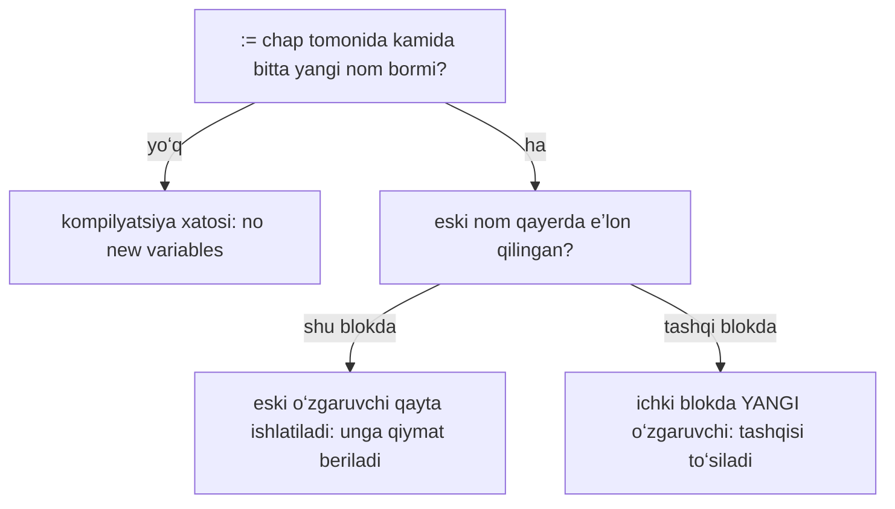

<div lang="uz">

🌐 **Oʻzbekcha** · [Русский](/lab/youtube/go/go-1-06/ru) · [English](/lab/youtube/go/go-1-06/en)  
Dars GO-1.06 · [Go: 0 → Guru](/lab/youtube/go#go-1-06) · ▶️ video tez orada · 💻 [GitHub](https://github.com/abdurahmon27/go-backend-uz/tree/main/lessons/006-functions)

> Bu sahifa videodagi darsning toʻliq yozma shakli: videoni koʻrmasdan (yoki eshitmasdan) ham shu yerdan oʻrganish mumkin.

## Nimani oʻrganasiz

Dasturga «9000-portda ishla» dedik. Dastur ekranga «sozlandi: 9000» deb yozdi. Keyingi qatorda esa
«server ishga tushdi: 8080». Kompilyator jim, Go'ning tekshiruvchi dasturi `go vet` ham jim. Qanday qilib bitta
dasturda bir vaqtning oʻzida ikki xil port boʻladi? Dars oxirida sababini topamiz va uni ushlaydigan vositani
ishlatamiz.

**Bitta gʻoya:** Go'da funksiya bir nechta qiymat qaytaradi va oʻzi ham qiymat. Har safar «bu qaysi
oʻzgaruvchi?» deb soʻrang: closure oʻzgaruvchining nusxasini emas, oʻzini ushlaydi, ichki blokdagi `:=` esa yangi
oʻzgaruvchi yaratadi.

Dars oxirida siz:

- natija va xatoni birga qaytaradigan funksiya yoza va uni chaqira olasiz;
- funksiyani boshqa funksiyaga bera olasiz va closure nimani ushlab qolishini aytib bera olasiz;
- variadic funksiya yozasiz va `slice...` bilan berilgan slice nega oʻzgarib ketishini bilasiz;
- `:=` shadowing xatosini oʻqiysiz, uni `shadow` tekshiruvchisi bilan topasiz va tuzatasiz.

Bugungi uchta asosiy yangi soʻz:

| Soʻz | Oddiy maʼnosi | Inglizcha |
|---|---|---|
| closure | tashqaridagi oʻzgaruvchini «choʻntagida» olib yuradigan funksiya | closure |
| variadic funksiya | istalgan sonli argument oladigan funksiya: `...int` | variadic function |
| shadowing (toʻsish) | ichki blokdagi yangi oʻzgaruvchi tashqaridagi bir xil nomli oʻzgaruvchini toʻsib qoʻyadi | shadowing |

Yoʻl-yoʻlakay ikkita yordamchi soʻz ham uchraydi: **xato qiymati** (`error`: «nima buzildi» degan matnni olib
yuradigan qiymat, `nil` esa «xato yoʻq») va **nomsiz funksiya** (nom berilmagan, joyida yozilgan funksiya).
Ikkalasini kerak boʻlgan joyda tushuntiramiz.

## Oldin bilish kerak

- [GO-0.01 · Dastur nima?](/lab/youtube/go/go-0-01): `func main`, `fmt.Println`, jingalak qavslar `{ }` ichidagi guruh.
- [GO-0.02 · Oʻzgaruvchi — qiymatga yopishtirilgan yorliq](/lab/youtube/go/go-0-02): `:=` yangi oʻzgaruvchi yaratadi, `=`
  qiymat beradi; `undefined`, `no new variables` va `declared and not used` xatolari.
- [GO-0.03 · Son va matn](/lab/youtube/go/go-0-03): `int` va `string`, `strconv.Itoa` sonni matnga aylantiradi.
- [GO-0.04 · if: dastur qaror qabul qiladi](/lab/youtube/go/go-0-04): `if`, `==`, `!=` («teng emasmi?»).
- [GO-1.05 · Go'da while yoʻq: bitta for](/lab/youtube/go/go-1-05): `for` va `range`, slice (`[]int{…}`), `append`, `var`,
  `go.mod` dagi `go` qatori, Go 1.22 dan beri har iteratsiyada yangi sikl oʻzgaruvchisi, `go vet`.
- Kichik dasturlarni [go.dev/play](https://go.dev/play) ga koʻchirib, **Run** bilan ishga tushirish mumkin. Lekin
  `PORT=9000` bilan ishlaydigan dasturlar, `eski/` papkasi (oʻz `go.mod` fayli bor) va `shadow` tekshiruvchisi
  uchun kurs papkasi kerak.
- Kurs kodini yuklab olgan boʻlsangiz, terminalni dars papkasida (`lessons/006-functions`) oching: quyidagi
  buyruqlar oʻsha yerdan ishlaydi. `go run ./ikki` — `ikki` papkasidagi dasturni ishga tushiradi.

Avval oldingi darsni eslaymiz. Bu kod `narxlar` slice'ini oʻzgartiradimi?

```go
narxlar := []int{100, 200, 300}
for _, n := range narxlar {
	n *= 2
}
```

<details>
<summary>Javob</summary>

**Yoʻq.** `range` har qadamda elementning **nusxasini** `n` ga yozadi. Biz nusxani ikki barobar qildik, slice'dagi
asl qiymatlar `[100 200 300]` boʻlib qoldi. Elementni oʻzgartirish uchun indeks kerak: `narxlar[i] *= 2`. Bugun
«nusxami yoki oʻzimi?» degan savol yana uch marta chiqadi.

</details>

## Jumboq: PORT=9000, server esa 8080 da

Server — boshqa kompyuterlardan soʻrov kutadigan dastur. **Port** — serverning «eshik raqami»: soʻrov aynan shu
raqamli eshikka keladi. Bizning dastur haqiqiy server ochmaydi, faqat qaysi portda ishga tushishini yozadi.

Portni dastur ichiga yozib qoʻymaymiz, uni tashqaridan, terminaldan beramiz. Buning uchun **muhit oʻzgaruvchisi**
(inglizcha environment variable) bor: buyruq oldidan yozilgan `NOM=qiymat` sozlamasi. `PORT=9000 go run ./port`
deganda `PORT` faqat shu bitta buyruq uchun `9000` boʻladi.

```console
$ PORT=9000 go run ./port
sozlandi: 9000
server ishga tushdi: 8080
```

Birinchi qator 9000 deydi, ikkinchisi 8080. Tekshiruvchi dastur nima deydi?

```console
$ go vet ./port
```

`go vet` hech narsa chiqarmadi: u hech qanday xato topmadi. Kompilyator ham dasturni bemalol tarjima qildi. Bu
xatoni tushunish uchun avval funksiyalarni koʻrib chiqamiz, keyin «Shadowing» boʻlimida aynan shu kodga qaytamiz.

## Funksiya: bir nechta qiymat qaytarish

Bir hisobni dasturning koʻp joyida qilish kerak boʻlsa, uni har safar qayta yozmaymiz. Uni bir marta yozib, nom
beramiz. Bu xuddi nomi bor retsept kartochkasi: unga masalliqlar beriladi, u tayyor taom qaytaradi. Dasturlashda
bu **funksiya** (inglizcha **function**) deyiladi. `main` ham funksiya, faqat uni Go oʻzi chaqiradi.

Retseptga beriladigan masalliqlar **parametr** deyiladi. Chaqirganda berilgan aniq qiymatlar esa **argument**.
Funksiya ishini tugatib, `return` bilan qaytargan qiymat — **qaytgan qiymat**.

Koʻp tillarda funksiya bitta qiymat qaytaradi. Go'da funksiya **bir nechta** qiymat qaytara oladi. Eng koʻp
uchraydigan juftlik: natija va xato. Masalan, 10 ni 0 ga boʻlib boʻlmaydi: funksiya «xato boʻldi» deb aytishi kerak.

Go'da `try` va `catch` yoʻq. Oddiy xatolar **xato qiymati** sifatida qaytadi: uning turi `error`, u odatda
oxirgi oʻrinda turadi. Hammasi joyida boʻlsa, xato oʻrnida `nil` qaytadi. `nil` — «hech narsa yoʻq», yaʼni xato
yoʻq. Go'da `panic` ham bor, lekin u faqat favqulodda holatlar uchun ([GO-1.15](/lab/youtube/go#go-1-15)).

Bu `ikki/main.go`:

```go filename="ikki/main.go" showLineNumbers
package main

import (
	"errors"
	"fmt"
	"strconv"
)

func bolish(a, b int) (int, error) {
	if b == 0 {
		return 0, errors.New("nolga boʻlib boʻlmaydi")
	}
	return a / b, nil
}

func main() {
	q, err := bolish(10, 3)
	fmt.Println(q, err)
	_, err = bolish(1, 0) // birinchi qiymat kerak emas: _
	fmt.Println(err)
	n, err := strconv.Atoi("12a")
	fmt.Println(n, err)
}
```

| Qator | Kod | Nima qiladi |
|---|---|---|
| 3–7 | `import ( … )` | uchta paketni ulaydi: `errors` (xato yasash), `fmt` (ekranga chiqarish), `strconv` (son ↔ matn) |
| 9 | `func bolish(a, b int) (int, error) {` | `bolish` («boʻlish») funksiyasi. Parametrlar: `a` va `b`, ikkalasi `int`. Qavs ichidagi `(int, error)` — ikkita qaytgan qiymatning turlari |
| 10 | `if b == 0 {` | boʻluvchi nolmi? |
| 11 | `return 0, errors.New("…")` | ha boʻlsa, funksiya shu yerda tugaydi va ikki qiymat qaytaradi: `0` va yangi xato. `errors.New` berilgan matn bilan xato qiymati yasaydi |
| 13 | `return a / b, nil` | aks holda boʻlinma va `nil` (xato yoʻq) |
| 17 | `q, err := bolish(10, 3)` | funksiyani chaqiradi (argumentlar 10 va 3); ikki qaytgan qiymat ikki yangi oʻzgaruvchiga tushadi: `q` va `err` |
| 18 | `fmt.Println(q, err)` | ikkalasini chiqaradi |
| 19 | `_, err = bolish(1, 0)` | birinchi qiymat kerak emas: uning oʻrniga `_` (pastki chiziq) yozildi. `err` allaqachon bor, shuning uchun `=` |
| 20 | `fmt.Println(err)` | xatoning matnini chiqaradi |
| 21 | `n, err := strconv.Atoi("12a")` | `strconv.Atoi` matndan son yasaydi va u ham son bilan xato qaytaradi |
| 22 | `fmt.Println(n, err)` | sonni va xatoni chiqaradi |

21-qatorga diqqat qiling. `n` yangi, `err` esa 17-qatorda yaratilgan eski oʻzgaruvchi. Shunga qaramay `:=`
ishladi va `err` ni **qayta ishlatdi**, yangisini yaratmadi. Sababi: `:=` ning chap tomonida kamida bitta yangi
nom (`n`) bor, `err` esa **shu blokda** eʼlon qilingan. Bu qoidaga dars oxirida qaytamiz.

Ishga tushirishdan oldin oʻylab koʻring: birinchi qator nima boʻladi? **A)** `3.3333333333333335 <nil>` ·
**B)** `3 <nil>` · **C)** `3`

<details>
<summary>Javob</summary>

**B: `3 <nil>`.** `a` va `b` — `int`, butun sonlarni boʻlganda kasr qismi tashlanadi: 10 / 3 = 3 (butun boʻlish).
`err` esa `nil`, `Println` uni `<nil>` deb chiqaradi. «A» ni tanlagan boʻlsangiz, kasrli son kutgansiz: buning uchun
`float64` kerak edi. «C» ni tanlagan boʻlsangiz, `Println` ga ikkita qiymat berilganini unutgansiz.

</details>

```console
$ go run ./ikki
3 <nil>
nolga boʻlib boʻlmaydi
0 strconv.Atoi: parsing "12a": invalid syntax
```

| Chaqiruv | 1-qiymat | 2-qiymat (xato) | Ekranga |
|---|---|---|---|
| `bolish(10, 3)` | 3 | `nil` | `3 <nil>` |
| `bolish(1, 0)` | 0 (`_` ga tashlandi) | «nolga boʻlib boʻlmaydi» | faqat xato matni |
| `strconv.Atoi("12a")` | 0 | `parsing "12a": invalid syntax` | `0 strconv.Atoi: …` |

`"12a"` son emas, shuning uchun `Atoi` 0 va xato qaytardi. Xato matni: *parsing "12a": invalid syntax* —
«"12a" ni oʻqishda: notoʻgʻri yozuv». Xatolar bilan toʻliq ishlashni [GO-1.14](/lab/youtube/go/go-1-14) da oʻrganamiz.

## Funksiya ham qiymat

Go'da funksiya son yoki matn kabi **qiymat**. Uni oʻzgaruvchiga yozish, boshqa funksiyaga argument qilib berish va
funksiyadan qaytarish mumkin. Retsept misolida: «har bir mevaga **shu ishni** qil» deb, ishning oʻzini berasiz.

Funksiyaning ham **turi** bor. `func(string) string` — «bitta `string` oladigan va `string` qaytaradigan
funksiya». Bu `qiymat/main.go`:

```go filename="qiymat/main.go" showLineNumbers
package main

import (
	"fmt"
	"strings"
)

func hammasiga(sozlar []string, f func(string) string) []string {
	var natija []string
	for _, s := range sozlar {
		natija = append(natija, f(s))
	}
	return natija
}

func main() {
	sozlar := []string{"olma", "nok", "uzum"}
	fmt.Println(hammasiga(sozlar, strings.ToUpper))

	qavs := func(s string) string { return "[" + s + "]" }
	fmt.Println(hammasiga(sozlar, qavs))
	fmt.Printf("%T\n", qavs)
}
```

| Qator | Kod | Nima qiladi |
|---|---|---|
| 8 | `func hammasiga(sozlar []string, f func(string) string) []string {` | `hammasiga` ikki parametr oladi: `sozlar` (matnlar slice'i) va `f` — **funksiya**, turi `func(string) string`. Oʻzi yangi slice qaytaradi |
| 9 | `var natija []string` | hozircha boʻsh natija slice'i |
| 10 | `for _, s := range sozlar {` | har bir soʻz ustida yuradi |
| 11 | `natija = append(natija, f(s))` | berilgan `f` ni soʻzga qoʻllaydi va javobini `natija` oxiriga qoʻshadi |
| 13 | `return natija` | tayyor slice'ni qaytaradi |
| 17 | `sozlar := []string{"olma", "nok", "uzum"}` | uchta soʻz |
| 18 | `hammasiga(sozlar, strings.ToUpper)` | standart `strings.ToUpper` («katta harfga») funksiyasini **qavssiz** beramiz: chaqirmaymiz, funksiyaning oʻzini beramiz |
| 20 | `qavs := func(s string) string { … }` | **nomsiz funksiya**: `func` dan keyin nom yoʻq, u shu yerda yozildi va `qavs` oʻzgaruvchisiga yozildi. Soʻzni kvadrat qavsga oladi (`+` matnlarni yopishtiradi) |
| 21 | `hammasiga(sozlar, qavs)` | endi oʻz funksiyamizni beramiz |
| 22 | `fmt.Printf("%T\n", qavs)` | `Printf` qolip boʻyicha chiqaradi: `%T` oʻrniga qiymatning **turi** yoziladi, `\n` — yangi qator |

Taxmin qiling: ikkinchi qator qanday boʻladi? **A)** `[olma] [nok] [uzum]` · **B)** `[[olma] [nok] [uzum]]` ·
**C)** `[olma nok uzum]`

<details>
<summary>Javob</summary>

**B.** `qavs` har bir soʻzni qavsga oldi: `[olma]`, `[nok]`, `[uzum]`. `hammasiga` esa slice qaytaradi, `Println`
slice'ni yana kvadrat qavs ichida chiqaradi. Shuning uchun qavs ichida qavs. «A» ni tanlagan boʻlsangiz, slice'ning
oʻz qavslarini unutgansiz. «C» esa hech narsa qilmaydigan funksiya bilan chiqar edi.

</details>

```console
$ go run ./qiymat
[OLMA NOK UZUM]
[[olma] [nok] [uzum]]
func(string) string
```

Oxirgi qatorda tur: `string` oladigan va `string` qaytaradigan funksiya. Shu tur `hammasiga` ning parametrlar
roʻyxatida turibdi. Shuning uchun `hammasiga` ga aynan shunday funksiyani berish mumkin, boshqasini emas.

Backend'da bu har kuni uchraydi. Masalan, Go'ning web-serveri `net/http` dagi `http.HandleFunc` ikkinchi argument
sifatida funksiya oladi: `func(ResponseWriter, *Request)`. Server soʻrov kelganda aynan shu funksiyani chaqiradi.

## Closure: oʻzgaruvchini ushlab qoladigan funksiya

Nomsiz funksiya oʻzi yozilgan joydagi oʻzgaruvchilarni ishlata oladi. Sanagichni tasavvur qiling: har bosilganda
bittaga oshadi va oldingi sonni eslab turadi. Bu `hisob/main.go`:

```go filename="hisob/main.go" showLineNumbers
package main

import "fmt"

func hisoblagich() func() int {
	n := 0
	return func() int {
		n++ // tashqi n'ni oʻzgartiradi
		return n
	}
}

func main() {
	a := hisoblagich()
	b := hisoblagich()
	fmt.Println(a(), a(), a())
	fmt.Println(b())
}
```

| Qator | Kod | Nima qiladi |
|---|---|---|
| 5 | `func hisoblagich() func() int {` | `hisoblagich` parametr olmaydi. U **funksiya qaytaradi**: turi `func() int` (hech narsa olmaydi, `int` qaytaradi) |
| 6 | `n := 0` | `hisoblagich` ning ichidagi `n` |
| 7 | `return func() int {` | nomsiz funksiyani qaytaradi |
| 8 | `n++` | tashqaridagi `n` ni bittaga oshiradi |
| 9 | `return n` | yangi qiymatni qaytaradi |
| 14–15 | `a := hisoblagich()`, `b := hisoblagich()` | ikki marta chaqiramiz: `a` va `b` — qaytgan ikki funksiya |
| 16 | `fmt.Println(a(), a(), a())` | `a` ni uch marta chaqiradi |
| 17 | `fmt.Println(b())` | `b` ni bir marta chaqiradi |

Gʻalati joyi bor: 7-qatorda `return` boʻldi, `hisoblagich` tugadi. `n` esa uning ichida edi. Qaytgan funksiya
`n++` qilganda qaysi `n` ni oshiradi? Tashqaridagi oʻzgaruvchini ishlatadigan va uni oʻzi bilan olib yuradigan
funksiya **closure** deyiladi. Uni choʻntagida `n` olib yurgan funksiya deb tasavvur qiling.

Taxmin qiling: `b()` nima qaytaradi? **A)** `4` · **B)** `1` · **C)** `0`

<details>
<summary>Javob</summary>

**B: `1`.** `hisoblagich` ning **har chaqiruvida yangi `n`** yaratiladi. `a` oʻz `n` ini 1, 2, 3 gacha oshirdi.
`b` esa boshqa `n` ni ushlab turibdi, u hali 0 edi, `b()` uni 1 qildi. «A» ni tanlagan boʻlsangiz, `a` va `b` bitta
`n` ni ishlatadi deb oʻylagansiz. «C» emas: `n++` qaytarishdan **oldin** bajariladi.

</details>

```console
$ go run ./hisob
1 2 3
1
```

| Chaqiruv | `a` ning `n` i | `b` ning `n` i | Qaytdi |
|---|---|---|---|
| `a := hisoblagich()` | 0 | — | |
| `b := hisoblagich()` | 0 | 0 | |
| `a()` | 1 | 0 | 1 |
| `a()` | 2 | 0 | 2 |
| `a()` | 3 | 0 | 3 |
| `b()` | 3 | 1 | 1 |

`n` esa `hisoblagich` tugagandan keyin ham yashaydi. Go'ning rasmiy qoidalariga (spetsifikatsiyaga) koʻra, closure
ishlatgan oʻzgaruvchilar *"survive as long as they are accessible"* — «ularga murojaat qilish mumkin ekan,
yashab turadi». Ular xotirada qayerda saqlanishini (stek yoki heap) [GO-1.11](/lab/youtube/go/go-1-11) da ochamiz.

## Pauza: closure nusxanimi, oʻzinimi ushlaydi?

Bu savolni javobni ochmasdan oʻylab koʻring. `x` 1 edi, closure yaratildi, keyin `x` 5 ga oʻzgardi:

```go
	x := 1
	f := func() int { return x * 10 }
	x = 5
	fmt.Println(f())
```

`fmt.Println(f())` nima chiqaradi? **A)** `10` · **B)** `50` · **C)** kompilyatsiya xatosi

<details>
<summary>Javob</summary>

**B: `50`.** Closure qiymatning **nusxasini emas**, oʻzgaruvchining **oʻzini** ushlaydi. Spetsifikatsiya aytadi:
bu oʻzgaruvchilar *"shared between the surrounding function and the function literal"* — «tashqi funksiya va
closure orasida umumiy». `f` chaqirilgan paytda `x` da 5 turibdi, 5 × 10 = 50. «A» ni tanlagan boʻlsangiz, closure
yaratilgan paytdagi 1 ni yodlab oldi deb oʻylagansiz. Bu darsdagi eng muhim tuzoq shu.

</details>

Bu `pauza/main.go`:

```go filename="pauza/main.go" showLineNumbers
package main

import "fmt"

func main() {
	x := 1
	f := func() int { return x * 10 }
	x = 5
	fmt.Println(f())
}
```

```console
$ go run ./pauza
50
```

```text
qator 6:  x [ 1 ]
qator 7:  f ──────► x [ 1 ]     f nusxa olmaydi, x ning oʻziga qaraydi
qator 8:  f ──────► x [ 5 ]     x = 5: katakdagi qiymat almashdi
qator 9:  f() = x * 10 = 5 * 10 = 50
```

## Sikldagi closure: Go 1.22 qoidasi yana

Shu sababli [GO-1.05](/lab/youtube/go/go-1-05) dagi sikl tuzogʻi closure bilan ham chiqar edi. Bu `sikl/main.go`:

```go filename="sikl/main.go" showLineNumbers
package main

import "fmt"

func main() {
	var ishlar []func()
	for i := 0; i < 3; i++ {
		ishlar = append(ishlar, func() { fmt.Print(i, " ") })
	}
	for _, ish := range ishlar {
		ish()
	}
	fmt.Println()
}
```

| Qator | Kod | Nima qiladi |
|---|---|---|
| 6 | `var ishlar []func()` | `ishlar` («ishlar») — funksiyalar slice'i; har biri hech narsa olmaydi va hech narsa qaytarmaydi |
| 7–9 | `for i := 0; i < 3; i++ { … }` | uch marta `i` ni chiqaradigan closure yasab, slice'ga qoʻshadi. Hozircha **chaqirmaydi** |
| 10–12 | `for _, ish := range ishlar { ish() }` | sikl tugagandan keyin har bir closure'ni chaqiradi |
| 13 | `fmt.Println()` | yangi qatorga oʻtadi |

Har bir closure `i` ning qiymatini emas, `i` oʻzgaruvchisining oʻzini ushlaydi. Demak, natija har iteratsiyada
nechta `i` borligiga bogʻliq. Bizning kurs modulida (`go.mod`: `go 1.26`) nima chiqadi? **A)** `0 1 2` ·
**B)** `3 3 3` · **C)** `2 2 2`

<details>
<summary>Javob</summary>

**A: `0 1 2`.** Go 1.22 dan beri sikl oʻzi eʼlon qilgan `i` har iteratsiyada **yangi**. Uch closure uch xil `i`
ni ushladi: 0, 1, 2. «B» eski qoidada chiqadi (pastda koʻramiz). «C» chiqmaydi: sikl `i` 3 boʻlganda toʻxtaydi.

</details>

```console
$ go run ./sikl
0 1 2 
```

`eski/` papkasida xuddi shu kod, lekin uning oʻz `go.mod` fayli bor va unda `go 1.21` yozilgan. `cd eski` — shu
papkaga kirish, `&&` — «muvaffaqiyatli boʻlsa, keyingisini bajar»:

```console
$ cd eski && go run .
3 3 3 
```

`go` qatori 1.22 dan past boʻlgan modulda butun sikl uchun **bitta** `i` bor. Uchala closure oʻsha bitta `i` ni
koʻradi, sikl tugaganda esa unda 3 turibdi.

| Modul | Nechta `i` | Closure'lar nimani koʻradi | Ekranga |
|---|---|---|---|
| `go 1.26` (kurs) | uchta: `i₀`, `i₁`, `i₂` | har biri oʻz `i` ini | `0 1 2` |
| `go 1.21` (`eski/`) | bitta | hammasi bitta `i` ni, oxirida 3 | `3 3 3` |

`go vet` ikkala holatda ham jim:

```console
$ go vet ./sikl
```

```console
$ cd eski && go vet .
```

Ikkala buyruq ham hech narsa chiqarmadi. Kodni eski modulga koʻchirsangiz, xato qaytadi.

## Variadic funksiya: istalgan sonli argument

`fmt.Println` ga bitta qiymat ham, uchta qiymat ham berasiz. Buni qanday qiladi? Uning parametri `a ...any`:
parametr turi oldidagi **uch nuqta** «istalgan sonli argument» degani. Bunday funksiya **variadic funksiya**
(inglizcha **variadic function**) deyiladi. Funksiya ichida bu parametr oddiy slice: `...int` → `[]int`.

Misol: server javob vaqtlari (millisekundlarda) berilgan, oʻrtadagisini — medianani — topamiz. Bu
`mediana/main.go`:

```go filename="mediana/main.go" showLineNumbers
package main

import (
	"fmt"
	"slices"
)

// mediana (soddalashtirilgan: toq sonli, boʻsh emas)
func mediana(vaqtlar ...int) int { // vaqtlar: []int
	slices.Sort(vaqtlar) // parametrni joyida saralaydi
	return vaqtlar[len(vaqtlar)/2]
}

func main() {
	fmt.Println(mediana(90, 10, 50))
	kechikish := []int{90, 10, 50}
	fmt.Println(mediana(kechikish...))
	fmt.Println(kechikish)
}
```

| Qator | Kod | Nima qiladi |
|---|---|---|
| 8 | `// mediana (…)` | izoh: soddalashtirilgan mediana, faqat toq sonli va boʻsh boʻlmagan roʻyxat uchun |
| 9 | `func mediana(vaqtlar ...int) int {` | variadic parametr `vaqtlar` («vaqtlar»). Ichkarida u `[]int` |
| 10 | `slices.Sort(vaqtlar)` | `slices` paketidagi `Sort` slice'ni kichigidan kattasiga **joyida** saralaydi: yangi slice yasamaydi |
| 11 | `return vaqtlar[len(vaqtlar)/2]` | `len` — elementlar soni (3); 3 / 2 = 1; 1-indeksdagi, yaʼni oʻrtadagi element |
| 15 | `mediana(90, 10, 50)` | uchta alohida son: Go ular uchun **yangi** slice yasaydi |
| 16 | `kechikish := []int{90, 10, 50}` | tayyor slice; `kechikish` — «kechikish» |
| 17 | `mediana(kechikish...)` | tayyor slice'ni uch nuqta bilan beramiz: «buni elementlarga ajratib ber» |
| 18 | `fmt.Println(kechikish)` | `kechikish` ni oxirida chiqaramiz |

Taxmin qiling: oxirgi qator nima boʻladi? **A)** `[90 10 50]` · **B)** `[10 50 90]` · **C)** `[50]`

<details>
<summary>Javob</summary>

**B: `[10 50 90]`.** Uch nuqta bilan berilganda **yangi slice yaratilmaydi**: `vaqtlar` va `kechikish` bitta
qiymatlar qatoriga qaraydi. `slices.Sort` uni saraladi, shuning uchun chaqiruvchining slice'i ham saralanib qoldi.
«A» ni tanlagan boʻlsangiz, funksiya slice'ning nusxasi bilan ishlaydi deb oʻylagansiz. «C» emas: `mediana`
slice'ni qisqartirmaydi, faqat bitta elementni qaytaradi.

</details>

```console
$ go run ./mediana
50
50
[10 50 90]
```

Ikkala mediana ham 50. Lekin oxirgi qatorga qarang: `kechikish` endi saralangan, uning tartibi buzildi.

```text
mediana(90, 10, 50):   vaqtlar ──► [ 90 | 10 | 50 ]  yangi qator, Sort'dan keyin hech kim koʻrmaydi

mediana(kechikish...): kechikish ──┐
                                   ├──► [ 90 | 10 | 50 ]  ──Sort──►  [ 10 | 50 | 90 ]
                       vaqtlar   ──┘    bitta qator, ikkala nom ham oʻzgarishni koʻradi
```

Go'da hamma argument nusxalanadi. Lekin slice'ning ichida qiymatlarning oʻzi emas, ular turgan qatorga
(massivga, inglizcha array) havola bor. Slice'ning nusxasi ham oʻsha massivga qaraydi. Slice ichida aniq nima
borligini [GO-1.08](/lab/youtube/go/go-1-08) da koʻramiz.

Funksiya esa qanday chaqirilganini bilmaydi: `mediana(90, 10, 50)` dan ham, `mediana(kechikish...)` dan ham
ichkarida bir xil `[]int` koʻradi. Shuning uchun qoida: **variadic parametrni oʻzgartirmang**. Kerak boʻlsa,
avval nusxa oling (pastda, «Koʻp uchraydigan xatolar» da). `...` eng koʻp `append(a, b...)` da uchraydi: bir
slice'ning hamma elementlarini boshqasining oxiriga qoʻshish.

## Shadowing: PORT=9000, server esa 8080 da

Endi boshidagi jumboq. Nega port 9000 deb berilsa ham, server 8080 da ishga tushadi? Bu `port/main.go`:

```go filename="port/main.go" showLineNumbers
package main

import (
	"fmt"
	"os"
	"strconv"
)

func main() {
	port := 8080
	if s := os.Getenv("PORT"); s != "" {
		port, err := strconv.Atoi(s)
		if err != nil {
			fmt.Println("xato:", err)
			return
		}
		fmt.Println("sozlandi:", port)
	}
	fmt.Println("server ishga tushdi:", port)
}
```

| Qator | Kod | Nima qiladi |
|---|---|---|
| 10 | `port := 8080` | standart port: 8080 |
| 11 | `if s := os.Getenv("PORT"); s != "" {` | `if` ning ikki qismi. Avval `s := os.Getenv("PORT")`: `os.Getenv` `PORT` muhit oʻzgaruvchisini matn sifatida oʻqiydi (berilmagan boʻlsa, boʻsh matn `""`). Nuqtali vergul `;` dan keyin savol: `s` boʻsh emasmi? Bunday yaratilgan `s` faqat shu `if` ichida yashaydi |
| 12 | `port, err := strconv.Atoi(s)` | matnni songa aylantiradi. **Xato shu yerda** |
| 13–16 | `if err != nil { … return }` | aylantirib boʻlmasa, xatoni chiqaradi va `main` dan chiqadi (`return`) |
| 17 | `fmt.Println("sozlandi:", port)` | `port` ni chiqaradi |
| 19 | `fmt.Println("server ishga tushdi:", port)` | `if` dan keyin `port` ni yana chiqaradi |

12-qatordagi `:=` tashqi `port` ni yangilamaydi. U `if` guruhi (Go hujjatida **blok**) ichida **yangi** `port`
yaratadi. Ichki blokdagi yangi oʻzgaruvchi tashqaridagi bir xil nomli oʻzgaruvchini toʻsib qoʻyadi: blok ichida
`port` deganda endi faqat ichkisi koʻrinadi. Bu **shadowing** (oʻzbekcha «toʻsish», «soya qilish») deyiladi.

Eshik tashqarisida va ichkarisida ikki xil «Aziz» turibdi deb tasavvur qiling. Xonaga kirib «Aziz!» deb
chaqirsangiz, ichkaridagisi javob beradi. Xonadan chiqsangiz, tashqaridagisi oʻsha joyida, unga hech kim tegmagan.

| Qator | Tashqi `port` | Ichki `port` | `err` | Ekranga |
|---|---|---|---|---|
| 10 | 8080 | — | — | |
| 11 | 8080 | — | — | (`s` = `"9000"`) |
| 12 | 8080 | **9000** (yangi) | `nil` (yangi) | |
| 17 | 8080 | 9000 | `nil` | `sozlandi: 9000` |
| 18 `}` | 8080 | yoʻqoldi | yoʻqoldi | |
| 19 | 8080 | — | — | `server ishga tushdi: 8080` |

```text
main bloki:     port [ 8080 ]  ◄── 19-qator shuni koʻradi
  if bloki:     s [ "9000" ]   port [ 9000 ]   err [ nil ]
                               ▲ yangi port: tashqisini toʻsadi, } da yoʻqoladi
```

### Nega dasturchi bu yerda `:=` yozgan?

Chunki `err` yangi: undan oldin hech qayerda eʼlon qilinmagan. Oddiy `=` yozsak nima boʻladi? Bu `tengxato/main.go`
(**ataylab xato**), 12-qatordagi `:=` oʻrniga `=` yozilgan (izoh qatori qoʻshilgani uchun u bu faylda 13-qatorda):

```go filename="tengxato/main.go" showLineNumbers
package main

import (
	"fmt"
	"os"
	"strconv"
)

// ataylab xato: := oʻrniga = yozsak, err if ichida eʼlon qilinmagan
func main() {
	port := 8080
	if s := os.Getenv("PORT"); s != "" {
		port, err = strconv.Atoi(s)
		if err != nil {
			fmt.Println("xato:", err)
			return
		}
	}
	fmt.Println("server ishga tushdi:", port)
}
```

Taxmin qiling: **A)** ishlaydi va 9000 ni chiqaradi · **B)** kompilyatsiya xatosi · **C)** ishlaydi, lekin 8080

<details>
<summary>Javob</summary>

**B.** `=` faqat **bor** oʻzgaruvchiga qiymat beradi. `port` bor, `err` esa yoʻq: Go uni tanimaydi. «A» toʻgʻri
boʻlar edi, agar `err` oldindan eʼlon qilinganida (tuzatish boʻlimida koʻramiz).

</details>

```console
$ go run ./tengxato
# github.com/abdurahmon27/go-backend-uz/lessons/006-functions/tengxato
tengxato/main.go:13:9: undefined: err
tengxato/main.go:14:6: undefined: err
tengxato/main.go:15:25: undefined: err
```

Birinchi qator — paketning toʻliq nomi. Keyin `tengxato/main.go`, 13-qator, 9-belgi: *undefined: err* —
«`err` aniqlanmagan». `err` ishlatilgan uchala joy uchun bittadan xabar. Demak, xato bitta belgida
(`:`) edi, lekin uni bitta belgini oʻchirib tuzatib boʻlmaydi.

### Kompilyator nega jim?

Shadowing Go'da **ruxsat etilgan**: ichki blokda tashqi nom bilan yangi oʻzgaruvchi yaratish xato emas. Kompilyator
faqat ishlatilmagan oʻzgaruvchini ushlaydi. `port/main.go` da ichki `port` 17-qatorda ekranga chiqarilgan, yaʼni
ishlatilgan. Oʻsha qatorni oʻchirsak-chi? Bu `ishlatilmagan/main.go` (**ataylab xato**):

```go filename="ishlatilmagan/main.go" showLineNumbers
package main

import (
	"fmt"
	"os"
	"strconv"
)

// ataylab xato: ichki port ishlatilmasa, Go buni xato deydi
func main() {
	port := 8080
	if s := os.Getenv("PORT"); s != "" {
		port, err := strconv.Atoi(s)
		if err != nil {
			fmt.Println("xato:", err)
			return
		}
	}
	fmt.Println("server ishga tushdi:", port)
}
```

Taxmin qiling: **A)** ishlaydi, `server ishga tushdi: 8080` · **B)** kompilyatsiya xatosi

<details>
<summary>Javob</summary>

**B.** Ichki `port` yaratildi, lekin hech qayerda ishlatilmadi. [GO-0.02](/lab/youtube/go/go-0-02) dagidek, Go ishlatilmagan
oʻzgaruvchini xato deydi. 19-qatordagi `port` esa tashqi `port`: u ichkisini «ishlatmaydi».

</details>

```console
$ go run ./ishlatilmagan
# github.com/abdurahmon27/go-backend-uz/lessons/006-functions/ishlatilmagan
ishlatilmagan/main.go:13:3: declared and not used: port
```

13-qator, 3-belgi: *declared and not used: port* — «`port` eʼlon qilingan, lekin ishlatilmagan». Bu xabar
yangi `port` borligini oshkor qildi. Asl dasturda esa ichki `port` ishlatilgan, shuning uchun kompilyator jim.

### `:=` qoidasi

Go spetsifikatsiyasidagi qoida:



`ikki/main.go` ning 21-qatorida `err` **shu blokda** edi: u qayta ishlatildi. `port/main.go` ning 12-qatorida esa
`port` **tashqi blokda** edi: yangisi yaratildi. Shuning uchun ichki blokda qiymat va xato qaytaradigan chaqiruv
boʻlsa, bu xato juda oson chiqadi.

### Temporal, 2021

Bu nazariy xato emas. 2021-yilda Temporal kompaniyasi oʻz blogida «yillar davomidagi birinchi maʼlumot yoʻqotish
xatosi» haqida yozdi. Ularning yozishicha, sabab maʼlumot saqlash kodidagi aynan shu shadowing edi. Soddalashtirilgan
rasm:

```text
var err error                        ← tashqi err
if request.IsNewBranch {
    blob, err := …                   ← := : YANGI, ichki err
    …
    err = h.session.ExecuteBatch(…)  ← bazaga yozish xatosi ICHKI err ga tushdi
}
if err != nil { … }                  ← tashqi err hali nil: tekshiruv oʻtib ketdi
                                       chaqiruvchiga «muvaffaqiyat» javobi qaytdi
```

Ular kodni qayta tuzib tuzatdi. Keyingi choralar roʻyxatiga esa (testlardan keyin) shadowing'ni topadigan
linter'ni ham kiritdi. **Linter** — kodni oʻqib, shubhali joylarni koʻrsatadigan tekshiruvchi dastur.

### Xatoni topish: `shadow`

`go vet` da shadowing tekshiruvi yoʻq. Uning manba kodidagi izohda shunday yozilgan: `shadow.Analyzer omitted: too
noisy` — «shadow tekshiruvi qoʻshilmadi: juda shovqinli», yaʼni u xato boʻlmagan joylarni ham koʻp koʻrsatadi. Go
jamoasining `shadow` tekshiruvchisi esa alohida bor. Uni oʻrnatamiz:

```console
$ GOPROXY=file://$(go env GOMODCACHE)/cache/download GOSUMDB=off go install golang.org/x/tools/go/analysis/passes/shadow/cmd/shadow@v0.53.0
```

`go install` dasturni yuklab, tarjima qiladi va `$(go env GOPATH)/bin/` papkasiga qoʻyadi; muvaffaqiyatli boʻlsa,
hech narsa chiqarmaydi. Boshidagi `GOPROXY=… GOSUMDB=off` qismi internetsiz, kompyuterdagi keshdan oʻrnatish uchun.
Internetingiz boʻlsa, ularsiz yozing: `go install golang.org/x/tools/go/analysis/passes/shadow/cmd/shadow@v0.53.0`.
Bu versiya Go 1.26 ni talab qiladi.

Endi uni `go vet` orqali ishlatamiz: `-vettool=` «oʻz tekshiruvlaring oʻrniga shu dasturni ishlat» degani.
`shadow` qaysi qatorni koʻrsatadi? **A)** 10 · **B)** 12 · **C)** 19

<details>
<summary>Javob</summary>

**B: 12-qator**, chunki yangi `port` aynan shu yerda eʼlon qilingan. U 10-qatordagi tashqi `port` ni toʻsadi.
19-qator esa tashqi `port` ni toʻgʻri ishlatyapti.

</details>

```console
$ go vet -vettool=$(go env GOPATH)/bin/shadow ./port
port/main.go:12:3: declaration of "port" shadows declaration at line 10
```

*declaration of "port" shadows declaration at line 10* — «`port` ning (12-qatordagi) eʼloni 10-qatordagi eʼlonni
toʻsadi». Bu tekshiruv sukut boʻyicha yoqilmagan: uning hujjatida yozilishicha, u hali juda koʻp notoʻgʻri
ogohlantirish beradi. VS Code'da Go kengaytmasi (gopls) sozlamalarida `shadow` ni yoqish mumkin.

### Tuzatish

Natijani yangi nomga olamiz (`p`), tashqi `port` ga esa oddiy `=` bilan yozamiz. Bu `portfix/main.go`:

```go filename="portfix/main.go" showLineNumbers
package main

import (
	"fmt"
	"os"
	"strconv"
)

func main() {
	port := 8080
	if s := os.Getenv("PORT"); s != "" {
		p, err := strconv.Atoi(s) // yangi nom
		if err != nil {
			fmt.Println("xato:", err)
			return
		}
		port = p // = : tashqi oʻzgaruvchiga yozamiz
		fmt.Println("sozlandi:", port)
	}
	fmt.Println("server ishga tushdi:", port)
}
```

- **12-qator:** `p, err := …` — `p` va `err` ikkalasi yangi, bu toʻgʻri: ular faqat `if` ichida kerak. `port` nomi
  endi bu qatorda yoʻq, demak u toʻsilmaydi.
- **17-qator:** `port = p` — `=` yangi oʻzgaruvchi yaratmaydi, u **tashqi** `port` ga qiymat beradi.

Taxmin qiling: **A)** `sozlandi: 9000`, `server ishga tushdi: 8080` · **B)** ikkala qatorda ham 9000

<details>
<summary>Javob</summary>

**B.** Endi blok ichida bitta `port` bor — tashqisi. 17-qator unga 9000 ni yozdi, `}` dan keyin ham u 9000.

</details>

```console
$ PORT=9000 go run ./portfix
sozlandi: 9000
server ishga tushdi: 9000
```

Ikkinchi yoʻl ham bor: `if` ichida avval `var err error` deb `err` ni eʼlon qilish, keyin
`port, err = strconv.Atoi(s)` deb oddiy `=` yozish. Xato bitta belgida edi, lekin uni bitta belgi bilan tuzatib
boʻlmadi: buni `tengxato` da koʻrdik. Bunday xatoni linter yoki yaxshi test ushlaydi. Test yozishni keyingi darsda,
[GO-1.07](/lab/youtube/go/go-1-07) da boshlaymiz.

## Chuqurroq (ixtiyoriy): `n` qayerda yashaydi va nomlangan qaytgan qiymatlar

Bu boʻlim videoda yoʻq, u kurs papkasidagi README'dan. Asosiy darsga kerak emas.

**`n` qayerda yashaydi?** Spetsifikatsiya faqat «ularga murojaat qilish mumkin ekan, yashaydi» deydi. Qayerda
saqlashni kompilyator oʻzi hal qiladi (escape analysis, [GO-1.11](/lab/youtube/go/go-1-11)). `-gcflags='-m -l'` kompilyatorga
«qarorlaringni yoz, funksiyalarni `main` ichiga koʻchirma (inline qilma)» deydi. `| grep heap | head -2` esa
chiqishdan `heap` soʻzi bor dastlabki ikki qatorni qoldiradi:

```console
$ go build -o /dev/null -gcflags='-m -l' ./hisob 2>&1 | grep heap | head -2
hisob/main.go:6:2: moved to heap: n
hisob/main.go:7:9: func literal escapes to heap
```

*moved to heap: n* — «`n` heap'ga koʻchirildi», yaʼni funksiya tugagandan keyin ham yashaydigan xotira qismiga.
Lekin `-l` siz, oddiy `-gcflags=-m` da kompilyator `hisoblagich` ni `main` ichiga koʻchiradi va u yerda closure
qochmaydi (README: `func literal does not escape`). Shuning uchun «closure = doim heap» degan qoida yoʻq.

**Nomlangan qaytgan qiymatlar.** Qaytgan qiymatlarga nom berish mumkin: `func bolish(a, b int) (q int, err error)`.
Unda boʻsh `return` shu nomlardagi qiymatlarni qaytaradi. Qisqa funksiyalarda qulay, uzun funksiyada esa nima
qaytayotganini koʻrish qiyinlashadi. Shadowing bilan birga kompilyator bu yerda yordam beradi. Bu misol kurs
papkasida yoʻq, u alohida ishga tushirildi:

```go
package main

import (
	"fmt"
	"strconv"
)

func portOl(s string) (port int, err error) {
	port = 8080
	if s != "" {
		port, err := strconv.Atoi(s)
		if err != nil {
			return
		}
		fmt.Println("sozlandi:", port)
	}
	return
}

func main() {
	fmt.Println(portOl("9000"))
}
```

```console
$ go run nomli/main.go
# command-line-arguments
nomli/main.go:13:4: result parameter port not in scope at return
	nomli/main.go:11:3: inner declaration of var port int
nomli/main.go:13:4: result parameter err not in scope at return
	nomli/main.go:11:9: inner declaration of var err error
```

*result parameter port not in scope at return* — «`return` joyida `port` qaytgan qiymati koʻrinmaydi», keyingi
qator: *inner declaration of var port int* — «11-qatorda ichki `port` eʼlon qilingan». Boʻsh `return` qaysi
`port` ni qaytarishini bilib boʻlmagani uchun, Go buni taqiqlaydi. Tuzatish asosiy darsdagidek: ichki blokda
`:=` oʻrniga yangi nom yoki `=`.

## Koʻp uchraydigan xatolar

**1. Ichki blokdagi `:=` tashqi oʻzgaruvchini yangilaydi deb oʻylash.** Bu darsning asosiy tuzogʻi, «Shadowing»
boʻlimida `port/main.go` da koʻrdik: dastur xato bermaydi, lekin `if` dan keyin `port` yana 8080. Kompilyator ham,
`go vet` ham jim. **Tuzatish:** ichki blokda natijani yangi nomga oling (`p, err := …`) va tashqi oʻzgaruvchiga
`=` bilan yozing (`port = p`). Shubhali joylarni `shadow` bilan tekshiring.

**2. Ikki qiymatni bitta oʻzgaruvchiga olish.** Bu misol kurs papkasida yoʻq, u alohida ishga tushirildi:

```go
package main

import (
	"errors"
	"fmt"
)

func bolish(a, b int) (int, error) {
	if b == 0 {
		return 0, errors.New("nolga boʻlib boʻlmaydi")
	}
	return a / b, nil
}

func main() {
	q := bolish(10, 3)
	fmt.Println(q)
}
```

```console
$ go run bittaqiymat/main.go
# command-line-arguments
bittaqiymat/main.go:16:7: assignment mismatch: 1 variable but bolish returns 2 values
```

16-qator, 7-belgi: *assignment mismatch: 1 variable but bolish returns 2 values* — «qiymat berishda nomuvofiqlik:
1 ta oʻzgaruvchi, lekin `bolish` 2 ta qiymat qaytaradi». **Tuzatish:** ikkala qiymatni oling: `q, err := bolish(10, 3)`.
Xato kerak boʻlmasa ham, uni ochiq tashlang: `q, _ := bolish(10, 3)`.

**3. Ikki funksiyani solishtirish.** Bu `taqqos/main.go` (**ataylab xato**; kurs papkasida bor, videoda yoʻq):

```go filename="taqqos/main.go" showLineNumbers
package main

import (
	"fmt"
	"strings"
)

// ataylab xato: funksiyalarni faqat nil bilan solishtirish mumkin
func main() {
	f := strings.ToUpper
	g := strings.ToUpper
	fmt.Println(f == g)
}
```

```console
$ go run ./taqqos
# github.com/abdurahmon27/go-backend-uz/lessons/006-functions/taqqos
taqqos/main.go:12:14: invalid operation: f == g (func can only be compared to nil)
```

12-qator, 14-belgi: *invalid operation: f == g (func can only be compared to nil)* — «notoʻgʻri amal: funksiyani
faqat `nil` bilan solishtirish mumkin». Funksiya qiymat, lekin `==` bilan taqqoslanmaydigan qiymat.
**Tuzatish:** funksiyalarni solishtirmang. `f != nil` («funksiya berilganmi?») esa ishlaydi.

**4. Closure qiymatning nusxasini oladi deb oʻylash.** «Pauza» boʻlimida koʻrdik: `x = 5` dan keyin `f()` 10 emas,
50 qaytardi. Closure oʻzgaruvchining oʻzini ushlaydi. **Tuzatish:** closure yaratilgan paytdagi qiymat kerak
boʻlsa, uni alohida oʻzgaruvchiga oling (`boshlangich := x`) va closure ichida oʻshani ishlating.

**5. Variadic parametrni oʻzgartirish.** «Variadic funksiya» boʻlimida `mediana(kechikish...)` chaqiruvchining
slice'ini saralab yubordi. **Tuzatish:** funksiya ichida avval nusxa oling: `slices.Clone` yangi massivli yangi
slice qaytaradi. Bu misol kurs papkasida yoʻq, u alohida ishga tushirildi:

```go
package main

import (
	"fmt"
	"slices"
)

func mediana(vaqtlar ...int) int {
	v := slices.Clone(vaqtlar) // oʻz nusxamiz
	slices.Sort(v)
	return v[len(v)/2]
}

func main() {
	kechikish := []int{90, 10, 50}
	fmt.Println(mediana(kechikish...))
	fmt.Println(kechikish)
}
```

```console
$ go run nusxaol/main.go
50
[90 10 50]
```

Mediana yana 50, `kechikish` esa endi oʻz tartibida qoldi.

## Oʻzingizni tekshiring

Avval oʻzingiz javob bering, keyin oching.

**1.** Go'da oddiy xato qanday qaytariladi va hammasi joyida boʻlsa, xato oʻrnida nima turadi?

<details>
<summary>Javob</summary>

Xato oddiy qiymat sifatida qaytadi: funksiya natija bilan birga `error` turidagi qiymat qaytaradi, odatda oxirgi
oʻrinda. Hammasi joyida boʻlsa, u `nil`. `try`/`catch` yoʻq; `panic` faqat favqulodda holatlar uchun.

</details>

**2.** Bu kod nima chiqaradi? **A)** `3` · **B)** `11` · **C)** `12`

```go
package main

import "fmt"

func main() {
	x := 2
	f := func() int { return x + 1 }
	x = 10
	fmt.Println(f())
}
```

<details>
<summary>Javob</summary>

**B: `11`.** Closure `x` ning oʻzini ushlaydi. `f` chaqirilgan paytda `x` da 10 turibdi: 10 + 1 = 11. «A» ni
tanlagan boʻlsangiz, closure `x` ning nusxasini oldi deb oʻylagansiz.

```console
$ go run savol1/main.go
11
```

</details>

**3.** Bu dastur nima chiqaradi?

```go
package main

import "fmt"

func nolla(s ...int) {
	s[0] = 0
}

func main() {
	a := []int{7, 8}
	nolla(a...)
	fmt.Println(a)
	b, c := 7, 8
	nolla(b, c)
	fmt.Println(b, c)
}
```

<details>
<summary>Javob</summary>

Birinchi qator `[0 8]`, ikkinchisi `7 8`. `nolla(a...)` da yangi slice yaratilmaydi: `s` va `a` bitta massivga
qaraydi, `s[0] = 0` `a` ni ham oʻzgartiradi. `nolla(b, c)` da esa Go yangi slice yasaydi va unga `b` va `c` ning
nusxalarini yozadi: `b` ga hech kim tegmaydi.

```console
$ go run savol2/main.go
[0 8]
7 8
```

</details>

**4.** `ikki/main.go` ning 21-qatorida `n, err := strconv.Atoi("12a")` yozilgan, `err` esa 17-qatorda yaratilgan.
21-qator yangi `err` yaratadimi? Agar bu qator `if` ichida boʻlsa-chi?

<details>
<summary>Javob</summary>

21-qator yangi `err` yaratmaydi: `err` **shu blokda** eʼlon qilingan, `:=` uni qayta ishlatadi (yangi nom `n`
boʻlgani uchun `:=` ruxsat etilgan). `if` ichida esa `err` tashqi blokda boʻlib qoladi, `:=` ichkarida **yangi**
`err` yaratadi va tashqisini toʻsadi.

</details>

**5.** `port/main.go` da xato bor, lekin kompilyator nega uni aytmadi?

<details>
<summary>Javob</summary>

Shadowing Go'da ruxsat etilgan. Kompilyator faqat ishlatilmagan oʻzgaruvchini ushlaydi, ichki `port` esa
`fmt.Println("sozlandi:", port)` da ishlatilgan. Bu xatoni `shadow` tekshiruvchisi topadi, `go vet` esa yoʻq.

</details>

**6.** [GO-1.05](/lab/youtube/go/go-1-05) dan: `switch` ichidagi `break` `for` siklini toʻxtatadimi?

<details>
<summary>Javob</summary>

Yoʻq. `break` eng ichki `for`, `switch` yoki `select` dan chiqadi, bu yerda — `switch` dan. Sikldan chiqish uchun
label kerak: `break qidiruv`.

</details>

(2 va 3-savollardagi dasturlar kurs papkasida yoʻq: ular alohida ishga tushirildi.)

## Uy vazifasi

Toʻrt darajadagi vazifa. Hamma fayllar va javoblar GitHub'dagi dars papkasida:
[lessons/006-functions](https://github.com/abdurahmon27/go-backend-uz/tree/main/lessons/006-functions).
Javoblar: [homework/](https://github.com/abdurahmon27/go-backend-uz/tree/main/lessons/006-functions/homework)
papkasi. Avval oʻzingiz urinib koʻring.

🟢 **Oson:** slice'dagi eng kichik va eng katta sonni xato bilan birga bitta funksiyadan qaytaring (boʻsh slice'da
xato).

<details>
<summary>Javob</summary>

`homework/oson/main.go`. `minMax(sonlar []int) (int, int, error)` — uchta qaytgan qiymat. Boʻsh slice'da
(`len(sonlar) == 0`) `0, 0` va `errors.New("boʻsh slice")` qaytadi. Aks holda birinchi elementdan boshlab, qolganlari
(`sonlar[1:]` — 1-indeksdan oxirigacha) ustida yuriladi. `min` va `max` — Go 1.21 dan beri tilning oʻzidagi
funksiyalar. `fmt.Println(minMax(…))`: bir nechta qiymat qaytaradigan chaqiruvni toʻgʻridan-toʻgʻri boshqa funksiyaga
berish mumkin.

```console
$ go run ./homework/oson
-3 12 <nil>
0 0 boʻsh slice
```

</details>

🟡 **Oʻrta:** istalgan sonli soʻzni ajratgich bilan bitta qatorga qoʻshadigan variadic funksiya yozing.

<details>
<summary>Javob</summary>

`homework/orta/main.go`. `birlashtir(ajratgich string, sozlar ...string)`: variadic parametr doim **oxirgi**
boʻladi. `strings.Builder` matnni boʻlakma-boʻlak yigʻadi; birinchi soʻzdan oldin ajratgich qoʻyilmaydi (`i > 0`).
Argumentsiz chaqiruvda `sozlar` boʻsh, natija boʻsh matn (`%q` uni qoʻshtirnoq ichida `""` deb chiqaradi). Standart
kutubxonada tayyori bor: `strings.Join`.

```console
$ go run ./homework/orta
olma, nok, uzum
""
anor + behi
anor + behi
```

</details>

🟠 **Qiyin:** `logla(nom, next)`: boshqa funksiyani oʻrab, har chaqiruvni sanab yozadigan funksiya qaytaring.
Bu backend'dagi middleware'ning (har soʻrov atrofida ishlaydigan oraliq qatlamning) kichik nusxasi.

<details>
<summary>Javob</summary>

`homework/qiyin/main.go`. `type ishlovchi func(string) string` funksiya turiga qisqa nom beradi. `logla` funksiya
oladi va uni oʻraydigan **yangi funksiya qaytaradi**: funksiya qiymat, closure va qaytgan funksiya bir joyda.
Closure `nom`, `next` va `n` ni ushlab qoladi, har `logla` chaqiruvida yangi `n`. `%s`, `%d`, `%q` — matn, son va
qoʻshtirnoqli matn uchun qolip joylari. Ikki qavat ham mumkin: `logla("tashqi", logla("ichki", salom))`.

```console
$ go run ./homework/qiyin
[salom #1] "Aziz" → "Salom, Aziz"
[salom #2] "Nodira" → "Salom, Nodira"
[ichki #1] "Gʻayrat" → "Salom, Gʻayrat"
[tashqi #1] "Gʻayrat" → "Salom, Gʻayrat"
```

HTTP middleware'lar aynan shunday quriladi: `func(next http.Handler) http.Handler`.

</details>

🔴 **Guru:** `homework/guru/xato/main.go` — Temporal xatosining soddalashtirilgan shakli. `saqla()` xato qaytarishi
kerak, lekin `nil` qaytaradi. Tuzating, `shadow` ham jim boʻlsin.

<details>
<summary>Javob</summary>

Avval xatoni koʻramiz:

```console
$ go run ./homework/guru/xato
saqla: <nil>
```

```console
$ go vet -vettool=$(go env GOPATH)/bin/shadow ./homework/guru/xato
homework/guru/xato/main.go:17:9: declaration of "err" shadows declaration at line 15
```

`blob, err := kodla(…)` `if` ichida **yangi** `err` yaratadi, keyingi `err = yoz(blob)` esa aynan shu ichki `err`
ga yozadi. Tashqi `err` `nil` boʻlib qoladi. Javob: `homework/guru/main.go`. Ichki blokda `:=` ishlatilmaydi:
`var blob string`, keyin `blob, err = kodla(…)`.

```console
$ go run ./homework/guru
saqla: baza: yozib boʻlmadi
```

```console
$ go vet -vettool=$(go env GOPATH)/bin/shadow ./homework/guru
```

`shadow` endi hech narsa chiqarmadi.

</details>

## Manbalar

- Go'ning rasmiy qoidalari (Go spec): [Function types](https://go.dev/ref/spec#Function_types),
  [Function literals](https://go.dev/ref/spec#Function_literals),
  [Return statements](https://go.dev/ref/spec#Return_statements),
  [Blank identifier](https://go.dev/ref/spec#Blank_identifier),
  [Passing arguments to ... parameters](https://go.dev/ref/spec#Passing_arguments_to_..._parameters),
  [Short variable declarations](https://go.dev/ref/spec#Short_variable_declarations),
  [Declarations and scope](https://go.dev/ref/spec#Declarations_and_scope),
  [Comparison operators](https://go.dev/ref/spec#Comparison_operators),
  [For statements](https://go.dev/ref/spec#For_statements)
- [Go FAQ: Why does Go not have exceptions?](https://go.dev/doc/faq#exceptions),
  [Go FAQ: When are function parameters passed by value?](https://go.dev/doc/faq#pass_by_value)
- [Effective Go: Multiple return values](https://go.dev/doc/effective_go#multiple-returns),
  [Go Code Review Comments: Named Result Parameters](https://go.dev/wiki/CodeReviewComments#named-result-parameters)
- [strconv.Atoi](https://pkg.go.dev/strconv#Atoi), [net/http.HandleFunc](https://pkg.go.dev/net/http#HandleFunc),
  [fmt.Println](https://pkg.go.dev/fmt#Println), [os.Getenv](https://pkg.go.dev/os#Getenv),
  [slices](https://pkg.go.dev/slices) (`Sort`, `Clone`)
- [Go blog: Fixing For Loops in Go 1.22](https://go.dev/blog/loopvar-preview)
- [cmd/vet/main.go: "shadow.Analyzer omitted: too noisy"](https://github.com/golang/go/blob/go1.26.8/src/cmd/vet/main.go#L84),
  [`shadow` tekshiruvchisi](https://pkg.go.dev/golang.org/x/tools/go/analysis/passes/shadow) (golang.org/x/tools v0.53.0)
- Ryland Goldstein, [How Go shadowing and bad choices caused our first data loss bug in years](https://temporal.io/blog/go-shadowing-bad-choices)
  (Temporal, 2021-03-03)
- [golang/go#377: proposal: spec: various changes to :=](https://github.com/golang/go/issues/377) (2009-yildan beri ochiq)
- Teiva Harsanyi, [100 Go Mistakes #1: Unintended variable shadowing](https://100go.co/#unintended-variable-shadowing-1)
- Hamma natijalar `go1.26.8 linux/amd64` da, 2026-11-26 kuni olingan.

## Video va kod

▶️ Video tez orada chiqadi. Bu sahifa darsni toʻliq oʻrgatadi, videoni kutish shart emas.

💻 [Kod va uy vazifasi javoblari GitHub'da](https://github.com/abdurahmon27/go-backend-uz/tree/main/lessons/006-functions)

---

← Oldingi dars: [GO-1.05](/lab/youtube/go/go-1-05) · Keyingi dars: [GO-1.07](/lab/youtube/go/go-1-07) → · [Barcha darslar](/lab/youtube/go)

</div>
