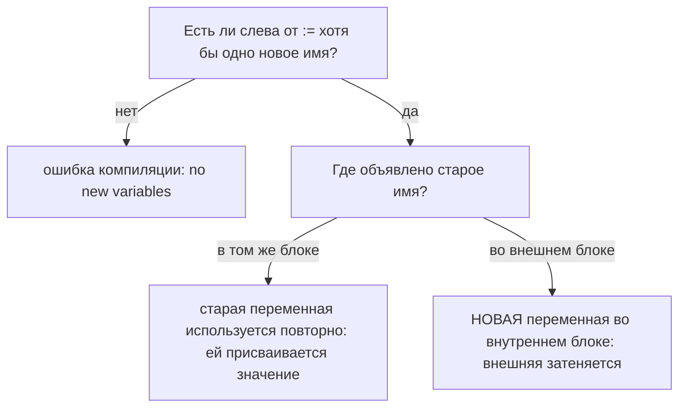

<div lang="ru">

🌐 [Oʻzbekcha](/lab/youtube/go/go-1-06) · **Русский** · [English](/lab/youtube/go/go-1-06/en)  
Урок GO-1.06 · [Go: 0 → Guru](/lab/youtube/go#go-1-06) · ▶️ видео скоро · 💻 [GitHub](https://github.com/abdurahmon27/go-backend-uz/tree/main/lessons/006-functions)

> Это полная письменная версия видеоурока: по ней можно учиться, не смотря (и не слушая) видео. Само видео на узбекском языке.

## Что вы узнаете

Мы сказали программе: «работай на порту 9000». Программа вывела «sozlandi: 9000» («настроено: 9000»). А следующая
строка: «server ishga tushdi: 8080» («сервер запущен: 8080»). Компилятор молчит, анализатор кода Go `go vet` тоже
молчит. Как в одной программе одновременно оказалось два разных порта? В конце урока мы найдём причину и
воспользуемся инструментом, который её ловит.

**Одна идея:** в Go функция возвращает несколько значений и сама является значением. Всегда спрашивайте «какая это
переменная?»: замыкание держит саму переменную, а не её копию, а `:=` во внутреннем блоке создаёт новую переменную.

К концу урока вы сможете:

- написать функцию, которая возвращает результат вместе с ошибкой, и вызвать её;
- передать функцию в другую функцию и объяснить, что именно удерживает замыкание;
- написать вариативную функцию и понять, почему слайс, переданный как `slice...`, меняется;
- прочитать ошибку затенения через `:=`, найти её анализатором `shadow` и исправить.

Три главных новых слова сегодня:

| Слово | Простой смысл | Термин |
|---|---|---|
| замыкание | функция, которая носит внешнюю переменную «в кармане» | closure |
| вариативная функция | функция, которая принимает любое число аргументов: `...int` | variadic function |
| затенение | новая переменная во внутреннем блоке закрывает внешнюю переменную с тем же именем | shadowing |

По дороге встретятся ещё два вспомогательных слова: **значение ошибки** (`error`: значение, которое несёт текст «что
сломалось»; `nil` означает «ошибки нет») и **анонимная функция** (функция без имени, написанная прямо на месте). Оба
объясним там, где они понадобятся.

## Что нужно знать заранее

- [GO-0.01 · Что такое программа?](/lab/youtube/go/go-0-01/ru): `func main`, `fmt.Println`, группа внутри фигурных скобок `{ }`.
- [GO-0.02 · Переменная — ярлык, приклеенный к значению](/lab/youtube/go/go-0-02/ru): `:=` создаёт новую переменную, `=`
  присваивает значение; ошибки `undefined`, `no new variables` и `declared and not used`.
- [GO-0.03 · Число и текст](/lab/youtube/go/go-0-03/ru): `int` и `string`; `strconv.Itoa` преобразует число в строку.
- [GO-0.04 · if: программа принимает решение](/lab/youtube/go/go-0-04/ru): `if`, `==`, `!=` («не равно ли?»).
- [GO-1.05 · В Go нет while: один for](/lab/youtube/go/go-1-05/ru): `for` и `range`, слайс (`[]int{…}`), `append`, `var`,
  строка `go` в `go.mod`, новая переменная цикла на каждой итерации начиная с Go 1.22, `go vet`.
- Небольшие программы можно скопировать на [go.dev/play](https://go.dev/play) и запустить кнопкой **Run**. Но для
  программ с `PORT=9000`, для папки `eski/` (у неё свой файл `go.mod`) и для анализатора `shadow` нужна папка курса.
- Если вы скачали код курса, откройте терминал в папке урока (`lessons/006-functions`): команды ниже запускаются
  оттуда. `go run ./ikki` запускает программу из папки `ikki`.

Сначала вспомним прошлый урок. Меняет ли этот код слайс `narxlar` («цены»)?

```go
narxlar := []int{100, 200, 300}
for _, n := range narxlar {
	n *= 2
}
```

<details>
<summary>Ответ</summary>

**Нет.** На каждом шаге `range` записывает в `n` **копию** элемента. Мы удвоили копию, а исходные значения в слайсе
остались `[100 200 300]`. Чтобы изменить элемент, нужен индекс: `narxlar[i] *= 2`. Сегодня вопрос «копия или сама
вещь?» встретится ещё три раза.

</details>

## Загадка: PORT=9000, а сервер на 8080

Сервер — это программа, которая ждёт запросов от других компьютеров. **Порт** — «номер двери» сервера: запрос
приходит именно в дверь с этим номером. Наша программа не открывает настоящий сервер, она только пишет, на каком
порту запустилась бы.

Порт мы не вписываем в программу, а передаём снаружи, из терминала. Для этого есть **переменная окружения**
(environment variable): настройка `ИМЯ=значение`, написанная перед командой. В `PORT=9000 go run ./port`
переменная `PORT` равна `9000` только для этой одной команды.

```console
$ PORT=9000 go run ./port
sozlandi: 9000
server ishga tushdi: 8080
```

Первая строка говорит 9000, вторая — 8080. Что скажет анализатор кода?

```console
$ go vet ./port
```

`go vet` ничего не вывел: он не нашёл проблем. Компилятор тоже спокойно перевёл программу. Чтобы понять эту ошибку,
сначала разберём функции, а затем в разделе «Затенение» вернёмся именно к этому коду.

## Функция: возврат нескольких значений

Когда одно и то же вычисление нужно во многих местах программы, мы не пишем его каждый раз заново. Пишем один раз и
даём имя. Это как карточка рецепта с названием: ей дают ингредиенты, она возвращает готовое блюдо. В
программировании это называется **функция** (function). `main` — тоже функция, только её вызывает сам Go.

Ингредиенты, которые принимает рецепт, называются **параметрами**. Конкретные значения, переданные при вызове, —
**аргументами**. Значение, которое функция отдаёт через `return`, закончив работу, — **возвращаемое значение**.

Во многих языках функция возвращает одно значение. В Go функция может вернуть **несколько** значений. Самая частая
пара — результат и ошибка. Например, 10 нельзя делить на 0: функция должна сообщить «что-то пошло не так».

В Go нет `try` и `catch`. Обычные ошибки возвращаются как **значение ошибки**: его тип `error`, и обычно оно стоит
на последнем месте. Если всё в порядке, на месте ошибки возвращается `nil`. `nil` — «ничего», то есть ошибки нет. В
Go есть и `panic`, но только для действительно исключительных ситуаций ([GO-1.15](/lab/youtube/go/go-1-15/ru)).

Это `ikki/main.go` (*ikki* — «два»):

```go filename="ikki/main.go" showLineNumbers
package main

import (
	"errors"
	"fmt"
	"strconv"
)

func bolish(a, b int) (int, error) {
	if b == 0 {
		return 0, errors.New("nolga boʻlib boʻlmaydi")
	}
	return a / b, nil
}

func main() {
	q, err := bolish(10, 3)
	fmt.Println(q, err)
	_, err = bolish(1, 0) // birinchi qiymat kerak emas: _
	fmt.Println(err)
	n, err := strconv.Atoi("12a")
	fmt.Println(n, err)
}
```

| Строка | Код | Что делает |
|---|---|---|
| 3–7 | `import ( … )` | подключает три пакета: `errors` (создавать ошибки), `fmt` (вывод), `strconv` (число ↔ строка) |
| 9 | `func bolish(a, b int) (int, error) {` | функция `bolish` («деление»). Параметры: `a` и `b`, оба `int`. `(int, error)` в скобках — типы двух возвращаемых значений |
| 10 | `if b == 0 {` | делитель равен нулю? |
| 11 | `return 0, errors.New("…")` | если да, функция заканчивается здесь и возвращает два значения: `0` и новую ошибку. `errors.New` создаёт значение ошибки с заданным текстом («на ноль делить нельзя») |
| 13 | `return a / b, nil` | иначе частное и `nil` (ошибки нет) |
| 17 | `q, err := bolish(10, 3)` | вызывает функцию (аргументы 10 и 3); два возвращаемых значения попадают в две новые переменные, `q` и `err` |
| 18 | `fmt.Println(q, err)` | выводит оба |
| 19 | `_, err = bolish(1, 0)` | первое значение не нужно: на его месте стоит `_` (подчёркивание). `err` уже есть, поэтому `=` (комментарий: «первое значение не нужно») |
| 20 | `fmt.Println(err)` | выводит текст ошибки |
| 21 | `n, err := strconv.Atoi("12a")` | `strconv.Atoi` делает из строки число и тоже возвращает число и ошибку |
| 22 | `fmt.Println(n, err)` | выводит число и ошибку |

Обратите внимание на строку 21. `n` новая, а `err` — старая переменная, созданная в строке 17. Тем не менее `:=`
сработал и **повторно использовал** `err`, новую не создал. Причина: слева от `:=` есть хотя бы одно новое имя
(`n`), а `err` объявлена **в том же блоке**. К этому правилу мы вернёмся в конце урока.

Подумайте до запуска: какой будет первая строка? **A)** `3.3333333333333335 <nil>` · **B)** `3 <nil>` · **C)** `3`

<details>
<summary>Ответ</summary>

**B: `3 <nil>`.** `a` и `b` — `int`; при делении целых чисел дробная часть отбрасывается: 10 / 3 = 3 (целочисленное
деление). `err` равна `nil`, и `Println` выводит её как `<nil>`. Если вы выбрали «A», вы ждали дробное число: для
этого нужен `float64`. Если «C» — вы забыли, что `Println` получил два значения.

</details>

```console
$ go run ./ikki
3 <nil>
nolga boʻlib boʻlmaydi
0 strconv.Atoi: parsing "12a": invalid syntax
```

| Вызов | 1-е значение | 2-е значение (ошибка) | Вывод |
|---|---|---|---|
| `bolish(10, 3)` | 3 | `nil` | `3 <nil>` |
| `bolish(1, 0)` | 0 (выброшено через `_`) | «nolga boʻlib boʻlmaydi» | только текст ошибки |
| `strconv.Atoi("12a")` | 0 | `parsing "12a": invalid syntax` | `0 strconv.Atoi: …` |

`"12a"` — не число, поэтому `Atoi` вернул 0 и ошибку. Текст ошибки *parsing "12a": invalid syntax* означает «при
разборе "12a": неверная запись». Полноценной работе с ошибками посвящён [GO-1.14](/lab/youtube/go/go-1-14/ru).

## Функция — тоже значение

В Go функция — такое же **значение**, как число или строка. Её можно записать в переменную, передать другой функции
как аргумент и вернуть из функции. В картинке с рецептом: вы говорите «сделай **вот это** с каждым фруктом» и
передаёте само действие.

У функции тоже есть **тип**. `func(string) string` — «функция, которая принимает одну `string` и возвращает
`string`». Это `qiymat/main.go` (*qiymat* — «значение»):

```go filename="qiymat/main.go" showLineNumbers
package main

import (
	"fmt"
	"strings"
)

func hammasiga(sozlar []string, f func(string) string) []string {
	var natija []string
	for _, s := range sozlar {
		natija = append(natija, f(s))
	}
	return natija
}

func main() {
	sozlar := []string{"olma", "nok", "uzum"}
	fmt.Println(hammasiga(sozlar, strings.ToUpper))

	qavs := func(s string) string { return "[" + s + "]" }
	fmt.Println(hammasiga(sozlar, qavs))
	fmt.Printf("%T\n", qavs)
}
```

| Строка | Код | Что делает |
|---|---|---|
| 8 | `func hammasiga(sozlar []string, f func(string) string) []string {` | `hammasiga` («ко всем») принимает два параметра: `sozlar` («слова», слайс строк) и `f` — **функцию** типа `func(string) string`. Возвращает новый слайс |
| 9 | `var natija []string` | слайс результата (`natija`), пока пустой |
| 10 | `for _, s := range sozlar {` | проходит по каждому слову |
| 11 | `natija = append(natija, f(s))` | применяет переданную `f` к слову и добавляет её ответ в конец `natija` |
| 13 | `return natija` | возвращает готовый слайс |
| 17 | `sozlar := []string{"olma", "nok", "uzum"}` | три слова: яблоко, груша, виноград |
| 18 | `hammasiga(sozlar, strings.ToUpper)` | передаём стандартную функцию `strings.ToUpper` («в верхний регистр») **без скобок**: мы её не вызываем, а передаём саму функцию |
| 20 | `qavs := func(s string) string { … }` | **анонимная функция**: после `func` нет имени, она написана прямо здесь и записана в переменную `qavs` («скобка»). Берёт слово в квадратные скобки (`+` склеивает строки) |
| 21 | `hammasiga(sozlar, qavs)` | теперь передаём свою функцию |
| 22 | `fmt.Printf("%T\n", qavs)` | `Printf` выводит по шаблону: вместо `%T` подставляется **тип** значения, `\n` — новая строка |

Угадайте: какой будет вторая строка? **A)** `[olma] [nok] [uzum]` · **B)** `[[olma] [nok] [uzum]]` ·
**C)** `[olma nok uzum]`

<details>
<summary>Ответ</summary>

**B.** `qavs` взяла каждое слово в скобки: `[olma]`, `[nok]`, `[uzum]`. А `hammasiga` возвращает слайс, и
`Println` выводит слайс снова в квадратных скобках. Получаются скобки внутри скобок. Если вы выбрали «A», вы
забыли о собственных скобках слайса. «C» получилось бы с функцией, которая ничего не делает.

</details>

```console
$ go run ./qiymat
[OLMA NOK UZUM]
[[olma] [nok] [uzum]]
func(string) string
```

В последней строке — тип: функция, которая принимает `string` и возвращает `string`. Этот тип стоит в списке
параметров `hammasiga`. Поэтому в `hammasiga` можно передать именно такую функцию, и никакую другую.

В бэкенде это встречается каждый день. Например, `http.HandleFunc` из веб-серверного пакета Go `net/http`
принимает вторым аргументом функцию: `func(ResponseWriter, *Request)`. Когда приходит запрос, сервер вызывает
именно её.

## Замыкание: функция, которая удерживает переменную

Анонимная функция может пользоваться переменными того места, где она написана. Представьте ручной счётчик: каждое
нажатие прибавляет единицу, а предыдущее число он помнит. Это `hisob/main.go` (*hisob* — «счёт»):

```go filename="hisob/main.go" showLineNumbers
package main

import "fmt"

func hisoblagich() func() int {
	n := 0
	return func() int {
		n++ // tashqi n'ni oʻzgartiradi
		return n
	}
}

func main() {
	a := hisoblagich()
	b := hisoblagich()
	fmt.Println(a(), a(), a())
	fmt.Println(b())
}
```

| Строка | Код | Что делает |
|---|---|---|
| 5 | `func hisoblagich() func() int {` | `hisoblagich` («счётчик») не принимает параметров. Она **возвращает функцию** типа `func() int` (ничего не принимает, возвращает `int`) |
| 6 | `n := 0` | `n` внутри `hisoblagich` |
| 7 | `return func() int {` | возвращает анонимную функцию |
| 8 | `n++` | увеличивает внешнюю `n` на единицу (комментарий: «меняет внешнюю n») |
| 9 | `return n` | возвращает новое значение |
| 14–15 | `a := hisoblagich()`, `b := hisoblagich()` | вызываем дважды: `a` и `b` — две возвращённые функции |
| 16 | `fmt.Println(a(), a(), a())` | вызывает `a` три раза |
| 17 | `fmt.Println(b())` | вызывает `b` один раз |

Здесь есть странность: в строке 7 был `return`, и `hisoblagich` закончилась. А `n` была у неё внутри. Когда
возвращённая функция делает `n++`, какую `n` она увеличивает? Функция, которая пользуется внешней переменной и
носит её с собой, называется **замыканием** (closure). Представьте её как функцию, у которой `n` лежит в кармане.

Угадайте: что вернёт `b()`? **A)** `4` · **B)** `1` · **C)** `0`

<details>
<summary>Ответ</summary>

**B: `1`.** **При каждом вызове `hisoblagich` создаётся новая `n`**. `a` увеличила свою `n` до 1, 2, 3. `b`
держит другую `n`: она была ещё 0, и `b()` сделала её 1. Если вы выбрали «A», вы думали, что у `a` и `b` одна общая
`n`. Не «C»: `n++` выполняется **до** возврата.

</details>

```console
$ go run ./hisob
1 2 3
1
```

| Вызов | `n` у `a` | `n` у `b` | Вернулось |
|---|---|---|---|
| `a := hisoblagich()` | 0 | — | |
| `b := hisoblagich()` | 0 | 0 | |
| `a()` | 1 | 0 | 1 |
| `a()` | 2 | 0 | 2 |
| `a()` | 3 | 0 | 3 |
| `b()` | 3 | 1 | 1 |

А `n` продолжает жить и после того, как `hisoblagich` завершилась. По официальным правилам Go (спецификации)
переменные, которыми пользуется замыкание, *"survive as long as they are accessible"* — «живут, пока к ним можно
обратиться». Где именно в памяти они хранятся (стек или куча), разберём в [GO-1.11](/lab/youtube/go/go-1-11/ru).

## Пауза: замыкание держит копию или саму переменную?

Подумайте над вопросом, не открывая ответ. `x` был 1, создали замыкание, потом `x` стал 5:

```go
	x := 1
	f := func() int { return x * 10 }
	x = 5
	fmt.Println(f())
```

Что выведет `fmt.Println(f())`? **A)** `10` · **B)** `50` · **C)** ошибка компиляции

<details>
<summary>Ответ</summary>

**B: `50`.** Замыкание держит **саму переменную**, **а не копию** значения. Спецификация говорит, что эти переменные
*"shared between the surrounding function and the function literal"* — «общие для внешней функции и замыкания».
Когда вызывается `f`, в `x` лежит 5, и 5 × 10 = 50. Если вы выбрали «A», вы думали, что замыкание запомнило 1,
которую видело при создании. Это самая важная ловушка урока.

</details>

Это `pauza/main.go`:

```go filename="pauza/main.go" showLineNumbers
package main

import "fmt"

func main() {
	x := 1
	f := func() int { return x * 10 }
	x = 5
	fmt.Println(f())
}
```

```console
$ go run ./pauza
50
```

```text
строка 6:  x [ 1 ]
строка 7:  f ──────► x [ 1 ]     f не делает копию, она смотрит на саму x
строка 8:  f ──────► x [ 5 ]     x = 5: значение в ячейке заменилось
строка 9:  f() = x * 10 = 5 * 10 = 50
```

## Замыкание в цикле: снова правило Go 1.22

Поэтому ловушка с циклом из [GO-1.05](/lab/youtube/go/go-1-05/ru) проявилась бы и с замыканиями. Это `sikl/main.go`
(*sikl* — «цикл»):

```go filename="sikl/main.go" showLineNumbers
package main

import "fmt"

func main() {
	var ishlar []func()
	for i := 0; i < 3; i++ {
		ishlar = append(ishlar, func() { fmt.Print(i, " ") })
	}
	for _, ish := range ishlar {
		ish()
	}
	fmt.Println()
}
```

| Строка | Код | Что делает |
|---|---|---|
| 6 | `var ishlar []func()` | `ishlar` («задачи») — слайс функций; каждая ничего не принимает и ничего не возвращает |
| 7–9 | `for i := 0; i < 3; i++ { … }` | трижды создаёт замыкание, которое выводит `i`, и добавляет его в слайс. Пока **не вызывает** |
| 10–12 | `for _, ish := range ishlar { ish() }` | после окончания цикла вызывает каждое замыкание |
| 13 | `fmt.Println()` | переходит на новую строку |

Каждое замыкание держит саму переменную `i`, а не её значение. Значит, результат зависит от того, сколько
переменных `i` существует на итерациях. Что выведет наш модуль курса (`go.mod`: `go 1.26`)? **A)** `0 1 2` ·
**B)** `3 3 3` · **C)** `2 2 2`

<details>
<summary>Ответ</summary>

**A: `0 1 2`.** Начиная с Go 1.22, переменная `i`, объявленная циклом, на каждой итерации **новая**. Три замыкания
удержали три разные `i`: 0, 1, 2. «B» получается по старому правилу (увидим ниже). «C» не бывает: цикл
останавливается, когда `i` равна 3.

</details>

```console
$ go run ./sikl
0 1 2 
```

В папке `eski/` (*eski* — «старый») тот же код, но у неё свой файл `go.mod`, и в нём написано `go 1.21`. `cd eski`
— перейти в эту папку, `&&` — «если получилось, выполни следующее»:

```console
$ cd eski && go run .
3 3 3 
```

В модуле, где строка `go` ниже 1.22, на весь цикл **одна** `i`. Все три замыкания видят эту одну `i`, а к концу
цикла в ней 3.

| Модуль | Сколько `i` | Что видят замыкания | Вывод |
|---|---|---|---|
| `go 1.26` (курс) | три: `i₀`, `i₁`, `i₂` | каждое свою `i` | `0 1 2` |
| `go 1.21` (`eski/`) | одна | все одну и ту же `i`, в конце 3 | `3 3 3` |

`go vet` молчит в обоих случаях:

```console
$ go vet ./sikl
```

```console
$ cd eski && go vet .
```

Обе команды ничего не вывели. Если перенести код в старый модуль, ошибка вернётся.

## Вариативная функция: любое число аргументов

В `fmt.Println` вы передаёте и одно значение, и три. Как он это делает? Его параметр — `a ...any`: **три точки**
перед типом параметра означают «любое число аргументов». Такая функция называется **вариативной** (variadic
function). Внутри функции этот параметр — обычный слайс: `...int` → `[]int`.

Пример: даны времена ответа сервера (в миллисекундах), найдём среднее по порядку — медиану. Это `mediana/main.go`:

```go filename="mediana/main.go" showLineNumbers
package main

import (
	"fmt"
	"slices"
)

// mediana (soddalashtirilgan: toq sonli, boʻsh emas)
func mediana(vaqtlar ...int) int { // vaqtlar: []int
	slices.Sort(vaqtlar) // parametrni joyida saralaydi
	return vaqtlar[len(vaqtlar)/2]
}

func main() {
	fmt.Println(mediana(90, 10, 50))
	kechikish := []int{90, 10, 50}
	fmt.Println(mediana(kechikish...))
	fmt.Println(kechikish)
}
```

| Строка | Код | Что делает |
|---|---|---|
| 8 | `// mediana (…)` | комментарий: упрощённая медиана, только для непустого списка нечётной длины |
| 9 | `func mediana(vaqtlar ...int) int {` | вариативный параметр `vaqtlar` («времена»). Внутри это `[]int` |
| 10 | `slices.Sort(vaqtlar)` | `Sort` из пакета `slices` сортирует слайс по возрастанию **на месте**: нового слайса не создаёт |
| 11 | `return vaqtlar[len(vaqtlar)/2]` | `len` — число элементов (3); 3 / 2 = 1; элемент с индексом 1, то есть средний |
| 15 | `mediana(90, 10, 50)` | три отдельных числа: Go создаёт для них **новый** слайс |
| 16 | `kechikish := []int{90, 10, 50}` | готовый слайс; `kechikish` — «задержка» |
| 17 | `mediana(kechikish...)` | передаём готовый слайс с тремя точками: «разложи его на элементы» |
| 18 | `fmt.Println(kechikish)` | в конце выводим `kechikish` |

Угадайте: какой будет последняя строка? **A)** `[90 10 50]` · **B)** `[10 50 90]` · **C)** `[50]`

<details>
<summary>Ответ</summary>

**B: `[10 50 90]`.** При передаче с тремя точками **новый слайс не создаётся**: `vaqtlar` и `kechikish` смотрят на
один и тот же ряд значений. `slices.Sort` его отсортировал, поэтому слайс вызывающего тоже оказался отсортирован.
Если вы выбрали «A», вы думали, что функция работает с копией слайса. Не «C»: `mediana` не укорачивает слайс, она
только возвращает один элемент.

</details>

```console
$ go run ./mediana
50
50
[10 50 90]
```

Обе медианы равны 50. Но посмотрите на последнюю строку: `kechikish` теперь отсортирован, его порядок нарушен.

```text
mediana(90, 10, 50):   vaqtlar ──► [ 90 | 10 | 50 ]  новый ряд, после Sort его никто не видит

mediana(kechikish...): kechikish ──┐
                                   ├──► [ 90 | 10 | 50 ]  ──Sort──►  [ 10 | 50 | 90 ]
                       vaqtlar   ──┘    один ряд: оба имени видят изменение
```

В Go каждый аргумент копируется. Но слайс содержит не сами значения, а ссылку на ряд, в котором они лежат
(**массив**, array). Копия слайса ссылается на тот же массив. Что именно лежит внутри слайса, увидим в
[GO-1.08](/lab/youtube/go/go-1-08/ru).

А функция не знает, как её вызвали: и из `mediana(90, 10, 50)`, и из `mediana(kechikish...)` она видит внутри
одинаковый `[]int`. Поэтому правило: **не изменяйте вариативный параметр**. Если нужно, сначала сделайте копию (ниже,
в «Частых ошибках»). Чаще всего `...` встречается в `append(a, b...)`: добавить все элементы одного слайса в конец
другого.

## Затенение: PORT=9000, а сервер на 8080

Теперь загадка из начала. Почему сервер запускается на 8080, хотя порт задан как 9000? Это `port/main.go`:

```go filename="port/main.go" showLineNumbers
package main

import (
	"fmt"
	"os"
	"strconv"
)

func main() {
	port := 8080
	if s := os.Getenv("PORT"); s != "" {
		port, err := strconv.Atoi(s)
		if err != nil {
			fmt.Println("xato:", err)
			return
		}
		fmt.Println("sozlandi:", port)
	}
	fmt.Println("server ishga tushdi:", port)
}
```

| Строка | Код | Что делает |
|---|---|---|
| 10 | `port := 8080` | порт по умолчанию: 8080 |
| 11 | `if s := os.Getenv("PORT"); s != "" {` | `if` из двух частей. Сначала `s := os.Getenv("PORT")`: `os.Getenv` читает переменную окружения `PORT` как строку (если она не задана — пустую строку `""`). После точки с запятой `;` — вопрос: `s` не пустая? Созданная так `s` живёт только внутри этого `if` |
| 12 | `port, err := strconv.Atoi(s)` | преобразует строку в число. **Ошибка здесь** |
| 13–16 | `if err != nil { … return }` | если преобразовать не удалось, выводит ошибку (`xato` — «ошибка») и выходит из `main` (`return`) |
| 17 | `fmt.Println("sozlandi:", port)` | выводит `port` |
| 19 | `fmt.Println("server ishga tushdi:", port)` | после `if` снова выводит `port` |

`:=` в строке 12 не обновляет внешний `port`. Он создаёт **новый** `port` внутри группы `if` (в документации Go —
**блок**). Новая переменная во внутреннем блоке закрывает внешнюю переменную с тем же именем: внутри блока `port`
теперь означает только внутреннюю. Это называется **затенение** (shadowing).

Представьте двух разных людей по имени Азиз: один за дверью снаружи, другой в комнате. Войдя в комнату и позвав
«Азиз!», вы услышите того, кто внутри. Выйдя из комнаты, вы найдёте внешнего на прежнем месте: его никто не трогал.

| Строка | Внешний `port` | Внутренний `port` | `err` | Вывод |
|---|---|---|---|---|
| 10 | 8080 | — | — | |
| 11 | 8080 | — | — | (`s` = `"9000"`) |
| 12 | 8080 | **9000** (новый) | `nil` (новая) | |
| 17 | 8080 | 9000 | `nil` | `sozlandi: 9000` |
| 18 `}` | 8080 | исчез | исчезла | |
| 19 | 8080 | — | — | `server ishga tushdi: 8080` |

```text
блок main:      port [ 8080 ]  ◄── строка 19 видит этот
  блок if:      s [ "9000" ]   port [ 9000 ]   err [ nil ]
                               ▲ новый port: закрывает внешний, исчезает на }
```

### Почему программист написал здесь `:=`?

Потому что `err` новая: раньше она нигде не объявлялась. Что будет, если написать обычное `=`? Это
`tengxato/main.go` (*teng xato* — «ошибка с равно»; **намеренная ошибка**): `:=` из строки 12 заменён на `=` (в
этом файле добавлена строка комментария, поэтому здесь это строка 13):

```go filename="tengxato/main.go" showLineNumbers
package main

import (
	"fmt"
	"os"
	"strconv"
)

// ataylab xato: := oʻrniga = yozsak, err if ichida eʼlon qilinmagan
func main() {
	port := 8080
	if s := os.Getenv("PORT"); s != "" {
		port, err = strconv.Atoi(s)
		if err != nil {
			fmt.Println("xato:", err)
			return
		}
	}
	fmt.Println("server ishga tushdi:", port)
}
```

Угадайте: **A)** запустится и выведет 9000 · **B)** ошибка компиляции · **C)** запустится, но выведет 8080

<details>
<summary>Ответ</summary>

**B.** `=` только присваивает значение **существующей** переменной. `port` существует, а `err` — нет: Go её не
знает. «A» было бы верно, если бы `err` объявили заранее (это увидим в исправлении).

</details>

```console
$ go run ./tengxato
# github.com/abdurahmon27/go-backend-uz/lessons/006-functions/tengxato
tengxato/main.go:13:9: undefined: err
tengxato/main.go:14:6: undefined: err
tengxato/main.go:15:25: undefined: err
```

Первая строка — полное имя пакета. Дальше `tengxato/main.go`, строка 13, символ 9: *undefined: err* — «`err` не
определена». По одному сообщению на каждое из трёх мест, где используется `err`. Значит, ошибка была в одном символе
(`:`), но исправить её, удалив этот один символ, нельзя.

### Почему молчит компилятор?

Затенение в Go **разрешено**: создать во внутреннем блоке новую переменную с внешним именем — не ошибка. Компилятор
ловит только неиспользуемую переменную. В `port/main.go` внутренний `port` выводится в строке 17, то есть
используется. А если удалить эту строку? Это `ishlatilmagan/main.go` (*ishlatilmagan* — «неиспользованный»;
**намеренная ошибка**):

```go filename="ishlatilmagan/main.go" showLineNumbers
package main

import (
	"fmt"
	"os"
	"strconv"
)

// ataylab xato: ichki port ishlatilmasa, Go buni xato deydi
func main() {
	port := 8080
	if s := os.Getenv("PORT"); s != "" {
		port, err := strconv.Atoi(s)
		if err != nil {
			fmt.Println("xato:", err)
			return
		}
	}
	fmt.Println("server ishga tushdi:", port)
}
```

Угадайте: **A)** запустится и выведет `server ishga tushdi: 8080` · **B)** ошибка компиляции

<details>
<summary>Ответ</summary>

**B.** Внутренний `port` создан, но нигде не используется. Как в [GO-0.02](/lab/youtube/go/go-0-02/ru), Go считает
неиспользуемую переменную ошибкой. А `port` в строке 19 — внешний: он внутренний не «использует».

</details>

```console
$ go run ./ishlatilmagan
# github.com/abdurahmon27/go-backend-uz/lessons/006-functions/ishlatilmagan
ishlatilmagan/main.go:13:3: declared and not used: port
```

Строка 13, символ 3: *declared and not used: port* — «`port` объявлена, но не используется». Это сообщение выдало,
что существует новый `port`. В исходной программе внутренний `port` используется, поэтому компилятор молчит.

### Правило `:=`

Правило из спецификации Go:



В строке 21 `ikki/main.go` `err` была **в том же блоке**: её использовали повторно. В строке 12 `port/main.go`
`port` был **во внешнем блоке**: создан новый. Поэтому, если во внутреннем блоке есть вызов, возвращающий значение и
ошибку, эта ошибка появляется очень легко.

### Temporal, 2021

Это не теоретическая ошибка. В 2021 году компания Temporal написала в своём блоге о «первой за много лет ошибке с
потерей данных». По их словам, причиной было именно такое затенение в коде сохранения данных. Упрощённая картинка:

```text
var err error                        ← внешняя err
if request.IsNewBranch {
    blob, err := …                   ← := : НОВАЯ, внутренняя err
    …
    err = h.session.ExecuteBatch(…)  ← ошибка записи в базу попала во ВНУТРЕННЮЮ err
}
if err != nil { … }                  ← внешняя err всё ещё nil: проверка прошла
                                       вызывающий получил ответ «успех»
```

Они исправили ошибку, перестроив код. А в список дальнейших мер (после тестов) включили и линтер, который находит
затенение. **Линтер** — анализатор кода, который читает код и указывает на подозрительные места.

### Как найти ошибку: `shadow`

В `go vet` нет проверки на затенение. В комментарии в его исходном коде написано: `shadow.Analyzer omitted: too
noisy` — «проверка shadow не включена: слишком шумная», то есть она отмечает и много мест, где ошибки нет. Но
анализатор `shadow` от команды Go существует отдельно. Установим его:

```console
$ GOPROXY=file://$(go env GOMODCACHE)/cache/download GOSUMDB=off go install golang.org/x/tools/go/analysis/passes/shadow/cmd/shadow@v0.53.0
```

`go install` скачивает программу, компилирует её и кладёт в папку `$(go env GOPATH)/bin/`; при успехе ничего не
выводит. Часть `GOPROXY=… GOSUMDB=off` в начале нужна для установки без интернета, из кеша на компьютере. Если
интернет есть, пишите без неё: `go install golang.org/x/tools/go/analysis/passes/shadow/cmd/shadow@v0.53.0`. Эта
версия требует Go 1.26.

Теперь запустим его через `go vet`: `-vettool=` означает «вместо своих проверок используй эту программу». На какую
строку укажет `shadow`? **A)** 10 · **B)** 12 · **C)** 19

<details>
<summary>Ответ</summary>

**B: строка 12**, потому что новый `port` объявлен именно там. Он закрывает внешний `port` из строки 10. Строка 19
использует внешний `port` правильно.

</details>

```console
$ go vet -vettool=$(go env GOPATH)/bin/shadow ./port
port/main.go:12:3: declaration of "port" shadows declaration at line 10
```

*declaration of "port" shadows declaration at line 10* — «объявление `port` (в строке 12) затеняет объявление в
строке 10». По умолчанию эта проверка не включена: в её документации сказано, что она пока даёт слишком много ложных
срабатываний. В VS Code `shadow` можно включить в настройках расширения Go (gopls).

### Исправление

Берём результат в новое имя (`p`), а во внешний `port` записываем обычным `=`. Это `portfix/main.go`:

```go filename="portfix/main.go" showLineNumbers
package main

import (
	"fmt"
	"os"
	"strconv"
)

func main() {
	port := 8080
	if s := os.Getenv("PORT"); s != "" {
		p, err := strconv.Atoi(s) // yangi nom
		if err != nil {
			fmt.Println("xato:", err)
			return
		}
		port = p // = : tashqi oʻzgaruvchiga yozamiz
		fmt.Println("sozlandi:", port)
	}
	fmt.Println("server ishga tushdi:", port)
}
```

- **Строка 12:** `p, err := …` — `p` и `err` обе новые, и это правильно: они нужны только внутри `if`. Имени `port`
  в этой строке больше нет, значит, он не затеняется (комментарий: «новое имя»).
- **Строка 17:** `port = p` — `=` не создаёт новую переменную, а присваивает значение **внешнему** `port`
  (комментарий: «записываем во внешнюю переменную»).

Угадайте: **A)** `sozlandi: 9000`, `server ishga tushdi: 8080` · **B)** 9000 в обеих строках

<details>
<summary>Ответ</summary>

**B.** Теперь в блоке только один `port` — внешний. Строка 17 записала в него 9000, и после `}` он по-прежнему 9000.

</details>

```console
$ PORT=9000 go run ./portfix
sozlandi: 9000
server ishga tushdi: 9000
```

Есть и второй способ: внутри `if` сначала объявить `err` через `var err error`, а затем написать
`port, err = strconv.Atoi(s)` с обычным `=`. Ошибка была в одном символе, но исправить её одним символом не
получилось: это мы видели в `tengxato`. Такую ошибку ловит линтер или хороший тест. Писать тесты начнём на следующем
уроке, [GO-1.07](/lab/youtube/go/go-1-07/ru).

## Глубже (необязательно): где живёт `n` и именованные возвращаемые значения

Этого раздела нет в видео, он взят из README в папке курса. Для основного урока он не нужен.

**Где живёт `n`?** Спецификация говорит только «живёт, пока к ней можно обратиться». Где её хранить, решает сам
компилятор (escape analysis, анализ убегания, [GO-1.11](/lab/youtube/go/go-1-11/ru)). `-gcflags='-m -l'` говорит компилятору
«выведи свои решения и не встраивай функции в `main` (не делай inline)». `| grep heap | head -2` оставляет первые две
строки вывода, в которых есть слово `heap`:

```console
$ go build -o /dev/null -gcflags='-m -l' ./hisob 2>&1 | grep heap | head -2
hisob/main.go:6:2: moved to heap: n
hisob/main.go:7:9: func literal escapes to heap
```

*moved to heap: n* — «`n` перенесена в кучу (heap)», то есть в ту часть памяти, которая живёт и после завершения
функции. Но без `-l`, с обычным `-gcflags=-m`, компилятор встраивает `hisoblagich` в `main`, и там замыкание не
убегает (README: `func literal does not escape`). Поэтому правила «замыкание = всегда куча» нет.

**Именованные возвращаемые значения.** Возвращаемым значениям можно дать имена:
`func bolish(a, b int) (q int, err error)`. Тогда пустой `return` возвращает значения под этими именами. В коротких
функциях это удобно, а в длинной трудно увидеть, что возвращается. Вместе с затенением здесь помогает компилятор.
Этого примера нет в папке курса, он запущен отдельно:

```go
package main

import (
	"fmt"
	"strconv"
)

func portOl(s string) (port int, err error) {
	port = 8080
	if s != "" {
		port, err := strconv.Atoi(s)
		if err != nil {
			return
		}
		fmt.Println("sozlandi:", port)
	}
	return
}

func main() {
	fmt.Println(portOl("9000"))
}
```

```console
$ go run nomli/main.go
# command-line-arguments
nomli/main.go:13:4: result parameter port not in scope at return
	nomli/main.go:11:3: inner declaration of var port int
nomli/main.go:13:4: result parameter err not in scope at return
	nomli/main.go:11:9: inner declaration of var err error
```

*result parameter port not in scope at return* — «в месте `return` возвращаемое значение `port` не видно»;
следующая строка, *inner declaration of var port int*, — «в строке 11 объявлен внутренний `port`». Поскольку
непонятно, какой `port` вернул бы пустой `return`, Go это запрещает. Исправление то же, что в основном уроке: во
внутреннем блоке новое имя или `=` вместо `:=`.

## Частые ошибки

**1. Думать, что `:=` во внутреннем блоке обновляет внешнюю переменную.** Это главная ловушка урока, мы видели её в
`port/main.go` в разделе «Затенение»: программа не выдаёт ошибки, но после `if` `port` снова 8080. Компилятор и
`go vet` молчат. **Исправление:** во внутреннем блоке берите результат в новое имя (`p, err := …`) и записывайте во
внешнюю переменную через `=` (`port = p`). Подозрительные места проверяйте `shadow`.

**2. Принимать два значения в одну переменную.** Этого примера нет в папке курса, он запущен отдельно:

```go
package main

import (
	"errors"
	"fmt"
)

func bolish(a, b int) (int, error) {
	if b == 0 {
		return 0, errors.New("nolga boʻlib boʻlmaydi")
	}
	return a / b, nil
}

func main() {
	q := bolish(10, 3)
	fmt.Println(q)
}
```

```console
$ go run bittaqiymat/main.go
# command-line-arguments
bittaqiymat/main.go:16:7: assignment mismatch: 1 variable but bolish returns 2 values
```

Строка 16, символ 7: *assignment mismatch: 1 variable but bolish returns 2 values* — «несоответствие при
присваивании: 1 переменная, а `bolish` возвращает 2 значения». **Исправление:** примите оба значения:
`q, err := bolish(10, 3)`. Даже если ошибка не нужна, выбросьте её явно: `q, _ := bolish(10, 3)`.

**3. Сравнивать две функции.** Это `taqqos/main.go` (*taqqos* — «сравнение»; **намеренная ошибка**; есть в папке
курса, но не в видео):

```go filename="taqqos/main.go" showLineNumbers
package main

import (
	"fmt"
	"strings"
)

// ataylab xato: funksiyalarni faqat nil bilan solishtirish mumkin
func main() {
	f := strings.ToUpper
	g := strings.ToUpper
	fmt.Println(f == g)
}
```

```console
$ go run ./taqqos
# github.com/abdurahmon27/go-backend-uz/lessons/006-functions/taqqos
taqqos/main.go:12:14: invalid operation: f == g (func can only be compared to nil)
```

Строка 12, символ 14: *invalid operation: f == g (func can only be compared to nil)* — «недопустимая операция:
функцию можно сравнивать только с `nil`». Функция — значение, но такое, которое нельзя сравнить через `==`.
**Исправление:** не сравнивайте функции. А `f != nil` («передали ли функцию?») работает.

**4. Думать, что замыкание берёт копию значения.** Мы видели это в разделе «Пауза»: после `x = 5` `f()` вернула 50,
а не 10. Замыкание держит саму переменную. **Исправление:** если нужно значение на момент создания замыкания,
сохраните его в отдельную переменную (`boshlangich := x`, «начальное») и используйте её внутри замыкания.

**5. Изменять вариативный параметр.** В разделе «Вариативная функция» `mediana(kechikish...)` отсортировала слайс
вызывающего. **Исправление:** сначала сделайте копию внутри функции: `slices.Clone` возвращает новый слайс с новым
массивом. Этого примера нет в папке курса, он запущен отдельно:

```go
package main

import (
	"fmt"
	"slices"
)

func mediana(vaqtlar ...int) int {
	v := slices.Clone(vaqtlar) // oʻz nusxamiz
	slices.Sort(v)
	return v[len(v)/2]
}

func main() {
	kechikish := []int{90, 10, 50}
	fmt.Println(mediana(kechikish...))
	fmt.Println(kechikish)
}
```

```console
$ go run nusxaol/main.go
50
[90 10 50]
```

Медиана снова 50, а `kechikish` теперь сохранил свой порядок.

## Проверьте себя

Сначала ответьте сами, потом откройте.

**1.** Как в Go возвращается обычная ошибка и что стоит на месте ошибки, когда всё в порядке?

<details>
<summary>Ответ</summary>

Ошибка возвращается как обычное значение: функция вместе с результатом возвращает значение типа `error`, обычно на
последнем месте. Если всё в порядке, оно равно `nil`. `try`/`catch` нет; `panic` — только для исключительных
ситуаций.

</details>

**2.** Что выведет этот код? **A)** `3` · **B)** `11` · **C)** `12`

```go
package main

import "fmt"

func main() {
	x := 2
	f := func() int { return x + 1 }
	x = 10
	fmt.Println(f())
}
```

<details>
<summary>Ответ</summary>

**B: `11`.** Замыкание держит саму `x`. Когда вызывается `f`, в `x` лежит 10: 10 + 1 = 11. Если вы выбрали «A», вы
думали, что замыкание взяло копию `x`.

```console
$ go run savol1/main.go
11
```

</details>

**3.** Что выведет эта программа?

```go
package main

import "fmt"

func nolla(s ...int) {
	s[0] = 0
}

func main() {
	a := []int{7, 8}
	nolla(a...)
	fmt.Println(a)
	b, c := 7, 8
	nolla(b, c)
	fmt.Println(b, c)
}
```

<details>
<summary>Ответ</summary>

Первая строка `[0 8]`, вторая `7 8`. В `nolla(a...)` новый слайс не создаётся: `s` и `a` смотрят на один массив,
поэтому `s[0] = 0` меняет и `a`. В `nolla(b, c)` Go создаёт новый слайс и записывает в него копии `b` и `c`: `b`
никто не трогает.

```console
$ go run savol2/main.go
[0 8]
7 8
```

</details>

**4.** В строке 21 `ikki/main.go` написано `n, err := strconv.Atoi("12a")`, а `err` создана в строке 17. Создаёт ли
строка 21 новую `err`? А если бы эта строка была внутри `if`?

<details>
<summary>Ответ</summary>

Строка 21 новую `err` не создаёт: `err` объявлена **в том же блоке**, и `:=` использует её повторно (`:=` разрешён,
потому что `n` — новое имя). А внутри `if` переменная `err` оказалась бы во внешнем блоке, и `:=` создал бы внутри
**новую** `err`, затенив внешнюю.

</details>

**5.** В `port/main.go` есть ошибка. Почему компилятор о ней не сообщил?

<details>
<summary>Ответ</summary>

Затенение в Go разрешено. Компилятор ловит только неиспользуемую переменную, а внутренний `port` используется в
`fmt.Println("sozlandi:", port)`. Эту ошибку находит анализатор `shadow`, а `go vet` — нет.

</details>

**6.** Из [GO-1.05](/lab/youtube/go/go-1-05/ru): останавливает ли `break` внутри `switch` цикл `for`?

<details>
<summary>Ответ</summary>

Нет. `break` выходит из самого внутреннего `for`, `switch` или `select`, здесь — из `switch`. Чтобы выйти из цикла,
нужна метка: `break qidiruv`.

</details>

(Программ из вопросов 2 и 3 нет в папке курса: они запущены отдельно.)

## Домашнее задание

Задания четырёх уровней. Все файлы и ответы — в папке урока на GitHub:
[lessons/006-functions](https://github.com/abdurahmon27/go-backend-uz/tree/main/lessons/006-functions).
Ответы: папка [homework/](https://github.com/abdurahmon27/go-backend-uz/tree/main/lessons/006-functions/homework).
Сначала попробуйте сами.

🟢 **Легко:** верните из одной функции наименьшее и наибольшее число слайса вместе с ошибкой (для пустого слайса —
ошибка).

<details>
<summary>Ответ</summary>

`homework/oson/main.go`. `minMax(sonlar []int) (int, int, error)` — три возвращаемых значения. Для пустого слайса
(`len(sonlar) == 0`) возвращаются `0, 0` и `errors.New("boʻsh slice")` («пустой слайс»). Иначе функция начинает с
первого элемента и проходит по остальным (`sonlar[1:]` — с индекса 1 до конца). `min` и `max` — встроенные функции
языка начиная с Go 1.21. `fmt.Println(minMax(…))`: вызов, возвращающий несколько значений, можно сразу передать в
другую функцию.

```console
$ go run ./homework/oson
-3 12 <nil>
0 0 boʻsh slice
```

</details>

🟡 **Средне:** напишите вариативную функцию, которая соединяет любое число слов в одну строку через разделитель.

<details>
<summary>Ответ</summary>

`homework/orta/main.go`. `birlashtir(ajratgich string, sozlar ...string)` («соединить(разделитель, слова)»):
вариативный параметр всегда **последний**. `strings.Builder` собирает строку по кусочкам; перед первым словом
разделитель не ставится (`i > 0`). При вызове без слов `sozlar` пуст, и результат — пустая строка (`%q` выводит её в
кавычках как `""`). В стандартной библиотеке есть готовая функция: `strings.Join`.

```console
$ go run ./homework/orta
olma, nok, uzum
""
anor + behi
anor + behi
```

</details>

🟠 **Сложно:** `logla(nom, next)` («логировать(имя, next)»): верните функцию, которая оборачивает другую функцию и
считает и записывает каждый вызов. Это маленькая версия middleware в бэкенде (промежуточного слоя вокруг каждого
запроса).

<details>
<summary>Ответ</summary>

`homework/qiyin/main.go`. `type ishlovchi func(string) string` даёт короткое имя типу функции. `logla` принимает
функцию и **возвращает новую функцию**, которая её оборачивает: значение-функция, замыкание и возвращаемая функция в
одном месте. Замыкание держит `nom`, `next` и `n`, и при каждом вызове `logla` создаётся новая `n`. `%s`, `%d`, `%q`
— места в шаблоне для строки, числа и строки в кавычках. Можно и в два слоя:
`logla("tashqi", logla("ichki", salom))` («внешний», «внутренний»).

```console
$ go run ./homework/qiyin
[salom #1] "Aziz" → "Salom, Aziz"
[salom #2] "Nodira" → "Salom, Nodira"
[ichki #1] "Gʻayrat" → "Salom, Gʻayrat"
[tashqi #1] "Gʻayrat" → "Salom, Gʻayrat"
```

HTTP middleware строятся именно так: `func(next http.Handler) http.Handler`.

</details>

🔴 **Гуру:** `homework/guru/xato/main.go` — упрощённая версия ошибки Temporal. `saqla()` («сохранить») должна
вернуть ошибку, но возвращает `nil`. Исправьте так, чтобы и `shadow` молчал.

<details>
<summary>Ответ</summary>

Сначала посмотрим на ошибку:

```console
$ go run ./homework/guru/xato
saqla: <nil>
```

```console
$ go vet -vettool=$(go env GOPATH)/bin/shadow ./homework/guru/xato
homework/guru/xato/main.go:17:9: declaration of "err" shadows declaration at line 15
```

`blob, err := kodla(…)` внутри `if` создаёт **новую** `err`, а следующее `err = yoz(blob)` записывает именно в эту
внутреннюю `err`. Внешняя `err` остаётся `nil`. Ответ: `homework/guru/main.go`. Во внутреннем блоке без `:=`:
`var blob string`, затем `blob, err = kodla(…)`.

```console
$ go run ./homework/guru
saqla: baza: yozib boʻlmadi
```

```console
$ go vet -vettool=$(go env GOPATH)/bin/shadow ./homework/guru
```

Теперь `shadow` ничего не выводит (текст ошибки означает «база: не удалось записать»).

</details>

## Источники

- Официальные правила Go (Go spec): [Function types](https://go.dev/ref/spec#Function_types),
  [Function literals](https://go.dev/ref/spec#Function_literals),
  [Return statements](https://go.dev/ref/spec#Return_statements),
  [Blank identifier](https://go.dev/ref/spec#Blank_identifier),
  [Passing arguments to ... parameters](https://go.dev/ref/spec#Passing_arguments_to_..._parameters),
  [Short variable declarations](https://go.dev/ref/spec#Short_variable_declarations),
  [Declarations and scope](https://go.dev/ref/spec#Declarations_and_scope),
  [Comparison operators](https://go.dev/ref/spec#Comparison_operators),
  [For statements](https://go.dev/ref/spec#For_statements)
- [Go FAQ: Why does Go not have exceptions?](https://go.dev/doc/faq#exceptions),
  [Go FAQ: When are function parameters passed by value?](https://go.dev/doc/faq#pass_by_value)
- [Effective Go: Multiple return values](https://go.dev/doc/effective_go#multiple-returns),
  [Go Code Review Comments: Named Result Parameters](https://go.dev/wiki/CodeReviewComments#named-result-parameters)
- [strconv.Atoi](https://pkg.go.dev/strconv#Atoi), [net/http.HandleFunc](https://pkg.go.dev/net/http#HandleFunc),
  [fmt.Println](https://pkg.go.dev/fmt#Println), [os.Getenv](https://pkg.go.dev/os#Getenv),
  [slices](https://pkg.go.dev/slices) (`Sort`, `Clone`)
- [Go blog: Fixing For Loops in Go 1.22](https://go.dev/blog/loopvar-preview)
- [cmd/vet/main.go: "shadow.Analyzer omitted: too noisy"](https://github.com/golang/go/blob/go1.26.8/src/cmd/vet/main.go#L84),
  [анализатор `shadow`](https://pkg.go.dev/golang.org/x/tools/go/analysis/passes/shadow) (golang.org/x/tools v0.53.0)
- Ryland Goldstein, [How Go shadowing and bad choices caused our first data loss bug in years](https://temporal.io/blog/go-shadowing-bad-choices)
  (Temporal, 2021-03-03)
- [golang/go#377: proposal: spec: various changes to :=](https://github.com/golang/go/issues/377) (открыт с 2009 года)
- Teiva Harsanyi, [100 Go Mistakes #1: Unintended variable shadowing](https://100go.co/#unintended-variable-shadowing-1)
- Все результаты получены на `go1.26.8 linux/amd64` 2026-11-26.

## Видео и код

▶️ Видео скоро выйдет. Эта страница объясняет урок полностью, ждать видео не обязательно.

💻 [Код и ответы к домашнему заданию на GitHub](https://github.com/abdurahmon27/go-backend-uz/tree/main/lessons/006-functions)

---

← Предыдущий урок: [GO-1.05](/lab/youtube/go/go-1-05/ru) · Следующий урок: [GO-1.07](/lab/youtube/go/go-1-07/ru) → · [Все уроки](/lab/youtube/go)

</div>
