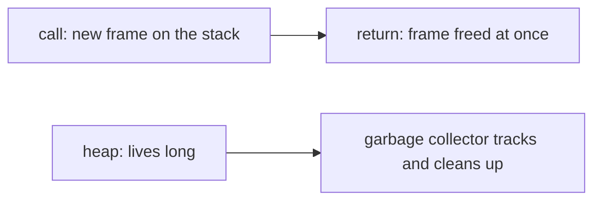

<div lang="en">

🌐 [Oʻzbekcha](/lab/youtube/go/go-1-11) · [Русский](/lab/youtube/go/go-1-11/ru) · **English**  
Lesson GO-1.11 · [Go: 0 → Guru](/lab/youtube/go#go-1-11) · ▶️ video coming soon · 💻 [GitHub](https://github.com/abdurahmon27/go-backend-uz/tree/main/lessons/011-pointers-escape)

> This is the full written version of the video lesson: you can learn from it without watching (or hearing) the video. The video itself is in Uzbek.

## What you will learn

Two functions create the same order. One returns a copy of the order, the other returns its address in memory.
When we measure them, the second takes 16 new bytes of memory on every call, and the first takes nothing. Then we
delete one comment line from the code, and the second function stops allocating too. How can one comment change
memory use? We will ask the compiler itself.

**The one idea:** a pointer gives you the address of a value. Where the value lives (on the stack or on the heap)
is decided by the compiler, not by the programmer. You can read its decision with `-gcflags=-m`, and a benchmark
tells you the cost.

By the end of the lesson you will be able to:

- take an address with `&` and change the original value through `*` and a pointer, and tell a copy from a pointer;
- explain the difference between the stack and the heap, and when the compiler puts a value on the heap;
- read the messages `moved to heap`, `does not escape`, `leaking param` and `escapes to heap` in the output of
  `go build -gcflags=-m`;
- find and fix the bug where a pointer to a slice element "loses" a change after `append`.

Today's three core new words:

| Word | Plain meaning | Term |
|---|---|---|
| pointer | a value that stores the memory address of another value; an explicit form of a JS/Python reference | pointer |
| stack frame | the space on the stack that each function call gets for itself | stack frame |
| escape analysis | the compiler's check: is the value still needed after the function returns, so does it "escape" to the heap? | escape analysis |

Two helper words appear on the way: **`nil`** (a pointer that points to nothing) and **garbage collector** (it
removes values that are no longer needed from the heap). We explain both where they are needed.

## Before you start

- [GO-1.10 · Structs and memory: same fields, 24 and 16 bytes](/lab/youtube/go/go-1-10/en): struct, field, the
  `Buyurtma{Summa: 100}` form (composite literal) and the size of a struct with `unsafe.Sizeof`.
- [GO-1.08 · Slices: the append trap and the outdated 1024 rule](/lab/youtube/go/go-1-08/en): the array inside a slice,
  `len` (length), `cap` (capacity), `append` allocating a new array when there is no room; a first look at the
  stack and the heap.
- [GO-1.07 · Don't guess, measure: first test and benchmark](/lab/youtube/go/go-1-07/en): `go test -bench . -benchmem`, the
  `ns/op`, `B/op` and `allocs/op` columns, `for b.Loop()` and inlining (the compiler copies a function body into
  the call site).
- [GO-1.06 · Functions: two return values, closures and variadic](/lab/youtube/go/go-1-06/en): in Go every argument is
  copied; the closure in the `hisob` program. Its "Going deeper" section used the `-gcflags` flag once; today we
  explain it fully.
- [GO-1.05 · Go has no while: one for and all its forms](/lab/youtube/go/go-1-05/en): `&d` is "the address of `d`", `*p` is
  "the value at address `p`".
- [GO-1.01 · Why Go exists, and what is inside go build](/lab/youtube/go/go-1-01/en): `go build` translates a program but
  does not run it.
- You can copy the `pointer/`, `slaysp/` and `slaysfix/` programs into [go.dev/play](https://go.dev/play) and run
  them with **Run**. Everything else (the `-gcflags` flag and the benchmarks) needs Go on your computer: open a
  terminal in the course folder (`lessons/011-pointers-escape`); the commands run from there.
- The results come from `go1.26.8`. Older Go versions may print slightly different `-gcflags=-m` messages.

First, a question about the previous lesson. How many bytes does this struct take (`unsafe.Sizeof`)?

```go
type Buyurtma struct {
	Summa      int64
	Tolandi    bool
	Yetkazildi bool
}
```

<details>
<summary>Answer</summary>

**16 bytes.** `int64` is 8 bytes, the two `bool`s are 1 byte each, 10 bytes in total. The size of a struct must
be a multiple of the alignment of its largest field (8), so 6 empty bytes (padding) are added at the end: 16.
You will see this number right away.

</details>

## The puzzle: one comment line

This is `hook/buyurtma.go` from the course folder. It has two functions that create the same order:

```go filename="hook/buyurtma.go" showLineNumbers
// hook: ikki funksiya bir xil buyurtma yaratadi. Biri qiymat qaytaradi,
// ikkinchisi pointer. Qaysi biri xotira ajratadi?
package hook

type Buyurtma struct {
	Summa      int64
	Tolandi    bool
	Yetkazildi bool
}

// go:noinline: kompilyator funksiyani chaqiruv joyiga koʻchirmasin
// (inline qilmasin), shunda har bir funksiyani alohida oʻlchaymiz.

//go:noinline
func yarat(summa int64) Buyurtma {
	b := Buyurtma{Summa: summa}
	return b
}

//go:noinline
func yaratP(summa int64) *Buyurtma {
	b := Buyurtma{Summa: summa}
	return &b
}
```

| Line | Code | What it does |
|---|---|---|
| 3 | `package hook` | not `main`, an ordinary package: only the benchmark uses it |
| 5–9 | `type Buyurtma struct {…}` | the 16-byte struct from the question above (`Buyurtma` means "order") |
| 14 | `//go:noinline` | a special comment for the compiler (a directive): "do not inline this function". There is **no** space after `//`, otherwise it is a normal comment |
| 15 | `func yarat(summa int64) Buyurtma {` | `yarat` ("create") takes an `int64` and returns the `Buyurtma` itself |
| 16 | `b := Buyurtma{Summa: summa}` | a local order `b` (only inside this function); the other fields get their zero value |
| 17 | `return b` | returns a **copy** of `b` |
| 21 | `func yaratP(summa int64) *Buyurtma {` | `*Buyurtma` is the type "address of a `Buyurtma`". The function returns the address, not the order |
| 23 | `return &b` | `&b` is "the address of `b`" (seen in GO-1.05) |

We explain `*` and `&` in detail in the next section. For now it is enough to know: `yarat` gives a copy of the
order, `yaratP` gives its address. The benchmark that measures them is in `hook/hook_test.go`:

```go filename="hook/hook_test.go" showLineNumbers
package hook

import "testing"

func BenchmarkQiymat(b *testing.B) {
	for b.Loop() {
		_ = yarat(100)
	}
}

func BenchmarkPointer(b *testing.B) {
	for b.Loop() {
		_ = yaratP(100)
	}
}
```

Two benchmarks; each calls one function again and again (as in [GO-1.07](/lab/youtube/go/go-1-07/en)). `_ =` throws the
result away. `-benchmem` counts memory allocation in addition to time:

```console
$ go test -bench . -benchmem ./hook
goos: linux
goarch: amd64
pkg: github.com/abdurahmon27/go-backend-uz/lessons/011-pointers-escape/hook
cpu: 12th Gen Intel(R) Core(TM) i5-12450H
BenchmarkQiymat-12     	1000000000	         0.7896 ns/op	       0 B/op	       0 allocs/op
BenchmarkPointer-12    	76790593	        14.42 ns/op	      16 B/op	       1 allocs/op
PASS
ok  	github.com/abdurahmon27/go-backend-uz/lessons/011-pointers-escape/hook	1.900s
```

| Benchmark | `B/op` | `allocs/op` | Meaning |
|---|---|---|---|
| `Qiymat` (`yarat`) | 0 | 0 | no new memory was taken |
| `Pointer` (`yaratP`) | 16 | 1 | one new 16-byte block on every call: exactly one `Buyurtma` |

The nanoseconds change a little on every run; `B/op` and `allocs/op` do not. So we look at the memory columns,
not at the time.

Now the `inl/` folder. Its `inl/buyurtma.go` is the same as `hook/buyurtma.go`. Only the comment at the top of the
file and the package name differ, and the single `//go:noinline` line above `yaratP` is deleted:

```go
func yaratP(summa int64) *Buyurtma {
	b := Buyurtma{Summa: summa}
	return &b
}
```

`inl/inl_test.go` holds the same two benchmarks. Let's run them:

```console
$ go test -bench . -benchmem ./inl
goos: linux
goarch: amd64
pkg: github.com/abdurahmon27/go-backend-uz/lessons/011-pointers-escape/inl
cpu: 12th Gen Intel(R) Core(TM) i5-12450H
BenchmarkQiymat-12     	1000000000	         0.8330 ns/op	       0 B/op	       0 allocs/op
BenchmarkPointer-12    	1000000000	         0.7943 ns/op	       0 B/op	       0 allocs/op
PASS
ok  	github.com/abdurahmon27/go-backend-uz/lessons/011-pointers-escape/inl	1.630s
```

Now `Pointer` also shows `0 B/op`, `0 allocs/op`. One comment line removed the memory allocation. To understand
how, we first look at what a pointer is, then at where a value lives. At the end we come back to the puzzle.

## A pointer: a copy of an address

We need a function that marks an order as "paid". In [GO-1.06](/lab/youtube/go/go-1-06/en) we saw that a Go function always
receives a **copy** of its argument. A struct is copied as a whole too. If the function changes the copy, the
original order does not change.

If you come from JavaScript or Python, this may be a surprise. In JS, when you pass an object to a function, the
function can change its properties, and the change is visible outside (MDN). In Python, arguments are passed "by
assignment": the name inside the function refers to the same object as the caller's (Python FAQ). In Go, a struct
is not a reference to an object; it is the value itself: both `c := b` and passing it to a function copy the whole
struct. The "two names, one object" behaviour is written explicitly in Go: with a **pointer**.

A pointer is a value that stores the memory address of another value. The difference from a JS or Python
reference: its type is visible (`*Buyurtma`), taking an address (`&`) and following it (`*`) are written in the
code, and it can be `nil`. Three notations:

| Notation | Read as | Meaning |
|---|---|---|
| `&b` | "the address of `b`" | where `b` is in memory; the result is a pointer |
| `*Buyurtma` | "pointer to `Buyurtma`" | a type name: a value that stores the address of a `Buyurtma` |
| `*p` | "the value at address `p`" | follow the pointer and get the original value itself |

The same sign does two different jobs: in front of a type (`*Buyurtma`) `*` means "pointer type", in front of a
value (`*p`) it means "follow the address". The `b *testing.B` we have been writing since [GO-1.07](/lab/youtube/go/go-1-07/en)
is a pointer too: a pointer to `testing.B`.

This is `pointer/main.go`:

```go filename="pointer/main.go" showLineNumbers
// pointer: qiymat nusxa boʻlib uzatiladi, pointer esa asl qiymatga yoʻl beradi.
package main

import "fmt"

type Buyurtma struct {
	Summa   int64
	Tolandi bool
}

// tola: b — nusxa. Oʻzgarish chaqiruvchiga yetmaydi.
func tola(b Buyurtma) {
	b.Tolandi = true
}

// tolaP: p — manzil. *p orqali asl buyurtmani oʻzgartiramiz.
func tolaP(p *Buyurtma) {
	p.Tolandi = true // (*p).Tolandi ning qisqa yozuvi
}

func main() {
	b := Buyurtma{Summa: 50_000}

	tola(b)
	fmt.Println("tola:  ", b.Tolandi)

	tolaP(&b)
	fmt.Println("tolaP: ", b.Tolandi)

	var p *Buyurtma // zero value: nil
	fmt.Println("p == nil:", p == nil)
}
```

| Line | Code | What it does |
|---|---|---|
| 6–9 | `type Buyurtma struct {…}` | an order with two fields: the amount and "is it paid?" (`Tolandi`) |
| 12 | `func tola(b Buyurtma) {` | `tola` ("pay") receives a **copy** of the order |
| 13 | `b.Tolandi = true` | sets the field of the copy to `true` |
| 17 | `func tolaP(p *Buyurtma) {` | `tolaP` receives the **address** of the order |
| 18 | `p.Tolandi = true` | follows the address and changes the field of the original order. The full form is `(*p).Tolandi`, but when you access a struct field Go adds the `*` for you |
| 22 | `b := Buyurtma{Summa: 50_000}` | the order in `main`; `50_000` is 50000, the `_` only makes it easier to read |
| 24 | `tola(b)` | a copy of `b` is passed |
| 25 | `fmt.Println("tola:  ", b.Tolandi)` | prints `b.Tolandi` from `main` |
| 27 | `tolaP(&b)` | the address of `b` is passed |
| 30 | `var p *Buyurtma` | a pointer declared without a value: its zero value is `nil` |
| 31 | `fmt.Println("p == nil:", p == nil)` | is `p` equal to `nil`? |

`tolaP(&b)` also makes a copy. But it is a copy of the **address**, not of the order: an 8-byte number. Both the
original address and its copy point to the same order.

Think before you run it: what do the first two lines print? **A)** `true`, `true` · **B)** `false`, `true` ·
**C)** `false`, `false`

<details>
<summary>Answer</summary>

**B: `false`, then `true`.** `tola` changed the copy; nobody touched `b` in `main`. `tolaP` followed the address
and changed the `b` in `main` itself. If you chose "A", you thought `tola` also receives the original order. If
you chose "C", you thought that since the pointer is copied too, it changes nothing: it is copied, but the copy
holds the same address.

</details>

```console
$ go run ./pointer
tola:   false
tolaP:  true
p == nil: true
```

Memory picture:

```text
tola(b):    main:  b [ 50000 | false ]
            tola:  b [ 50000 | true  ]     a separate copy, gone when the function ends

tolaP(&b):  main:  b [ 50000 | true  ]  ◄──┐
            tolaP: p [ address of b  ] ───┘  a copy of the address, but it points to the same b
```

The zero value of a pointer is **`nil`**: such a pointer points to nothing (similar to `null` in JS and `None` in
Python). If you read or write a field through a `nil` pointer, the program stops with a **panic** (a crash). We
run this below, in "Common mistakes".

## Stack and heap: where a value lives

So where in memory do these orders live? A Go program has two areas of memory.

The **stack** (we met it in [GO-1.08](/lab/youtube/go/go-1-08/en)) is fast memory for function calls. When a function is
called, space for its local variables is reserved on top of the stack. This space is called a **stack frame**, or
just a **frame**. Every call that was not inlined gets its own frame on the stack. When the function returns, the
frame is freed at once: the register that points to the top of the stack (the stack pointer) simply moves back.
That is why freeing a frame is almost free.

The **heap** is shared memory for values that live longer. Taking space from it costs more. Also, every value on
the heap has to be cleaned up later. The **garbage collector** does this: while the program runs, it checks which
values nobody uses any more and frees their space. That takes time too.

In Python every object lives on the heap (Python docs: *"a private heap containing all Python objects"*), and you
do not choose this. Go also has a garbage collector, but there is a difference: the compiler chooses the stack or
the heap for each value.



Important: **in Go, the compiler, not the programmer, decides where a value goes.** The official Go FAQ says you
do not need to know where a value is stored for the program to be correct.
But it matters for speed: the 16 bytes of `yaratP` came from the heap.

## The rule: if the compiler cannot prove it, the heap

In C, if you return the address of a local variable, the code compiles with a warning. But after the function
ends, its frame is gone, and the pointer keeps pointing at a place that no longer exists: a **dangling pointer**.
Using it is *undefined behavior*, so the result is not defined: the program may work, crash, or silently do the
wrong thing (the C11 standard, §6.2.4).

In Go, the `return &b` in `yaratP` is safe. Effective Go: *"unlike in C, it's perfectly OK to return the address
of a local variable"*. The compiler makes sure of it. The rule from the Go FAQ:

> *"if the compiler cannot prove that the variable is not referenced after the function returns, then the compiler
> must allocate the variable on the garbage-collected heap to avoid dangling pointer errors."*

So: if the compiler **cannot prove** that the variable is not used after the function returns, it puts the
variable on the heap. In `yaratP`, the address of `b` leaves the function, so `b` is created on the heap. This
check is called **escape analysis**: for every value, the compiler works out whether it "escapes" the function.

There is one more reason: a very large variable can also go to the heap (FAQ: *"if a local variable is very
large, it might make more sense to store it on the heap"*).

The compiler's source code (`cmd/compile/internal/escape/escape.go`) states two rules of this analysis:

1. a value on the heap must not point to a value on the stack;
2. a pointer must not outlive the stack value it points to.

Both guarantee one thing: no pointer is left pointing into a frame that is gone.

## -gcflags=-m: asking the compiler

How do we see the compiler's decision? We give `go build` (GO-1.01) the `-gcflags=-m` flag. `gc` is the name of
the Go compiler, and `-gcflags` means "pass these flags to the compiler". `-m` tells the compiler "print your
decisions": what it inlined and what it put on the heap.

We collect five cases in `escape/escape.go`:

```go filename="escape/escape.go" showLineNumbers
// escape: kompilyator qaysi oʻzgaruvchini heap'ga chiqaradi?
// go build -gcflags=-m ./escape
package escape

import "fmt"

type Buyurtma struct {
	Summa   int64
	Tolandi bool
}

// 1. Lokal oʻzgaruvchining manzili qaytariladi:
// funksiya tugagach ham yashashi kerak.
func yangi(summa int64) *Buyurtma {
	b := Buyurtma{Summa: summa}
	return &b
}

// 2. Pointer pastga uzatiladi, lekin hech qayerda saqlanmaydi.
func summa(p *Buyurtma) int64 {
	return p.Summa
}

// 3. Pointer global oʻzgaruvchiga yoziladi.
var oxirgi *Buyurtma

func eslab(p *Buyurtma) {
	oxirgi = p
}

// 4. Qiymat interface'ga (any) aylanadi: fmt.Println ...any oladi.
func chop(b Buyurtma) {
	fmt.Println(b.Summa)
}

// 5. Lokal slice: oʻlchami kichik va oʻzgarmas — stack'da;
// juda katta yoki oʻlchami noma'lum — kompilyator qaror qiladi.
func hajm(n int) int {
	kichik := make([]byte, 64)
	katta := make([]byte, 100_000)
	nomalum := make([]byte, n)
	return len(kichik) + len(katta) + len(nomalum)
}
```

| Line | Code | What it does |
|---|---|---|
| 14–17 | `func yangi(…) *Buyurtma` | **Case 1:** returns the address of the local `b` (same as `yaratP`); `yangi` means "new" |
| 20–22 | `func summa(p *Buyurtma) int64` | **Case 2:** the pointer only comes in to be read: it returns `p.Summa` and stores `p` nowhere |
| 25 | `var oxirgi *Buyurtma` | a **global** variable declared outside any function: it lives as long as the program (`oxirgi` means "last") |
| 27–29 | `func eslab(p *Buyurtma)` | **Case 3:** `eslab` ("remember") writes the pointer into the global `oxirgi` |
| 32–34 | `func chop(b Buyurtma)` | **Case 4:** `chop` ("print") passes the amount to `fmt.Println` |
| 38–43 | `func hajm(n int) int` | **Case 5:** three slices. `make([]byte, 64)` is a 64-byte slice ([GO-1.08](/lab/youtube/go/go-1-08/en)); one of 100 000 bytes; and one whose size is `n`, so unknown at compile time |

This package has no `main`; we do not run it, we only translate it. We need the compiler's messages.

One question before we run it. Where is `b` in `yangi` created? **A)** on the stack: it is gone when the function
ends, and the pointer dangles · **B)** on the heap · **C)** a compile error

<details>
<summary>Answer</summary>

**B: on the heap.** The address of `b` leaves the function through `return`. The compiler cannot prove that `b`
is not used after the function returns (in fact it is used), so it puts it on the heap. "A" is how C behaves: Go
has no dangling pointers. Not "C": returning the address of a local is perfectly fine in Go.

</details>

```console
$ go build -gcflags=-m ./escape
# github.com/abdurahmon27/go-backend-uz/lessons/011-pointers-escape/escape
escape/escape.go:14:6: can inline yangi
escape/escape.go:20:6: can inline summa
escape/escape.go:27:6: can inline eslab
escape/escape.go:32:6: can inline chop
escape/escape.go:38:6: can inline hajm
escape/escape.go:33:13: inlining call to fmt.Println
escape/escape.go:15:2: moved to heap: b
escape/escape.go:20:12: p does not escape
escape/escape.go:27:12: leaking param: p
escape/escape.go:33:13: ... argument does not escape
escape/escape.go:33:15: b.Summa escapes to heap
escape/escape.go:39:16: make([]byte, 64) does not escape
escape/escape.go:40:15: make([]byte, 100000) escapes to heap
escape/escape.go:41:17: make([]byte, n) does not escape
```

Every line has the form `file:line:column: message`. The first line, starting with `#`, is the full package name.
The next six lines are about inlining: *can inline yangi* means "`yangi` can be inlined", *inlining call to
fmt.Println* means "the call to `fmt.Println` was inlined". We need them later. We read the rest case by case:

| Case | Message | Plain words | Meaning |
|---|---|---|---|
| 1 | `15:2: moved to heap: b` | "`b` was moved to the heap" | the address left the function: `b` is created on the heap |
| 2 | `20:12: p does not escape` | "`p` does not escape" | `summa` stores the pointer nowhere |
| 3 | `27:12: leaking param: p` | "parameter `p` leaks" | the pointer left the function (into a global variable) |
| 4 | `33:15: b.Summa escapes to heap` | "`b.Summa` escapes to the heap" | the value passed to `Println` |
| 5 | `39:16`, `40:15`, `41:17` | | three slices: in their own section below |

Case 4 needs an explanation. `fmt.Println` accepts values of any type: its parameter is `...any`. `any` means "any
type". A value passed to such a parameter is packed into an **interface**: the value is wrapped together with a
record of its type (interfaces are covered in [GO-1.13](/lab/youtube/go/go-1-13/en)). The compiler marks this case as
"escaped". But the runtime (helper code Go adds to every program) does not allocate memory for non-negative
numbers that fit in one byte (0 to 255). We measure this in "Going deeper".

The `... argument does not escape` line is about the list built for the `...any` parameter of `Println`: it
stays on the stack.

## -m=2: why did it escape?

"It escaped" is not enough; you can also ask "why?". The `-m=2` flag prints the reason too. Its output is very
long, so we cut out the part we need. Reading the command piece by piece:

- `2>&1`: the compiler writes its messages to the error stream; this joins them with the normal output so the
  next command sees them;
- `|`: passes the output of the left command to the right command;
- `grep -A3 'b escapes'`: keeps the line with the words `b escapes` and the 3 lines after it.

```console
$ go build -gcflags=-m=2 ./escape 2>&1 | grep -A3 'b escapes'
escape/escape.go:15:2: b escapes to heap in yangi:
escape/escape.go:15:2:   flow: ~r0 ← &b:
escape/escape.go:15:2:     from &b (address-of) at escape/escape.go:16:9
escape/escape.go:15:2:     from return &b (return) at escape/escape.go:16:2
```

We read it from top to bottom:

| Line | Plain words |
|---|---|
| `b escapes to heap in yangi:` | "`b` escapes to the heap in `yangi`:" |
| `flow: ~r0 ← &b:` | "flow: `&b` → `~r0`". `~r0` is the internal name the compiler gives the function's first return value |
| `from &b (address-of) at …16:9` | line 16, column 9: `&b`, the address is taken |
| `from return &b (return) at …16:2` | line 16, column 2: that address goes into the function result through `return` |

The compiler showed the path step by step: address taken → written into the result → left the function.

## Three slices: 64 bytes, 100 000 bytes and n

Now the three lines of case 5:

| Code | `-m` message | Where |
|---|---|---|
| `make([]byte, 64)` | `does not escape` | on the stack |
| `make([]byte, 100_000)` | `escapes to heap` | on the heap: larger than 64 KiB |
| `make([]byte, n)` | `does not escape` | on the stack up to 32 bytes (since Go 1.25); larger is still on the heap |

The **small slice** stayed on the stack. The **100 000-byte slice** went to the heap even though it goes nowhere.
That is the "very large variable" rule from above. For values created with `make` or `new`, the limit is written
in the compiler's code: 64 KiB, that is 65 536 bytes (`cmd/compile/internal/ir/cfg.go`,
`MaxImplicitStackVarSize`).

The **slice of unknown size** did not escape either. The old rule was "unknown size means heap". But since Go
1.25, the compiler reserves a small backup buffer on the stack for such a `make`. Currently it is 32 bytes (Keith
Randall, *Allocating on the Stack*, Go blog, 2026). If `n` fits into that buffer, the slice lives on the stack. If
not, the runtime still takes the memory from the heap.

So an important warning: **even when you see `does not escape`, the memory may come from the heap.** `-m` only
reports the decision made at compile time. What really happens while the program runs is shown by a benchmark
(you measure exactly this in the guru homework).

## Pause: summa(&a) or eslab(&b)?

A question for you. Two functions create their own order and pass its address to another function:

```go
func birinchi() int64 {
	a := Buyurtma{Summa: 100}
	return summa(&a)
}

func ikkinchi() {
	b := Buyurtma{Summa: 200}
	eslab(&b)
}
```

`summa` and `eslab` are the functions from `escape.go` above: `summa` only reads `p.Summa`, `eslab` writes the
pointer into the global `oxirgi`. Which order goes to the heap? **A)** only `a` · **B)** only `b` ·
**C)** both. Hint: what did `leaking param` mean?

<details>
<summary>Answer</summary>

**B: only `b`.** The compiler keeps a short summary for every function: what happens to its parameter (in the
compiler's code these are called *parameter tags*). The summary for `summa`: "`p does not escape`", the pointer
is stored nowhere. So `a` stays on the stack. The summary for `eslab`: "`leaking param: p`". So the variable of
**every** caller that passes an address to `eslab` goes to the heap. If you chose "A", you mixed up `summa` and
`eslab`. If you chose "C", you thought that passing an address to another function is already an escape: no, it
depends on which function.

</details>

This is `savol/savol.go` from the course folder:

```go filename="savol/savol.go" showLineNumbers
// savol: ikki chaqiruvchi, ikkalasi lokal buyurtmaning manzilini beradi.
// Qaysi buyurtma heap'ga chiqadi? (go:noinline: kompilyator chaqiruvchini
// faqat funksiyaning qisqa xulosasi — "parameter tags" — boʻyicha tahlil qilsin)
// go build -gcflags=-m ./savol 2>&1 | grep moved
package savol

type Buyurtma struct {
	Summa   int64
	Tolandi bool
}

//go:noinline
func summa(p *Buyurtma) int64 { return p.Summa } // p does not escape

var oxirgi *Buyurtma

//go:noinline
func eslab(p *Buyurtma) { oxirgi = p } // leaking param: p

func birinchi() int64 {
	a := Buyurtma{Summa: 100}
	return summa(&a)
}

func ikkinchi() {
	b := Buyurtma{Summa: 200}
	eslab(&b)
}
```

Here `summa` and `eslab` are written on one line each and marked `//go:noinline`. Otherwise the compiler would copy
them into `birinchi` ("first") and `ikkinchi` ("second"), and the decision would come from the copied body, not
from the summary (the result would still be the same).

```console
$ go build -gcflags=-m ./savol
# github.com/abdurahmon27/go-backend-uz/lessons/011-pointers-escape/savol
savol/savol.go:20:6: can inline birinchi
savol/savol.go:25:6: can inline ikkinchi
savol/savol.go:13:12: p does not escape
savol/savol.go:18:12: leaking param: p
savol/savol.go:26:2: moved to heap: b
```

Only one `moved to heap`: `b` on line 26. There is no such message for `a` on line 21; it is on the stack.

## Back to the puzzle: inlining changes the decision

Now the secret from the start. In `inl/`, the `//go:noinline` above `yaratP` was deleted. So the compiler
**inlines** `yaratP` into the benchmark: it copies its three lines into the `BenchmarkPointer` loop. Now the
compiler sees that the order is used only inside that loop, and keeps it on the stack.

```text
before inlining:                       after inlining:
BenchmarkPointer → yaratP(100)         BenchmarkPointer:
  yaratP: b → return &b (escapes)        b := Buyurtma{Summa: 100}
          → heap, 16 B                   _ = &b    (does not leave the loop) → stack, 0 B
```

Let's ask the compiler. The benchmark is in a `_test.go` file, and `go build` does not translate test files. So we
use `go test`: `-run '^$'` is a filter that matches no test, so no tests run and the package is only translated.
The output is long; `grep -E '…'` keeps the lines that start with `inl/` and contain `yaratP` or `heap` (`-E` lets
`|` mean "or"):

```console
$ go test -gcflags=-m -run '^$' ./inl 2>&1 | grep -E '^inl/.*(yaratP|heap)'
inl/buyurtma.go:19:6: can inline yaratP
inl/inl_test.go:13:13: inlining call to yaratP
inl/buyurtma.go:20:2: moved to heap: b
```

| Line | Meaning |
|---|---|
| `can inline yaratP` | `yaratP` can be inlined |
| `inl_test.go:13:13: inlining call to yaratP` | the call on line 13 of the benchmark was inlined |
| `buyurtma.go:20:2: moved to heap: b` | `b` was moved to the heap, but this is about the **standalone copy** of `yaratP` |

The third line is misleading. `-m` still says `moved to heap: b`. This is about the standalone, non-inlined copy
of the function: the copy that runs when someone calls it the normal way from another package. The benchmark
uses the inlined copy, and there `b` is on the stack: hence `0 allocs/op`.

The `hisob` counter from [GO-1.06](/lab/youtube/go/go-1-06/en) works the same way. `cd ../006-functions` moves into the folder
of lesson six, and `&&` means "if the previous command succeeded, run the next one". `-o /dev/null` does not save
the ready file anywhere: we only need the messages.

```console
$ cd ../006-functions && go build -o /dev/null -gcflags=-m ./hisob 2>&1 | grep -E 'moved|func literal|inlining call to hisob'
hisob/main.go:14:18: inlining call to hisoblagich
hisob/main.go:15:18: inlining call to hisoblagich
hisob/main.go:6:2: moved to heap: n
hisob/main.go:7:9: func literal escapes to heap
hisob/main.go:14:18: func literal does not escape
hisob/main.go:15:18: func literal does not escape
```

`func literal` is an anonymous function; here it is the closure that `hisoblagich` ("counter") returns. In the
standalone `hisoblagich` function, `n` moves to the heap (line 6) and the closure escapes (line 7). On lines 14 and
15 of `main`, `hisoblagich` was inlined, and there the closure does not escape (*func literal does not escape*). In
GO-1.06 we left the question "where does `n` live?" for this lesson: the answer is that it depends on the call
site.

But inlining has a limit. The compiler inlines only small functions. A larger constructor with a few `if`s and a
loop is usually not inlined, and a pointer it returns usually goes to the heap. So do not generalise to "if I
remove `//go:noinline`, the pointer becomes free".

## The trap: a pointer, but no change

Now one dangerous trap with slices. This is `slaysp/main.go`; the code is **wrong on purpose**:

```go filename="slaysp/main.go" showLineNumbers
// slaysp: slice elementiga pointer, keyin append. Ataylab xato.
package main

import "fmt"

type Buyurtma struct {
	Summa   int64
	Tolandi bool
}

func main() {
	s := []Buyurtma{{Summa: 100}, {Summa: 200}} // len 2, cap 2
	p := &s[0]                                  // birinchi buyurtmaga pointer

	s = append(s, Buyurtma{Summa: 300}) // cap yetmadi: yangi massiv
	p.Tolandi = true                    // eski massivni oʻzgartiradi

	fmt.Println("p.Tolandi:   ", p.Tolandi)
	fmt.Println("s[0].Tolandi:", s[0].Tolandi)
	fmt.Println("bir joymi?   ", p == &s[0])
}
```

| Line | Code | What it does |
|---|---|---|
| 12 | `s := []Buyurtma{{Summa: 100}, {Summa: 200}}` | a slice of two orders. The type name is left out in the inner `{…}`: Go knows it is `Buyurtma`. `len` = `cap` = 2 |
| 13 | `p := &s[0]` | a pointer to element 0 of the slice, the first order in the array |
| 15 | `s = append(s, …)` | adds a third order |
| 16 | `p.Tolandi = true` | marks the first order as "paid" through the pointer |
| 18–20 | `fmt.Println(…)` | the value the pointer sees, the value in the slice, and whether `p` still points to `s[0]` (`p == &s[0]`; `bir joymi?` means "same place?") |

Think before you run it: what are `p.Tolandi` and `s[0].Tolandi`? **A)** `true`, `true` ·
**B)** `true`, `false` · **C)** `false`, `false`

<details>
<summary>Answer</summary>

**B: `true`, `false`.** The slice had capacity 2, and both places were taken. The rule from
[GO-1.08](/lab/youtube/go/go-1-08/en): if there is no room, `append` allocates a **new array**, copies the old elements into
it and returns a new slice. `s` now points to the new array, and `p` stayed in the old one. `p.Tolandi = true`
changed the order in the old array, which nobody sees any more. If you chose "A", you thought `append` always
writes to the same array. Not "C": the pointer really did change the place it points to.

</details>

```console
$ go run ./slaysp
p.Tolandi:    true
s[0].Tolandi: false
bir joymi?    false
```

`bir joymi? false`: `p` and `&s[0]` are now different addresses.

```text
before append:      s ──► old array [ 100 | 200 ]
                    p ──►           ▲ (element 0)

after append:       p ──► old array [ 100 ✔ | 200 ]       Tolandi = true here
                    s ──► new array [ 100 | 200 | 300 | … ]  s[0].Tolandi = false
```

The worst part: when the capacity is enough, the bug is **invisible**. If the slice has spare room, `append`
writes into the same array, `p` and `s[0]` stay the same place, and everything works. That is why this bug easily
passes tests: if a test uses a slice with spare room, the bug does not show at all.

Neither the compiler nor `go vet` sees this bug:

```console
$ go vet ./slaysp && echo vet: jim
vet: jim
```

`go vet` found nothing, so the `echo vet: jim` after `&&` ran (`echo` just prints text; `jim` means "quiet").

**The fix is simple:** do not keep a pointer to a slice element for long. After `append`, access the element by
index, or take the pointer again after `append`. This is `slaysfix/main.go`:

```go filename="slaysfix/main.go" showLineNumbers
// slaysfix: pointer'ni append'dan keyin oling yoki indeks bilan ishlang.
package main

import "fmt"

type Buyurtma struct {
	Summa   int64
	Tolandi bool
}

func main() {
	s := []Buyurtma{{Summa: 100}, {Summa: 200}}

	s = append(s, Buyurtma{Summa: 300})
	s[0].Tolandi = true // indeks orqali: har doim hozirgi massiv

	fmt.Println("s[0].Tolandi:", s[0].Tolandi)
}
```

- **Line 14:** `append` first.
- **Line 15:** then write through `s[0]`: `s` always points to the current array.

```console
$ go run ./slaysfix
s[0].Tolandi: true
```

Another way is to store pointers, not values, in the slice: `[]*Buyurtma`. Then even if `append` moves the array,
every order stays where it is. This is close to a list of objects in JS or Python: the list holds references to
the objects, not the objects themselves. But every element becomes a separate heap value, and that has its own
cost (README).

## Summary: when do you need a pointer?

| Situation | Choice |
|---|---|
| the function must change the value (`tolaP`) | pointer |
| small struct (`Buyurtma`, 16 bytes) | a copy is often cheaper: do not use a pointer for speed |
| large struct | a pointer really can be faster |
| not sure | look with `-gcflags=-m`, then measure with a benchmark |

The puzzle showed that "a pointer is faster for a small struct" is wrong: `yaratP` with its 16-byte heap
allocation was slower. For a large struct it is the other way round. `katta/katta_test.go` from the course folder
passes a 4096-byte struct in two ways:

```go filename="katta/katta_test.go" showLineNumbers
// katta: 4 KiB'lik struct. Qiymat bilan uzatilsa, har chaqiruvda 4096 bayt
// nusxalanadi; pointer bilan — faqat 8 baytlik manzil.
// go test -bench . ./katta
package katta

import "testing"

type Hisobot struct {
	Qatorlar [512]int64 // 4096 bayt
}

//go:noinline
func jamiQ(h Hisobot) int64 { return h.Qatorlar[0] + h.Qatorlar[511] }

//go:noinline
func jamiP(h *Hisobot) int64 { return h.Qatorlar[0] + h.Qatorlar[511] }

var h Hisobot

func BenchmarkQiymat(b *testing.B) {
	for b.Loop() {
		jamiQ(h)
	}
}

func BenchmarkPointer(b *testing.B) {
	for b.Loop() {
		jamiP(&h)
	}
}
```

- **Lines 8–10:** `Hisobot` ("report") holds an array of 512 `int64`: 512 × 8 = 4096 bytes. `[512]int64` is a
  fixed-size array ([GO-1.08](/lab/youtube/go/go-1-08/en)).
- **Line 13:** `jamiQ` receives a copy of the struct: 4096 bytes are copied on every call.
- **Line 16:** `jamiP` receives only the 8-byte address.
- **Line 18:** the global `h` exists from the start to the end of the program, so it does not have to be created
  on every call. That is why neither benchmark allocates memory.

```console
$ go test -bench . -benchmem ./katta
goos: linux
goarch: amd64
pkg: github.com/abdurahmon27/go-backend-uz/lessons/011-pointers-escape/katta
cpu: 12th Gen Intel(R) Core(TM) i5-12450H
BenchmarkQiymat-12     	31075632	        38.97 ns/op	       0 B/op	       0 allocs/op
BenchmarkPointer-12    	1000000000	         0.7064 ns/op	       0 B/op	       0 allocs/op
PASS
ok  	github.com/abdurahmon27/go-backend-uz/lessons/011-pointers-escape/katta	1.921s
```

On this computer, copying 4096 bytes took ≈39 ns, passing the address ≈0.7 ns. The Go wiki's code review
comments say the same: do not pass a pointer just to save a few bytes, but this advice *"does not apply to large
structs"*.

Every value that goes to the heap is extra work for the garbage collector. The Go team is working on it: in Go
1.25 the compiler started keeping more slices on the stack, and in Go 1.26 `append` does too (Go blog,
*Allocating on the Stack*). So the rule is: look with `-m`, but the benchmark has the last word.

Today we saw that a pointer gives an address, and the compiler decides on its own where a value lives. In the
next lesson, [GO-1.12](/lab/youtube/go/go-1-12/en), we study methods: value receiver or pointer receiver, and when to choose
which?

## Going deeper (optional): Println, the numbers 0–255 and other limits

This section is not needed for the core lesson; it comes from the course README and the measurements in the
research notes.

**Does `Println` really allocate?** In case 4, `-m` said "`b.Summa escapes to heap`". Let's count.
`testing.AllocsPerRun(1000, f)` calls `f` 1000 times and returns the number of allocations per call.
`fmt.Fprintln(io.Discard, v)` is `Println` itself, except the text goes "nowhere" (`io.Discard`) instead of to the
screen. This program is not in the course folder; it was run separately:

```go
package main

import (
	"fmt"
	"io"
	"testing"
)

func main() {
	for _, v := range []int64{100, 255, 256, 100_000, -1} {
		n := testing.AllocsPerRun(1000, func() {
			fmt.Fprintln(io.Discard, v)
		})
		fmt.Println(v, "→", n, "allocs")
	}
}
```

```console
$ go run -trimpath boxing/main.go
100 → 0 allocs
255 → 0 allocs
256 → 1 allocs
100000 → 1 allocs
-1 → 1 allocs
```

For the numbers 0 to 255 the runtime uses a ready-made table (`staticuint64s` in `runtime/iface.go`) and does not
allocate. From 256 up, and for negative numbers, there is one allocation per call. So `escapes to heap` means "an
allocation may happen", not "it always happens".

**Other limits** (from the README):

- the stack limit is 64 KiB for values created with `make`, `new` and `&T{}`, and 128 KiB for `var x T`
  (`cmd/compile/internal/ir/cfg.go`).
- The inlining budget: the compiler "prices" a function, and if the price is above 80 it usually does not inline
  it (`inlineMaxBudget = 80`). PGO (compiling with a profile collected from running the program) gives frequently
  called functions a bigger budget.
- `-gcflags=-m` applies only to the package you name. For all packages: `-gcflags=all=-m`.
- Go has no pointer arithmetic: you cannot write `p + 1` to move to the next address as in C (Go FAQ: *Why is
  there no pointer arithmetic?*). This is for safety.

## Common mistakes

**1. Thinking "a pointer is always faster".** The most common misconception on this topic. The puzzle showed it:
returning the 16-byte `Buyurtma` through a pointer caused a heap allocation on every call (`16 B/op`,
`1 allocs/op`), while the copy allocated nothing. The pointer was faster only for the large struct (the
"Summary" section). **Fix:** use a pointer when the value must be changed. If you want one for speed, measure
with a benchmark first.

**2. Taking a pointer to a slice element and then calling `append`.** We saw it in "The trap": `p := &s[0]`, then
`append`, and the change made through `p` is not visible in the slice. There is no error, `go vet` is silent, and
with enough capacity the bug does not show at all. **Fix:** after `append`, write by index
(`s[0].Tolandi = true`) or take the pointer again after `append`.

**3. Accessing a field through a `nil` pointer.** (This example is not in the course folder; it was run
separately.)

```go
package main

import "fmt"

type Buyurtma struct {
	Summa   int64
	Tolandi bool
}

func main() {
	var p *Buyurtma // nil: hech narsaga ishora qilmaydi
	fmt.Println(p.Summa)
}
```

```console
$ go run -trimpath nilp/main.go
panic: runtime error: invalid memory address or nil pointer dereference
[signal SIGSEGV: segmentation violation code=0x1 addr=0x0 pc=0x49e156]

goroutine 1 [running]:
main.main()
	./main.go:12 +0x16
exit status 2
```

`-trimpath` only shortens the file path in the message. Reading it: *invalid memory address or nil pointer
dereference*: the program used an invalid memory address, or followed a `nil` pointer. *SIGSEGV* is a signal from
the operating system: the program accessed an address it may not use (`addr=0x0`, the zero address).
`main.go:12` is line 12, `fmt.Println(p.Summa)`. The compiler does not see this error: it appears only while the
program runs. **Fix:** give the pointer a real address before you use it (`p := &Buyurtma{}`), or check it:
`if p != nil { … }`.

**4. Passing the value itself where a pointer is expected.** `tolaP` expects a pointer, but we passed `b`
itself. (Not in the course folder; run separately.)

```go
package main

import "fmt"

type Buyurtma struct {
	Summa   int64
	Tolandi bool
}

func tolaP(p *Buyurtma) {
	p.Tolandi = true
}

func main() {
	b := Buyurtma{Summa: 50_000}
	tolaP(b)
	fmt.Println(b.Tolandi)
}
```

```console
$ go run turxato/main.go
# command-line-arguments
turxato/main.go:16:8: cannot use b (variable of struct type Buyurtma) as *Buyurtma value in argument to tolaP
```

Line 16, column 8: *cannot use b (variable of struct type Buyurtma) as \*Buyurtma value in argument to tolaP*:
`b`, a variable of the struct type `Buyurtma`, cannot be used where `tolaP` needs a `*Buyurtma`. `Buyurtma` and
`*Buyurtma` are two different types. **Fix:** pass the address: `tolaP(&b)`.

**5. Thinking `does not escape` means "no memory is allocated".** We saw it in "Three slices": for
`make([]byte, n)`, `-m` says *does not escape*, but if `n` does not fit into the 32-byte buffer, the runtime
still takes memory from the heap. And `escapes to heap` does not always mean an allocation either ("Going
deeper"). **Fix:** treat `-m` as a hint, and measure the cost with `go test -bench . -benchmem`.

**6. Thinking it is dangerous in Go to return the address of a local variable.** People coming from C are afraid
of `return &b`. In Go it is not a bug: the compiler puts `b` on the heap and the pointer does not dangle ("The
rule" section). **Fix:** do not be afraid, but know that it is a heap allocation.

## Check yourself

Answer first, then open the answer.

**1.** What do `&b` and `*p` do? What does the type `*Buyurtma` mean?

<details>
<summary>Answer</summary>

`&b` takes the address of `b` (the result is a pointer). `*p` goes to the value itself at address `p`.
`*Buyurtma` is "pointer to `Buyurtma`": the type of a value that stores the address of a `Buyurtma`.

</details>

**2.** What does this code print? **A)** `10 99` · **B)** `99 99` · **C)** `10 10`

```go
a := Buyurtma{Summa: 10}
p := &a
q := p
q.Summa = 99
fmt.Println(a.Summa, p.Summa)
```

<details>
<summary>Answer</summary>

**B: `99 99`.** `q := p` copies the pointer, but the copy holds the same address. Both `p` and `q` point to the
same `a`, so `q.Summa = 99` changed `a` itself. If you chose "A", you thought `q := p` creates a new order.

The complete program (not in the course folder; run separately):

```go
package main

import "fmt"

type Buyurtma struct {
	Summa   int64
	Tolandi bool
}

func main() {
	a := Buyurtma{Summa: 10}
	p := &a
	q := p
	q.Summa = 99
	fmt.Println(a.Summa, p.Summa)
}
```

```console
$ go run savol1/main.go
99 99
```

</details>

**3.** If `-gcflags=-m` prints `leaking param: p`, how does that affect code that calls this function?

<details>
<summary>Answer</summary>

The function moves `p` out of itself (for example, into a global variable). The compiler records this in the
function's summary, and the variable of every caller that passes an address to this function goes to the heap:
`eslab(&b)` → `moved to heap: b`.

</details>

**4.** Why can memory come from the heap even when `-m` says *does not escape*?

<details>
<summary>Answer</summary>

`-m` reports the compile-time decision. For `make([]byte, n)` of unknown size, the compiler reserves only a
32-byte backup buffer on the stack (since Go 1.25). If `n` is larger, the memory is taken from the heap while the
program runs. A benchmark shows the real cost.

</details>

**5.** Why does `allocs/op` drop from 1 to 0 when we delete the `//go:noinline` above `yaratP`?

<details>
<summary>Answer</summary>

The compiler inlines `yaratP` into the benchmark. Now it sees that the order is used only inside the loop, and
keeps it on the stack. Escape analysis decides after inlining, at each call site.

</details>

**6.** From [GO-1.08](/lab/youtube/go/go-1-08/en): `s := make([]int, 1, 4)`, then `t := append(s, 5)`. Does `append`
allocate a new array?

<details>
<summary>Answer</summary>

No. `len` is 1, `cap` is 4: the array has spare room, so `append` writes into the same array, and `t` points to
the same array as `s`. That is exactly why today's trap is invisible when the capacity is enough.

</details>

## Homework

Tasks at four levels. All files are in the lesson folder on GitHub:
[lessons/011-pointers-escape](https://github.com/abdurahmon27/go-backend-uz/tree/main/lessons/011-pointers-escape).
Answers: the [homework/](https://github.com/abdurahmon27/go-backend-uz/tree/main/lessons/011-pointers-escape/homework)
folder. Try it yourself first.

🟢 **Easy:** write a function that returns the address of an integer. Say in advance what `-gcflags=-m` will
print, then check.

<details>
<summary>Answer</summary>

`homework/oson/oson.go`: inside `yangiSon` ("new number"), `x := 42` and `return &x`. This is case 1 from
`yangi`: the address leaves the function, so `x` is moved to the heap.

```console
$ go build -gcflags=-m ./homework/oson
# github.com/abdurahmon27/go-backend-uz/lessons/011-pointers-escape/homework/oson
homework/oson/oson.go:6:6: can inline yangiSon
homework/oson/oson.go:7:2: moved to heap: x
```

</details>

🟡 **Medium:** write the `chop` function without `fmt.Println`, so that `-m` reports no escape.

<details>
<summary>Answer</summary>

`homework/orta/orta.go`. `var buf [24]byte` is a 24-byte array on the stack. `strconv.AppendInt` turns the amount
into text and writes it into that array, `append(s, '\n')` adds a newline, and `os.Stdout.Write(s)` prints the
bytes to the screen. There is no `any`, so nothing is packed into an interface. `grep -v inlin` removes the lines
about inlining (`-v` means "keep the lines that do not match"):

```console
$ go build -gcflags=-m ./homework/orta 2>&1 | grep -v inlin
# github.com/abdurahmon27/go-backend-uz/lessons/011-pointers-escape/homework/orta
homework/orta/orta.go:20:12: append does not escape
```

One message is left: `append does not escape`, so nothing escaped.

</details>

🟠 **Hard:** catch the `&s[0]` + `append` trap with a test and fix it. Test both cases: `cap` is enough and `cap`
is not enough.

<details>
<summary>Answer</summary>

`homework/qiyin/`. `qoshXato` is the bug from `slaysp` as a function, `qosh` is the correct version using the
index. `TestQosh` is a table-driven test: `make([]Buyurtma, 1, 4)` (room left) and `make([]Buyurtma, 1)` (no
room). The bug shows only in the second case, so the table needs both. If you run `TestQosh` with `qoshXato`, the
"cap yetmaydi" ("cap is not enough") case fails. `TestXatoBor` shows that the bug really exists (it passes).

```console
$ go test -v ./homework/qiyin
=== RUN   TestQosh
=== RUN   TestQosh/cap_yetadi
=== RUN   TestQosh/cap_yetmaydi
--- PASS: TestQosh (0.00s)
    --- PASS: TestQosh/cap_yetadi (0.00s)
    --- PASS: TestQosh/cap_yetmaydi (0.00s)
=== RUN   TestXatoBor
    qiyin_test.go:32: qoshXato: s[0].Tolandi = false — oʻzgarish eski massivda qoldi
--- PASS: TestXatoBor (0.00s)
PASS
ok  	github.com/abdurahmon27/go-backend-uz/lessons/011-pointers-escape/homework/qiyin	0.002s
```

</details>

🔴 **Guru:** how many elements of a `make([]int64, n)` of unknown size fit on the stack? Find the answer with a
benchmark.

<details>
<summary>Answer</summary>

**4.** The backup buffer on the stack is 32 bytes and an `int64` is 8 bytes: 32 ÷ 8 = 4.
`homework/guru/guru_test.go` measures `ishlat(4)` and `ishlat(5)`:

```console
$ go test -bench . -benchmem ./homework/guru
goos: linux
goarch: amd64
pkg: github.com/abdurahmon27/go-backend-uz/lessons/011-pointers-escape/homework/guru
cpu: 12th Gen Intel(R) Core(TM) i5-12450H
BenchmarkMake4-12    	1000000000	         1.198 ns/op	       0 B/op	       0 allocs/op
BenchmarkMake5-12    	58778767	        19.51 ns/op	      48 B/op	       1 allocs/op
PASS
ok  	github.com/abdurahmon27/go-backend-uz/lessons/011-pointers-escape/homework/guru	2.348s
```

`n = 4` → 0 allocations. `n = 5` (40 bytes) → 1 allocation of 48 bytes: Go hands out memory in blocks of ready-made
sizes (size class, [GO-1.08](/lab/youtube/go/go-1-08/en)), and the closest block to 40 bytes is 48. In both cases `-m` prints the
same `make([]int64, n) does not escape`. For `make([]byte, n)` the limit is 32 elements.

</details>

## Sources

- Go FAQ: [How do I know whether a variable is allocated on the heap or the stack?](https://go.dev/doc/faq#stack_or_heap),
  [Why are function arguments passed by value?](https://go.dev/doc/faq#pass_by_value)
- [Effective Go: Composite literals](https://go.dev/doc/effective_go#composite_literals) (*"return the address of a
  local variable"*)
- The Go specification (Go spec): [Address operators](https://go.dev/ref/spec#Address_operators),
  [Selectors](https://go.dev/ref/spec#Selectors) (`p.z // (*p).z`; `nil` pointer → panic),
  [Appending to and copying slices](https://go.dev/ref/spec#Appending_and_copying_slices)
- [Go wiki: CodeReviewComments — Pass Values](https://go.dev/wiki/CodeReviewComments#pass-values)
- Keith Randall, [Allocating on the Stack](https://go.dev/blog/allocation-optimizations) (Go blog, 2026)
- [cmd/compile](https://pkg.go.dev/cmd/compile): the `-m` flag and the `//go:noinline` directive
- Comparison with JS and Python: [MDN: Functions — function parameters](https://developer.mozilla.org/en-US/docs/Web/JavaScript/Guide/Functions),
  [Python FAQ: call by reference](https://docs.python.org/3/faq/programming.html#how-do-i-write-a-function-with-output-parameters-call-by-reference),
  [Python: Memory Management](https://docs.python.org/3/c-api/memory.html)
- Stack frame and stack pointer: [CMU 15-213, Machine-Level Programming III: Procedures](https://www.cs.cmu.edu/~213/schedule.html)
- Go source code: [cmd/compile/internal/escape/escape.go](https://github.com/golang/go/blob/go1.26.8/src/cmd/compile/internal/escape/escape.go)
  (the two rules, parameter tags), [cmd/compile/internal/ir/cfg.go](https://github.com/golang/go/blob/go1.26.8/src/cmd/compile/internal/ir/cfg.go)
  (`MaxImplicitStackVarSize`)
- C11 (N1570) §6.2.4 Storage durations of objects: [open-std.org](https://www.open-std.org/jtc1/sc22/wg14/www/docs/n1570.pdf)
- William Kennedy, [Language Mechanics On Stacks And Pointers](https://ardanlabs.com/blog/2017/05/language-mechanics-on-stacks-and-pointers.html),
  [Language Mechanics On Escape Analysis](https://ardanlabs.com/blog/2017/05/language-mechanics-on-escape-analysis.html)
  (Ardan Labs, 2017; written before Go 1.25)
- All results from `go1.26.8 linux/amd64` (Intel i5-12450H), 2026-11-26. `ns/op` changes a little on every run;
  `B/op` and `allocs/op` do not.

## Video and code

▶️ The video is coming soon. This page teaches the whole lesson, so you don't have to wait for it.

💻 [Code and homework answers on GitHub](https://github.com/abdurahmon27/go-backend-uz/tree/main/lessons/011-pointers-escape)

---

← Previous lesson: [GO-1.10](/lab/youtube/go/go-1-10/en) · Next lesson: [GO-1.12](/lab/youtube/go/go-1-12/en) → · [All lessons](/lab/youtube/go)

</div>
