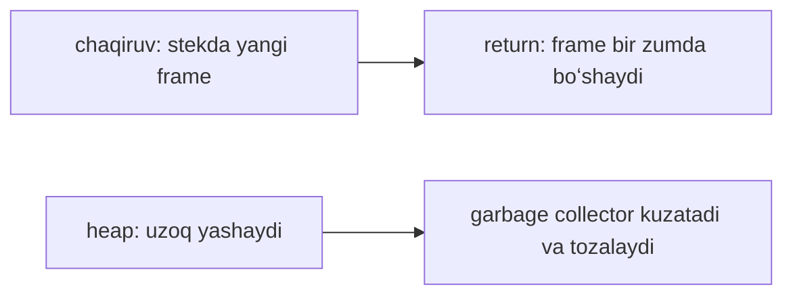

<div lang="uz">

🌐 **Oʻzbekcha** · [Русский](/lab/youtube/go/go-1-11/ru) · [English](/lab/youtube/go/go-1-11/en)  
Dars GO-1.11 · [Go: 0 → Guru](/lab/youtube/go#go-1-11) · ▶️ video tez orada · 💻 [GitHub](https://github.com/abdurahmon27/go-backend-uz/tree/main/lessons/011-pointers-escape)

> Bu sahifa videodagi darsning toʻliq yozma shakli: videoni koʻrmasdan (yoki eshitmasdan) ham shu yerdan oʻrganish mumkin.

## Nimani oʻrganasiz

Ikki funksiya bir xil buyurtma yaratadi. Biri buyurtmaning nusxasini qaytaradi, ikkinchisi esa uning xotiradagi
manzilini. Oʻlchab koʻrsak, ikkinchisi har chaqiruvda xotiradan 16 bayt yangi joy oladi, birinchisi esa hech narsa
olmaydi. Keyin kodning bitta izoh qatorini oʻchiramiz, va ikkinchi funksiya ham joy olmay qoʻyadi. Bitta izoh
qanday qilib xotira sarfini oʻzgartiradi? Javobni kompilyatorning oʻzidan soʻraymiz.

**Bitta gʻoya:** pointer qiymatning manzilini beradi. Qiymat qayerda yashashini (stekdami yoki heap'dami) esa
dasturchi emas, kompilyator hal qiladi. Uning qarorini `-gcflags=-m` bilan oʻqish mumkin, narxini esa benchmark
aytadi.

Dars oxirida siz:

- `&` bilan manzil olib, `*` va pointer orqali asl qiymatni oʻzgartira olasiz, nusxa bilan pointer farqini bilasiz;
- stek va heap farqini, kompilyator qiymatni qachon heap'ga qoʻyishini tushuntirib bera olasiz;
- `go build -gcflags=-m` chiqishidagi `moved to heap`, `does not escape`, `leaking param`, `escapes to heap`
  xabarlarini oʻqiy olasiz;
- slice elementiga olingan pointer `append` dan keyin nega «yoʻqolishini» topib, tuzata olasiz.

Bugungi uchta asosiy yangi soʻz:

| Soʻz | Oddiy maʼnosi | Inglizcha |
|---|---|---|
| pointer | qiymatning xotiradagi manzilini saqlaydigan qiymat; JS/Python'dagi havolaning (reference) ochiq yozilgan shakli | pointer |
| frame | funksiyaning har bir chaqiruviga stekda ajratiladigan oʻz joyi | stack frame |
| escape analysis (qochish tahlili) | kompilyatorning tekshiruvi: qiymat funksiyadan keyin ham kerakmi, demak heap'ga «qochadimi» | escape analysis |

Yoʻl-yoʻlakay ikkita yordamchi soʻz ham uchraydi: **`nil`** (hech narsaga ishora qilmaydigan pointer) va
**garbage collector** (heap'dagi keraksiz qiymatlarni tozalaydigan yordamchi). Ikkalasini kerak boʻlgan joyda
tushuntiramiz.

## Oldin bilish kerak

- [GO-1.10 · Struct'lar va xotira: bir xil maydonlar, 24 va 16 bayt](/lab/youtube/go/go-1-10): struct, maydon,
  `Buyurtma{Summa: 100}` kabi yozuv (composite literal) va `unsafe.Sizeof` bilan struct oʻlchami.
- [GO-1.08 · Slice'lar: append tuzogʻi va eskirgan 1024 qoidasi](/lab/youtube/go/go-1-08): slice ichidagi massiv,
  `len` (uzunlik), `cap` (sigʻim), joy qolmasa `append` yangi massiv ajratishi; stek va heap haqida birinchi
  tanishuv.
- [GO-1.07 · Taxmin qilmang, oʻlchang: birinchi test va benchmark](/lab/youtube/go/go-1-07): `go test -bench . -benchmem`,
  `ns/op`, `B/op`, `allocs/op` ustunlari, `for b.Loop()` va inline (kompilyator funksiya tanasini chaqiruv joyiga
  koʻchirishi).
- [GO-1.06 · Funksiyalar: ikki qiymat qaytarish, closure va variadic](/lab/youtube/go/go-1-06): Go'da hamma argument
  nusxalanadi; `hisob` dasturidagi closure. Uning «Chuqurroq» qismida `-gcflags` bayrogʻini bir marta koʻrgan
  edik, bugun uni toʻliq ochamiz.
- [GO-1.05 · Go'da while yoʻq: bitta for va uning hamma shakllari](/lab/youtube/go/go-1-05): `&d` — «`d` ning manzili»,
  `*p` — «`p` manzilidagi qiymat».
- [GO-1.01 · Go nega bor? go build ichida nima bor](/lab/youtube/go#go-1-01): `go build` dasturni tarjima qiladi, lekin
  ishga tushirmaydi.
- `pointer/`, `slaysp/` va `slaysfix/` dasturlarini [go.dev/play](https://go.dev/play) ga koʻchirib, **Run** bilan
  ishga tushirish mumkin. Qolgan hamma narsa (`-gcflags` bayrogʻi va benchmark'lar) uchun kompyuteringizda Go
  kerak: terminalni kurs papkasida (`lessons/011-pointers-escape`) oching, buyruqlar oʻsha yerdan ishlaydi.
- Natijalar `go1.26.8` da olingan. Eski Go versiyasida `-gcflags=-m` xabarlari biroz boshqacha boʻlishi mumkin.

Avval oldingi darsni eslaymiz. Bu struct necha bayt joy egallaydi (`unsafe.Sizeof`)?

```go
type Buyurtma struct {
	Summa      int64
	Tolandi    bool
	Yetkazildi bool
}
```

<details>
<summary>Javob</summary>

**16 bayt.** `int64` 8 bayt, ikkita `bool` 1 baytdan, jami 10 bayt. Struct oʻlchami eng katta maydon tekislanishiga
(8 ga) karrali boʻlishi kerak, shuning uchun oxiriga 6 bayt boʻsh joy (padding) qoʻshiladi: 16. Bu son bugun
darhol uchraydi.

</details>

## Jumboq: bitta izoh qatori

Bu kurs papkasidagi `hook/buyurtma.go`. Unda bir xil buyurtma yaratadigan ikki funksiya bor:

```go filename="hook/buyurtma.go" showLineNumbers
// hook: ikki funksiya bir xil buyurtma yaratadi. Biri qiymat qaytaradi,
// ikkinchisi pointer. Qaysi biri xotira ajratadi?
package hook

type Buyurtma struct {
	Summa      int64
	Tolandi    bool
	Yetkazildi bool
}

// go:noinline: kompilyator funksiyani chaqiruv joyiga koʻchirmasin
// (inline qilmasin), shunda har bir funksiyani alohida oʻlchaymiz.

//go:noinline
func yarat(summa int64) Buyurtma {
	b := Buyurtma{Summa: summa}
	return b
}

//go:noinline
func yaratP(summa int64) *Buyurtma {
	b := Buyurtma{Summa: summa}
	return &b
}
```

| Qator | Kod | Nima qiladi |
|---|---|---|
| 3 | `package hook` | bu `main` emas, oddiy paket: uni faqat benchmark ishlatadi |
| 5–9 | `type Buyurtma struct {…}` | eslash savolidagi 16 baytli struct |
| 14 | `//go:noinline` | kompilyatorga maxsus izoh (direktiva): «bu funksiyani inline qilma». `//` dan keyin boʻsh joy **yoʻq**, aks holda bu oddiy izoh boʻlib qoladi |
| 15 | `func yarat(summa int64) Buyurtma {` | `int64` oladi va `Buyurtma` ning oʻzini qaytaradi |
| 16 | `b := Buyurtma{Summa: summa}` | lokal (faqat shu funksiya ichidagi) `b` buyurtmasi; qolgan maydonlar zero value |
| 17 | `return b` | `b` ning **nusxasini** qaytaradi |
| 21 | `func yaratP(summa int64) *Buyurtma {` | `*Buyurtma` — «`Buyurtma` ning manzili» turi. Funksiya buyurtmani emas, manzilini qaytaradi |
| 23 | `return &b` | `&b` — «`b` ning manzili» (GO-1.05 da koʻrgan edik) |

`*` va `&` ni keyingi boʻlimda batafsil ochamiz. Hozircha shuni bilish yetadi: `yarat` buyurtmaning nusxasini,
`yaratP` esa manzilini beradi. Ularni oʻlchaydigan benchmark `hook/hook_test.go` da:

```go filename="hook/hook_test.go" showLineNumbers
package hook

import "testing"

func BenchmarkQiymat(b *testing.B) {
	for b.Loop() {
		_ = yarat(100)
	}
}

func BenchmarkPointer(b *testing.B) {
	for b.Loop() {
		_ = yaratP(100)
	}
}
```

Ikki benchmark, har biri bitta funksiyani qayta-qayta chaqiradi ([GO-1.07](/lab/youtube/go/go-1-07) dagi kabi). `_ =`
natijani tashlab yuboradi. `-benchmem` esa vaqtdan tashqari xotira ajratishni ham sanaydi:

```console
$ go test -bench . -benchmem ./hook
goos: linux
goarch: amd64
pkg: github.com/abdurahmon27/go-backend-uz/lessons/011-pointers-escape/hook
cpu: 12th Gen Intel(R) Core(TM) i5-12450H
BenchmarkQiymat-12     	1000000000	         0.7896 ns/op	       0 B/op	       0 allocs/op
BenchmarkPointer-12    	76790593	        14.42 ns/op	      16 B/op	       1 allocs/op
PASS
ok  	github.com/abdurahmon27/go-backend-uz/lessons/011-pointers-escape/hook	1.900s
```

| Benchmark | `B/op` | `allocs/op` | Maʼnosi |
|---|---|---|---|
| `Qiymat` (`yarat`) | 0 | 0 | xotiradan yangi joy olinmadi |
| `Pointer` (`yaratP`) | 16 | 1 | har chaqiruvda bitta yangi 16 baytli joy: aynan bitta `Buyurtma` |

Nanosekundlar har ishga tushirishda biroz oʻzgaradi, `B/op` va `allocs/op` esa oʻzgarmaydi. Shuning uchun biz
vaqtga emas, xotira ustunlariga qaraymiz.

Endi `inl/` papkasi. Undagi `inl/buyurtma.go` `hook/buyurtma.go` bilan bir xil. Faqat fayl boshidagi izoh va
paket nomi boshqa, hamda `yaratP` tepasidagi bitta `//go:noinline` qatori oʻchirilgan:

```go
func yaratP(summa int64) *Buyurtma {
	b := Buyurtma{Summa: summa}
	return &b
}
```

`inl/inl_test.go` ham xuddi shu ikki benchmark. Ishga tushiramiz:

```console
$ go test -bench . -benchmem ./inl
goos: linux
goarch: amd64
pkg: github.com/abdurahmon27/go-backend-uz/lessons/011-pointers-escape/inl
cpu: 12th Gen Intel(R) Core(TM) i5-12450H
BenchmarkQiymat-12     	1000000000	         0.8330 ns/op	       0 B/op	       0 allocs/op
BenchmarkPointer-12    	1000000000	         0.7943 ns/op	       0 B/op	       0 allocs/op
PASS
ok  	github.com/abdurahmon27/go-backend-uz/lessons/011-pointers-escape/inl	1.630s
```

Endi `Pointer` ham `0 B/op`, `0 allocs/op`. Bitta izoh qatori xotira ajratishni yoʻq qildi. Bu qanday ishlashini
tushunish uchun avval pointer nima ekanini, keyin qiymat qayerda yashashini koʻramiz. Oxirida bu jumboqqa
qaytamiz.

## Pointer: manzilning nusxasi

Buyurtmani «toʻlandi» deb belgilaydigan funksiya kerak. [GO-1.06](/lab/youtube/go/go-1-06) da koʻrdik: Go'da funksiyaga
har doim argumentning **nusxasi** beriladi. Struct ham butunligicha nusxalanadi. Funksiya nusxani oʻzgartirsa,
asl buyurtma oʻzgarmaydi.

JavaScript yoki Python'dan kelgan boʻlsangiz, bu kutilmagan boʻlishi mumkin. JS'da obyektni funksiyaga bersangiz,
funksiya uning xossalarini oʻzgartira oladi va oʻzgarish tashqarida ham koʻrinadi (MDN). Python'da argument
«assignment orqali» uzatiladi: funksiyadagi nom chaqiruvchi bilan bitta obyektga qaraydi (Python FAQ). Go'da esa
struct — obyektga havola emas, qiymatning oʻzi: `c := b` ham, funksiyaga berish ham butun struct'ni nusxalaydi.
«Ikki nom, bitta obyekt» xulqi Go'da ochiq yoziladi: **pointer** bilan.

Pointer — qiymatning xotiradagi manzilini saqlaydigan qiymat (inglizcha *pointer*, «koʻrsatkich»). JS va
Python'dagi havoladan farqi: uning turi koʻrinadi (`*Buyurtma`), manzilni olish (`&`) va manzil boʻyicha borish
(`*`) ham kodda yoziladi, va u `nil` boʻlishi mumkin. Uch belgi:

| Yozuv | Oʻqilishi | Maʼnosi |
|---|---|---|
| `&b` | «`b` ning manzili» | `b` xotirada qayerda turgani; natija — pointer |
| `*Buyurtma` | «`Buyurtma` ga pointer» | tur nomi: `Buyurtma` ning manzilini saqlaydigan qiymat |
| `*p` | «`p` manzilidagi qiymat» | pointer boʻyicha borib, asl qiymatning oʻzini olish |

Bir belgi ikki joyda ikki xil ishlaydi: tur oldida (`*Buyurtma`) `*` «pointer turi» degani, qiymat oldida (`*p`)
esa «manzil boʻyicha bor» degani. [GO-1.07](/lab/youtube/go/go-1-07) dan beri yozib kelayotgan `b *testing.B` ham pointer:
`testing.B` ga pointer.

Bu `pointer/main.go`:

```go filename="pointer/main.go" showLineNumbers
// pointer: qiymat nusxa boʻlib uzatiladi, pointer esa asl qiymatga yoʻl beradi.
package main

import "fmt"

type Buyurtma struct {
	Summa   int64
	Tolandi bool
}

// tola: b — nusxa. Oʻzgarish chaqiruvchiga yetmaydi.
func tola(b Buyurtma) {
	b.Tolandi = true
}

// tolaP: p — manzil. *p orqali asl buyurtmani oʻzgartiramiz.
func tolaP(p *Buyurtma) {
	p.Tolandi = true // (*p).Tolandi ning qisqa yozuvi
}

func main() {
	b := Buyurtma{Summa: 50_000}

	tola(b)
	fmt.Println("tola:  ", b.Tolandi)

	tolaP(&b)
	fmt.Println("tolaP: ", b.Tolandi)

	var p *Buyurtma // zero value: nil
	fmt.Println("p == nil:", p == nil)
}
```

| Qator | Kod | Nima qiladi |
|---|---|---|
| 6–9 | `type Buyurtma struct {…}` | ikki maydonli buyurtma: summa va «toʻlandimi?» |
| 12 | `func tola(b Buyurtma) {` | `tola` («toʻla») buyurtmaning **nusxasini** oladi |
| 13 | `b.Tolandi = true` | nusxadagi maydonni `true` qiladi |
| 17 | `func tolaP(p *Buyurtma) {` | `tolaP` buyurtmaning **manzilini** oladi |
| 18 | `p.Tolandi = true` | manzil boʻyicha borib, asl buyurtmaning maydonini oʻzgartiradi. Toʻliq yozuvi `(*p).Tolandi`, lekin struct maydoniga murojaat qilganda Go `*` ni oʻzi qoʻyadi |
| 22 | `b := Buyurtma{Summa: 50_000}` | `main` dagi buyurtma; `50_000` — 50000, `_` faqat oʻqishni osonlashtiradi |
| 24 | `tola(b)` | `b` ning nusxasi beriladi |
| 25 | `fmt.Println("tola:  ", b.Tolandi)` | `main` dagi `b.Tolandi` ni chiqaradi |
| 27 | `tolaP(&b)` | `b` ning manzili beriladi |
| 30 | `var p *Buyurtma` | qiymatsiz eʼlon qilingan pointer: uning zero value'si `nil` |
| 31 | `fmt.Println("p == nil:", p == nil)` | `p` `nil` ga tengmi? |

`tolaP(&b)` da ham nusxa olinadi. Lekin bu buyurtmaning emas, **manzilning nusxasi**: 8 baytlik son. Asl manzil
ham, uning nusxasi ham bitta buyurtmaga qaraydi.

Ishga tushirishdan oldin oʻylab koʻring: birinchi ikki qatorda nima chiqadi? **A)** `true`, `true` ·
**B)** `false`, `true` · **C)** `false`, `false`

<details>
<summary>Javob</summary>

**B: `false`, keyin `true`.** `tola` nusxani oʻzgartirdi, `main` dagi `b` ga hech kim tegmadi. `tolaP` esa
manzil boʻyicha borib, `main` dagi `b` ning oʻzini oʻzgartirdi. «A» ni tanlagan boʻlsangiz, `tola` ham asl
buyurtmani oladi deb oʻylagansiz. «C» ni tanlagan boʻlsangiz, pointer ham nusxalanadi, demak u ham hech narsani
oʻzgartirmaydi deb oʻylagansiz: nusxalanadi, lekin nusxa oʻsha manzilni saqlaydi.

</details>

```console
$ go run ./pointer
tola:   false
tolaP:  true
p == nil: true
```

Xotira rasmi:

```text
tola(b):    main:  b [ 50000 | false ]
            tola:  b [ 50000 | true  ]     alohida nusxa, funksiya tugashi bilan yoʻqoladi

tolaP(&b):  main:  b [ 50000 | true  ]  ◄──┐
            tolaP: p [ b ning manzili ] ───┘  manzilning nusxasi, lekin oʻsha b ga qaraydi
```

Pointer'ning zero value'si **`nil`**: bunday pointer hech narsaga ishora qilmaydi (JS'dagi `null`, Python'dagi
`None` ga oʻxshaydi). `nil` pointer orqali maydonni oʻqisangiz yoki yozsangiz, dastur **panic** bilan (favqulodda) toʻxtaydi. Buni pastda,
«Koʻp uchraydigan xatolar» da ishga tushirib koʻramiz.

## Stek va heap: qiymat qayerda yashaydi

Endi bu buyurtmalar xotiraning qayerida turadi? Go dasturida xotiraning ikki qismi bor.

**Stek** ([GO-1.08](/lab/youtube/go/go-1-08) da tanishgan edik) — funksiya chaqiruvlari uchun tezkor xotira. Funksiya
chaqirilganda stek tepasida uning lokal oʻzgaruvchilari uchun joy ajratiladi. Bu joy inglizcha **stack frame** yoki
qisqacha **frame** deyiladi. Inline qilinmagan har bir chaqiruv stekda oʻz frame'ini oladi. Funksiya qaytganda
frame bir zumda boʻshaydi: stek tepasini koʻrsatadigan registr (stack pointer) orqaga suriladi, xolos. Shuning
uchun frame'ni boʻshatish deyarli tekin.

**Heap** — uzoqroq yashaydigan qiymatlar uchun umumiy xotira. Undan joy olish qimmatroq. Bundan tashqari,
heap'dagi har bir qiymatni keyinroq tozalash kerak. Bu ishni **garbage collector** («axlat yigʻuvchi») qiladi: u
dastur ishlab turganda qaysi qiymatni hech kim ishlatmayotganini tekshirib, joyini boʻshatadi. Bu ham vaqt oladi.

Python'da hamma obyekt heap'da yashaydi (Python hujjatlari: *"a private heap containing all Python objects"*), va
siz buni tanlamaysiz. Go'da ham garbage collector bor, lekin farqi bor: har bir qiymat uchun stek yoki heap'ni
kompilyator tanlaydi.



Muhim: **Go'da qiymatni qayerga qoʻyishni dasturchi emas, kompilyator hal qiladi.** Go'ning rasmiy
savol-javoblari (Go FAQ) aytadi: dastur toʻgʻri ishlashi uchun qiymat qayerda turganini bilish shart emas.
Lekin tezlik uchun bu muhim: `yaratP` ning 16 bayti aynan heap'dan olingan edi.

## Qoida: kompilyator isbotlay olmasa — heap

C tilida lokal oʻzgaruvchining manzilini qaytarsangiz, kod ogohlantirish bilan kompilyatsiya boʻladi. Lekin
funksiya tugagach, uning frame'i yoʻqoladi, pointer esa yoʻq joyga qarab qoladi: **osilib qolgan pointer**
(dangling pointer). Uni ishlatish *undefined behavior*, yaʼni natijasi aniqlanmagan: dastur ishlashi ham,
yiqilishi ham, jim notoʻgʻri ishlashi ham mumkin (C11 standarti, §6.2.4).

Go'da esa `yaratP` dagi `return &b` xavfsiz. Effective Go aytadi: *"unlike in C, it's perfectly OK to return the
address of a local variable"* — «C'dan farqli, lokal oʻzgaruvchining manzilini qaytarish mutlaqo toʻgʻri». Buni
kompilyator taʼminlaydi. Go FAQ'dagi qoida:

> *"if the compiler cannot prove that the variable is not referenced after the function returns, then the compiler
> must allocate the variable on the garbage-collected heap to avoid dangling pointer errors."*

Yaʼni: oʻzgaruvchi funksiya qaytgandan keyin ishlatilmasligini kompilyator **isbotlay olmasa**, uni heap'ga
qoʻyadi. `yaratP` da `b` ning manzili funksiyadan tashqariga chiqadi, shuning uchun `b` heap'da yaratiladi. Shu
tekshiruv **escape analysis** (qochish tahlili) deyiladi: kompilyator har bir qiymat funksiyadan «qochadimi»
(inglizcha *escape*) yoki yoʻqmi, shuni aniqlaydi.

Yana bir sabab: juda katta oʻzgaruvchi ham heap'ga tushishi mumkin (FAQ: *"if a local variable is very large, it
might make more sense to store it on the heap"*).

Kompilyatorning manba kodida (`cmd/compile/internal/escape/escape.go`) bu tahlilning ikki qoidasi yozilgan:

1. heap'dagi qiymat stekdagi qiymatga ishora qilmasligi kerak;
2. pointer oʻzi ishora qilgan stekdagi qiymatdan uzoq yashamasligi kerak.

Ikkalasi ham bitta narsani taʼminlaydi: hech bir pointer yoʻqolgan frame'ga qarab qolmaydi.

## -gcflags=-m: kompilyatordan soʻraymiz

Kompilyator qarorini qanday koʻramiz? `go build` ga (GO-1.01) `-gcflags=-m` bayrogʻini beramiz. `gc` — Go
kompilyatorining nomi, `-gcflags` esa «kompilyatorga shu bayroqlarni uzat» degani. `-m` kompilyatorga
«qarorlaringni yoz» deydi: nimani inline qildi, nimani heap'ga qoʻydi.

Beshta holatni `escape/escape.go` da yigʻamiz:

```go filename="escape/escape.go" showLineNumbers
// escape: kompilyator qaysi oʻzgaruvchini heap'ga chiqaradi?
// go build -gcflags=-m ./escape
package escape

import "fmt"

type Buyurtma struct {
	Summa   int64
	Tolandi bool
}

// 1. Lokal oʻzgaruvchining manzili qaytariladi:
// funksiya tugagach ham yashashi kerak.
func yangi(summa int64) *Buyurtma {
	b := Buyurtma{Summa: summa}
	return &b
}

// 2. Pointer pastga uzatiladi, lekin hech qayerda saqlanmaydi.
func summa(p *Buyurtma) int64 {
	return p.Summa
}

// 3. Pointer global oʻzgaruvchiga yoziladi.
var oxirgi *Buyurtma

func eslab(p *Buyurtma) {
	oxirgi = p
}

// 4. Qiymat interface'ga (any) aylanadi: fmt.Println ...any oladi.
func chop(b Buyurtma) {
	fmt.Println(b.Summa)
}

// 5. Lokal slice: oʻlchami kichik va oʻzgarmas — stack'da;
// juda katta yoki oʻlchami noma'lum — kompilyator qaror qiladi.
func hajm(n int) int {
	kichik := make([]byte, 64)
	katta := make([]byte, 100_000)
	nomalum := make([]byte, n)
	return len(kichik) + len(katta) + len(nomalum)
}
```

| Qator | Kod | Nima qiladi |
|---|---|---|
| 14–17 | `func yangi(…) *Buyurtma` | **1-holat:** lokal `b` ning manzili qaytariladi (`yaratP` bilan bir xil) |
| 20–22 | `func summa(p *Buyurtma) int64` | **2-holat:** pointer faqat oʻqish uchun keladi: `p.Summa` qaytariladi, `p` hech qayerda saqlanmaydi |
| 25 | `var oxirgi *Buyurtma` | funksiyadan tashqarida eʼlon qilingan **global** oʻzgaruvchi: u butun dastur davomida yashaydi |
| 27–29 | `func eslab(p *Buyurtma)` | **3-holat:** `eslab` («eslab qol») pointer'ni global `oxirgi` ga yozadi |
| 32–34 | `func chop(b Buyurtma)` | **4-holat:** `chop` («chop et») summani `fmt.Println` ga beradi |
| 38–43 | `func hajm(n int) int` | **5-holat:** uchta slice. `make([]byte, 64)` — 64 baytlik slice ([GO-1.08](/lab/youtube/go/go-1-08)); 100 000 baytlik; va oʻlchami `n` ga bogʻliq, yaʼni kompilyatsiya paytida nomaʼlum |

Bu paketda `main` yoʻq, uni ishga tushirmaymiz, faqat tarjima qilamiz. Kompilyatorning xabarlari bizga kerak.

Ishga tushirishdan oldin bitta savol. `yangi` dagi `b` qayerda yaratiladi? **A)** stekda: funksiya tugashi bilan
yoʻqoladi va pointer osilib qoladi · **B)** heap'da · **C)** kompilyatsiya xatosi

<details>
<summary>Javob</summary>

**B: heap'da.** `b` ning manzili `return` orqali funksiyadan chiqadi. Kompilyator `b` funksiyadan keyin
ishlatilmasligini isbotlay olmaydi (aksincha, aynan ishlatiladi), shuning uchun uni heap'ga qoʻyadi. «A» — C
tilidagi xulq: Go'da osilib qolgan pointer boʻlmaydi. «C» emas: Go'da lokal manzilni qaytarish mutlaqo toʻgʻri.

</details>

```console
$ go build -gcflags=-m ./escape
# github.com/abdurahmon27/go-backend-uz/lessons/011-pointers-escape/escape
escape/escape.go:14:6: can inline yangi
escape/escape.go:20:6: can inline summa
escape/escape.go:27:6: can inline eslab
escape/escape.go:32:6: can inline chop
escape/escape.go:38:6: can inline hajm
escape/escape.go:33:13: inlining call to fmt.Println
escape/escape.go:15:2: moved to heap: b
escape/escape.go:20:12: p does not escape
escape/escape.go:27:12: leaking param: p
escape/escape.go:33:13: ... argument does not escape
escape/escape.go:33:15: b.Summa escapes to heap
escape/escape.go:39:16: make([]byte, 64) does not escape
escape/escape.go:40:15: make([]byte, 100000) escapes to heap
escape/escape.go:41:17: make([]byte, n) does not escape
```

Har bir qator `fayl:qator:ustun: xabar` shaklida. `#` bilan boshlangan birinchi qator — paketning toʻliq nomi.
Keyingi olti qator inline haqida: *can inline yangi* — «`yangi` ni inline qilish mumkin», *inlining call to
fmt.Println* — «`fmt.Println` chaqiruvi inline qilindi». Ular bizga keyinroq kerak boʻladi. Qolganlarini
holatma-holat oʻqiymiz:

| Holat | Xabar | Tarjimasi | Maʼnosi |
|---|---|---|---|
| 1 | `15:2: moved to heap: b` | «`b` heap'ga koʻchirildi» | manzil funksiyadan chiqdi: `b` heap'da yaratiladi |
| 2 | `20:12: p does not escape` | «`p` qochmaydi» | `summa` pointer'ni hech qayerda saqlamaydi |
| 3 | `27:12: leaking param: p` | «`p` parametri oqib chiqyapti» | pointer funksiyadan tashqariga (global oʻzgaruvchiga) chiqdi |
| 4 | `33:15: b.Summa escapes to heap` | «`b.Summa` heap'ga qochadi» | `Println` ga berilgan qiymat |
| 5 | `39:16`, `40:15`, `41:17` | | uchta slice: pastda alohida boʻlimda |

4-holat tushuntirish talab qiladi. `fmt.Println` istalgan turdagi qiymatni qabul qiladi: uning parametri `...any`.
`any` — «istalgan tur». Shunday parametrga berilgan qiymat **interface** ichiga joylanadi: qiymat oʻz turi haqidagi
yozuv bilan birga oʻraladi (interface'larni [GO-1.13](/lab/youtube/go/go-1-13) da oʻrganamiz). Kompilyator bu holatni
«qochdi» deb belgilaydi. Lekin runtime (Go har bir dasturga qoʻshadigan yordamchi kod) manfiy boʻlmagan, bir
baytga sigʻadigan sonlar (0 dan 255 gacha) uchun xotira ajratmaydi. Buni «Chuqurroq» boʻlimida oʻlchaymiz.

`... argument does not escape` qatori esa `Println` ning `...any` parametri uchun yigʻilgan roʻyxat haqida: u
stekda qoladi.

## -m=2: nega qochdi?

«Qochdi» deyish yetmaydi, «nega?» deb ham soʻrash mumkin. `-m=2` bayrogʻi sababni ham yozadi. Uning chiqishi juda
uzun, shuning uchun undan kerakli qismni ajratib olamiz. Buyruqni boʻlaklab oʻqiymiz:

- `2>&1` — kompilyator xabarlarini xatolar oqimiga yozadi; bu yozuv ularni oddiy chiqishga qoʻshadi, shunda keyingi
  buyruq ularni koʻradi;
- `|` — chap buyruq chiqishini oʻngdagi buyruqqa uzatadi;
- `grep -A3 'b escapes'` — `b escapes` soʻzlari bor qatorni va undan keyingi 3 qatorni qoldiradi.

```console
$ go build -gcflags=-m=2 ./escape 2>&1 | grep -A3 'b escapes'
escape/escape.go:15:2: b escapes to heap in yangi:
escape/escape.go:15:2:   flow: ~r0 ← &b:
escape/escape.go:15:2:     from &b (address-of) at escape/escape.go:16:9
escape/escape.go:15:2:     from return &b (return) at escape/escape.go:16:2
```

Pastdan yuqoriga oʻqiymiz:

| Qator | Tarjimasi |
|---|---|
| `b escapes to heap in yangi:` | «`b` `yangi` ichida heap'ga qochadi:» |
| `flow: ~r0 ← &b:` | «oqim: `&b` → `~r0`». `~r0` — kompilyator funksiyaning birinchi qaytgan qiymatiga bergan ichki nom |
| `from &b (address-of) at …16:9` | 16-qator, 9-ustun: `&b` — manzil olindi |
| `from return &b (return) at …16:2` | 16-qator, 2-ustun: bu manzil `return` bilan funksiya natijasiga ketdi |

Kompilyator yoʻlni qatorma-qator koʻrsatdi: manzil olindi → natijaga yozildi → funksiyadan chiqdi.

## Uchta slice: 64 bayt, 100 000 bayt va n

Endi 5-holatning uchta qatori:

| Kod | `-m` xabari | Qayerda |
|---|---|---|
| `make([]byte, 64)` | `does not escape` | stekda |
| `make([]byte, 100_000)` | `escapes to heap` | heap'da: 64 KiB dan katta |
| `make([]byte, n)` | `does not escape` | stekda 32 baytgacha (Go 1.25 dan), kattasi baribir heap'da |

**Kichik slice** stekda qoldi. **100 000 baytlik slice** esa hech qayerga chiqmasa ham heap'ga tushdi. Bu
yuqoridagi «juda katta oʻzgaruvchi» qoidasi. `make` yoki `new` bilan yaratiladigan qiymatlar uchun chegara
kompilyator kodida yozilgan: 64 KiB, yaʼni 65 536 bayt (`cmd/compile/internal/ir/cfg.go`,
`MaxImplicitStackVarSize`).

**Oʻlchami nomaʼlum slice** ham qochmadi. Eski qoida «oʻlchami nomaʼlum boʻlsa — heap» edi. Lekin Go 1.25 dan beri
kompilyator bunday `make` uchun stekda kichik zaxira joy ajratadi. Hozircha bu joy 32 bayt (Keith Randall, *Allocating
on the Stack*, Go blogi, 2026). `n` shu joyga sigʻsa, slice stekda turadi. Sigʻmasa, runtime joyni baribir heap'dan
oladi.

Demak, muhim ogohlantirish: **`does not escape` koʻrsangiz ham, xotira heap'dan olinishi mumkin.** `-m` faqat
kompilyatsiya paytidagi qarorni aytadi. Dastur ishlaganda haqiqatan nima boʻlishini benchmark koʻrsatadi
(uy vazifasining guru darajasida aynan shuni oʻlchaysiz).

## Pauza: summa(&a) yoki eslab(&b)?

Endi sizga bitta savol. Ikki funksiya oʻz buyurtmasini yaratib, uning manzilini boshqa funksiyaga beradi:

```go
func birinchi() int64 {
	a := Buyurtma{Summa: 100}
	return summa(&a)
}

func ikkinchi() {
	b := Buyurtma{Summa: 200}
	eslab(&b)
}
```

`summa` va `eslab` — yuqoridagi `escape.go` dagi funksiyalar: `summa` faqat `p.Summa` ni oʻqiydi, `eslab` esa
pointer'ni global `oxirgi` ga yozadi. Qaysi buyurtma heap'ga chiqadi? **A)** faqat `a` · **B)** faqat `b` ·
**C)** ikkalasi ham. Ishora: `leaking param` nimani anglatardi?

<details>
<summary>Javob</summary>

**B: faqat `b`.** Kompilyator har bir funksiya haqida qisqa xulosa saqlaydi: uning parametri bilan nima boʻladi
(kompilyator kodida bu *parameter tags* deyiladi). `summa` uchun xulosa: «`p does not escape`», pointer hech
qayerda saqlanmaydi. Shuning uchun `a` stekda qoladi. `eslab` uchun xulosa: «`leaking param: p`». Demak, `eslab`
ga manzil bergan **har bir** chaqiruvchining oʻzgaruvchisi heap'ga chiqadi. «A» ni tanlagan boʻlsangiz, `summa` va
`eslab` ni almashtirib yuborgansiz. «C» ni tanlagan boʻlsangiz, manzilni boshqa funksiyaga berishning oʻzi
qochish deb oʻylagansiz: yoʻq, qaysi funksiyaga berilgani muhim.

</details>

Bu kurs papkasidagi `savol/savol.go`:

```go filename="savol/savol.go" showLineNumbers
// savol: ikki chaqiruvchi, ikkalasi lokal buyurtmaning manzilini beradi.
// Qaysi buyurtma heap'ga chiqadi? (go:noinline: kompilyator chaqiruvchini
// faqat funksiyaning qisqa xulosasi — "parameter tags" — boʻyicha tahlil qilsin)
// go build -gcflags=-m ./savol 2>&1 | grep moved
package savol

type Buyurtma struct {
	Summa   int64
	Tolandi bool
}

//go:noinline
func summa(p *Buyurtma) int64 { return p.Summa } // p does not escape

var oxirgi *Buyurtma

//go:noinline
func eslab(p *Buyurtma) { oxirgi = p } // leaking param: p

func birinchi() int64 {
	a := Buyurtma{Summa: 100}
	return summa(&a)
}

func ikkinchi() {
	b := Buyurtma{Summa: 200}
	eslab(&b)
}
```

`summa` va `eslab` bu yerda bir qatorda yozilgan va `//go:noinline` bilan belgilangan. Aks holda kompilyator ularni
`birinchi` va `ikkinchi` ichiga koʻchirar edi, va qaror xulosadan emas, koʻchirilgan tanadan chiqar edi (natija
baribir bir xil boʻladi).

```console
$ go build -gcflags=-m ./savol
# github.com/abdurahmon27/go-backend-uz/lessons/011-pointers-escape/savol
savol/savol.go:20:6: can inline birinchi
savol/savol.go:25:6: can inline ikkinchi
savol/savol.go:13:12: p does not escape
savol/savol.go:18:12: leaking param: p
savol/savol.go:26:2: moved to heap: b
```

`moved to heap` faqat bitta: 26-qatordagi `b`. 21-qatordagi `a` haqida bunday xabar yoʻq, u stekda.

## Jumboqqa qaytamiz: inline qarorni oʻzgartiradi

Endi boshidagi sir. `inl/` da `yaratP` tepasidagi `//go:noinline` oʻchirilgan edi. Shunda kompilyator `yaratP` ni
benchmark ichiga **inline** qiladi: uning uch qatorini `BenchmarkPointer` siklining ichiga koʻchiradi. Endi
kompilyator buyurtma faqat shu sikl ichida ishlatilishini koʻradi va uni stekda qoldiradi.

```text
inline'dan oldin:                      inline'dan keyin:
BenchmarkPointer → yaratP(100)         BenchmarkPointer:
  yaratP: b → return &b (qochadi)        b := Buyurtma{Summa: 100}
          → heap, 16 B                   _ = &b    (sikldan chiqmaydi) → stek, 0 B
```

Buni kompilyatorning oʻzidan soʻraymiz. Benchmark `_test.go` faylida, `go build` esa test fayllarini tarjima
qilmaydi. Shuning uchun `go test` ishlatamiz: `-run '^$'` hech qaysi testga mos kelmaydigan filtr, yaʼni testlar
ishga tushmaydi, paket faqat tarjima qilinadi. Chiqish uzun, `grep -E '…'` undan `inl/` bilan boshlanib, `yaratP`
yoki `heap` soʻzi bor qatorlarni qoldiradi (`-E` `|` ni «yoki» deb oʻqishga ruxsat beradi):

```console
$ go test -gcflags=-m -run '^$' ./inl 2>&1 | grep -E '^inl/.*(yaratP|heap)'
inl/buyurtma.go:19:6: can inline yaratP
inl/inl_test.go:13:13: inlining call to yaratP
inl/buyurtma.go:20:2: moved to heap: b
```

| Qator | Maʼnosi |
|---|---|
| `can inline yaratP` | `yaratP` ni inline qilish mumkin |
| `inl_test.go:13:13: inlining call to yaratP` | benchmark'ning 13-qatoridagi chaqiruv inline qilindi |
| `buyurtma.go:20:2: moved to heap: b` | `b` heap'ga koʻchirildi — lekin bu `yaratP` ning **alohida nusxasi** haqida |

Uchinchi qator chalgʻitadi. `-m` baribir `moved to heap: b` deydi. Bu gap funksiyaning alohida, inline
qilinmagan nusxasi haqida: uni boshqa paketdan kimdir oddiy chaqirsa, shu nusxa ishlaydi. Benchmark esa inline
qilingan nusxani ishlatadi, va u yerda `b` stekda: shuning uchun `0 allocs/op`.

[GO-1.06](/lab/youtube/go/go-1-06) dagi `hisob` hisoblagichida ham xuddi shunday. `cd ../006-functions` buyrugʻi oltinchi
dars papkasiga oʻtadi, `&&` esa «oldingi buyruq muvaffaqiyatli boʻlsa, keyingisini bajar». `-o /dev/null` tayyor
faylni hech qayerga saqlamaydi: bizga faqat xabarlar kerak.

```console
$ cd ../006-functions && go build -o /dev/null -gcflags=-m ./hisob 2>&1 | grep -E 'moved|func literal|inlining call to hisob'
hisob/main.go:14:18: inlining call to hisoblagich
hisob/main.go:15:18: inlining call to hisoblagich
hisob/main.go:6:2: moved to heap: n
hisob/main.go:7:9: func literal escapes to heap
hisob/main.go:14:18: func literal does not escape
hisob/main.go:15:18: func literal does not escape
```

`func literal` — nomsiz funksiya, bu yerda `hisoblagich` qaytaradigan closure. Alohida `hisoblagich` funksiyasida
`n` heap'ga koʻchadi (6-qator) va closure qochadi (7-qator). `main` ning 14 va 15-qatorlarida esa `hisoblagich`
inline qilindi, va u yerda closure qochmaydi (*func literal does not escape*). GO-1.06 da «`n` qayerda yashaydi?»
degan savolni shu darsga qoldirgan edik: javob — chaqiruv joyiga bogʻliq.

Lekin inline qilishning chegarasi bor. Kompilyator faqat kichik funksiyalarni inline qiladi. Bir nechta `if` va
sikli bor kattaroq konstruktor odatda inline qilinmaydi, va undan qaytarilgan pointer koʻpincha heap'ga chiqadi.
Shuning uchun «`//go:noinline` ni olib tashlasam, pointer tekin boʻladi» deb umumlashtirmang.

## Tuzoq: pointer bor, oʻzgarish yoʻq

Endi slice'dagi bitta xavfli tuzoq. Bu `slaysp/main.go`, kod **ataylab xato**:

```go filename="slaysp/main.go" showLineNumbers
// slaysp: slice elementiga pointer, keyin append. Ataylab xato.
package main

import "fmt"

type Buyurtma struct {
	Summa   int64
	Tolandi bool
}

func main() {
	s := []Buyurtma{{Summa: 100}, {Summa: 200}} // len 2, cap 2
	p := &s[0]                                  // birinchi buyurtmaga pointer

	s = append(s, Buyurtma{Summa: 300}) // cap yetmadi: yangi massiv
	p.Tolandi = true                    // eski massivni oʻzgartiradi

	fmt.Println("p.Tolandi:   ", p.Tolandi)
	fmt.Println("s[0].Tolandi:", s[0].Tolandi)
	fmt.Println("bir joymi?   ", p == &s[0])
}
```

| Qator | Kod | Nima qiladi |
|---|---|---|
| 12 | `s := []Buyurtma{{Summa: 100}, {Summa: 200}}` | ikki buyurtmali slice. Ichki `{…}` da tur nomi tushirib qoldirilgan: Go uni `Buyurtma` deb biladi. `len` = `cap` = 2 |
| 13 | `p := &s[0]` | slice'ning 0-elementiga, yaʼni massivdagi birinchi buyurtmaga pointer |
| 15 | `s = append(s, …)` | uchinchi buyurtmani qoʻshadi |
| 16 | `p.Tolandi = true` | pointer orqali birinchi buyurtmani «toʻlandi» deb belgilaydi |
| 18–20 | `fmt.Println(…)` | pointer koʻrgan qiymat, slice'dagi qiymat va `p` hali ham `s[0]` ga qaraydimi (`p == &s[0]`) |

Ishga tushirishdan oldin oʻylab koʻring: `p.Tolandi` va `s[0].Tolandi` nima boʻladi? **A)** `true`, `true` ·
**B)** `true`, `false` · **C)** `false`, `false`

<details>
<summary>Javob</summary>

**B: `true`, `false`.** Slice'ning sigʻimi 2 edi, ikkalasi ham band. [GO-1.08](/lab/youtube/go/go-1-08) dagi qoida: joy
yetmasa, `append` **yangi massiv** ajratadi, eski elementlarni unga nusxalaydi va yangi slice'ni qaytaradi. `s`
endi yangi massivga qaraydi, `p` esa eski massivda qoldi. `p.Tolandi = true` eski massivdagi buyurtmani
oʻzgartirdi, uni esa endi hech kim koʻrmaydi. «A» ni tanlagan boʻlsangiz, `append` doim oʻsha massivga yozadi deb
oʻylagansiz. «C» emas: pointer oʻzi qaragan joyni haqiqatan oʻzgartirdi.

</details>

```console
$ go run ./slaysp
p.Tolandi:    true
s[0].Tolandi: false
bir joymi?    false
```

`bir joymi? false`: `p` va `&s[0]` endi har xil manzil.

```text
append'dan oldin:   s ──► eski massiv [ 100 | 200 ]
                    p ──►             ▲ (0-element)

append'dan keyin:   p ──► eski massiv [ 100 ✔ | 200 ]       Tolandi = true shu yerda
                    s ──► yangi massiv [ 100 | 200 | 300 | … ]  s[0].Tolandi = false
```

Eng yomoni: sigʻim yetganda xato **koʻrinmaydi**. Agar slice'da boʻsh joy boʻlsa, `append` oʻsha massivga yozadi,
`p` va `s[0]` bitta joy boʻlib qoladi va hammasi toʻgʻri ishlaydi. Shuning uchun bu xato testlardan oson oʻtib
ketadi: test boʻsh joyli slice bilan ishlasa, xato umuman koʻrinmaydi.

Kompilyator ham, `go vet` ham bu xatoni koʻrmaydi:

```console
$ go vet ./slaysp && echo vet: jim
vet: jim
```

`go vet` hech narsa topmadi, shuning uchun `&&` dan keyingi `echo vet: jim` ishladi (`echo` shunchaki matnni
chiqaradi).

**Tuzatish oddiy:** slice elementiga pointer'ni uzoq saqlamang. `append` dan keyin elementga indeks orqali murojaat
qiling yoki pointer'ni `append` dan keyin qayta oling. Bu `slaysfix/main.go`:

```go filename="slaysfix/main.go" showLineNumbers
// slaysfix: pointer'ni append'dan keyin oling yoki indeks bilan ishlang.
package main

import "fmt"

type Buyurtma struct {
	Summa   int64
	Tolandi bool
}

func main() {
	s := []Buyurtma{{Summa: 100}, {Summa: 200}}

	s = append(s, Buyurtma{Summa: 300})
	s[0].Tolandi = true // indeks orqali: har doim hozirgi massiv

	fmt.Println("s[0].Tolandi:", s[0].Tolandi)
}
```

- **14-qator:** avval `append`.
- **15-qator:** keyin `s[0]` orqali yozamiz: `s` doim hozirgi massivga qaraydi.

```console
$ go run ./slaysfix
s[0].Tolandi: true
```

Yana bir yoʻl — slice'da qiymatlarni emas, pointer'larni saqlash: `[]*Buyurtma`. Shunda `append` massivni
koʻchirsa ham, har bir buyurtma joyida qoladi. Bu JS yoki Python'dagi obyektlar roʻyxatiga yaqin: roʻyxatda
obyektlarning oʻzi emas, ularga havolalar turadi. Lekin har bir element alohida heap qiymati boʻladi, bu ham oʻz
narxiga ega (README).

## Xulosa: pointer qachon kerak?

| Holat | Tanlov |
|---|---|
| funksiya qiymatni oʻzgartirishi kerak (`tolaP`) | pointer |
| kichik struct (`Buyurtma`, 16 bayt) | nusxa koʻpincha arzonroq: pointer'ni tezlik uchun ishlatmang |
| katta struct | pointer haqiqatan tezroq boʻlishi mumkin |
| ishonchingiz komil emas | `-gcflags=-m` bilan qarang, keyin benchmark bilan oʻlchang |

Kichik struct'da pointer tez degan fikr notoʻgʻri ekanini jumboqda koʻrdik: `yaratP` 16 baytli heap ajratish bilan
sekinroq edi. Katta struct'da esa aksincha. Kurs papkasidagi `katta/katta_test.go` 4096 baytli struct'ni ikki xil
uzatadi:

```go filename="katta/katta_test.go" showLineNumbers
// katta: 4 KiB'lik struct. Qiymat bilan uzatilsa, har chaqiruvda 4096 bayt
// nusxalanadi; pointer bilan — faqat 8 baytlik manzil.
// go test -bench . ./katta
package katta

import "testing"

type Hisobot struct {
	Qatorlar [512]int64 // 4096 bayt
}

//go:noinline
func jamiQ(h Hisobot) int64 { return h.Qatorlar[0] + h.Qatorlar[511] }

//go:noinline
func jamiP(h *Hisobot) int64 { return h.Qatorlar[0] + h.Qatorlar[511] }

var h Hisobot

func BenchmarkQiymat(b *testing.B) {
	for b.Loop() {
		jamiQ(h)
	}
}

func BenchmarkPointer(b *testing.B) {
	for b.Loop() {
		jamiP(&h)
	}
}
```

- **8–10-qator:** `Hisobot` («hisobot») ichida 512 ta `int64` dan iborat massiv: 512 × 8 = 4096 bayt.
  `[512]int64` — oʻlchami oʻzgarmas massiv ([GO-1.08](/lab/youtube/go/go-1-08)).
- **13-qator:** `jamiQ` struct'ning nusxasini oladi: har chaqiruvda 4096 bayt koʻchiriladi.
- **16-qator:** `jamiP` faqat 8 baytlik manzilni oladi.
- **18-qator:** global `h` dastur boshidan oxirigacha mavjud, uni har chaqiruvda yaratish kerak emas. Shuning uchun
  ikkala benchmark ham xotira ajratmaydi.

```console
$ go test -bench . -benchmem ./katta
goos: linux
goarch: amd64
pkg: github.com/abdurahmon27/go-backend-uz/lessons/011-pointers-escape/katta
cpu: 12th Gen Intel(R) Core(TM) i5-12450H
BenchmarkQiymat-12     	31075632	        38.97 ns/op	       0 B/op	       0 allocs/op
BenchmarkPointer-12    	1000000000	         0.7064 ns/op	       0 B/op	       0 allocs/op
PASS
ok  	github.com/abdurahmon27/go-backend-uz/lessons/011-pointers-escape/katta	1.921s
```

Bu kompyuterda 4096 baytni nusxalash ≈39 ns, manzilni berish ≈0,7 ns oldi. Go wiki'dagi kod koʻrib chiqish
tavsiyalari ham shuni aytadi: bir necha baytni tejash uchun pointer bermang, lekin bu tavsiya *"does not apply to
large structs"* — «katta struct'larga taalluqli emas».

Heap'ga chiqqan har bir qiymat garbage collector uchun qoʻshimcha ish. Go jamoasi bu ustida ishlayapti: Go 1.25 da
kompilyator koʻproq slice'ni stekda qoldiradigan boʻldi, Go 1.26 da esa `append` ham shunday ishlaydi (Go blogi,
*Allocating on the Stack*). Shuning uchun qoida: `-m` bilan qarang, lekin oxirgi soʻzni benchmark aytadi.

Bugun koʻrdik: pointer manzilni beradi, kompilyator esa qiymat qayerda yashashini oʻzi hal qiladi. Keyingi darsda,
[GO-1.12](/lab/youtube/go/go-1-12) da, metodlarni oʻrganamiz: value receiver yoki pointer receiver, qachon qaysi birini
tanlash kerak?

## Chuqurroq (ixtiyoriy): Println, 0–255 sonlar va boshqa chegaralar

Bu boʻlim asosiy darsga kerak emas, u kurs README'si va research'dagi oʻlchovlardan.

**`Println` haqiqatan xotira ajratadimi?** 4-holatda `-m` «`b.Summa escapes to heap`» dedi. Buni sanab koʻramiz.
`testing.AllocsPerRun(1000, f)` `f` ni 1000 marta chaqirib, bir chaqiruvdagi ajratishlar sonini qaytaradi.
`fmt.Fprintln(io.Discard, v)` — `Println` ning oʻzi, faqat matn ekranga emas, «hech qayerga» (`io.Discard`) yoziladi.
Bu dastur kurs papkasida yoʻq, u alohida ishga tushirildi:

```go
package main

import (
	"fmt"
	"io"
	"testing"
)

func main() {
	for _, v := range []int64{100, 255, 256, 100_000, -1} {
		n := testing.AllocsPerRun(1000, func() {
			fmt.Fprintln(io.Discard, v)
		})
		fmt.Println(v, "→", n, "allocs")
	}
}
```

```console
$ go run -trimpath boxing/main.go
100 → 0 allocs
255 → 0 allocs
256 → 1 allocs
100000 → 1 allocs
-1 → 1 allocs
```

0 dan 255 gacha sonlar uchun runtime tayyor jadvaldan (`runtime/iface.go` dagi `staticuint64s`) foydalanadi va
joy ajratmaydi. 256 dan boshlab va manfiy sonlarda har chaqiruvda bitta ajratish bor. Demak, `escapes to heap`
«ajratish boʻlishi mumkin» degani, «albatta boʻladi» emas.

**Boshqa chegaralar** (README'dan):

- `make`, `new` va `&T{}` bilan yaratiladigan qiymatlar uchun stek chegarasi 64 KiB, `var x T` uchun esa 128 KiB
  (`cmd/compile/internal/ir/cfg.go`).
- Inline byudjeti: kompilyator funksiyani «narxlaydi» va narxi 80 dan oshsa, odatda inline qilmaydi
  (`inlineMaxBudget = 80`). PGO (dastur ishlashidan yigʻilgan profil boʻyicha tarjima) koʻp chaqiriladigan
  funksiyalarga kattaroq byudjet beradi.
- `-gcflags=-m` faqat koʻrsatilgan paketga qoʻllanadi. Hamma paketlar uchun: `-gcflags=all=-m`.
- Go'da pointer arifmetikasi yoʻq: C'dagidek `p + 1` deb keyingi manzilga oʻtib boʻlmaydi (Go FAQ: *Why is there no
  pointer arithmetic?*). Bu xavfsizlik uchun.

## Koʻp uchraydigan xatolar

**1. «Pointer har doim tezroq» deb oʻylash.** Bu mavzuning eng keng tarqalgan notoʻgʻri tasavvuri. Jumboqda
koʻrdik: 16 baytli `Buyurtma` ni pointer bilan qaytarish har chaqiruvda heap ajratishga olib keldi (`16 B/op`,
`1 allocs/op`), nusxa esa hech narsa ajratmadi. Pointer faqat katta struct'da tezroq edi («Xulosa» boʻlimi).
**Tuzatish:** pointer'ni qiymatni oʻzgartirish kerak boʻlganda ishlating. Tezlik uchun ishlatmoqchi boʻlsangiz,
avval benchmark bilan oʻlchang.

**2. Slice elementiga pointer olib, keyin `append` qilish.** «Tuzoq» boʻlimida koʻrdik: `p := &s[0]`, keyin
`append`, va `p` orqali yozilgan oʻzgarish slice'da koʻrinmaydi. Xato bermaydi, `go vet` jim, sigʻim yetsa esa
umuman koʻrinmaydi. **Tuzatish:** `append` dan keyin indeks orqali yozing (`s[0].Tolandi = true`) yoki pointer'ni
`append` dan keyin qayta oling.

**3. `nil` pointer orqali maydonga murojaat qilish.** (Bu misol kurs papkasida yoʻq, alohida ishga tushirildi.)

```go
package main

import "fmt"

type Buyurtma struct {
	Summa   int64
	Tolandi bool
}

func main() {
	var p *Buyurtma // nil: hech narsaga ishora qilmaydi
	fmt.Println(p.Summa)
}
```

```console
$ go run -trimpath nilp/main.go
panic: runtime error: invalid memory address or nil pointer dereference
[signal SIGSEGV: segmentation violation code=0x1 addr=0x0 pc=0x49e156]

goroutine 1 [running]:
main.main()
	./main.go:12 +0x16
exit status 2
```

`-trimpath` faqat xabardagi fayl yoʻlini qisqa qiladi. Xabarni oʻqiymiz: *invalid memory address or nil pointer
dereference* — «notoʻgʻri xotira manzili yoki `nil` pointer boʻyicha qiymatga borish». *SIGSEGV* — operatsion
tizimning signali: dastur ruxsat etilmagan manzilga (`addr=0x0`, yaʼni nol manzilga) murojaat qildi. `main.go:12`
— 12-qator, `fmt.Println(p.Summa)`. Kompilyator bu xatoni koʻrmaydi: u faqat dastur ishlaganda chiqadi.
**Tuzatish:** pointer'ni ishlatishdan oldin unga haqiqiy manzil bering (`p := &Buyurtma{}`) yoki tekshiring:
`if p != nil { … }`.

**4. Pointer kutilgan joyga qiymatning oʻzini berish.** `tolaP` pointer kutadi, biz esa `b` ning oʻzini berdik.
(Kurs papkasida yoʻq, alohida ishga tushirildi.)

```go
package main

import "fmt"

type Buyurtma struct {
	Summa   int64
	Tolandi bool
}

func tolaP(p *Buyurtma) {
	p.Tolandi = true
}

func main() {
	b := Buyurtma{Summa: 50_000}
	tolaP(b)
	fmt.Println(b.Tolandi)
}
```

```console
$ go run turxato/main.go
# command-line-arguments
turxato/main.go:16:8: cannot use b (variable of struct type Buyurtma) as *Buyurtma value in argument to tolaP
```

16-qator, 8-ustun: *cannot use b (variable of struct type Buyurtma) as \*Buyurtma value in argument to tolaP* —
«`b` ni (`Buyurtma` struct turidagi oʻzgaruvchini) `tolaP` argumenti sifatida `*Buyurtma` qiymati oʻrnida
ishlatib boʻlmaydi». `Buyurtma` va `*Buyurtma` — ikki xil tur. **Tuzatish:** manzilni bering: `tolaP(&b)`.

**5. `does not escape` = «xotira ajratilmaydi» deb oʻylash.** «Uchta slice» boʻlimida koʻrdik: `make([]byte, n)`
uchun `-m` *does not escape* deydi, lekin `n` 32 baytlik zaxiraga sigʻmasa, runtime baribir heap'dan joy oladi.
`escapes to heap` ham doim ajratish degani emas («Chuqurroq» boʻlimi). **Tuzatish:** `-m` ni yoʻl koʻrsatkich deb
biling, narxni `go test -bench . -benchmem` bilan oʻlchang.

**6. Go'da lokal oʻzgaruvchining manzilini qaytarish xavfli deb oʻylash.** C'dan kelganlar `return &b` dan
qoʻrqishadi. Go'da bu xato emas: kompilyator `b` ni heap'ga qoʻyadi va pointer osilib qolmaydi («Qoida» boʻlimi).
**Tuzatish:** qoʻrqmang, lekin bu heap ajratish ekanini biling.

## Oʻzingizni tekshiring

Avval oʻzingiz javob bering, keyin oching.

**1.** `&b` va `*p` nima qiladi? `*Buyurtma` turi nimani bildiradi?

<details>
<summary>Javob</summary>

`&b` — `b` ning manzilini oladi (natija pointer). `*p` — `p` manzilidagi qiymatning oʻziga boradi. `*Buyurtma` —
«`Buyurtma` ga pointer», yaʼni `Buyurtma` ning manzilini saqlaydigan qiymat turi.

</details>

**2.** Bu kod nima chiqaradi? **A)** `10 99` · **B)** `99 99` · **C)** `10 10`

```go
a := Buyurtma{Summa: 10}
p := &a
q := p
q.Summa = 99
fmt.Println(a.Summa, p.Summa)
```

<details>
<summary>Javob</summary>

**B: `99 99`.** `q := p` pointer'ning nusxasini oladi, lekin nusxa oʻsha manzilni saqlaydi. `p` ham, `q` ham bitta
`a` ga qaraydi, shuning uchun `q.Summa = 99` `a` ning oʻzini oʻzgartirdi. «A» ni tanlagan boʻlsangiz, `q := p` yangi
buyurtma yaratadi deb oʻylagansiz.

Toʻliq dastur (kurs papkasida yoʻq, alohida ishga tushirildi):

```go
package main

import "fmt"

type Buyurtma struct {
	Summa   int64
	Tolandi bool
}

func main() {
	a := Buyurtma{Summa: 10}
	p := &a
	q := p
	q.Summa = 99
	fmt.Println(a.Summa, p.Summa)
}
```

```console
$ go run savol1/main.go
99 99
```

</details>

**3.** `-gcflags=-m` `leaking param: p` desa, bu funksiyani chaqirgan kodga qanday taʼsir qiladi?

<details>
<summary>Javob</summary>

Funksiya `p` ni oʻzidan tashqariga (masalan, global oʻzgaruvchiga) chiqaradi. Kompilyator buni funksiyaning
xulosasida saqlaydi, va shu funksiyaga manzil bergan har bir chaqiruvchining oʻzgaruvchisi heap'ga chiqadi:
`eslab(&b)` → `moved to heap: b`.

</details>

**4.** Nima uchun `-m` *does not escape* desa ham, xotira heap'dan olinishi mumkin?

<details>
<summary>Javob</summary>

`-m` kompilyatsiya paytidagi qarorni aytadi. Oʻlchami nomaʼlum `make([]byte, n)` uchun kompilyator stekda faqat
32 baytlik zaxira joy ajratadi (Go 1.25 dan). `n` kattaroq boʻlsa, joy dastur ishlaganda heap'dan olinadi. Haqiqiy
narxni benchmark koʻrsatadi.

</details>

**5.** `yaratP` tepasidagi `//go:noinline` ni oʻchirsak, nega `allocs/op` 1 dan 0 ga tushadi?

<details>
<summary>Javob</summary>

Kompilyator `yaratP` ni benchmark ichiga inline qiladi. Endi u buyurtma faqat sikl ichida ishlatilishini koʻradi
va uni stekda qoldiradi. Escape analysis inline'dan keyin, har bir chaqiruv joyida qaror qiladi.

</details>

**6.** [GO-1.08](/lab/youtube/go/go-1-08) dan: `s := make([]int, 1, 4)`, keyin `t := append(s, 5)`. `append` yangi massiv
ajratadimi?

<details>
<summary>Javob</summary>

Yoʻq. `len` 1, `cap` 4: massivda boʻsh joy bor, shuning uchun `append` oʻsha massivga yozadi va `t` ham `s` bilan
bitta massivga qaraydi. Bugungi tuzoq aynan shuning uchun sigʻim yetganda koʻrinmaydi.

</details>

## Uy vazifasi

Toʻrt darajadagi vazifa. Hamma fayllar GitHub'dagi dars papkasida:
[lessons/011-pointers-escape](https://github.com/abdurahmon27/go-backend-uz/tree/main/lessons/011-pointers-escape).
Javoblar: [homework/](https://github.com/abdurahmon27/go-backend-uz/tree/main/lessons/011-pointers-escape/homework)
papkasi. Avval oʻzingiz urinib koʻring.

🟢 **Oson:** butun sonning manzilini qaytaradigan funksiya yozing. `-gcflags=-m` nima deyishini oldindan ayting,
keyin tekshiring.

<details>
<summary>Javob</summary>

`homework/oson/oson.go`: `yangiSon` («yangi son») ichida `x := 42` va `return &x`. Bu `yangi` dagi 1-holatning
oʻzi: manzil funksiyadan chiqadi, shuning uchun `x` heap'ga koʻchiriladi.

```console
$ go build -gcflags=-m ./homework/oson
# github.com/abdurahmon27/go-backend-uz/lessons/011-pointers-escape/homework/oson
homework/oson/oson.go:6:6: can inline yangiSon
homework/oson/oson.go:7:2: moved to heap: x
```

</details>

🟡 **Oʻrta:** `chop` funksiyasini `fmt.Println` siz yozing, shunda `-m` hech narsa qochdi demasin.

<details>
<summary>Javob</summary>

`homework/orta/orta.go`. `var buf [24]byte` — stekdagi 24 baytlik massiv. `strconv.AppendInt` summani matnga
aylantirib, shu massivga yozadi, `append(s, '\n')` yangi qator belgisini qoʻshadi, `os.Stdout.Write(s)` esa
baytlarni ekranga chiqaradi. `any` yoʻq, demak interface'ga joylash ham yoʻq. `grep -v inlin` inline haqidagi
qatorlarni olib tashlaydi (`-v` — «mos kelmaganlarini qoldir»):

```console
$ go build -gcflags=-m ./homework/orta 2>&1 | grep -v inlin
# github.com/abdurahmon27/go-backend-uz/lessons/011-pointers-escape/homework/orta
homework/orta/orta.go:20:12: append does not escape
```

Bitta xabar qoldi: `append does not escape` — hech narsa qochmadi.

</details>

🟠 **Qiyin:** `&s[0]` + `append` tuzogʻini test bilan ushlang va tuzating. Ikkala holatni tekshiring: `cap` yetadi
va `cap` yetmaydi.

<details>
<summary>Javob</summary>

`homework/qiyin/`. `qoshXato` — `slaysp` dagi xato funksiya koʻrinishida, `qosh` — indeks orqali toʻgʻri versiya.
`TestQosh` jadval test: `make([]Buyurtma, 1, 4)` (boʻsh joy bor) va `make([]Buyurtma, 1)` (boʻsh joy yoʻq).
Xato faqat ikkinchi holatda chiqadi, shuning uchun jadvalda ikkalasi ham kerak. `TestQosh` ni `qoshXato` bilan
ishlatsangiz, «cap yetmaydi» holati yiqiladi. `TestXatoBor` esa xato haqiqatan borligini koʻrsatadi (u oʻtadi).

```console
$ go test -v ./homework/qiyin
=== RUN   TestQosh
=== RUN   TestQosh/cap_yetadi
=== RUN   TestQosh/cap_yetmaydi
--- PASS: TestQosh (0.00s)
    --- PASS: TestQosh/cap_yetadi (0.00s)
    --- PASS: TestQosh/cap_yetmaydi (0.00s)
=== RUN   TestXatoBor
    qiyin_test.go:32: qoshXato: s[0].Tolandi = false — oʻzgarish eski massivda qoldi
--- PASS: TestXatoBor (0.00s)
PASS
ok  	github.com/abdurahmon27/go-backend-uz/lessons/011-pointers-escape/homework/qiyin	0.002s
```

</details>

🔴 **Guru:** oʻlchami nomaʼlum `make([]int64, n)` ning nechta elementi stekka sigʻadi? Javobni benchmark bilan
toping.

<details>
<summary>Javob</summary>

**4 ta.** Stekdagi zaxira joy 32 bayt, `int64` esa 8 bayt: 32 ÷ 8 = 4. `homework/guru/guru_test.go` da `ishlat(4)`
va `ishlat(5)` oʻlchanadi:

```console
$ go test -bench . -benchmem ./homework/guru
goos: linux
goarch: amd64
pkg: github.com/abdurahmon27/go-backend-uz/lessons/011-pointers-escape/homework/guru
cpu: 12th Gen Intel(R) Core(TM) i5-12450H
BenchmarkMake4-12    	1000000000	         1.198 ns/op	       0 B/op	       0 allocs/op
BenchmarkMake5-12    	58778767	        19.51 ns/op	      48 B/op	       1 allocs/op
PASS
ok  	github.com/abdurahmon27/go-backend-uz/lessons/011-pointers-escape/homework/guru	2.348s
```

`n = 4` → 0 ajratish. `n = 5` (40 bayt) → 1 ajratish, 48 bayt: Go xotirani tayyor oʻlchamdagi bloklarda beradi
(size class, [GO-1.08](/lab/youtube/go/go-1-08)), 40 baytga eng yaqin blok 48 bayt. Ikkala holatda ham `-m` bir xil
`make([]int64, n) does not escape` deydi. `make([]byte, n)` uchun chegara 32 element.

</details>

## Manbalar

- Go FAQ: [How do I know whether a variable is allocated on the heap or the stack?](https://go.dev/doc/faq#stack_or_heap),
  [Why are function arguments passed by value?](https://go.dev/doc/faq#pass_by_value)
- [Effective Go: Composite literals](https://go.dev/doc/effective_go#composite_literals) (*"return the address of a
  local variable"*)
- Go'ning rasmiy qoidalari (Go spec): [Address operators](https://go.dev/ref/spec#Address_operators),
  [Selectors](https://go.dev/ref/spec#Selectors) (`p.z // (*p).z`; `nil` pointer → panic),
  [Appending to and copying slices](https://go.dev/ref/spec#Appending_and_copying_slices)
- [Go wiki: CodeReviewComments — Pass Values](https://go.dev/wiki/CodeReviewComments#pass-values)
- Keith Randall, [Allocating on the Stack](https://go.dev/blog/allocation-optimizations) (Go blogi, 2026)
- [cmd/compile](https://pkg.go.dev/cmd/compile): `-m` bayrogʻi va `//go:noinline` direktivasi
- JS va Python bilan solishtirish: [MDN: Functions — function parameters](https://developer.mozilla.org/en-US/docs/Web/JavaScript/Guide/Functions),
  [Python FAQ: call by reference](https://docs.python.org/3/faq/programming.html#how-do-i-write-a-function-with-output-parameters-call-by-reference),
  [Python: Memory Management](https://docs.python.org/3/c-api/memory.html)
- Stack frame va stack pointer: [CMU 15-213, Machine-Level Programming III: Procedures](https://www.cs.cmu.edu/~213/schedule.html)
- Go manba kodi: [cmd/compile/internal/escape/escape.go](https://github.com/golang/go/blob/go1.26.8/src/cmd/compile/internal/escape/escape.go)
  (ikki qoida, parameter tags), [cmd/compile/internal/ir/cfg.go](https://github.com/golang/go/blob/go1.26.8/src/cmd/compile/internal/ir/cfg.go)
  (`MaxImplicitStackVarSize`)
- C11 (N1570) §6.2.4 Storage durations of objects: [open-std.org](https://www.open-std.org/jtc1/sc22/wg14/www/docs/n1570.pdf)
- William Kennedy, [Language Mechanics On Stacks And Pointers](https://ardanlabs.com/blog/2017/05/language-mechanics-on-stacks-and-pointers.html),
  [Language Mechanics On Escape Analysis](https://ardanlabs.com/blog/2017/05/language-mechanics-on-escape-analysis.html)
  (Ardan Labs, 2017; Go 1.25 dan oldin yozilgan)
- Hamma natijalar `go1.26.8 linux/amd64` da (Intel i5-12450H), 2026-11-26 kuni olingan. `ns/op` har safar biroz
  oʻzgaradi, `B/op` va `allocs/op` oʻzgarmaydi.

## Video va kod

▶️ Video tez orada chiqadi. Bu sahifa darsni toʻliq oʻrgatadi, videoni kutish shart emas.

💻 [Kod va uy vazifasi javoblari GitHub'da](https://github.com/abdurahmon27/go-backend-uz/tree/main/lessons/011-pointers-escape)

---

← Oldingi dars: [GO-1.10](/lab/youtube/go/go-1-10) · Keyingi dars: [GO-1.12](/lab/youtube/go/go-1-12) → · [Barcha darslar](/lab/youtube/go)

</div>
