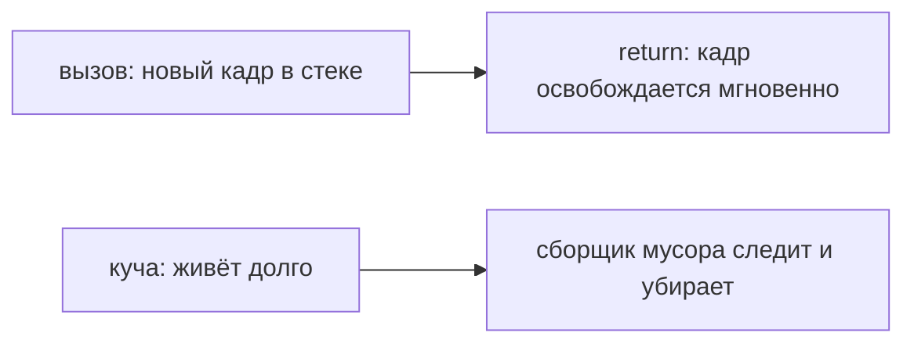

<div lang="ru">

🌐 [Oʻzbekcha](/lab/youtube/go/go-1-11) · **Русский** · [English](/lab/youtube/go/go-1-11/en)  
Урок GO-1.11 · [Go: 0 → Guru](/lab/youtube/go#go-1-11) · ▶️ видео скоро · 💻 [GitHub](https://github.com/abdurahmon27/go-backend-uz/tree/main/lessons/011-pointers-escape)

> Это полная письменная версия видеоурока: по ней можно учиться, не смотря (и не слушая) видео. Само видео на узбекском языке.

## Что вы узнаете

Две функции создают один и тот же заказ. Одна возвращает копию заказа, другая — его адрес в памяти. Если
измерить, вторая на каждый вызов берёт из памяти 16 новых байт, а первая не берёт ничего. Потом мы удаляем из
кода одну строку комментария, и вторая функция тоже перестаёт выделять память. Как один комментарий меняет
расход памяти? Спросим об этом сам компилятор.

**Главная идея:** указатель даёт адрес значения. А где значение живёт (в стеке или в куче), решает не
программист, а компилятор. Его решение можно прочитать через `-gcflags=-m`, а цену показывает бенчмарк.

К концу урока вы сможете:

- брать адрес через `&` и менять исходное значение через `*` и указатель, понимать разницу между копией и указателем;
- объяснить разницу между стеком и кучей и когда компилятор кладёт значение в кучу;
- читать сообщения `moved to heap`, `does not escape`, `leaking param`, `escapes to heap` в выводе
  `go build -gcflags=-m`;
- находить и исправлять ошибку, когда указатель на элемент слайса «теряет» изменение после `append`.

Три главных новых слова сегодня:

| Слово | Простой смысл | По-английски |
|---|---|---|
| указатель | значение, которое хранит адрес другого значения в памяти; явная форма ссылки (reference) из JS/Python | pointer |
| кадр стека | собственное место в стеке, которое выделяется каждому вызову функции | stack frame |
| escape-анализ (анализ «побега») | проверка компилятора: нужно ли значение после выхода из функции, то есть «сбегает» ли оно в кучу | escape analysis |

По дороге встретятся ещё два вспомогательных слова: **`nil`** (указатель, который ни на что не указывает) и
**сборщик мусора** (garbage collector: убирает ненужные значения из кучи). Оба объясним там, где они понадобятся.

## Что нужно знать заранее

- [GO-1.10 · Структуры и память: одинаковые поля, 24 и 16 байт](/lab/youtube/go/go-1-10/ru): структура, поле, запись вида
  `Buyurtma{Summa: 100}` (составной литерал, composite literal) и размер структуры через `unsafe.Sizeof`.
- [GO-1.08 · Слайсы: ловушка append и устаревшее правило 1024](/lab/youtube/go/go-1-08/ru): массив внутри слайса,
  `len` (длина), `cap` (ёмкость), новый массив в `append`, когда места нет; первое знакомство со стеком и кучей.
- [GO-1.07 · Не гадайте, измеряйте: первый тест и бенчмарк](/lab/youtube/go/go-1-07/ru): `go test -bench . -benchmem`,
  столбцы `ns/op`, `B/op`, `allocs/op`, `for b.Loop()` и встраивание (inline: компилятор переносит тело функции
  в место вызова).
- [GO-1.06 · Функции: два возвращаемых значения, замыкание и variadic](/lab/youtube/go/go-1-06/ru): в Go все аргументы
  копируются; замыкание в программе `hisob`. В его разделе «Глубже» мы один раз видели флаг `-gcflags`, сегодня
  разберём его полностью.
- [GO-1.05 · В Go нет while: один for и все его формы](/lab/youtube/go/go-1-05/ru): `&d` — «адрес `d`», `*p` — «значение по
  адресу `p`».
- [GO-1.01 · Зачем нужен Go? Что внутри go build](/lab/youtube/go/go-1-01/ru): `go build` переводит программу, но не
  запускает её.
- Программы `pointer/`, `slaysp/` и `slaysfix/` можно скопировать на [go.dev/play](https://go.dev/play) и запустить
  кнопкой **Run**. Для всего остального (флаг `-gcflags` и бенчмарки) нужен Go на вашем компьютере: откройте
  терминал в папке курса (`lessons/011-pointers-escape`), команды запускаются оттуда.
- Результаты получены на `go1.26.8`. В старых версиях Go сообщения `-gcflags=-m` могут немного отличаться.

Сначала вспомним прошлый урок. Сколько байт занимает эта структура (`unsafe.Sizeof`)?

```go
type Buyurtma struct {
	Summa      int64
	Tolandi    bool
	Yetkazildi bool
}
```

<details>
<summary>Ответ</summary>

**16 байт.** `int64` — 8 байт, два `bool` по 1 байту, всего 10 байт. Размер структуры должен быть кратен
выравниванию самого большого поля (8), поэтому в конце добавляется 6 пустых байт (padding): 16. Это число
встретится прямо сейчас.

</details>

## Загадка: одна строка комментария

Это файл `hook/buyurtma.go` из папки курса. В нём две функции, которые создают одинаковый заказ:

```go filename="hook/buyurtma.go" showLineNumbers
// hook: ikki funksiya bir xil buyurtma yaratadi. Biri qiymat qaytaradi,
// ikkinchisi pointer. Qaysi biri xotira ajratadi?
package hook

type Buyurtma struct {
	Summa      int64
	Tolandi    bool
	Yetkazildi bool
}

// go:noinline: kompilyator funksiyani chaqiruv joyiga koʻchirmasin
// (inline qilmasin), shunda har bir funksiyani alohida oʻlchaymiz.

//go:noinline
func yarat(summa int64) Buyurtma {
	b := Buyurtma{Summa: summa}
	return b
}

//go:noinline
func yaratP(summa int64) *Buyurtma {
	b := Buyurtma{Summa: summa}
	return &b
}
```

| Строка | Код | Что делает |
|---|---|---|
| 3 | `package hook` | это не `main`, а обычный пакет: его использует только бенчмарк |
| 5–9 | `type Buyurtma struct {…}` | 16-байтовая структура из вопроса выше (`Buyurtma` — «заказ») |
| 14 | `//go:noinline` | специальный комментарий для компилятора (директива): «не встраивай эту функцию». После `//` пробела **нет**, иначе это обычный комментарий |
| 15 | `func yarat(summa int64) Buyurtma {` | `yarat` («создай») принимает `int64` и возвращает сам `Buyurtma` |
| 16 | `b := Buyurtma{Summa: summa}` | локальный (только внутри этой функции) заказ `b`; остальные поля — нулевое значение |
| 17 | `return b` | возвращает **копию** `b` |
| 21 | `func yaratP(summa int64) *Buyurtma {` | `*Buyurtma` — тип «адрес `Buyurtma`». Функция возвращает не заказ, а его адрес |
| 23 | `return &b` | `&b` — «адрес `b`» (видели в GO-1.05) |

`*` и `&` подробно разберём в следующем разделе. Пока достаточно знать: `yarat` отдаёт копию заказа, а `yaratP` —
его адрес. Бенчмарк, который их измеряет, лежит в `hook/hook_test.go`:

```go filename="hook/hook_test.go" showLineNumbers
package hook

import "testing"

func BenchmarkQiymat(b *testing.B) {
	for b.Loop() {
		_ = yarat(100)
	}
}

func BenchmarkPointer(b *testing.B) {
	for b.Loop() {
		_ = yaratP(100)
	}
}
```

Два бенчмарка, каждый раз за разом вызывает одну функцию (как в [GO-1.07](/lab/youtube/go/go-1-07/ru)). `_ =` отбрасывает
результат. `-benchmem` кроме времени считает ещё и выделение памяти:

```console
$ go test -bench . -benchmem ./hook
goos: linux
goarch: amd64
pkg: github.com/abdurahmon27/go-backend-uz/lessons/011-pointers-escape/hook
cpu: 12th Gen Intel(R) Core(TM) i5-12450H
BenchmarkQiymat-12     	1000000000	         0.7896 ns/op	       0 B/op	       0 allocs/op
BenchmarkPointer-12    	76790593	        14.42 ns/op	      16 B/op	       1 allocs/op
PASS
ok  	github.com/abdurahmon27/go-backend-uz/lessons/011-pointers-escape/hook	1.900s
```

| Бенчмарк | `B/op` | `allocs/op` | Смысл |
|---|---|---|---|
| `Qiymat` (`yarat`) | 0 | 0 | новая память не выделялась |
| `Pointer` (`yaratP`) | 16 | 1 | на каждый вызов одно новое место в 16 байт: ровно один `Buyurtma` |

Наносекунды при каждом запуске немного меняются, а `B/op` и `allocs/op` — нет. Поэтому мы смотрим не на время,
а на столбцы памяти.

Теперь папка `inl/`. Файл `inl/buyurtma.go` такой же, как `hook/buyurtma.go`. Отличаются только комментарий в
начале файла и имя пакета, а ещё удалена одна строка `//go:noinline` над `yaratP`:

```go
func yaratP(summa int64) *Buyurtma {
	b := Buyurtma{Summa: summa}
	return &b
}
```

В `inl/inl_test.go` те же два бенчмарка. Запускаем:

```console
$ go test -bench . -benchmem ./inl
goos: linux
goarch: amd64
pkg: github.com/abdurahmon27/go-backend-uz/lessons/011-pointers-escape/inl
cpu: 12th Gen Intel(R) Core(TM) i5-12450H
BenchmarkQiymat-12     	1000000000	         0.8330 ns/op	       0 B/op	       0 allocs/op
BenchmarkPointer-12    	1000000000	         0.7943 ns/op	       0 B/op	       0 allocs/op
PASS
ok  	github.com/abdurahmon27/go-backend-uz/lessons/011-pointers-escape/inl	1.630s
```

Теперь и у `Pointer` `0 B/op`, `0 allocs/op`. Одна строка комментария убрала выделение памяти. Чтобы понять, как
это работает, сначала разберём, что такое указатель, потом — где живёт значение. В конце вернёмся к загадке.

## Указатель: копия адреса

Нужна функция, которая помечает заказ как «оплачен». В [GO-1.06](/lab/youtube/go/go-1-06/ru) мы видели: в Go функция всегда
получает **копию** аргумента. Структура тоже копируется целиком. Если функция меняет копию, исходный заказ не
меняется.

Если вы пришли из JavaScript или Python, это может удивить. В JS, если передать объект в функцию, она может
изменить его свойства, и изменение будет видно снаружи (MDN). В Python аргументы передаются «присваиванием»: имя
внутри функции указывает на тот же объект, что и у вызывающего кода (Python FAQ). А в Go структура — не ссылка на
объект, а само значение: и `c := b`, и передача в функцию копируют всю структуру. Поведение «два имени, один
объект» в Go записывается явно — через **указатель**.

Указатель — значение, которое хранит адрес другого значения в памяти (по-английски *pointer*). Отличие от
ссылки в JS и Python: его тип виден (`*Buyurtma`), взятие адреса (`&`) и переход по адресу (`*`) тоже пишутся в
коде, и он может быть `nil`. Три обозначения:

| Запись | Как читать | Смысл |
|---|---|---|
| `&b` | «адрес `b`» | где `b` лежит в памяти; результат — указатель |
| `*Buyurtma` | «указатель на `Buyurtma`» | имя типа: значение, которое хранит адрес `Buyurtma` |
| `*p` | «значение по адресу `p`» | перейти по указателю и получить само исходное значение |

Один знак работает в двух местах по-разному: перед типом (`*Buyurtma`) `*` означает «тип указателя», а перед
значением (`*p`) — «перейди по адресу». `b *testing.B`, который мы пишем с [GO-1.07](/lab/youtube/go/go-1-07/ru), — тоже
указатель: указатель на `testing.B`.

Это `pointer/main.go`:

```go filename="pointer/main.go" showLineNumbers
// pointer: qiymat nusxa boʻlib uzatiladi, pointer esa asl qiymatga yoʻl beradi.
package main

import "fmt"

type Buyurtma struct {
	Summa   int64
	Tolandi bool
}

// tola: b — nusxa. Oʻzgarish chaqiruvchiga yetmaydi.
func tola(b Buyurtma) {
	b.Tolandi = true
}

// tolaP: p — manzil. *p orqali asl buyurtmani oʻzgartiramiz.
func tolaP(p *Buyurtma) {
	p.Tolandi = true // (*p).Tolandi ning qisqa yozuvi
}

func main() {
	b := Buyurtma{Summa: 50_000}

	tola(b)
	fmt.Println("tola:  ", b.Tolandi)

	tolaP(&b)
	fmt.Println("tolaP: ", b.Tolandi)

	var p *Buyurtma // zero value: nil
	fmt.Println("p == nil:", p == nil)
}
```

| Строка | Код | Что делает |
|---|---|---|
| 6–9 | `type Buyurtma struct {…}` | заказ с двумя полями: сумма и «оплачен ли?» (`Tolandi`) |
| 12 | `func tola(b Buyurtma) {` | `tola` («оплати») получает **копию** заказа |
| 13 | `b.Tolandi = true` | ставит `true` в поле копии |
| 17 | `func tolaP(p *Buyurtma) {` | `tolaP` получает **адрес** заказа |
| 18 | `p.Tolandi = true` | переходит по адресу и меняет поле исходного заказа. Полная запись — `(*p).Tolandi`, но при обращении к полю структуры Go ставит `*` сам |
| 22 | `b := Buyurtma{Summa: 50_000}` | заказ в `main`; `50_000` — это 50000, `_` только облегчает чтение |
| 24 | `tola(b)` | передаётся копия `b` |
| 25 | `fmt.Println("tola:  ", b.Tolandi)` | выводит `b.Tolandi` из `main` |
| 27 | `tolaP(&b)` | передаётся адрес `b` |
| 30 | `var p *Buyurtma` | указатель, объявленный без значения: его нулевое значение — `nil` |
| 31 | `fmt.Println("p == nil:", p == nil)` | равен ли `p` значению `nil`? |

В `tolaP(&b)` тоже делается копия. Но это копия не заказа, а **адреса**: число в 8 байт. И исходный адрес, и его
копия указывают на один и тот же заказ.

Подумайте перед запуском: что выведут первые две строки? **A)** `true`, `true` · **B)** `false`, `true` ·
**C)** `false`, `false`

<details>
<summary>Ответ</summary>

**B: `false`, затем `true`.** `tola` изменила копию, `b` в `main` никто не трогал. `tolaP` же перешла по адресу и
изменила сам `b` из `main`. Если вы выбрали «A», вы думали, что `tola` тоже получает исходный заказ. Если «C» —
что раз указатель тоже копируется, то и он ничего не меняет: копируется, но копия хранит тот же адрес.

</details>

```console
$ go run ./pointer
tola:   false
tolaP:  true
p == nil: true
```

Картина памяти:

```text
tola(b):    main:  b [ 50000 | false ]
            tola:  b [ 50000 | true  ]     отдельная копия, исчезает с концом функции

tolaP(&b):  main:  b [ 50000 | true  ]  ◄──┐
            tolaP: p [ адрес b       ] ───┘  копия адреса, но смотрит на тот же b
```

Нулевое значение указателя — **`nil`**: такой указатель ни на что не указывает (похоже на `null` в JS и `None` в
Python). Если через `nil`-указатель прочитать или записать поле, программа остановится с **panic** (аварийно).
Запустим это ниже, в «Частых ошибках».

## Стек и куча: где живёт значение

Где же в памяти лежат эти заказы? У программы на Go есть две области памяти.

**Стек** (знакомились в [GO-1.08](/lab/youtube/go/go-1-08/ru)) — быстрая память для вызовов функций. При вызове функции на
вершине стека выделяется место для её локальных переменных. Это место по-английски называется **stack frame**,
по-русски **кадр стека**. Каждый вызов, который не был встроен, получает в стеке свой кадр. Когда функция
возвращается, кадр освобождается мгновенно: регистр, указывающий на вершину стека (stack pointer), просто
сдвигается обратно. Поэтому освобождение кадра почти бесплатно.

**Куча** (heap) — общая память для значений, которые живут дольше. Выделять в ней место дороже. Кроме того,
каждое значение в куче потом нужно убрать. Это делает **сборщик мусора** (garbage collector): пока программа
работает, он проверяет, какие значения больше никто не использует, и освобождает их место. На это тоже уходит
время.

В Python все объекты живут в куче (документация Python: *"a private heap containing all Python objects"*), и вы
этого не выбираете. В Go тоже есть сборщик мусора, но есть и отличие: для каждого значения стек или кучу
выбирает компилятор.



Важно: **в Go, куда положить значение, решает не программист, а компилятор.** Официальные вопросы и ответы Go
(Go FAQ) говорят: для правильной работы программы знать, где лежит значение, не нужно.
Но для скорости это важно: 16 байт `yaratP` были взяты именно из кучи.

## Правило: не может доказать — значит, куча

Если в C вернуть адрес локальной переменной, код скомпилируется с предупреждением. Но после выхода из функции её
кадр исчезает, а указатель продолжает смотреть в несуществующее место: **висячий указатель** (dangling pointer).
Его использование — *undefined behavior*, то есть результат не определён: программа может работать, упасть или
молча работать неправильно (стандарт C11, §6.2.4).

А в Go `return &b` в `yaratP` безопасен. Effective Go: *"unlike in C, it's perfectly OK to return the address of
a local variable"* — «в отличие от C, вернуть адрес локальной переменной совершенно нормально». Это обеспечивает
компилятор. Правило из Go FAQ:

> *"if the compiler cannot prove that the variable is not referenced after the function returns, then the compiler
> must allocate the variable on the garbage-collected heap to avoid dangling pointer errors."*

То есть: если компилятор **не может доказать**, что переменная не используется после возврата из функции, он
кладёт её в кучу. В `yaratP` адрес `b` выходит наружу, поэтому `b` создаётся в куче. Эта проверка называется
**escape-анализом** (escape analysis): компилятор определяет для каждого значения, «сбегает» ли оно из функции
(по-английски *escape*) или нет.

Есть и другая причина: очень большая переменная тоже может попасть в кучу (FAQ: *"if a local variable is very
large, it might make more sense to store it on the heap"*).

В исходном коде компилятора (`cmd/compile/internal/escape/escape.go`) записаны два правила этого анализа:

1. значение в куче не должно указывать на значение в стеке;
2. указатель не должен жить дольше значения в стеке, на которое он указывает.

Оба гарантируют одно: ни один указатель не останется смотреть в исчезнувший кадр.

## -gcflags=-m: спрашиваем компилятор

Как увидеть решение компилятора? Даём `go build` (GO-1.01) флаг `-gcflags=-m`. `gc` — имя компилятора Go, а
`-gcflags` означает «передай компилятору эти флаги». `-m` говорит компилятору «напиши свои решения»: что он
встроил, что положил в кучу.

Пять случаев собраны в `escape/escape.go`:

```go filename="escape/escape.go" showLineNumbers
// escape: kompilyator qaysi oʻzgaruvchini heap'ga chiqaradi?
// go build -gcflags=-m ./escape
package escape

import "fmt"

type Buyurtma struct {
	Summa   int64
	Tolandi bool
}

// 1. Lokal oʻzgaruvchining manzili qaytariladi:
// funksiya tugagach ham yashashi kerak.
func yangi(summa int64) *Buyurtma {
	b := Buyurtma{Summa: summa}
	return &b
}

// 2. Pointer pastga uzatiladi, lekin hech qayerda saqlanmaydi.
func summa(p *Buyurtma) int64 {
	return p.Summa
}

// 3. Pointer global oʻzgaruvchiga yoziladi.
var oxirgi *Buyurtma

func eslab(p *Buyurtma) {
	oxirgi = p
}

// 4. Qiymat interface'ga (any) aylanadi: fmt.Println ...any oladi.
func chop(b Buyurtma) {
	fmt.Println(b.Summa)
}

// 5. Lokal slice: oʻlchami kichik va oʻzgarmas — stack'da;
// juda katta yoki oʻlchami noma'lum — kompilyator qaror qiladi.
func hajm(n int) int {
	kichik := make([]byte, 64)
	katta := make([]byte, 100_000)
	nomalum := make([]byte, n)
	return len(kichik) + len(katta) + len(nomalum)
}
```

| Строка | Код | Что делает |
|---|---|---|
| 14–17 | `func yangi(…) *Buyurtma` | **Случай 1:** возвращается адрес локального `b` (как в `yaratP`); `yangi` — «новый» |
| 20–22 | `func summa(p *Buyurtma) int64` | **Случай 2:** указатель приходит только для чтения: возвращается `p.Summa`, `p` нигде не сохраняется |
| 25 | `var oxirgi *Buyurtma` | **глобальная** переменная, объявленная вне функций: живёт всё время работы программы (`oxirgi` — «последний») |
| 27–29 | `func eslab(p *Buyurtma)` | **Случай 3:** `eslab` («запомни») записывает указатель в глобальную `oxirgi` |
| 32–34 | `func chop(b Buyurtma)` | **Случай 4:** `chop` («напечатай») передаёт сумму в `fmt.Println` |
| 38–43 | `func hajm(n int) int` | **Случай 5:** три слайса. `make([]byte, 64)` — слайс на 64 байта ([GO-1.08](/lab/youtube/go/go-1-08/ru)); на 100 000 байт; и размером `n`, то есть неизвестным во время компиляции |

В этом пакете нет `main`, мы его не запускаем, а только переводим. Нам нужны сообщения компилятора.

Перед запуском вопрос. Где создаётся `b` из `yangi`? **A)** в стеке: исчезает с концом функции, и указатель
повисает · **B)** в куче · **C)** ошибка компиляции

<details>
<summary>Ответ</summary>

**B: в куче.** Адрес `b` выходит из функции через `return`. Компилятор не может доказать, что `b` не используется
после выхода из функции (наоборот, именно используется), поэтому кладёт её в кучу. «A» — поведение C: в Go висячих
указателей не бывает. Не «C»: в Go вернуть адрес локальной переменной совершенно нормально.

</details>

```console
$ go build -gcflags=-m ./escape
# github.com/abdurahmon27/go-backend-uz/lessons/011-pointers-escape/escape
escape/escape.go:14:6: can inline yangi
escape/escape.go:20:6: can inline summa
escape/escape.go:27:6: can inline eslab
escape/escape.go:32:6: can inline chop
escape/escape.go:38:6: can inline hajm
escape/escape.go:33:13: inlining call to fmt.Println
escape/escape.go:15:2: moved to heap: b
escape/escape.go:20:12: p does not escape
escape/escape.go:27:12: leaking param: p
escape/escape.go:33:13: ... argument does not escape
escape/escape.go:33:15: b.Summa escapes to heap
escape/escape.go:39:16: make([]byte, 64) does not escape
escape/escape.go:40:15: make([]byte, 100000) escapes to heap
escape/escape.go:41:17: make([]byte, n) does not escape
```

Каждая строка имеет вид `файл:строка:столбец: сообщение`. Первая строка с `#` — полное имя пакета. Следующие шесть
строк — о встраивании: *can inline yangi* — «`yangi` можно встроить», *inlining call to fmt.Println* — «вызов
`fmt.Println` встроен». Они понадобятся позже. Остальные читаем по случаям:

| Случай | Сообщение | Перевод | Смысл |
|---|---|---|---|
| 1 | `15:2: moved to heap: b` | «`b` перемещена в кучу» | адрес вышел из функции: `b` создаётся в куче |
| 2 | `20:12: p does not escape` | «`p` не сбегает» | `summa` нигде не сохраняет указатель |
| 3 | `27:12: leaking param: p` | «параметр `p` утекает» | указатель вышел из функции наружу (в глобальную переменную) |
| 4 | `33:15: b.Summa escapes to heap` | «`b.Summa` сбегает в кучу» | значение, переданное в `Println` |
| 5 | `39:16`, `40:15`, `41:17` | | три слайса: в отдельном разделе ниже |

Случай 4 требует пояснения. `fmt.Println` принимает значения любого типа: его параметр — `...any`. `any` — «любой
тип». Значение, переданное в такой параметр, упаковывается в **interface**: значение заворачивается вместе с записью
о своём типе (интерфейсы изучаем в [GO-1.13](/lab/youtube/go#go-1-13)). Компилятор помечает этот случай как «сбежало». Но
runtime (вспомогательный код, который Go добавляет в каждую программу) не выделяет память для неотрицательных
чисел, помещающихся в один байт (от 0 до 255). Измерим это в разделе «Глубже».

А строка `... argument does not escape` — о списке, который собирается для параметра `...any` у `Println`: он
остаётся в стеке.

## -m=2: почему сбежала?

Сказать «сбежала» мало, можно спросить и «почему?». Флаг `-m=2` пишет ещё и причину. Его вывод очень длинный,
поэтому вырежем нужную часть. Читаем команду по частям:

- `2>&1` — компилятор пишет сообщения в поток ошибок; эта запись добавляет их к обычному выводу, чтобы следующая
  команда их увидела;
- `|` — передаёт вывод левой команды правой;
- `grep -A3 'b escapes'` — оставляет строку со словами `b escapes` и 3 строки после неё.

```console
$ go build -gcflags=-m=2 ./escape 2>&1 | grep -A3 'b escapes'
escape/escape.go:15:2: b escapes to heap in yangi:
escape/escape.go:15:2:   flow: ~r0 ← &b:
escape/escape.go:15:2:     from &b (address-of) at escape/escape.go:16:9
escape/escape.go:15:2:     from return &b (return) at escape/escape.go:16:2
```

Читаем сверху вниз:

| Строка | Перевод |
|---|---|
| `b escapes to heap in yangi:` | «`b` сбегает в кучу в `yangi`:» |
| `flow: ~r0 ← &b:` | «поток: `&b` → `~r0`». `~r0` — внутреннее имя, которое компилятор дал первому возвращаемому значению функции |
| `from &b (address-of) at …16:9` | строка 16, столбец 9: `&b` — взят адрес |
| `from return &b (return) at …16:2` | строка 16, столбец 2: этот адрес ушёл через `return` в результат функции |

Компилятор показал путь шаг за шагом: взяли адрес → записали в результат → вышли из функции.

## Три слайса: 64 байта, 100 000 байт и n

Теперь три строки случая 5:

| Код | Сообщение `-m` | Где |
|---|---|---|
| `make([]byte, 64)` | `does not escape` | в стеке |
| `make([]byte, 100_000)` | `escapes to heap` | в куче: больше 64 KiB |
| `make([]byte, n)` | `does not escape` | в стеке до 32 байт (с Go 1.25), больше — всё равно в куче |

**Маленький слайс** остался в стеке. **Слайс на 100 000 байт** попал в кучу, хотя никуда не выходит. Это правило
«очень большой переменной» выше. Для значений, создаваемых через `make` или `new`, предел записан в коде
компилятора: 64 KiB, то есть 65 536 байт (`cmd/compile/internal/ir/cfg.go`, `MaxImplicitStackVarSize`).

**Слайс неизвестного размера** тоже не сбежал. Старое правило было «размер неизвестен — куча». Но с Go 1.25
компилятор выделяет для такого `make` небольшой запасной буфер в стеке. Сейчас это 32 байта (Keith Randall,
*Allocating on the Stack*, блог Go, 2026). Если `n` помещается в этот буфер, слайс лежит в стеке. Если нет, runtime
всё равно берёт память из кучи.

Отсюда важное предупреждение: **даже если вы видите `does not escape`, память может браться из кучи.** `-m`
сообщает только решение, принятое во время компиляции. Что на самом деле происходит при работе программы,
показывает бенчмарк (именно это вы измерите в задании уровня guru).

## Пауза: summa(&a) или eslab(&b)?

Вопрос для вас. Две функции создают свой заказ и передают его адрес другой функции:

```go
func birinchi() int64 {
	a := Buyurtma{Summa: 100}
	return summa(&a)
}

func ikkinchi() {
	b := Buyurtma{Summa: 200}
	eslab(&b)
}
```

`summa` и `eslab` — функции из `escape.go` выше: `summa` только читает `p.Summa`, а `eslab` записывает указатель в
глобальную `oxirgi`. Какой заказ попадёт в кучу? **A)** только `a` · **B)** только `b` · **C)** оба.
Подсказка: что означало `leaking param`?

<details>
<summary>Ответ</summary>

**B: только `b`.** Компилятор хранит для каждой функции краткую сводку: что происходит с её параметром (в коде
компилятора это называется *parameter tags*). Сводка для `summa`: «`p does not escape`», указатель нигде не
сохраняется. Поэтому `a` остаётся в стеке. Сводка для `eslab`: «`leaking param: p`». Значит, переменная **любого**
вызывающего кода, передавшего адрес в `eslab`, попадает в кучу. Если вы выбрали «A», вы перепутали `summa` и
`eslab`. Если «C» — вы думали, что сама передача адреса другой функции уже побег: нет, важно, какой функции.

</details>

Это `savol/savol.go` из папки курса:

```go filename="savol/savol.go" showLineNumbers
// savol: ikki chaqiruvchi, ikkalasi lokal buyurtmaning manzilini beradi.
// Qaysi buyurtma heap'ga chiqadi? (go:noinline: kompilyator chaqiruvchini
// faqat funksiyaning qisqa xulosasi — "parameter tags" — boʻyicha tahlil qilsin)
// go build -gcflags=-m ./savol 2>&1 | grep moved
package savol

type Buyurtma struct {
	Summa   int64
	Tolandi bool
}

//go:noinline
func summa(p *Buyurtma) int64 { return p.Summa } // p does not escape

var oxirgi *Buyurtma

//go:noinline
func eslab(p *Buyurtma) { oxirgi = p } // leaking param: p

func birinchi() int64 {
	a := Buyurtma{Summa: 100}
	return summa(&a)
}

func ikkinchi() {
	b := Buyurtma{Summa: 200}
	eslab(&b)
}
```

Здесь `summa` и `eslab` записаны в одну строку и помечены `//go:noinline`. Иначе компилятор перенёс бы их внутрь
`birinchi` («первая») и `ikkinchi` («вторая»), и решение вытекало бы не из сводки, а из перенесённого тела
(результат при этом был бы тот же).

```console
$ go build -gcflags=-m ./savol
# github.com/abdurahmon27/go-backend-uz/lessons/011-pointers-escape/savol
savol/savol.go:20:6: can inline birinchi
savol/savol.go:25:6: can inline ikkinchi
savol/savol.go:13:12: p does not escape
savol/savol.go:18:12: leaking param: p
savol/savol.go:26:2: moved to heap: b
```

`moved to heap` только одно: `b` в строке 26. Про `a` в строке 21 такого сообщения нет, она в стеке.

## Возвращаемся к загадке: встраивание меняет решение

Теперь тайна из начала. В `inl/` строка `//go:noinline` над `yaratP` удалена. Тогда компилятор **встраивает**
(inline) `yaratP` в бенчмарк: переносит три её строки внутрь цикла `BenchmarkPointer`. Теперь компилятор видит,
что заказ используется только внутри этого цикла, и оставляет его в стеке.

```text
до встраивания:                        после встраивания:
BenchmarkPointer → yaratP(100)         BenchmarkPointer:
  yaratP: b → return &b (сбегает)        b := Buyurtma{Summa: 100}
          → куча, 16 B                   _ = &b    (не выходит из цикла) → стек, 0 B
```

Спросим об этом сам компилятор. Бенчмарк лежит в файле `_test.go`, а `go build` тестовые файлы не переводит.
Поэтому используем `go test`: `-run '^$'` — фильтр, которому не соответствует ни один тест, то есть тесты не
запускаются, пакет только переводится. Вывод длинный, `grep -E '…'` оставляет из него строки, которые начинаются с
`inl/` и содержат `yaratP` или `heap` (`-E` позволяет читать `|` как «или»):

```console
$ go test -gcflags=-m -run '^$' ./inl 2>&1 | grep -E '^inl/.*(yaratP|heap)'
inl/buyurtma.go:19:6: can inline yaratP
inl/inl_test.go:13:13: inlining call to yaratP
inl/buyurtma.go:20:2: moved to heap: b
```

| Строка | Смысл |
|---|---|
| `can inline yaratP` | `yaratP` можно встроить |
| `inl_test.go:13:13: inlining call to yaratP` | вызов в строке 13 бенчмарка встроен |
| `buyurtma.go:20:2: moved to heap: b` | `b` перемещена в кучу — но это об **отдельной копии** `yaratP` |

Третья строка сбивает с толку. `-m` всё равно говорит `moved to heap: b`. Это сказано об отдельной, невстроенной
копии функции: она работает, если кто-то вызовет функцию обычным образом из другого пакета. А бенчмарк использует
встроенную копию, и там `b` в стеке: отсюда `0 allocs/op`.

То же самое со счётчиком `hisob` из [GO-1.06](/lab/youtube/go/go-1-06/ru). Команда `cd ../006-functions` переходит в папку
шестого урока, а `&&` означает «если предыдущая команда успешна, выполни следующую». `-o /dev/null` никуда не
сохраняет готовый файл: нам нужны только сообщения.

```console
$ cd ../006-functions && go build -o /dev/null -gcflags=-m ./hisob 2>&1 | grep -E 'moved|func literal|inlining call to hisob'
hisob/main.go:14:18: inlining call to hisoblagich
hisob/main.go:15:18: inlining call to hisoblagich
hisob/main.go:6:2: moved to heap: n
hisob/main.go:7:9: func literal escapes to heap
hisob/main.go:14:18: func literal does not escape
hisob/main.go:15:18: func literal does not escape
```

`func literal` — анонимная функция, здесь это замыкание, которое возвращает `hisoblagich` («счётчик»). В отдельной
функции `hisoblagich` переменная `n` перемещается в кучу (строка 6), и замыкание сбегает (строка 7). А в строках 14
и 15 `main` функция `hisoblagich` встроена, и там замыкание не сбегает (*func literal does not escape*). В GO-1.06 мы
отложили до этого урока вопрос «где живёт `n`?»: ответ — зависит от места вызова.

Но у встраивания есть предел. Компилятор встраивает только маленькие функции. Конструктор побольше, с несколькими
`if` и циклом, обычно не встраивается, и возвращённый из него указатель чаще всего уходит в кучу. Поэтому не
обобщайте: «уберу `//go:noinline` — и указатель станет бесплатным».

## Ловушка: указатель есть, изменения нет

Теперь одна опасная ловушка со слайсом. Это `slaysp/main.go`, код **ошибочный нарочно**:

```go filename="slaysp/main.go" showLineNumbers
// slaysp: slice elementiga pointer, keyin append. Ataylab xato.
package main

import "fmt"

type Buyurtma struct {
	Summa   int64
	Tolandi bool
}

func main() {
	s := []Buyurtma{{Summa: 100}, {Summa: 200}} // len 2, cap 2
	p := &s[0]                                  // birinchi buyurtmaga pointer

	s = append(s, Buyurtma{Summa: 300}) // cap yetmadi: yangi massiv
	p.Tolandi = true                    // eski massivni oʻzgartiradi

	fmt.Println("p.Tolandi:   ", p.Tolandi)
	fmt.Println("s[0].Tolandi:", s[0].Tolandi)
	fmt.Println("bir joymi?   ", p == &s[0])
}
```

| Строка | Код | Что делает |
|---|---|---|
| 12 | `s := []Buyurtma{{Summa: 100}, {Summa: 200}}` | слайс из двух заказов. Во внутренних `{…}` имя типа опущено: Go знает, что это `Buyurtma`. `len` = `cap` = 2 |
| 13 | `p := &s[0]` | указатель на элемент 0 слайса, то есть на первый заказ в массиве |
| 15 | `s = append(s, …)` | добавляет третий заказ |
| 16 | `p.Tolandi = true` | через указатель помечает первый заказ как «оплачен» |
| 18–20 | `fmt.Println(…)` | значение, которое видит указатель, значение в слайсе и смотрит ли `p` всё ещё на `s[0]` (`p == &s[0]`; `bir joymi?` — «одно место?») |

Подумайте перед запуском: чему будут равны `p.Tolandi` и `s[0].Tolandi`? **A)** `true`, `true` ·
**B)** `true`, `false` · **C)** `false`, `false`

<details>
<summary>Ответ</summary>

**B: `true`, `false`.** Ёмкость слайса была 2, и оба места заняты. Правило из [GO-1.08](/lab/youtube/go/go-1-08/ru): если места
не хватает, `append` выделяет **новый массив**, копирует в него старые элементы и возвращает новый слайс. `s`
теперь смотрит на новый массив, а `p` остался в старом. `p.Tolandi = true` изменил заказ в старом массиве, который
больше никто не видит. Если вы выбрали «A», вы думали, что `append` всегда пишет в тот же массив. Не «C»: указатель
действительно изменил то место, на которое смотрел.

</details>

```console
$ go run ./slaysp
p.Tolandi:    true
s[0].Tolandi: false
bir joymi?    false
```

`bir joymi? false`: `p` и `&s[0]` теперь разные адреса.

```text
до append:          s ──► старый массив [ 100 | 200 ]
                    p ──►               ▲ (элемент 0)

после append:       p ──► старый массив [ 100 ✔ | 200 ]       Tolandi = true здесь
                    s ──► новый массив  [ 100 | 200 | 300 | … ]  s[0].Tolandi = false
```

Хуже всего то, что при достаточной ёмкости ошибка **не видна**. Если в слайсе есть свободное место, `append`
пишет в тот же массив, `p` и `s[0]` остаются одним местом, и всё работает правильно. Поэтому эта ошибка легко
проходит тесты: если тест работает со слайсом со свободным местом, ошибки вообще не видно.

Ни компилятор, ни `go vet` эту ошибку не видят:

```console
$ go vet ./slaysp && echo vet: jim
vet: jim
```

`go vet` ничего не нашёл, поэтому сработало `echo vet: jim` после `&&` (`echo` просто выводит текст; `jim` —
«тихо»).

**Исправление простое:** не храните долго указатель на элемент слайса. После `append` обращайтесь к элементу по
индексу или возьмите указатель заново после `append`. Это `slaysfix/main.go`:

```go filename="slaysfix/main.go" showLineNumbers
// slaysfix: pointer'ni append'dan keyin oling yoki indeks bilan ishlang.
package main

import "fmt"

type Buyurtma struct {
	Summa   int64
	Tolandi bool
}

func main() {
	s := []Buyurtma{{Summa: 100}, {Summa: 200}}

	s = append(s, Buyurtma{Summa: 300})
	s[0].Tolandi = true // indeks orqali: har doim hozirgi massiv

	fmt.Println("s[0].Tolandi:", s[0].Tolandi)
}
```

- **Строка 14:** сначала `append`.
- **Строка 15:** потом пишем через `s[0]`: `s` всегда смотрит на текущий массив.

```console
$ go run ./slaysfix
s[0].Tolandi: true
```

Ещё один путь — хранить в слайсе не значения, а указатели: `[]*Buyurtma`. Тогда, даже если `append` перенесёт
массив, каждый заказ останется на своём месте. Это близко к списку объектов в JS или Python: в списке лежат не сами
объекты, а ссылки на них. Но каждый элемент становится отдельным значением в куче, и у этого тоже есть своя цена
(README).

## Итог: когда нужен указатель?

| Ситуация | Выбор |
|---|---|
| функция должна изменить значение (`tolaP`) | указатель |
| маленькая структура (`Buyurtma`, 16 байт) | копия часто дешевле: не используйте указатель ради скорости |
| большая структура | указатель действительно может быть быстрее |
| не уверены | посмотрите через `-gcflags=-m`, потом измерьте бенчмарком |

В загадке мы видели, что мысль «на маленькой структуре указатель быстрее» неверна: `yaratP` с 16-байтовым
выделением в куче был медленнее. А на большой структуре — наоборот. `katta/katta_test.go` из папки курса передаёт
структуру в 4096 байт двумя способами:

```go filename="katta/katta_test.go" showLineNumbers
// katta: 4 KiB'lik struct. Qiymat bilan uzatilsa, har chaqiruvda 4096 bayt
// nusxalanadi; pointer bilan — faqat 8 baytlik manzil.
// go test -bench . ./katta
package katta

import "testing"

type Hisobot struct {
	Qatorlar [512]int64 // 4096 bayt
}

//go:noinline
func jamiQ(h Hisobot) int64 { return h.Qatorlar[0] + h.Qatorlar[511] }

//go:noinline
func jamiP(h *Hisobot) int64 { return h.Qatorlar[0] + h.Qatorlar[511] }

var h Hisobot

func BenchmarkQiymat(b *testing.B) {
	for b.Loop() {
		jamiQ(h)
	}
}

func BenchmarkPointer(b *testing.B) {
	for b.Loop() {
		jamiP(&h)
	}
}
```

- **Строки 8–10:** внутри `Hisobot` («отчёт») массив из 512 `int64`: 512 × 8 = 4096 байт. `[512]int64` — массив
  фиксированного размера ([GO-1.08](/lab/youtube/go/go-1-08/ru)).
- **Строка 13:** `jamiQ` получает копию структуры: на каждый вызов копируется 4096 байт.
- **Строка 16:** `jamiP` получает только 8-байтовый адрес.
- **Строка 18:** глобальная `h` существует от начала до конца программы, её не нужно создавать на каждый вызов.
  Поэтому оба бенчмарка не выделяют память.

```console
$ go test -bench . -benchmem ./katta
goos: linux
goarch: amd64
pkg: github.com/abdurahmon27/go-backend-uz/lessons/011-pointers-escape/katta
cpu: 12th Gen Intel(R) Core(TM) i5-12450H
BenchmarkQiymat-12     	31075632	        38.97 ns/op	       0 B/op	       0 allocs/op
BenchmarkPointer-12    	1000000000	         0.7064 ns/op	       0 B/op	       0 allocs/op
PASS
ok  	github.com/abdurahmon27/go-backend-uz/lessons/011-pointers-escape/katta	1.921s
```

На этом компьютере копирование 4096 байт заняло ≈39 нс, передача адреса — ≈0,7 нс. Рекомендации по ревью кода в
Go wiki говорят то же: не передавайте указатель, чтобы сэкономить несколько байт, но этот совет *"does not apply
to large structs"* — «не относится к большим структурам».

Каждое значение, ушедшее в кучу, — лишняя работа для сборщика мусора. Команда Go над этим работает: в Go 1.25
компилятор стал оставлять в стеке больше слайсов, а в Go 1.26 так работает и `append` (блог Go, *Allocating on the
Stack*). Поэтому правило: смотрите через `-m`, но последнее слово за бенчмарком.

Сегодня мы увидели: указатель даёт адрес, а компилятор сам решает, где живёт значение. В следующем уроке,
[GO-1.12](/lab/youtube/go#go-1-12), изучаем методы: value receiver или pointer receiver, когда что выбирать?

## Глубже (необязательно): Println, числа 0–255 и другие пределы

Этот раздел не нужен для основного урока, он взят из README курса и измерений в research.

**Правда ли `Println` выделяет память?** В случае 4 `-m` сказал «`b.Summa escapes to heap`». Посчитаем.
`testing.AllocsPerRun(1000, f)` вызывает `f` 1000 раз и возвращает число выделений на один вызов.
`fmt.Fprintln(io.Discard, v)` — тот же `Println`, только текст пишется не на экран, а «в никуда» (`io.Discard`).
Этой программы нет в папке курса, она запускалась отдельно:

```go
package main

import (
	"fmt"
	"io"
	"testing"
)

func main() {
	for _, v := range []int64{100, 255, 256, 100_000, -1} {
		n := testing.AllocsPerRun(1000, func() {
			fmt.Fprintln(io.Discard, v)
		})
		fmt.Println(v, "→", n, "allocs")
	}
}
```

```console
$ go run -trimpath boxing/main.go
100 → 0 allocs
255 → 0 allocs
256 → 1 allocs
100000 → 1 allocs
-1 → 1 allocs
```

Для чисел от 0 до 255 runtime использует готовую таблицу (`staticuint64s` в `runtime/iface.go`) и память не
выделяет. Начиная с 256 и для отрицательных чисел на каждый вызов одно выделение. Значит, `escapes to heap`
означает «выделение может быть», а не «будет обязательно».

**Другие пределы** (из README):

- предел стека для значений, создаваемых через `make`, `new` и `&T{}`, — 64 KiB, а для `var x T` — 128 KiB
  (`cmd/compile/internal/ir/cfg.go`).
- Бюджет встраивания: компилятор «оценивает» функцию, и если цена больше 80, обычно не встраивает её
  (`inlineMaxBudget = 80`). PGO (компиляция по профилю, собранному при работе программы) даёт часто вызываемым
  функциям больший бюджет.
- `-gcflags=-m` применяется только к указанному пакету. Для всех пакетов: `-gcflags=all=-m`.
- В Go нет арифметики указателей: нельзя, как в C, написать `p + 1` и перейти к следующему адресу (Go FAQ: *Why is
  there no pointer arithmetic?*). Это ради безопасности.

## Частые ошибки

**1. Думать, что «указатель всегда быстрее».** Самое распространённое заблуждение этой темы. В загадке мы видели:
возврат 16-байтового `Buyurtma` через указатель приводил к выделению в куче на каждый вызов (`16 B/op`,
`1 allocs/op`), а копия не выделяла ничего. Указатель был быстрее только на большой структуре (раздел «Итог»).
**Исправление:** используйте указатель, когда значение нужно изменить. Если хотите использовать его ради скорости,
сначала измерьте бенчмарком.

**2. Взять указатель на элемент слайса, а потом сделать `append`.** Видели в разделе «Ловушка»: `p := &s[0]`, затем
`append`, и изменение через `p` в слайсе не видно. Ошибки нет, `go vet` молчит, а при достаточной ёмкости проблема
вообще не проявляется. **Исправление:** после `append` пишите по индексу (`s[0].Tolandi = true`) или берите
указатель заново после `append`.

**3. Обращаться к полю через `nil`-указатель.** (Этого примера нет в папке курса, он запускался отдельно.)

```go
package main

import "fmt"

type Buyurtma struct {
	Summa   int64
	Tolandi bool
}

func main() {
	var p *Buyurtma // nil: hech narsaga ishora qilmaydi
	fmt.Println(p.Summa)
}
```

```console
$ go run -trimpath nilp/main.go
panic: runtime error: invalid memory address or nil pointer dereference
[signal SIGSEGV: segmentation violation code=0x1 addr=0x0 pc=0x49e156]

goroutine 1 [running]:
main.main()
	./main.go:12 +0x16
exit status 2
```

`-trimpath` только укорачивает путь к файлу в сообщении. Читаем: *invalid memory address or nil pointer
dereference* — «неверный адрес памяти или переход по `nil`-указателю». *SIGSEGV* — сигнал операционной системы:
программа обратилась к запрещённому адресу (`addr=0x0`, то есть к нулевому адресу). `main.go:12` — строка 12,
`fmt.Println(p.Summa)`. Компилятор эту ошибку не видит: она появляется только при работе программы.
**Исправление:** перед использованием дайте указателю настоящий адрес (`p := &Buyurtma{}`) или проверьте:
`if p != nil { … }`.

**4. Передать само значение туда, где ждут указатель.** `tolaP` ждёт указатель, а мы передали сам `b`. (Нет в
папке курса, запускалось отдельно.)

```go
package main

import "fmt"

type Buyurtma struct {
	Summa   int64
	Tolandi bool
}

func tolaP(p *Buyurtma) {
	p.Tolandi = true
}

func main() {
	b := Buyurtma{Summa: 50_000}
	tolaP(b)
	fmt.Println(b.Tolandi)
}
```

```console
$ go run turxato/main.go
# command-line-arguments
turxato/main.go:16:8: cannot use b (variable of struct type Buyurtma) as *Buyurtma value in argument to tolaP
```

Строка 16, столбец 8: *cannot use b (variable of struct type Buyurtma) as \*Buyurtma value in argument to tolaP* —
«нельзя использовать `b` (переменную структурного типа `Buyurtma`) как значение `*Buyurtma` в аргументе `tolaP`».
`Buyurtma` и `*Buyurtma` — два разных типа. **Исправление:** передайте адрес: `tolaP(&b)`.

**5. Думать, что `does not escape` = «память не выделяется».** Видели в разделе «Три слайса»: для
`make([]byte, n)` `-m` говорит *does not escape*, но если `n` не помещается в 32-байтовый буфер, runtime всё равно
берёт память из кучи. И `escapes to heap` тоже не всегда означает выделение (раздел «Глубже»). **Исправление:**
считайте `-m` подсказкой, а цену измеряйте через `go test -bench . -benchmem`.

**6. Думать, что в Go опасно возвращать адрес локальной переменной.** Пришедшие из C боятся `return &b`. В Go это
не ошибка: компилятор кладёт `b` в кучу, и указатель не повисает (раздел «Правило»). **Исправление:** не бойтесь,
но помните, что это выделение в куче.

## Проверьте себя

Сначала ответьте сами, потом откройте.

**1.** Что делают `&b` и `*p`? Что означает тип `*Buyurtma`?

<details>
<summary>Ответ</summary>

`&b` берёт адрес `b` (результат — указатель). `*p` переходит к самому значению по адресу `p`. `*Buyurtma` —
«указатель на `Buyurtma`», то есть тип значения, которое хранит адрес `Buyurtma`.

</details>

**2.** Что выведет этот код? **A)** `10 99` · **B)** `99 99` · **C)** `10 10`

```go
a := Buyurtma{Summa: 10}
p := &a
q := p
q.Summa = 99
fmt.Println(a.Summa, p.Summa)
```

<details>
<summary>Ответ</summary>

**B: `99 99`.** `q := p` берёт копию указателя, но копия хранит тот же адрес. И `p`, и `q` смотрят на один `a`,
поэтому `q.Summa = 99` изменило сам `a`. Если вы выбрали «A», вы думали, что `q := p` создаёт новый заказ.

Полная программа (нет в папке курса, запускалась отдельно):

```go
package main

import "fmt"

type Buyurtma struct {
	Summa   int64
	Tolandi bool
}

func main() {
	a := Buyurtma{Summa: 10}
	p := &a
	q := p
	q.Summa = 99
	fmt.Println(a.Summa, p.Summa)
}
```

```console
$ go run savol1/main.go
99 99
```

</details>

**3.** Если `-gcflags=-m` пишет `leaking param: p`, как это влияет на код, вызывающий эту функцию?

<details>
<summary>Ответ</summary>

Функция выводит `p` за свои пределы (например, в глобальную переменную). Компилятор сохраняет это в сводке функции,
и переменная любого вызывающего кода, передавшего адрес в эту функцию, попадает в кучу: `eslab(&b)` →
`moved to heap: b`.

</details>

**4.** Почему память может браться из кучи, даже если `-m` пишет *does not escape*?

<details>
<summary>Ответ</summary>

`-m` сообщает решение времени компиляции. Для `make([]byte, n)` неизвестного размера компилятор выделяет в стеке
только 32-байтовый запасной буфер (с Go 1.25). Если `n` больше, память берётся из кучи во время работы программы.
Реальную цену показывает бенчмарк.

</details>

**5.** Почему, если удалить `//go:noinline` над `yaratP`, `allocs/op` падает с 1 до 0?

<details>
<summary>Ответ</summary>

Компилятор встраивает `yaratP` в бенчмарк. Теперь он видит, что заказ используется только внутри цикла, и
оставляет его в стеке. Escape-анализ принимает решение после встраивания, в каждом месте вызова.

</details>

**6.** Из [GO-1.08](/lab/youtube/go/go-1-08/ru): `s := make([]int, 1, 4)`, затем `t := append(s, 5)`. Выделит ли `append` новый
массив?

<details>
<summary>Ответ</summary>

Нет. `len` 1, `cap` 4: в массиве есть свободное место, поэтому `append` пишет в тот же массив, и `t` смотрит на
тот же массив, что и `s`. Именно поэтому сегодняшняя ловушка не видна при достаточной ёмкости.

</details>

## Домашнее задание

Задания четырёх уровней. Все файлы — в папке урока на GitHub:
[lessons/011-pointers-escape](https://github.com/abdurahmon27/go-backend-uz/tree/main/lessons/011-pointers-escape).
Ответы — в папке [homework/](https://github.com/abdurahmon27/go-backend-uz/tree/main/lessons/011-pointers-escape/homework).
Сначала попробуйте сами.

🟢 **Легко:** напишите функцию, которая возвращает адрес целого числа. Заранее скажите, что напишет
`-gcflags=-m`, потом проверьте.

<details>
<summary>Ответ</summary>

`homework/oson/oson.go`: в `yangiSon` («новое число») `x := 42` и `return &x`. Это тот же случай 1 из `yangi`:
адрес выходит из функции, поэтому `x` перемещается в кучу.

```console
$ go build -gcflags=-m ./homework/oson
# github.com/abdurahmon27/go-backend-uz/lessons/011-pointers-escape/homework/oson
homework/oson/oson.go:6:6: can inline yangiSon
homework/oson/oson.go:7:2: moved to heap: x
```

</details>

🟡 **Средне:** напишите функцию `chop` без `fmt.Println`, чтобы `-m` не сообщал ни о каком побеге.

<details>
<summary>Ответ</summary>

`homework/orta/orta.go`. `var buf [24]byte` — массив на 24 байта в стеке. `strconv.AppendInt` превращает сумму в
текст и пишет в этот массив, `append(s, '\n')` добавляет перевод строки, а `os.Stdout.Write(s)` выводит байты на
экран. `any` нет, значит, нет и упаковки в interface. `grep -v inlin` убирает строки о встраивании (`-v` —
«оставь несовпадающие»):

```console
$ go build -gcflags=-m ./homework/orta 2>&1 | grep -v inlin
# github.com/abdurahmon27/go-backend-uz/lessons/011-pointers-escape/homework/orta
homework/orta/orta.go:20:12: append does not escape
```

Осталось одно сообщение: `append does not escape` — ничего не сбежало.

</details>

🟠 **Сложно:** поймайте ловушку `&s[0]` + `append` тестом и исправьте её. Проверьте оба случая: `cap` хватает и
`cap` не хватает.

<details>
<summary>Ответ</summary>

`homework/qiyin/`. `qoshXato` — ошибка из `slaysp` в виде функции, `qosh` — правильная версия через индекс.
`TestQosh` — табличный тест: `make([]Buyurtma, 1, 4)` (место есть) и `make([]Buyurtma, 1)` (места нет). Ошибка
проявляется только во втором случае, поэтому в таблице нужны оба. Если запустить `TestQosh` с `qoshXato`, случай
«cap yetmaydi» («cap не хватает») упадёт. А `TestXatoBor` показывает, что ошибка действительно есть (он проходит).

```console
$ go test -v ./homework/qiyin
=== RUN   TestQosh
=== RUN   TestQosh/cap_yetadi
=== RUN   TestQosh/cap_yetmaydi
--- PASS: TestQosh (0.00s)
    --- PASS: TestQosh/cap_yetadi (0.00s)
    --- PASS: TestQosh/cap_yetmaydi (0.00s)
=== RUN   TestXatoBor
    qiyin_test.go:32: qoshXato: s[0].Tolandi = false — oʻzgarish eski massivda qoldi
--- PASS: TestXatoBor (0.00s)
PASS
ok  	github.com/abdurahmon27/go-backend-uz/lessons/011-pointers-escape/homework/qiyin	0.002s
```

</details>

🔴 **Guru:** сколько элементов `make([]int64, n)` неизвестного размера помещается в стек? Найдите ответ
бенчмарком.

<details>
<summary>Ответ</summary>

**4.** Запасной буфер в стеке — 32 байта, `int64` — 8 байт: 32 ÷ 8 = 4. В `homework/guru/guru_test.go` измеряются
`ishlat(4)` и `ishlat(5)`:

```console
$ go test -bench . -benchmem ./homework/guru
goos: linux
goarch: amd64
pkg: github.com/abdurahmon27/go-backend-uz/lessons/011-pointers-escape/homework/guru
cpu: 12th Gen Intel(R) Core(TM) i5-12450H
BenchmarkMake4-12    	1000000000	         1.198 ns/op	       0 B/op	       0 allocs/op
BenchmarkMake5-12    	58778767	        19.51 ns/op	      48 B/op	       1 allocs/op
PASS
ok  	github.com/abdurahmon27/go-backend-uz/lessons/011-pointers-escape/homework/guru	2.348s
```

`n = 4` → 0 выделений. `n = 5` (40 байт) → 1 выделение, 48 байт: Go выдаёт память блоками готовых размеров
(size class, [GO-1.08](/lab/youtube/go/go-1-08/ru)), ближайший к 40 байтам блок — 48 байт. В обоих случаях `-m` пишет одно и то же:
`make([]int64, n) does not escape`. Для `make([]byte, n)` предел — 32 элемента.

</details>

## Источники

- Go FAQ: [How do I know whether a variable is allocated on the heap or the stack?](https://go.dev/doc/faq#stack_or_heap),
  [Why are function arguments passed by value?](https://go.dev/doc/faq#pass_by_value)
- [Effective Go: Composite literals](https://go.dev/doc/effective_go#composite_literals) (*"return the address of a
  local variable"*)
- Официальная спецификация Go (Go spec): [Address operators](https://go.dev/ref/spec#Address_operators),
  [Selectors](https://go.dev/ref/spec#Selectors) (`p.z // (*p).z`; `nil`-указатель → panic),
  [Appending to and copying slices](https://go.dev/ref/spec#Appending_and_copying_slices)
- [Go wiki: CodeReviewComments — Pass Values](https://go.dev/wiki/CodeReviewComments#pass-values)
- Keith Randall, [Allocating on the Stack](https://go.dev/blog/allocation-optimizations) (блог Go, 2026)
- [cmd/compile](https://pkg.go.dev/cmd/compile): флаг `-m` и директива `//go:noinline`
- Сравнение с JS и Python: [MDN: Functions — function parameters](https://developer.mozilla.org/en-US/docs/Web/JavaScript/Guide/Functions),
  [Python FAQ: call by reference](https://docs.python.org/3/faq/programming.html#how-do-i-write-a-function-with-output-parameters-call-by-reference),
  [Python: Memory Management](https://docs.python.org/3/c-api/memory.html)
- Кадр стека и stack pointer: [CMU 15-213, Machine-Level Programming III: Procedures](https://www.cs.cmu.edu/~213/schedule.html)
- Исходный код Go: [cmd/compile/internal/escape/escape.go](https://github.com/golang/go/blob/go1.26.8/src/cmd/compile/internal/escape/escape.go)
  (два правила, parameter tags), [cmd/compile/internal/ir/cfg.go](https://github.com/golang/go/blob/go1.26.8/src/cmd/compile/internal/ir/cfg.go)
  (`MaxImplicitStackVarSize`)
- C11 (N1570) §6.2.4 Storage durations of objects: [open-std.org](https://www.open-std.org/jtc1/sc22/wg14/www/docs/n1570.pdf)
- William Kennedy, [Language Mechanics On Stacks And Pointers](https://ardanlabs.com/blog/2017/05/language-mechanics-on-stacks-and-pointers.html),
  [Language Mechanics On Escape Analysis](https://ardanlabs.com/blog/2017/05/language-mechanics-on-escape-analysis.html)
  (Ardan Labs, 2017; написано до Go 1.25)
- Все результаты получены на `go1.26.8 linux/amd64` (Intel i5-12450H), 2026-11-26. `ns/op` каждый раз немного
  меняется, `B/op` и `allocs/op` — нет.

## Видео и код

▶️ Видео скоро выйдет. Эта страница объясняет урок полностью, ждать видео не обязательно.

💻 [Код и ответы к домашнему заданию на GitHub](https://github.com/abdurahmon27/go-backend-uz/tree/main/lessons/011-pointers-escape)

---

← Предыдущий урок: [GO-1.10](/lab/youtube/go/go-1-10/ru) · Следующий урок: [GO-1.12](/lab/youtube/go#go-1-12) → · [Все уроки](/lab/youtube/go)

</div>
