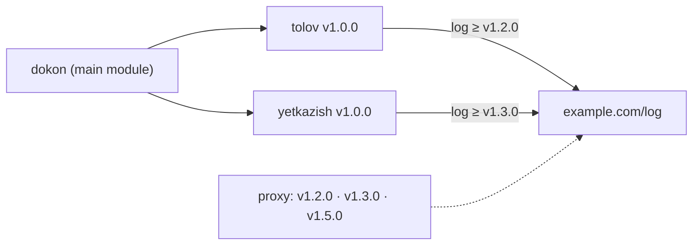

<div lang="en">

🌐 [Oʻzbekcha](/lab/youtube/go/go-1-16) · [Русский](/lab/youtube/go/go-1-16/ru) · **English**  
Lesson GO-1.16 · [Go: 0 → Guru](/lab/youtube/go#go-1-16) · ▶️ video coming soon · 💻 [GitHub](https://github.com/abdurahmon27/go-backend-uz/tree/main/lessons/016-go-mod)

> This is the full written version of the video lesson: you can learn from it without watching (or hearing) the video. The video itself is in Uzbek.

## What you will learn

You did not touch the router code and you did not upgrade Go. You only added one library. After that, the API
started answering `GET /salom` with 200 instead of 404. How can adding a library change the router? The answer is in
one line of the `go.mod` file: `go 1.21`.

**The one idea:** the `go` line in `go.mod` is not decoration. It decides three things: which language version this
module's code is compiled with, which GODEBUG default values the whole program runs with, and which Go builds it.
The `require` lines are a list of minimum versions: MVS takes the smallest version that is needed, not the newest,
and go.sum checks that nobody swapped the code.

By the end of the lesson you will:

- tell apart the three jobs of the `go` line, and see what changes before you raise it, with
  `go list -f '{{.DefaultGODEBUG}}'`;
- bring back old behaviour without touching the `go` line (the `godebug` line, the `GODEBUG` environment
  variable);
- predict which version MVS selects, and explain how this differs from npm and pip;
- know what go.sum, the `internal/` folder and the `tool` directive are for.

Today's three core new words:

| Word | Plain meaning | English term |
|---|---|---|
| GODEBUG setting | the key for one behaviour of the standard library: `httpmuxgo121=1` = the old router | GODEBUG setting |
| toolchain | Go itself: the `go` command, the compiler and the standard library, in one version | toolchain |
| MVS | for each module, take the highest of the required versions | minimal version selection |

Two helper words also appear: the **main module** (the module you are building) and a **hash** (the SHA-256
fingerprint of a file; go.sum is made of them). We explain both where they are needed.

## Before you start

- [GO-1.01 · Go nega bor? go build ichida nima bor](/lab/youtube/go/go-1-01/en): `go run` and `go build`; the compiler
  translates packages one by one.
- [GO-1.05 · Go'da while yoʻq: bitta for va uning hamma shakllari](/lab/youtube/go/go-1-05/en): in a `go 1.21` module the loop
  prints `c.uz c.uz c.uz`, and since `go 1.22` it prints `a.uz b.uz c.uz`. That lesson promised to explain this
  line "in GO-1.16". This is it.
- [GO-1.03 · Konstanta va iota: oʻzgarmas nomlar, time.Sleep(2) va jim buziladigan raqamlar](/lab/youtube/go/go-1-03/en): the
  `Status` enum (`Unknown`, `New`, `Paid`, `Shipped`) comes back in the `tool` section.
- [GO-1.13 · Interface'lar: nil nega nil'ga teng emas?](/lab/youtube/go/go-1-13/en): `fmt.Stringer`. A type with a
  `String() string` method prints in `Println` as a name, not a number.
- You cannot run this lesson on go.dev/play: each example is a separate module (with its own `go.mod`), and some
  download another Go version. You need Go 1.26 on your computer. Open a terminal in the course folder
  (`lessons/016-go-mod`); every command runs from there. `cd eski && …` first moves into the `eski` folder, then
  runs the command.
- The `example.com/...` modules are not on the internet; they are in the `mvs/proxy` folder. In a fresh clone of the
  repository, the README asks you to run this once:

```bash
cd lessons/016-go-mod
export GOPROXY=file://$PWD/mvs/proxy,https://proxy.golang.org GONOSUMDB=example.com CGO_ENABLED=0
(cd mvs/dokon && go mod download)
```

- `GOTOOLCHAIN=go1.27.4` and `kelajak/` download Go 1.27.4 the first time: an archive of about 76 MB.
- The results come from `go1.26.8` and `go1.27.4` (`linux/amd64`).

First, a question about the previous lesson. `main` has a `recover` inside a `defer`, and a `panic` happens in
another goroutine. Is the program saved?

<details>
<summary>Answer</summary>

**No, the program still crashes.** A `panic` goes up only through the calls of its own goroutine and does not move to
another goroutine. A `recover` inside that same goroutine had to catch it. When the `panic` reaches the top of the
goroutine, the Go specification says the whole program stops
([Go spec: Handling panics](https://go.dev/ref/spec#Handling_panics)).

</details>

## The puzzle: one library changed the router

The `eski/` folder has an HTTP router with one route. The program does not open a server: it passes a request
straight to the router and prints the response code.

```go filename="eski/main.go" showLineNumbers
package main

import (
	"fmt"
	"net/http"
	"net/http/httptest"
)

func main() {
	mux := http.NewServeMux()
	mux.HandleFunc("GET /salom", func(w http.ResponseWriter, r *http.Request) {
		fmt.Fprint(w, "salom!")
	})

	for _, method := range []string{"GET", "POST"} {
		w := httptest.NewRecorder()
		mux.ServeHTTP(w, httptest.NewRequest(method, "/salom", nil))
		fmt.Println(method, "/salom →", w.Code)
	}
}
```

| Line | Code | What it does |
|---|---|---|
| 4–6 | `"fmt"`, `"net/http"`, `"net/http/httptest"` | `httptest` is a package that makes fake requests and responses for tests |
| 10 | `mux := http.NewServeMux()` | the router from the standard library (`ServeMux`) |
| 11–13 | `mux.HandleFunc("GET /salom", …)` | the pattern `"GET /salom"`: since Go 1.22 it means "method `GET` + path `/salom`"; the response body is `salom!` |
| 15 | `for _, method := range []string{"GET", "POST"}` | we try two methods |
| 16 | `w := httptest.NewRecorder()` | a fake response: it keeps the status code the router wrote |
| 17 | `mux.ServeHTTP(w, httptest.NewRequest(method, "/salom", nil))` | passes the request straight to the router, without opening a port |
| 18 | `fmt.Println(method, "/salom →", w.Code)` | the method and the status code |

In Express the method is in the function name: `app.get("/salom", …)`. In Laravel too: `Route::get('/salom', …)`.
In Go 1.22 the standard `ServeMux` started to accept the method inside the pattern (release notes: *"enhanced to
accept methods and wildcards"*).

The module's `go.mod` file:

```console
$ cat eski/go.mod
module eski

go 1.21
```

Now the `mvs/yuksal.sh` script. It takes a temporary copy of `eski/`, runs it, then adds one library and runs it
again. It does not touch the router code, and Go is still 1.26.8.

```bash
#!/usr/bin/env bash
# eski/ (go 1.21) ning nusxasiga go 1.22 talab qiladigan kutubxonani qo'shib, uni ishlatamiz.
# Router kodiga tegmaymiz. go get go.mod'dagi go qatorini o'zi ko'taradi va ServeMux xulqi o'zgaradi.
# Asl eski/ papkasi o'zgarmaydi: hammasi vaqtinchalik nusxada.
set -eu
proxy="file://$(cd "$(dirname "$0")" && pwd)/proxy"
nusxa=$(mktemp -d)
trap 'rm -rf "$nusxa"' EXIT
cp "$(dirname "$0")"/../eski/{go.mod,main.go} "$nusxa"
cd "$nusxa"
go run .
# yangi fayl: kutubxonani ishlatadi, router'ga tegmaydi
printf 'package main\n\nimport "example.com/ramka"\n\nvar _ = ramka.Nomi()\n' > ramka.go
GOPROXY="$proxy" GONOSUMDB=example.com go get example.com/ramka@v1.0.0 2>&1 | grep -v downloading
go run .
```

`ramka.go` is a new file: it only imports and uses the `example.com/ramka` library. The library comes from the local
proxy in the folder (`GOPROXY="$proxy"`). Its `go.mod` has one important line:

```console
$ cat mvs/manba/ramka@v1.0.0/go.mod
module example.com/ramka

go 1.22
```

Think first: after the library is added, what does `GET /salom` return?

**A)** 404 again: the router code did not change · **B)** 200 · **C)** a build error: the library needs `go 1.22`,
the module has `go 1.21`

<details>
<summary>Answer</summary>

**B: 200.** `go get` does not fail: it raises the module's `go` line to `1.22` by itself. And with a `go 1.22` line,
Go turns on the new router. If you chose "A", you thought the router's behaviour depends only on the code. If you
chose "C", you thought the `go` line is only checked: `go get` raises it by itself. The whole lesson explains why.

</details>

```console
$ mvs/yuksal.sh
GET /salom → 404
POST /salom → 404
go: upgraded go 1.21 => 1.22
go: added example.com/ramka v1.0.0
GET /salom → 200
POST /salom → 405
```

Look at one line: `go: upgraded go 1.21 => 1.22`. The library needs `go 1.22`, so `go get` raised our `go` line too.
The result:

| `go` line | Router | `GET /salom` | `POST /salom` |
|---|---|---|---|
| `go 1.21` | old (as in Go 1.21) | 404 | 404 |
| `go 1.22` | new: `GET` is a method | 200 | 405 (wrong method) |

How does the old router read `"GET /salom"`? Its code is still in Go (`net/http/servemux121.go`). A pattern that does
not start with `/` looks to it like a pattern that starts with a host name: `if pattern[0] != '/' { mux.hosts = true }`.
So `"GET "` is the host and `/salom` is the path. The request's host is `example.com` (`httptest.NewRequest` sets
it), not `"GET "`. No request matches, so both methods got 404.

This time the change was for the better. But the same raise silently changes other things too: we will see this in
the GODEBUG section.

## go.mod: not a package.json

A **module** is a set of packages that are versioned together. Close equivalents: one npm package, one Composer
package, or one project on PyPI. The `go.mod` file sits at the root of the module. We look at a full example in
`asbob/`:

```console
$ cat asbob/go.mod
module asbob

go 1.26.0

tool golang.org/x/tools/cmd/stringer

require (
	golang.org/x/mod v0.43.0 // indirect
	golang.org/x/sync v0.25.0 // indirect
	golang.org/x/tools v0.53.0 // indirect
)
```

| Line | Code | What it does |
|---|---|---|
| 1 | `module asbob` | the module name; packages inside it are imported by this path (`asbob/...`) |
| 3 | `go 1.26.0` | the `go` line, the main topic of this lesson |
| 5 | `tool golang.org/x/tools/cmd/stringer` | a program the project uses (Go 1.24+); we come back to it at the end |
| 7–11 | `require (…)` | the modules it needs and their **minimum** versions |
| 8–10 | `// indirect` | no package of the main module imports this module directly |

Since `go 1.17`, `go.mod` also lists the modules that are needed indirectly: they are marked with an `// indirect`
comment. `require x v0.53.0` means "at least v0.53.0", not "exactly v0.53.0". We will see this in the MVS section.

Side by side with similar files in other languages:

| What | Go | npm | Python | PHP (Composer) |
|---|---|---|---|---|
| name | `module asbob` | `"name"` | `[project] name` (`pyproject.toml`) | `"name"` |
| which language/runtime version | `go 1.26.0` | `"engines": {"node": …}` | `requires-python` | `"require": {"php": …}` |
| dependencies | `require x v0.53.0` — at least this version | `"x": "^0.53.0"` — a range | `x>=0.53` — a range | `"x": "^0.53"` — a range |
| project tools | `tool …` | `devDependencies` | — | `require-dev` |
| file with pinned exact versions | none, not needed (MVS) | `package-lock.json` | output of `pip freeze` | `composer.lock` |
| code hashes | `go.sum` | `integrity` in `package-lock.json` | `--require-hashes` mode | — |

There are two differences, and this lesson is about them. First, the `go` line is not advice like `engines`: it
changes how the code is compiled and how it runs. Second, Go has no lock file, and that is on purpose.

## The three jobs of the go line

| # | Job | What it affects | Whose `go` line counts |
|---|---|---|---|
| 1 | language version (the compiler's `-lang` flag) | the packages of this module | each module's own |
| 2 | default values of GODEBUG settings | the whole program | only the main module's (or `go.work`) |
| 3 | minimum Go version | the build | a mandatory requirement since Go 1.21; before that only advice |

The Go Toolchains document: *"Go 1.21 changed the go line to be a mandatory requirement instead"*. Before that, an
old Go still tried to build a newer module, and if it failed, it only printed a note about the version mismatch.
Let's look at the three jobs one by one.

## 1. Language version: the compiler's -lang flag

`go build -n` does not run the commands, it only prints them. Among them, we pick out with `grep` the `-lang` flag
that is passed to the compiler:

```console
$ cd eski && go build -n . 2>&1 | grep -o -- '-lang=go[0-9.]*'
-lang=go1.21
```

```console
$ cd yangi && go build -n . 2>&1 | grep -o -- '-lang=go[0-9.]*'
-lang=go1.26
```

The `-lang` value comes from the `go` line (`cmd/go/internal/work/gc.go`: `-lang=go` + `p.Module.GoVersion`). The
loop from [GO-1.05](/lab/youtube/go/go-1-05/en) looks at exactly this flag: a new variable on every iteration exists only with
`-lang=go1.22` or higher.

New syntax depends on it too. The `til/` module has `go 1.21`, and the code uses `range` over an integer, which was
added in Go 1.22:

```go filename="til/main.go" showLineNumbers
package main

import "fmt"

func main() {
	for i := range 3 { // Go 1.22 dan beri: butun son ustida range
		fmt.Print(i, " ")
	}
	fmt.Println()
}
```

| Line | Code | What it does |
|---|---|---|
| 6 | `for i := range 3 {` | since Go 1.22: `i` takes the values 0, 1, 2 (like `for (let i = 0; i < 3; i++)` in JS) |
| 7 | `fmt.Print(i, " ")` | prints the number and a space |
| 9 | `fmt.Println()` | end of line |

Think first: what does `go run .` do? The computer has Go 1.26.8, which knows this syntax.

**A)** `0 1 2` · **B)** a compile error · **C)** the program runs but prints nothing

<details>
<summary>Answer</summary>

**B.** The compiler is Go 1.26.8, but it compiles the module with `-lang=go1.21` and rejects syntax that Go 1.21 does
not have. If you chose "A", you thought the compiler version decides everything.

</details>

```console
$ cd til && go run .
# til
./main.go:6:17: cannot range over 3 (untyped int constant): requires go1.22 or later (-lang was set to go1.21; check go.mod)
```

Let's read the error: `./main.go:6:17` is the file, line 6, column 17 (the `3`). *cannot range over 3 (untyped int
constant): requires go1.22 or later*: you cannot range over 3, go1.22 or newer is needed. The reason is in the
brackets: *-lang was set to go1.21; check go.mod*.

The fix: raise the `go` line to `go 1.22` or higher. For a single file, a `//go:build go1.22` line at the top of the
file raises the language version (the guru task in [GO-1.05](/lab/youtube/go/go-1-05/en)).

## 2. GODEBUG: settings for old behaviour

Go 1 has a compatibility promise: old code must keep working with a new Go. But sometimes the Go team has to change
behaviour: a new router, safer TLS, a GOMAXPROCS that respects the container. If such a change can break old code,
the Go team adds a **GODEBUG setting** that brings the old behaviour back. A setting has the form `key=value`: for
example, `httpmuxgo121=1` brings back the router from Go 1.21.

When a new Go sees an old `go` line, it picks that version's behaviour **for such settings**. The GODEBUG document:
*"the Go toolchain amends its defaults to match that older Go version as closely as possible"*. Other fixes and
runtime improvements still apply: this is only about changes that have a setting.

`go list -f '{{.DefaultGODEBUG}}' .` prints the settings that are written into the program at build time: only the
ones that differ from the current Go defaults, separated by commas. `tr , '\n'` splits them into lines, `wc -l`
counts them:

```console
$ cd eski && go list -f '{{.DefaultGODEBUG}}' . | tr , '\n' | wc -l
30
```

In `eski/`, with a `go 1.21` line, 30 settings are in their old state. Four of them:

```console
$ cd eski && go list -f '{{.DefaultGODEBUG}}' . | tr , '\n' | grep -E 'mux|tls10|maxprocs'
containermaxprocs=0
httpmuxgo121=1
tls10server=1
updatemaxprocs=0
```

| Setting | What happens with an old `go` line |
|---|---|
| `httpmuxgo121=1` | the router from Go 1.21: the 404 from the puzzle |
| `tls10server=1` | the server also accepts TLS 1.0 clients (the new default: at least TLS 1.2) |
| `containermaxprocs=0` | GOMAXPROCS (how many cores run Go code at the same time) ignores the container's CPU limit |
| `updatemaxprocs=0` | GOMAXPROCS is not recalculated when the CPU limit changes |

The last two were added in Go 1.25. A service in Docker with `--cpus=2` and a `go 1.21` line sets GOMAXPROCS from the
machine's cores, not from the container's limit. And the `go get` from the puzzle silently turned off
`tls10server` too: TLS 1.0 clients can no longer connect to the server.

How many settings stay in their old state for each `go` line (Go 1.26.8, measured outside the course folder in
separate modules with an empty `main` package; the results match the README):

| `go` line | 1.21 | 1.22 | 1.23 | 1.24 | 1.25 | 1.26 |
|---|---|---|---|---|---|---|
| settings in the old state | 30 | 25 | 17 | 8 | 3 | 0 |

Before and after you raise the `go` line, print this list and compare: the difference is the list of behaviour that
changes silently in your service.

## Two jobs, two different go lines

Now let's look at two jobs together. `qoida/ilova` (`go 1.26`) uses the `qoida/kutubxona` module (`go 1.21`):

```console
$ cat qoida/ilova/go.mod
module ilova

go 1.26

require example.com/kutubxona v0.0.0

replace example.com/kutubxona => ../kutubxona
```

```console
$ cat qoida/kutubxona/go.mod
module example.com/kutubxona

go 1.21
```

The `replace` line says to take the library from the neighbouring folder, not from the internet (similar to
`"file:../kutubxona"` in npm). `require … v0.0.0` is a placeholder version for `replace`.

```go filename="qoida/kutubxona/kutubxona.go" showLineNumbers
// Package kutubxona: go.mod'ida "go 1.21". Uni go 1.26 dagi ilova ishlatadi.
package kutubxona

import (
	"fmt"
	"net/http"
)

// Router "GET /salom" ni roʻyxatga oladi.
// Qaysi router ishlashini (GODEBUG) ilovaning go qatori hal qiladi.
func Router() *http.ServeMux {
	mux := http.NewServeMux()
	mux.HandleFunc("GET /salom", func(w http.ResponseWriter, r *http.Request) {
		fmt.Fprint(w, "salom!")
	})
	return mux
}

// Domenlar 5-darsdagi sikl: har qadamda d ning manzilini saqlaydi.
// Til versiyasi (-lang) shu modulning go qatoridan olinadi: go 1.21.
func Domenlar() string {
	var navbat []*string
	for _, d := range []string{"a.uz", "b.uz", "c.uz"} {
		navbat = append(navbat, &d)
	}
	s := ""
	for _, p := range navbat {
		s += *p + " "
	}
	return s
}
```

| Line | Code | What it does |
|---|---|---|
| 11–17 | `func Router() *http.ServeMux` | builds and returns the `"GET /salom"` router from the puzzle |
| 21–31 | `func Domenlar() string` | `Domenlar` ("domains"): the loop from [GO-1.05](/lab/youtube/go/go-1-05/en): each iteration adds the address of `d` (`&d`) to a list, then it reads them all |
| 22 | `var navbat []*string` | a slice of pointers to strings (`*string` is a pointer to a string; [GO-1.11](/lab/youtube/go/go-1-11/en)) |
| 28 | `s += *p + " "` | `*p` is the string the pointer points to |

```go filename="qoida/ilova/main.go" showLineNumbers
package main

import (
	"fmt"
	"net/http/httptest"

	"example.com/kutubxona"
)

// ilova: go 1.26. kutubxona: go 1.21.
func main() {
	w := httptest.NewRecorder()
	kutubxona.Router().ServeHTTP(w, httptest.NewRequest("GET", "/salom", nil))
	fmt.Println("kutubxona router:", w.Code)
	fmt.Println("kutubxona sikl:  ", kutubxona.Domenlar())
	fmt.Println("ilova sikl:      ", domenlar())
}

// domenlar kutubxonadagi bilan bir xil sikl, lekin go 1.26 modulda.
func domenlar() string {
	var navbat []*string
	for _, d := range []string{"a.uz", "b.uz", "c.uz"} {
		navbat = append(navbat, &d)
	}
	s := ""
	for _, p := range navbat {
		s += *p + " "
	}
	return s
}
```

| Line | Code | What it does |
|---|---|---|
| 7 | `"example.com/kutubxona"` | imports the library |
| 12–14 | `kutubxona.Router().ServeHTTP(…)` | sends `GET /salom` to the library's router |
| 15 | `kutubxona.Domenlar()` | the loop in the library (in the `go 1.21` module) |
| 16, 20–30 | `domenlar()` | the same loop, letter for letter, but in the `go 1.26` module |

Think first: what does `go run .` print?

**A)** router 404; both loops `c.uz c.uz c.uz` · **B)** router 200; library loop `c.uz c.uz c.uz`, app loop
`a.uz b.uz c.uz` · **C)** router 200; both loops `a.uz b.uz c.uz`

<details>
<summary>Answer</summary>

**B.** The two jobs look at different `go` lines. The language version comes from each module itself: the library is
compiled with `-lang=go1.21`, so its loop has one `d`. GODEBUG comes only from the main module's line (`ilova`,
`go 1.26`): the router is new. If you chose "A", you thought everything comes from the library's `go` line. If you
chose "C", you thought everything comes from the app's line.

</details>

Let's see which `-lang` the compiler gets for each package. `-a` rebuilds every package without looking at the
cache, so the command is printed for both; `-p` is the package's import path:

```console
$ cd qoida/ilova && go build -a -n . 2>&1 | grep -oE -- '-p (main|example.com/kutubxona) -lang=go[0-9.]*'
-p example.com/kutubxona -lang=go1.21
-p main -lang=go1.26
```

```console
$ cd qoida/ilova && go run .
kutubxona router: 200
kutubxona sikl:   c.uz c.uz c.uz 
ilova sikl:       a.uz b.uz c.uz 
```

| What | From which `go` line | Result |
|---|---|---|
| library loop (`-lang`) | the library's: `go 1.21` | `c.uz c.uz c.uz` |
| app loop (`-lang`) | the app's: `go 1.26` | `a.uz b.uz c.uz` |
| router in the library (GODEBUG) | the app's: `go 1.26` | 200 |

GODEBUG values are written into the binary once, for the whole program. The `go` command takes them from the main
module's line (`cmd/go/internal/load/godebug.go`: `MainModules.GoVersion`). The **main module** is the module in
which you run `go build` or `go run`. If you use a workspace (a `go.work` file that builds several modules
together), the values come from `go.work`.

The practical conclusion: the Go 1.22 loop fix does not reach libraries with an old `go` line until their `go` line
is raised.

## Changing one GODEBUG setting on its own

If raising the `go` line all at once feels risky (30 settings change together), you can change one setting on its
own. In `sozlama/` the line is still `go 1.21`, but a `godebug` line turns on the new router:

```console
$ cat sozlama/go.mod
module sozlama

go 1.21

godebug httpmuxgo121=0
```

`main.go` is the same as in the puzzle.

```console
$ cd sozlama && go run .
GET /salom → 200
POST /salom → 405
```

200, even with `go 1.21`: `godebug httpmuxgo121=0` updated only the router; the other 29 settings stay in their old
state. Only Go 1.23 and newer understand this line (older ones fail; see "Common mistakes"). The `godebug` lines in
`go.mod` are also read only from the main module.

There is also the reverse: `godebug default=go1.21`. Then the language version comes from the `go` line (for
example, 1.26), while the GODEBUG defaults stay as in Go 1.21. The GODEBUG document: *"This allows setting the
GODEBUG defaults separately from the Go language version"*.

And when the program starts, the `GODEBUG` environment variable wins over everything:

```console
$ cd sozlama && GODEBUG=httpmuxgo121=1 go run .
GET /salom → 404
POST /salom → 404
```

| Level | Where | When it applies |
|---|---|---|
| 1 | the main module's `go` line | at build time, the default value for every setting |
| 2 | the main module's `godebug` lines (Go 1.23+) | at build time, they override level 1 |
| 3 | the `GODEBUG` environment variable | when the program starts, it wins over everything |

There is one more way: you will find it yourself in the homework.

## Settings are not forever: Go 1.27

An old `go` line does not keep old behaviour forever. The GODEBUG document says settings are *"maintained for a
minimum of two years (four Go releases)"*. After that they can be removed.

The `taymer/` module has `go 1.22`:

```go filename="taymer/main.go" showLineNumbers
package main

import (
	"fmt"
	"runtime"
	"time"
)

func main() {
	t := time.NewTimer(time.Millisecond)
	time.Sleep(20 * time.Millisecond) // taymer allaqachon ishladi
	t.Reset(time.Hour)                // endi bir soat kutishi kerak

	select {
	case <-t.C:
		fmt.Println(runtime.Version(), "→ eski signal keldi")
	default:
		fmt.Println(runtime.Version(), "→ kanal boʻsh")
	}
}
```

| Line | Code | What it does |
|---|---|---|
| 10 | `t := time.NewTimer(time.Millisecond)` | a timer that fires after 1 ms; it sends its signal to the `t.C` channel |
| 11 | `time.Sleep(20 * time.Millisecond)` | we wait 20 ms: the timer has already fired |
| 12 | `t.Reset(time.Hour)` | we reset the timer: now it should wait one hour |
| 14–19 | `select { case <-t.C: … default: … }` | if the channel has a signal, it takes it; if not, it goes to `default` without waiting |
| 16, 18 | `runtime.Version()` | prints which Go built the program |

A **channel** is a queue that goroutines use to pass values. Channels are covered in [GO-1.21](/lab/youtube/go#go-1-21),
and `select` in [GO-3.03](/lab/youtube/go#go-3-03). Here only one thing matters: is there an old signal left in the channel
after `Reset`?

Before Go 1.23 the timer channel had one slot (a buffer). The signal of a timer that had already fired stayed there
even after `Reset`. Go 1.23 introduced new behaviour: after `Reset` and `Stop` no old signal arrives. A setting for
the old behaviour was added too: `asynctimerchan=1`. For a `go 1.22` line, Go 1.26 picks exactly that setting.

Think first: what do `go run .` (Go 1.26.8) and `GOTOOLCHAIN=go1.27.4 go run .` print? `GOTOOLCHAIN` tells the
`go` command which Go version to use.

**A)** both `eski signal keldi` · **B)** Go 1.26.8 `eski signal keldi`, Go 1.27.4 `kanal boʻsh` ·
**C)** both `kanal boʻsh`

<details>
<summary>Answer</summary>

**B.** For the `go 1.22` line, Go 1.26.8 picks `asynctimerchan=1`, and the old signal stays in the channel
(`eski signal keldi`, "the old signal arrived"). Go 1.27 removed this setting completely: from Go 1.23 to 1.27 is
exactly four releases. The old behaviour cannot come back, so the channel is empty (`kanal boʻsh`). If you chose
"A", you thought an old `go` line keeps old behaviour forever.

</details>

```console
$ cd taymer && go run .
go1.26.8 → eski signal keldi
```

```console
$ cd taymer && GOTOOLCHAIN=go1.27.4 go run .
go1.27.4 → kanal boʻsh
```

Neither the code nor the `go` line changed, only the Go version. The Go 1.27 release notes: *"The asynctimerchan
GODEBUG setting … has been removed permanently"*. The TLS 1.0 setting (`tls10server`) was removed too. On Go 1.27.4,
`go list` for `eski/` now prints 26 settings, not 30.

The `go` line changes things silently. But if an old value is written explicitly in `go.mod`, Go 1.27 stops the
build. That is the case in `homework/guru`:

```console
$ cat homework/guru/go.mod
module guru

go 1.22

godebug asynctimerchan=1
```

`2>&1 | tail -1` shows only the last line of the error:

```console
$ cd homework/guru && GOTOOLCHAIN=go1.27.4 go run . 2>&1 | tail -1
go.mod:5: removed GODEBUG "asynctimerchan" set to old value "1" (https://go.dev/doc/godebug#go-127)
```

*removed GODEBUG "asynctimerchan" set to old value "1"*: a removed GODEBUG setting is set to its old value "1". This
is good: a stopped build is better than a program that silently behaves differently. The fix is the guru task in
the homework.

## 3. Toolchain: Go downloads the Go it needs

The third job: the `go` line is the lowest Go version that can build the module. The **toolchain** is Go itself:
the `go` command, the compiler and the standard library. The `kelajak/` module needs a newer Go than the one on the
computer:

```console
$ grep '^go ' kelajak/go.mod
go 1.27.4
```

The computer has Go 1.26.8. The first `go run .`:

```console
$ cd kelajak && go run .
go: downloading go1.27.4 (linux/amd64)
ishlayapti: go1.27.4
```

The `go` command downloaded the Go it needed by itself and ran the program with it (`ishlayapti` means
"running"). The default mode is `GOTOOLCHAIN=auto`: Go 1.27.4 comes from the proxy as the `golang.org/toolchain`
module and is checked against a checksum like any other module. From the second run on, there is no
`go: downloading` line: Go is in the cache. How much space does it take?

```console
$ cd $(go env GOMODCACHE) && du -sh --si --apparent-size cache/download/golang.org/toolchain/@v/*go1.27.4*.zip golang.org/toolchain@*go1.27.4*
76M	cache/download/golang.org/toolchain/@v/v0.0.1-go1.27.4.linux-amd64.zip
228M	golang.org/toolchain@v0.0.1-go1.27.4.linux-amd64
```

The archive is about 76 MB, 228 MB after unpacking (`--si` means megabytes of 1000, `--apparent-size` means the
files' own size). With `GOTOOLCHAIN=local`, `go` downloads nothing and gives a clear error:

```console
$ cd kelajak && GOTOOLCHAIN=local go run .
go: go.mod requires go >= 1.27.4 (running go 1.26.8; GOTOOLCHAIN=local)
```

*go.mod requires go >= 1.27.4 (running go 1.26.8; GOTOOLCHAIN=local)*.

Compare this with `engines` in npm. The npm documentation: unless `engine-strict` is set, this field *"is advisory
only and will only produce warnings"*. We checked it (Node 24.10.0, npm 11.6.1, outside the course folder): when a
dependency has `"engines": { "node": ">=99" }`, `npm install` warned `npm warn EBADENGINE Unsupported engine` and
installed the package anyway. Only with `--engine-strict` did it print `npm error code EBADENGINE`. Before Go 1.21
the `go` line was such advice too. Now it is a requirement: Go downloads the version it needs or refuses.

`go.mod` can also have a separate `toolchain` line, for example `toolchain go1.27.4`. It is a suggestion: if Go is
older, it switches to that version; in `local` mode the line is ignored. Only the main module's `toolchain` line is
read.

Now back to the puzzle. Since Go 1.21 a module's `go` line cannot be lower than its dependencies' lines. `ramka`
needed `go 1.22`, so `go get` raised our line to `1.22`, and the router changed. The same happened in `asbob/`: the
`go.mod` of `golang.org/x/tools v0.53.0` says `go 1.26.0`, so `asbob/go.mod` has `go 1.26.0`, not `go 1.26`.

If you write a library, keep its `go` line as low as you can: it raises the `go` line of everyone who uses your
library. And `go mod init` writes the full version of the current Go by default (see "Common mistakes").

## require and MVS: which version gets in?

Now the `require` lines. The `mvs/dokon` module depends on two libraries:

```console
$ cat mvs/dokon/go.mod
module dokon

go 1.26

require (
	example.com/tolov v1.0.0
	example.com/yetkazish v1.0.0
)

require example.com/log v1.3.0 // indirect
```

```go filename="mvs/dokon/main.go" showLineNumbers
package main

import (
	"fmt"

	"example.com/tolov"
	"example.com/yetkazish"
)

// tolov v1.0.0 example.com/log v1.2.0 ni, yetkazish v1.0.0 esa v1.3.0 ni talab qiladi.
// Eng yangisi v1.5.0. Build'ga qaysi biri kiradi?
func main() {
	fmt.Println("tolov ichidagi log:    ", tolov.Log())
	fmt.Println("yetkazish ichidagi log:", yetkazish.Log())
}
```

`tolov.Log()` and `yetkazish.Log()` ("payment" and "delivery") both call the `Versiya()` function of the
`example.com/log` module inside: it tells which version of `log` got into the build. The libraries' `go.mod` files:

```console
$ cat mvs/manba/tolov@v1.0.0/go.mod
module example.com/tolov

go 1.21

require example.com/log v1.2.0
```

```console
$ cat mvs/manba/yetkazish@v1.0.0/go.mod
module example.com/yetkazish

go 1.21

require example.com/log v1.3.0
```

The proxy (`mvs/proxy`, a folder in place of the server Go downloads modules from) has three versions of `log`:

```console
$ cat mvs/proxy/example.com/log/@v/list
v1.2.0
v1.3.0
v1.5.0
```



Go runs the **MVS** (*minimal version selection*) algorithm on this graph.

Question: which version of `log` gets into the build?

**A)** v1.2.0 · **B)** v1.3.0 · **C)** v1.5.0, the newest

<details>
<summary>Answer</summary>

**B: v1.3.0.** For each module, MVS takes the highest of the required versions: from v1.2.0 and v1.3.0, that is
v1.3.0. This is the smallest version that meets every requirement. Nobody asked for v1.5.0, so it does not get in.
If you chose "A", you forgot the `yetkazish` requirement: v1.2.0 does not meet "at least v1.3.0". If you chose "C",
you thought like npm or pip (we compare below).

</details>

`GOPROXY=file://$PWD/../proxy` means: take modules from the local folder, not from `proxy.golang.org` (`$PWD` is
the current folder). `go mod graph` prints the edges of the graph: "who → requires whom". `grep -v ^dokon` removes
the main module's own lines:

```console
$ cd mvs/dokon && GOPROXY=file://$PWD/../proxy go mod graph | grep -v ^dokon | grep ' example.com/log@'
example.com/tolov@v1.0.0 example.com/log@v1.2.0
example.com/yetkazish@v1.0.0 example.com/log@v1.3.0
```

```console
$ cd mvs/dokon && GOPROXY=file://$PWD/../proxy go run .
tolov ichidagi log:     v1.3.0
yetkazish ichidagi log: v1.3.0
```

Both libraries got v1.3.0: the binary has one version of `log`.

**Compare with npm and pip.** We put the same three packages (log 1.2.0, 1.3.0, 1.5.0; `tolov` needs `log` at least
1.2.0, `yetkazish` at least 1.3.0) into a local npm registry and a local folder of Python packages (outside the
course folder, run separately):

| Tool | Requirements | Selected log |
|---|---|---|
| npm 11.6.1 (`npm install`) | `"log": "^1.2.0"`, `"log": "^1.3.0"` | 1.5.0 |
| uv 0.11.21 (`uv pip compile`, a pip-compatible resolver) | `log>=1.2.0`, `log>=1.3.0` | 1.5.0 |
| Go 1.26.8 (MVS) | `require example.com/log v1.2.0`, `… v1.3.0` | v1.3.0 |

npm and pip take the **newest** version that matches the range. So the result depends on the day you install: if
log 1.6.0 comes out tomorrow, a fresh `npm install` takes it. For a reproducible build they write a lock file:
`package-lock.json`, `composer.lock`, a list from `pip freeze`. The Go Modules Reference says instead: *"Unlike
other dependency management systems, the build list is not saved in a "lock" file. MVS is deterministic, and the
build list doesn't change when new versions of dependencies are released"*.

Versions change only when you run `go get` or add a new import (`go mod tidy` writes a new module with its newest
version at that moment). A major version (`v2` and higher) is a different import path (`example.com/log/v2`), so for
MVS it is a different module.

## go.sum: catching swapped code

The version is fixed. But is the code the proxy gave us the same code? `go.sum` checks that:

```console
$ grep log mvs/dokon/go.sum
example.com/log v1.3.0 h1:jtLzF0d3cKr1ihfE0BawA7k/zEgug+2kxGS3dBm4J3M=
example.com/log v1.3.0/go.mod h1:RUfJNjFPRI6tqrT6oiqycOZSUh5GZuxUqKeqkpkD9gM=
```

Each line has a module, a version and a **hash** (the SHA-256 fingerprint of a file). Usually a module has two
lines: one for the archive of all its code, the other (with `/go.mod`) only for its `go.mod` file. `h1:` is SHA-256
in base64.

go.sum is not a lock file: it does not choose versions (versions come from `go.mod` through MVS), it only checks the
downloaded code. In npm both jobs are in one file: `package-lock.json` pins the versions and also keeps a hash in the
`integrity` field. In pip, hash checking is on only in `--require-hashes` mode.

Now let's try an attack. `mvs/zaharli/` ("poisoned") is a copy of the proxy where the code of log v1.3.0 is
**swapped**, while the version number is the same. `mvs/hujum.sh` ("attack"):

```bash
#!/usr/bin/env bash
# Hujum mashqi: zaharli/ proxy'da example.com/log v1.3.0 ning kodi almashtirilgan,
# versiya raqami esa o'sha. dokon'ni toza module cache bilan (yangi kompyuterdagidek)
# build qilamiz: avval zaharli/, topilmasa proxy/ dan yuklanadi.
# go.sum'dagi hash mos kelmaydi va go build to'xtaydi.
set -u
cd "$(dirname "$0")/dokon"
kesh=$(mktemp -d)
GOFLAGS=-modcacherw GOMODCACHE="$kesh" GONOSUMDB=example.com \
	GOPROXY="file://$(cd .. && pwd)/zaharli,file://$(cd .. && pwd)/proxy" \
	go build -o /dev/null .
kod=$?
rm -rf "$kesh"
exit $kod
```

The script builds `dokon` with a clean module cache (`GOMODCACHE="$kesh"` is an empty temporary folder), as on a new
computer or in CI. `GOPROXY` lists `zaharli` first, then `proxy`. `grep -E` picks the lines we need:

```console
$ mvs/hujum.sh 2>&1 | grep -E 'mismatch|downloaded|go.sum:|SECURITY'
verifying example.com/log@v1.3.0: checksum mismatch
	downloaded: h1:Jd4sA3vV+K6bvDLKgdPZFUlO3LCcZQ48avOZ1TR2bDs=
	go.sum:     h1:jtLzF0d3cKr1ihfE0BawA7k/zEgug+2kxGS3dBm4J3M=
SECURITY ERROR
```

*verifying example.com/log@v1.3.0: checksum mismatch*: the hash does not match. `downloaded:` is the hash of the
downloaded code, `go.sum:` is the committed hash. They differ, and `go` stops the build with *SECURITY ERROR*.

Public modules that are not in go.sum yet (when you add a new dependency) are checked by the `sum.golang.org`
checksum database. The Go Modules Reference: it *"makes untrusted proxies possible since they can't serve the wrong
code without it going unnoticed"*. Our `example.com` modules are not public, so the README excludes them from this
check with `GONOSUMDB=example.com`.

## internal/: no imports from outside

An `internal` folder closes code off. The rule: a package `.../a/internal/b` can be imported only by code inside
`.../a/`. The `ichki/` module:

```console
$ cd ichki && find . -name '*.go' | sort
./kassa/main.go
./ombor/hisob/hisob.go
./ombor/internal/narx/narx.go
```

```go filename="ichki/ombor/internal/narx/narx.go" showLineNumbers
// Package narx faqat ombor/ va uning ichidagi paketlar uchun.
package narx

// QQS bilan narx (12 foiz).
func QQS(som int) int { return som * 112 / 100 }
```

```go filename="ichki/ombor/hisob/hisob.go" showLineNumbers
// Package hisob ombor/ ichida: internal/narx ni import qila oladi.
package hisob

import "ichki/ombor/internal/narx"

func Jami(som int) int { return narx.QQS(som) }
```

```go filename="ichki/kassa/main.go" showLineNumbers
// kassa ombor/ dan tashqarida: internal/narx ni import qila olmaydi.
package main

import (
	"fmt"

	"ichki/ombor/internal/narx"
)

func main() {
	fmt.Println(narx.QQS(1000))
}
```

`narx` ("price") is inside `ombor/internal/` (`ombor` means "warehouse"), so only code under `ombor/` can import it.
`hisob` ("calculation") is `ombor/hisob`, inside. `kassa` ("checkout") is outside `ombor/`. `som * 112 / 100` is the
price with 12 % VAT (`QQS`).

```console
$ cd ichki && go build ./ombor/... && echo ombor: ok
ombor: ok
```

```console
$ cd ichki && go build ./kassa
package ichki/kassa
	kassa/main.go:7:2: use of internal package ichki/ombor/internal/narx not allowed
```

*use of internal package ichki/ombor/internal/narx not allowed*. This is a rule of `go build`, not a convention.

Why it matters: others cannot come to depend on your internal code, and you can change it freely. The closest tool in
Node is the `"exports"` field in `package.json`: files that are not listed there cannot be imported from outside the
package. In Python, `_name` is only a convention: PEP 8 calls it a *"weak "internal use" indicator"*, and the import
still works.

## The tool directive: stringer in go.mod

The last directive is `tool`. `asbob/` has the `Status` type from [GO-1.03](/lab/youtube/go/go-1-03/en):

```go filename="asbob/main.go" showLineNumbers
package main

import "fmt"

//go:generate go tool stringer -type=Status

// Status — 3-darsdagi enum: zero value maʼnoli holat emas (Unknown).
type Status int

const (
	Unknown Status = iota
	New
	Paid
	Shipped
)

func main() {
	fmt.Println(Unknown, New, Paid, Shipped)
}
```

| Line | Code | What it does |
|---|---|---|
| 5 | `//go:generate go tool stringer -type=Status` | `go generate` runs this command |
| 8–15 | `type Status int` and `iota` | the enum from GO-1.03: `Unknown` = 0 (zero value), `New` = 1, `Paid` = 2, `Shipped` = 3 |
| 18 | `fmt.Println(Unknown, New, Paid, Shipped)` | prints the four states |

`stringer` is a program from the Go team: it writes a `String() string` method for `Status`
(`status_string.go`). A type with a `String()` method implements `fmt.Stringer` and prints in `Println` with its
name ([GO-1.13](/lab/youtube/go/go-1-13/en)).

Think first: if we run only `main.go`, without `status_string.go`, what is printed?

**A)** `Unknown New Paid Shipped` · **B)** `0 1 2 3` · **C)** a compile error

<details>
<summary>Answer</summary>

**B.** Without a `String()` method, `Status` prints like a plain `int`. If you chose "A", you thought Go keeps the
constant names by itself: it does not; the names live in the code `stringer` wrote.

</details>

`go run main.go` takes only this file of the package:

```console
$ cd asbob && go run main.go
0 1 2 3
```

Where does `stringer` come from? Since Go 1.24, `go get -tool golang.org/x/tools/cmd/stringer` writes it into
`go.mod` as a `tool` line (its version goes into `require`):

```console
$ cd asbob && grep -n stringer main.go go.mod
main.go:5://go:generate go tool stringer -type=Status
go.mod:5:tool golang.org/x/tools/cmd/stringer
```

Before, people wrote a helper file `tools.go` for this: `//go:build tools` and a blank import of the program. Now
`go tool stringer` runs exactly the version in `go.mod`. The closest thing in npm is `devDependencies` plus `npx`,
which runs the program from `node_modules/.bin`.

```console
$ cd asbob && go generate && go run .
Unknown New Paid Shipped
```

`go generate` rewrote `status_string.go` (the file did not change), and `go run .`, with all the files of the
package, printed the state names.

## Summary

- The `go` line = language version (each module's own) + GODEBUG defaults (the main module's) + minimum Go version.
- Raise it on purpose: run the tests and compare `go list -f '{{.DefaultGODEBUG}}' .` before and after.
- If you write a library, keep its `go` line as low as you can: it raises your users' `go` lines too.
- MVS takes the smallest needed version, not the newest; a new release does not change the build.
- Always commit go.sum together with `go.mod` (Go wiki: Modules FAQ).

## Common mistakes

**1. Thinking the `go` line is decoration.** The most common belief: `go 1.21` is "a note about which Go the code was
written for". In fact, raising it (by hand or through `go get`) is a silent change of behaviour: the router from the
puzzle, `tls10server`, GOMAXPROCS. There is no error; the result changes. See the "puzzle" and "2. GODEBUG"
sections. The fix: compare `go list -f '{{.DefaultGODEBUG}}' .` before and after the raise, run the tests, and watch
for the `go: upgraded go …` line that `go get` prints.

**2. New syntax in an old module.** `for i := range 3` in a `go 1.21` module → `requires go1.22 or later (-lang was
set to go1.21; check go.mod)`. We saw it in "1. Language version". The fix: raise the `go` line or put
`//go:build go1.22` in the file.

**3. A `godebug` line and an old Go.** Only Go 1.23 and newer understand the `godebug` line. Let's run `sozlama/` with
Go 1.22.12:

```console
$ cd sozlama && GOTOOLCHAIN=go1.22.12 go run .
go: errors parsing go.mod:
go.mod:5: unknown directive: godebug
```

*errors parsing go.mod … unknown directive: godebug*: line 5 has a directive Go 1.22 does not know. The fix: make sure
everyone on the team (and CI) uses Go 1.23+, or pass the setting through the `GODEBUG` environment variable.

**4. The old value of a removed setting.** `godebug asynctimerchan=1` stops the build on Go 1.27 (the "Settings are
not forever" section). The fix: delete the line or set `asynctimerchan=0`, and adapt the code to the new behaviour
(the guru task in the homework).

**5. Not committing go.sum.** If you put go.sum in `.gitignore`, the build stops for a colleague who clones the
repository. A copy of `mvs/dokon` without go.sum (outside the course folder, run separately, with `GOPROXY` pointing
at the local proxy):

```console
$ go run .
main.go:6:2: missing go.sum entry for module providing package example.com/tolov (imported by dokon); to add:
	go get dokon
main.go:7:2: missing go.sum entry for module providing package example.com/yetkazish (imported by dokon); to add:
	go get dokon
```

*missing go.sum entry for module providing package example.com/tolov*: go.sum has no entry for the module that
provides this package. `go get` or `go mod tidy` will create the entry again, but this time they trust whatever the
proxy serves now: the protection from `hujum.sh` is gone. The fix: commit go.sum together with `go.mod`. For the same
reason, do not "fix" a checksum mismatch by deleting go.sum.

**6. A high `go` line in a library.** `go mod init` writes the full version of the current Go (in a separate empty
folder):

```console
$ go mod init x && cat go.mod
go: creating new go.mod: module x
module x

go 1.26.8
```

For an application this is fine. In a library, `go 1.26.8` raises every module that uses it to at least
`go 1.26.8` (the `go: upgraded go …` from the puzzle). The fix: in a library, lower the `go` line to the lowest
version your code really needs.

**7. Importing an `internal` package from outside.** `use of internal package … not allowed` (we saw it in the
"internal/" section). The fix: move the package out of `internal/` (it becomes public API) or move the code that uses
it under the parent folder of `internal`.

## Check yourself

**1.** `ilova` (`go 1.26`) uses a library with a `go 1.21` line. Which language version is the library's code
compiled with? Which GODEBUG values does the router in the library run with?

<details>
<summary>Answer</summary>

The language version comes from the library itself: `-lang=go1.21`. GODEBUG comes only from the main module's
(`ilova`) `go` line: the Go 1.26 defaults, so the router is new (200).

</details>

**2.** Tomorrow `example.com/log v1.6.0` appears in the proxy. If you change nothing and run `go run .` in
`mvs/dokon`, what is printed?

<details>
<summary>Answer</summary>

`v1.3.0` on both lines again. MVS looks only at required versions, and nobody required v1.6.0. A new release does
not change the build. It gets in only through `go get example.com/log@latest` (or through a dependency that raises
the requirement).

</details>

**3.** A module's `go.mod` looks like this, and the computer has Go 1.26.8:

```text
module tc

go 1.26

toolchain go1.27.4
```

`main.go` is the same as in `kelajak/` (it prints `runtime.Version()`). What do `go run .` and
`GOTOOLCHAIN=local go run .` print?

<details>
<summary>Answer</summary>

Go 1.26.8 meets the `go 1.26` requirement. But there is a `toolchain go1.27.4` suggestion, and in the default `auto`
mode Go switches to that version if it is older. In `local` mode the suggestion is ignored. Outside the course
folder, run in a separate module:

```console
$ go run .
ishlayapti: go1.27.4
$ GOTOOLCHAIN=local go run .
ishlayapti: go1.26.8
```

</details>

**4.** A colleague says: "go.sum is Go's package-lock.json; if we delete it, the versions change." Are they right?

<details>
<summary>Answer</summary>

No. The `require` lines in `go.mod` and MVS decide the versions. go.sum only keeps and checks the hashes of the
downloaded code and of the `go.mod` files. If you delete it, the versions do not change, but the build stops with
"missing go.sum entry", and the protection against swapped code is gone.

</details>

**5.** From [GO-1.05](/lab/youtube/go/go-1-05/en): why does the library loop in `qoida/` print `c.uz c.uz c.uz`, while the same
loop in the app prints `a.uz b.uz c.uz`?

<details>
<summary>Answer</summary>

Since Go 1.22 a `for` loop gets a new variable on every iteration, but only in modules with `go 1.22` or higher. The
library is compiled with `-lang=go1.21`: one `d` for the whole loop, all three `&d` are one address, and the last
value is `c.uz`. The app has `-lang=go1.26`: a new `d` on every iteration.

</details>

**6.** Can a new package `ichki/ombor/hisob/hisobot` inside `ichki/ombor/hisob/` import
`ichki/ombor/internal/narx`? What about a package `ichki/kassa/chek`?

<details>
<summary>Answer</summary>

`hisob/hisobot`: yes, it is under `ichki/ombor/`, and the parent folder of `internal` is `ichki/ombor/`.
`kassa/chek`: no, it is outside `ombor/`, and `go build` says `use of internal package … not allowed`.

</details>

## Homework

Four tasks at four levels. All files are in the lesson folder on GitHub:
[lessons/016-go-mod](https://github.com/abdurahmon27/go-backend-uz/tree/main/lessons/016-go-mod). Answers are in the
[homework/](https://github.com/abdurahmon27/go-backend-uz/tree/main/lessons/016-go-mod/homework) folder. Try it
yourself first.

🟢 **Easy:** run `go list -f '{{.DefaultGODEBUG}}' .` in your own project. If the output is empty, why?

<details>
<summary>Answer</summary>

The command prints only the settings that **differ** from the current Go defaults. If the `go` line matches the
toolchain (`go 1.26` + Go 1.26), the list is empty. That is the case in `yangi/` (`go 1.26`); the command prints
nothing:

```console
$ cd yangi && go list -f '{{.DefaultGODEBUG}}' .
```

`eski/` (`go 1.21`) has 30. Each one is described at
[go.dev/doc/godebug#history](https://go.dev/doc/godebug#history).

</details>

🟡 **Medium:** switch `yangi/` to the old router without touching the `go` line. Also find a way the lesson did not
mention.

<details>
<summary>Answer</summary>

Four ways, without touching the `go 1.26` line:

1. A `godebug httpmuxgo121=1` line in `go.mod` (needs Go 1.23+).
2. A `godebug default=go1.21` line in `go.mod`: the language version stays 1.26, and the GODEBUG defaults are as in
   1.21 (30 settings, including `httpmuxgo121=1`).
3. **The way the lesson did not mention:** a `//go:debug httpmuxgo121=1` comment at the very top of a file in the
   `main` package, before `package`. It works since Go 1.21.
4. At run time: `GODEBUG=httpmuxgo121=1 go run .`.

Way 3 is in `homework/orta/main.go`:

```go filename="homework/orta/main.go" showLineNumbers
//go:debug httpmuxgo121=1

package main

import (
	"fmt"
	"net/http"
	"net/http/httptest"
)

func main() {
	mux := http.NewServeMux()
	mux.HandleFunc("GET /salom", func(w http.ResponseWriter, r *http.Request) {
		fmt.Fprint(w, "salom!")
	})

	for _, method := range []string{"GET", "POST"} {
		w := httptest.NewRecorder()
		mux.ServeHTTP(w, httptest.NewRequest(method, "/salom", nil))
		fmt.Println(method, "/salom →", w.Code)
	}
}
```

```console
$ cd homework/orta && go run .
GET /salom → 404
POST /salom → 404
```

```console
$ cd homework/orta && go list -f '{{.DefaultGODEBUG}}' .
httpmuxgo121=1
```

Even though `go.mod` says `go 1.26`, `//go:debug` wrote the setting into the binary.

</details>

🟠 **Hard:** run `go get example.com/log@v1.2.0` in `mvs/dokon`. What happens to `yetkazish`, and why?

<details>
<summary>Answer</summary>

`homework/qiyin/qiyin.sh` does this in a temporary copy of `dokon`:

```console
$ homework/qiyin/qiyin.sh
go: downgraded example.com/log v1.3.0 => v1.2.0
go: removed example.com/yetkazish v1.0.0
--- go.mod:
module dokon

go 1.26

require example.com/tolov v1.0.0

require example.com/log v1.2.0 // indirect
--- go build:
main.go:7:2: no required module provides package example.com/yetkazish; to add it:
	go get example.com/yetkazish
```

`yetkazish v1.0.0` needs `log` at least v1.3.0. To lower `log` to v1.2.0, `go get` looks for an older version of
`yetkazish` that works with log ≤ v1.2.0. There is none, so it removes `yetkazish`
(`go: removed example.com/yetkazish v1.0.0`). The code still imports it, so the build stops. MVS never selects a
version **below** a requirement.

</details>

🔴 **Guru:** make `homework/guru` (`go 1.22` + `godebug asynctimerchan=1`) build on Go 1.27, and adapt the code to
the new timer behaviour.

<details>
<summary>Answer</summary>

Right now:

```console
$ cd homework/guru && go run .
go1.26.8 → eski signal keldi
```

```console
$ cd homework/guru && GOTOOLCHAIN=go1.27.4 go run .
go: error loading go.mod:
go.mod:5: removed GODEBUG "asynctimerchan" set to old value "1" (https://go.dev/doc/godebug#go-127)
```

The Go 1.27 release notes: a removed setting written with its last default value (`asynctimerchan=0`) is accepted;
with the old value (`=1`) the `go` command fails. The fix: delete the `godebug` line or set `asynctimerchan=0`. We
checked `=0` in a copy: both Go 1.26.8 and Go 1.27.4 print `kanal boʻsh`. Then adapt the code to the new behaviour:
draining the channel by hand after `Reset`/`Stop` (`select { case <-t.C: default: }`) is no longer needed. The
`go 1.22` line on its own (without a `godebug` line) gives no error on Go 1.27; it just runs with the new behaviour
(`taymer/` from the lesson).

</details>

## Sources

- [Go Modules Reference](https://go.dev/ref/mod): [go.mod files](https://go.dev/ref/mod#go-mod-file),
  [Minimal version selection](https://go.dev/ref/mod#minimal-version-selection),
  [go.sum files](https://go.dev/ref/mod#go-sum-files), [Checksum database](https://go.dev/ref/mod#checksum-database)
- [Go Toolchains](https://go.dev/doc/toolchain) (the `go` and `toolchain` lines, `GOTOOLCHAIN`)
- [Go, Backwards Compatibility, and GODEBUG](https://go.dev/doc/godebug) (`godebug` lines, `default=`, at least two
  years, [history of settings](https://go.dev/doc/godebug#history))
- Release notes: [Go 1.22: Enhanced routing patterns](https://go.dev/doc/go1.22#enhanced_routing_patterns),
  [Go 1.23](https://go.dev/doc/go1.23) (timers), [Go 1.24: tool](https://go.dev/doc/go1.24#tools),
  [Go 1.27](https://go.dev/doc/go1.27) (removed settings)
- Go source code (go1.26.8): [cmd/go/internal/work/gc.go](https://github.com/golang/go/blob/go1.26.8/src/cmd/go/internal/work/gc.go#L69-L80)
  (`-lang`), [cmd/go/internal/load/godebug.go](https://github.com/golang/go/blob/go1.26.8/src/cmd/go/internal/load/godebug.go#L48-L62)
  (main module), [net/http/servemux121.go](https://github.com/golang/go/blob/go1.26.8/src/net/http/servemux121.go#L75-L76)
  (old router)
- [Internal Directories](https://pkg.go.dev/cmd/go#hdr-Internal_Directories) (`go help gopath`)
- [Go wiki: Should I commit my go.sum file](https://go.dev/wiki/Modules#should-i-commit-my-gosum-file-as-well-as-my-gomod-file)
- Russ Cox: [Minimal Version Selection](https://research.swtch.com/vgo-mvs) (2018),
  [Backward Compatibility, Go 1.21, and Go 2](https://go.dev/blog/compat),
  [Forward Compatibility and Toolchain Management in Go 1.21](https://go.dev/blog/toolchain) (2023)
- [Go spec: Handling panics](https://go.dev/ref/spec#Handling_panics) (the recall question)
- Other languages: [npm: package.json engines](https://docs.npmjs.com/cli/v11/configuring-npm/package-json#engines),
  [npm: package-lock.json](https://docs.npmjs.com/cli/v11/configuring-npm/package-lock-json),
  [Node.js: package entry points (exports)](https://nodejs.org/api/packages.html#package-entry-points),
  [pip: hash-checking mode](https://pip.pypa.io/en/stable/topics/secure-installs/),
  [PEP 8: naming styles](https://peps.python.org/pep-0008/#descriptive-naming-styles),
  [Composer: composer.lock](https://getcomposer.org/doc/01-basic-usage.md#commit-your-composer-lock-file-to-version-control)
- All Go results come from `go1.26.8 linux/amd64` and `go1.27.4 linux/amd64` (Intel i5-12450H) on 2026-11-26; the
  old Go through `GOTOOLCHAIN=go1.22.12`. For comparison: Node.js v24.10.0, npm 11.6.1, uv 0.11.21.

## Video and code

▶️ The video is coming soon. This page teaches the whole lesson, so you don't have to wait for it.

💻 [Code and homework answers on GitHub](https://github.com/abdurahmon27/go-backend-uz/tree/main/lessons/016-go-mod)

---

← Previous lesson: [GO-1.15](/lab/youtube/go/go-1-15/en) · Next lesson: [GO-1.17](/lab/youtube/go/go-1-17/en) → · [All lessons](/lab/youtube/go)

</div>
