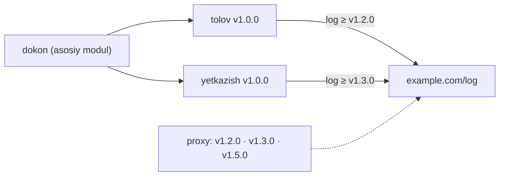

<div lang="uz">

🌐 **Oʻzbekcha** · [Русский](/lab/youtube/go/go-1-16/ru) · [English](/lab/youtube/go/go-1-16/en)  
Dars GO-1.16 · [Go: 0 → Guru](/lab/youtube/go#go-1-16) · ▶️ video tez orada · 💻 [GitHub](https://github.com/abdurahmon27/go-backend-uz/tree/main/lessons/016-go-mod)

> Bu sahifa videodagi darsning toʻliq yozma shakli: videoni koʻrmasdan (yoki eshitmasdan) ham shu yerdan oʻrganish mumkin.

## Nimani oʻrganasiz

Router kodiga tegmadingiz, Go'ni ham yangilamadingiz. Faqat bitta kutubxona qoʻshdingiz. Shundan keyin API
`GET /salom` ga 404 oʻrniga 200 qaytara boshladi. Qanday qilib kutubxona qoʻshish routerning xulqini oʻzgartiradi?
Javob `go.mod` fayldagi bitta qatorda: `go 1.21`.

**Bitta gʻoya:** `go.mod` dagi `go` qatori bezak emas. U uchta narsani hal qiladi. Shu modul kodi qaysi til versiyasi
bilan kompilyatsiya qilinadi? Butun dastur GODEBUG sozlamalarining qaysi standart qiymatlari bilan ishlaydi? Dastur
qaysi Go bilan build qilinadi? `require` qatorlari esa eng kichik versiyalar roʻyxati. MVS eng yangisini emas,
kerakli eng kichigini oladi, go.sum esa kod almashtirilmaganini tekshiradi.

Dars oxirida siz:

- `go` qatorining uchta vazifasini ajrata olasiz va uni koʻtarishdan oldin nima oʻzgarishini
  `go list -f '{{.DefaultGODEBUG}}'` bilan koʻra olasiz;
- eski xulqni `go` qatoriga tegmasdan qaytara olasiz (`godebug` qatori, `GODEBUG` muhit oʻzgaruvchisi);
- MVS qaysi versiyani tanlashini oldindan ayta olasiz va npm hamda pip'dan farqini tushuntira olasiz;
- go.sum, `internal/` papkasi va `tool` direktivasi nima uchun kerakligini bilasiz.

Bugungi uchta asosiy yangi soʻz:

| Soʻz | Oddiy maʼnosi | Inglizcha |
|---|---|---|
| GODEBUG sozlamasi | standart kutubxonadagi bitta xulqning kaliti: `httpmuxgo121=1` — eski router | GODEBUG setting |
| toolchain | Go'ning oʻzi: `go` buyrugʻi, kompilyator va standart kutubxona, bitta versiyada | toolchain |
| MVS | har bir modul uchun talab qilingan versiyalarning eng kattasini olish | minimal version selection |

Yoʻl-yoʻlakay ikkita yordamchi soʻz ham uchraydi: **asosiy modul** (*main module*, siz build qilayotgan modul) va
**hash** (faylning SHA-256 izi, go.sum shulardan iborat). Ikkalasini kerakli joyda tushuntiramiz.

## Oldin bilish kerak

- [GO-1.01 · Go nega bor? go build ichida nima bor](/lab/youtube/go/go-1-01): `go run` va `go build`, kompilyator
  paketlarni birma-bir tarjima qiladi.
- [GO-1.05 · Go'da while yoʻq: bitta for va uning hamma shakllari](/lab/youtube/go/go-1-05): `go 1.21` modulda sikl
  `c.uz c.uz c.uz` chiqaradi, `go 1.22` dan beri esa `a.uz b.uz c.uz`. Oʻsha darsda bu qator «GO-1.16 da» ochilishi
  aytilgan edi. Mana shu dars.
- [GO-1.03 · Konstanta va iota: oʻzgarmas nomlar, time.Sleep(2) va jim buziladigan raqamlar](/lab/youtube/go/go-1-03):
  `Status` enum'i (`Unknown`, `New`, `Paid`, `Shipped`), `tool` boʻlimida qaytadi.
- [GO-1.13 · Interface'lar: nil nega nil'ga teng emas?](/lab/youtube/go/go-1-13): `fmt.Stringer`. `String() string`
  metodi bor tur `Println` da son emas, nom boʻlib chiqadi.
- Bu darsni go.dev/play da ishga tushirib boʻlmaydi: har bir misol alohida modul (oʻz `go.mod` i bor), baʼzilari
  Go'ning boshqa versiyasini yuklab oladi. Kompyuteringizda Go 1.26 kerak. Terminalni kurs papkasida
  (`lessons/016-go-mod`) oching, hamma buyruqlar oʻsha yerdan ishlaydi. `cd eski && …` avval `eski` papkasiga
  oʻtadi, keyin buyruqni bajaradi.
- `example.com/...` modullari internetda yoʻq, ular papkadagi `mvs/proxy` da. Yangi klon qilingan repoda README
  bir marta shuni bajarishni aytadi:

```bash
cd lessons/016-go-mod
export GOPROXY=file://$PWD/mvs/proxy,https://proxy.golang.org GONOSUMDB=example.com CGO_ENABLED=0
(cd mvs/dokon && go mod download)
```

- `GOTOOLCHAIN=go1.27.4` va `kelajak/` birinchi marta Go 1.27.4 ni yuklaydi: arxiv qariyb 76 MB.
- Natijalar `go1.26.8` va `go1.27.4` (`linux/amd64`) da olingan.

Avval oldingi darsni eslaymiz. `main` da `defer` ichida `recover` bor, `panic` esa boshqa goroutine'da
boʻldi. Dastur qutqariladimi?

<details>
<summary>Javob</summary>

**Yoʻq, dastur baribir yiqiladi.** `panic` faqat oʻz goroutine'sining chaqiruvlari boʻylab yuqoriga chiqadi va
boshqa goroutine'ga oʻtmaydi. Uni oʻsha goroutine ichidagi `recover` ushlashi kerak edi. `panic` goroutine boshiga
yetganda, Go spetsifikatsiyasiga koʻra butun dastur toʻxtaydi
([Go spec: Handling panics](https://go.dev/ref/spec#Handling_panics)).

</details>

## Jumboq: bitta kutubxona routerni oʻzgartirdi

`eski/` papkasida bitta marshrutli HTTP router bor. Dastur server ochmaydi: soʻrovni toʻgʻridan-toʻgʻri routerga
beradi va javob kodini chiqaradi.

```go filename="eski/main.go" showLineNumbers
package main

import (
	"fmt"
	"net/http"
	"net/http/httptest"
)

func main() {
	mux := http.NewServeMux()
	mux.HandleFunc("GET /salom", func(w http.ResponseWriter, r *http.Request) {
		fmt.Fprint(w, "salom!")
	})

	for _, method := range []string{"GET", "POST"} {
		w := httptest.NewRecorder()
		mux.ServeHTTP(w, httptest.NewRequest(method, "/salom", nil))
		fmt.Println(method, "/salom →", w.Code)
	}
}
```

| Qator | Kod | Nima qiladi |
|---|---|---|
| 4–6 | `"fmt"`, `"net/http"`, `"net/http/httptest"` | `httptest` — test uchun soxta soʻrov va javob yasaydigan paket |
| 10 | `mux := http.NewServeMux()` | standart kutubxonadagi router (`ServeMux`) |
| 11–13 | `mux.HandleFunc("GET /salom", …)` | pattern (yoʻl shabloni) `"GET /salom"`: Go 1.22 dan beri bu «`GET` metodi + `/salom` yoʻli» degani; javobga `salom!` yoziladi |
| 15 | `for _, method := range []string{"GET", "POST"}` | ikki metod bilan sinaymiz |
| 16 | `w := httptest.NewRecorder()` | soxta javob: router yozgan status kodini saqlaydi |
| 17 | `mux.ServeHTTP(w, httptest.NewRequest(method, "/salom", nil))` | soʻrovni port ochmasdan toʻgʻridan-toʻgʻri routerga beradi |
| 18 | `fmt.Println(method, "/salom →", w.Code)` | metod va status kodi |

Express'da metod funksiya nomida: `app.get("/salom", …)`. Laravel'da ham: `Route::get('/salom', …)`. Go 1.22 da
standart `ServeMux` metodni pattern ichida qabul qila boshladi (release notes: *"enhanced to accept methods and
wildcards"*).

Modulning `go.mod` fayli:

```console
$ cat eski/go.mod
module eski

go 1.21
```

Endi `mvs/yuksal.sh` skripti. U `eski/` ning vaqtinchalik nusxasini oladi, ishga tushiradi, keyin bitta kutubxona
qoʻshadi va yana ishga tushiradi. Router kodiga tegmaydi, Go ham oʻsha 1.26.8.

```bash
#!/usr/bin/env bash
# eski/ (go 1.21) ning nusxasiga go 1.22 talab qiladigan kutubxonani qo'shib, uni ishlatamiz.
# Router kodiga tegmaymiz. go get go.mod'dagi go qatorini o'zi ko'taradi va ServeMux xulqi o'zgaradi.
# Asl eski/ papkasi o'zgarmaydi: hammasi vaqtinchalik nusxada.
set -eu
proxy="file://$(cd "$(dirname "$0")" && pwd)/proxy"
nusxa=$(mktemp -d)
trap 'rm -rf "$nusxa"' EXIT
cp "$(dirname "$0")"/../eski/{go.mod,main.go} "$nusxa"
cd "$nusxa"
go run .
# yangi fayl: kutubxonani ishlatadi, router'ga tegmaydi
printf 'package main\n\nimport "example.com/ramka"\n\nvar _ = ramka.Nomi()\n' > ramka.go
GOPROXY="$proxy" GONOSUMDB=example.com go get example.com/ramka@v1.0.0 2>&1 | grep -v downloading
go run .
```

`ramka.go` — yangi fayl: u faqat `example.com/ramka` kutubxonasini import qiladi va ishlatadi. Kutubxona papkadagi
lokal proxy'dan olinadi (`GOPROXY="$proxy"`). Uning `go.mod` ida bitta muhim qator bor:

```console
$ cat mvs/manba/ramka@v1.0.0/go.mod
module example.com/ramka

go 1.22
```

Oʻylab koʻring: kutubxona qoʻshilgandan keyin `GET /salom` nima qaytaradi?

**A)** yana 404: router kodi oʻzgarmadi · **B)** 200 · **C)** build xatosi: kutubxona `go 1.22` talab qiladi,
modul esa `go 1.21`

<details>
<summary>Javob</summary>

**B: 200.** `go get` xato bermaydi: u modulning `go` qatorini oʻzi `1.22` ga koʻtaradi. `go 1.22` qatori bilan
esa Go yangi routerni yoqadi. «A» ni tanlagan boʻlsangiz, router xulqi faqat kodga bogʻliq deb oʻylagansiz. «C» ni
tanlagan boʻlsangiz, `go` qatori faqat tekshiriladi deb oʻylagansiz: `go get` uni oʻzi koʻtaradi. Nega bunday ekanini butun dars davomida ochamiz.

</details>

```console
$ mvs/yuksal.sh
GET /salom → 404
POST /salom → 404
go: upgraded go 1.21 => 1.22
go: added example.com/ramka v1.0.0
GET /salom → 200
POST /salom → 405
```

Bitta qatorga qarang: `go: upgraded go 1.21 => 1.22`. Kutubxona `go 1.22` talab qilgani uchun `go get` bizning
`go` qatorimizni ham koʻtardi. Natijada:

| `go` qatori | Router | `GET /salom` | `POST /salom` |
|---|---|---|---|
| `go 1.21` | eski (Go 1.21 dagi) | 404 | 404 |
| `go 1.22` | yangi: `GET` — metod | 200 | 405 (metod mos emas) |

Eski router `"GET /salom"` ni qanday oʻqiydi? Uning kodi Go'da hali bor (`net/http/servemux121.go`).
`/` bilan boshlanmagan pattern unga host nomi bilan boshlangandek koʻrinadi:
`if pattern[0] != '/' { mux.hosts = true }`. Demak `"GET "` — host, `/salom` — yoʻl. Soʻrovning hosti esa
`example.com` (`httptest.NewRequest` shuni qoʻyadi), `"GET "` emas. Hech qaysi soʻrov mos kelmaydi, shuning uchun
ikkala metod ham 404 oldi.

Bu safar oʻzgarish yaxshi tomonga boʻldi. Lekin xuddi shu koʻtarilish boshqa narsalarni ham jim oʻzgartiradi: buni
GODEBUG boʻlimida koʻramiz.

## go.mod: package.json emas

**Modul** (*module*) — birga versiyalanadigan paketlar toʻplami. npm'dagi bitta paket, Composer'dagi bitta paket
yoki PyPI'dagi bitta loyiha shunga yaqin. Modulning ildizida `go.mod` fayli turadi. Toʻliq namunani `asbob/` da
koʻramiz:

```console
$ cat asbob/go.mod
module asbob

go 1.26.0

tool golang.org/x/tools/cmd/stringer

require (
	golang.org/x/mod v0.43.0 // indirect
	golang.org/x/sync v0.25.0 // indirect
	golang.org/x/tools v0.53.0 // indirect
)
```

| Qator | Kod | Nima qiladi |
|---|---|---|
| 1 | `module asbob` | modul nomi; uning ichidagi paketlar shu yoʻl bilan import qilinadi (`asbob/...`) |
| 3 | `go 1.26.0` | `go` qatori — darsning asosiy mavzusi |
| 5 | `tool golang.org/x/tools/cmd/stringer` | loyiha ishlatadigan dastur (Go 1.24+); oxirida qaytamiz |
| 7–11 | `require (…)` | kerakli modullar va ularning **eng kichik** versiyalari |
| 8–10 | `// indirect` | bu modulni asosiy modulning hech bir paketi toʻgʻridan-toʻgʻri import qilmaydi |

`go 1.17` dan beri `go.mod` bilvosita kerak boʻlgan modullarni ham yozadi: ular `// indirect` izohi bilan
belgilanadi. `require x v0.53.0` — «aniq v0.53.0» emas, «kamida v0.53.0» degani. Buni MVS boʻlimida koʻramiz.

Boshqa tillardagi oʻxshash fayllar bilan yonma-yon:

| Nima | Go | npm | Python | PHP (Composer) |
|---|---|---|---|---|
| nom | `module asbob` | `"name"` | `[project] name` (`pyproject.toml`) | `"name"` |
| qaysi til/runtime versiyasi | `go 1.26.0` | `"engines": {"node": …}` | `requires-python` | `"require": {"php": …}` |
| bogʻliqliklar | `require x v0.53.0` — kamida shu versiya | `"x": "^0.53.0"` — diapazon | `x>=0.53` — diapazon | `"x": "^0.53"` — diapazon |
| loyiha asboblari | `tool …` | `devDependencies` | — | `require-dev` |
| aniq versiyalar qotirilgan fayl | yoʻq, kerak emas (MVS) | `package-lock.json` | `pip freeze` natijasi | `composer.lock` |
| kod hash'lari | `go.sum` | `package-lock.json` dagi `integrity` | `--require-hashes` rejimi | — |

Ikki farq bor, va dars aynan shular haqida. Birinchidan, `go` qatori `engines` kabi maslahat emas: u kodning
qanday kompilyatsiya qilinishini va ishlashini oʻzgartiradi. Ikkinchidan, Go'da lock fayl yoʻq, va bu ataylab
qilingan.

## go qatorining uchta vazifasi

| # | Vazifa | Kimga taʼsir qiladi | Qaysi `go` qatori hisobga olinadi |
|---|---|---|---|
| 1 | til versiyasi (kompilyatorning `-lang` bayrogʻi) | shu modul paketlari | har bir modulning oʻzinikidan |
| 2 | GODEBUG sozlamalarining standart qiymatlari | butun dastur | faqat asosiy modulniki (yoki `go.work`) |
| 3 | minimal Go versiyasi | build | Go 1.21 dan beri majburiy talab; oldin faqat maslahat edi |

Go Toolchains hujjati: *"Go 1.21 changed the go line to be a mandatory requirement instead"* — «Go 1.21 `go`
qatorini majburiy talabga oʻzgartirdi». Undan oldin eski Go yangi modulni baribir build qilishga urinardi va
muvaffaqiyatsiz boʻlsa faqat versiya mos emasligi haqida eslatma chiqarardi. Uchala vazifani birma-bir koʻramiz.

## 1. Til versiyasi: kompilyatorning -lang bayrogʻi

`go build -n` buyruqlarni bajarmaydi, faqat chiqaradi. Ular orasida kompilyatorga beriladigan `-lang` bayrogʻini
`grep` bilan ajratamiz:

```console
$ cd eski && go build -n . 2>&1 | grep -o -- '-lang=go[0-9.]*'
-lang=go1.21
```

```console
$ cd yangi && go build -n . 2>&1 | grep -o -- '-lang=go[0-9.]*'
-lang=go1.26
```

`-lang` qiymati `go` qatoridan olinadi (`cmd/go/internal/work/gc.go`: `-lang=go` + `p.Module.GoVersion`).
[GO-1.05](/lab/youtube/go/go-1-05) dagi sikl ham aynan shu bayroqqa qaraydi: har iteratsiyada yangi oʻzgaruvchi faqat
`-lang=go1.22` va undan yuqorisida boʻladi.

Yangi sintaksis ham shunga bogʻliq. `til/` moduli `go 1.21`, kodda esa Go 1.22 da qoʻshilgan butun son ustida
`range`:

```go filename="til/main.go" showLineNumbers
package main

import "fmt"

func main() {
	for i := range 3 { // Go 1.22 dan beri: butun son ustida range
		fmt.Print(i, " ")
	}
	fmt.Println()
}
```

| Qator | Kod | Nima qiladi |
|---|---|---|
| 6 | `for i := range 3 {` | Go 1.22 dan beri: `i` 0, 1, 2 qiymatlarini oladi (JS'dagi `for (let i = 0; i < 3; i++)`) |
| 7 | `fmt.Print(i, " ")` | sonni va boʻsh joyni chiqaradi |
| 9 | `fmt.Println()` | qator oxiri |

Oʻylab koʻring: `go run .` nima qiladi? Kompyuterdagi Go 1.26.8, bu sintaksisni biladi.

**A)** `0 1 2` · **B)** kompilyatsiya xatosi · **C)** dastur ishlaydi, lekin hech narsa chiqarmaydi

<details>
<summary>Javob</summary>

**B.** Kompilyator Go 1.26.8, lekin u modulni `-lang=go1.21` bilan kompilyatsiya qiladi va Go 1.21 da yoʻq
sintaksisni rad etadi. «A» ni tanlagan boʻlsangiz, kompilyator versiyasi hamma narsani hal qiladi deb
oʻylagansiz.

</details>

```console
$ cd til && go run .
# til
./main.go:6:17: cannot range over 3 (untyped int constant): requires go1.22 or later (-lang was set to go1.21; check go.mod)
```

Xatoni oʻqiymiz: `./main.go:6:17` — fayl, 6-qator, 17-ustun (`3`). *cannot range over 3 (untyped int constant):
requires go1.22 or later* — «3 ustida range qilib boʻlmaydi: go1.22 yoki undan yangisi kerak». Qavs ichida sabab:
*-lang was set to go1.21; check go.mod* — «`-lang` go1.21 qilib berilgan; go.mod'ni tekshiring».

Tuzatish: `go` qatorini `go 1.22` yoki undan yuqori qiling. Faqat bitta fayl uchun esa fayl boshidagi
`//go:build go1.22` qatori til versiyasini koʻtaradi ([GO-1.05](/lab/youtube/go/go-1-05) dagi guru vazifasi).

## 2. GODEBUG: eski xulqning sozlamalari

Go 1 moslik vaʼdasi bor: eski kod yangi Go bilan ham ishlashi kerak. Lekin baʼzan Go jamoasi xulqni oʻzgartirishi
kerak boʻladi: yangi router, xavfsizroq TLS, konteynerga mos GOMAXPROCS. Bunday oʻzgarish eski kodni buzishi mumkin
boʻlsa, Go jamoasi eski xulqni qaytaradigan **GODEBUG sozlamasi** (*GODEBUG setting*) qoʻshadi. Sozlama
`kalit=qiymat` koʻrinishida: masalan, `httpmuxgo121=1` Go 1.21 dagi routerni qaytaradi.

Yangi Go eski `go` qatorini koʻrsa, **shunday sozlamalarda** oʻsha versiyadagi xulqni tanlaydi. GODEBUG hujjati:
*"the Go toolchain amends its defaults to match that older Go version as closely as possible"* — «toolchain standart
qiymatlarini oʻsha eski versiyaga iloji boricha yaqinlashtiradi». Boshqa tuzatishlar va runtime yaxshilanishlari
baribir ishlaydi: gap faqat sozlamasi bor oʻzgarishlar haqida.

`go list -f '{{.DefaultGODEBUG}}' .` dastur build qilinganda unga yoziladigan sozlamalarni chiqaradi: faqat Go'ning
hozirgi standart qiymatlaridan farq qiladiganlarini, vergul bilan. `tr , '\n'` ularni qatorlarga ajratadi, `wc -l`
sanaydi:

```console
$ cd eski && go list -f '{{.DefaultGODEBUG}}' . | tr , '\n' | wc -l
30
```

`go 1.21` qatorli `eski/` da 30 ta sozlama eski holatda. Ulardan toʻrttasi:

```console
$ cd eski && go list -f '{{.DefaultGODEBUG}}' . | tr , '\n' | grep -E 'mux|tls10|maxprocs'
containermaxprocs=0
httpmuxgo121=1
tls10server=1
updatemaxprocs=0
```

| Sozlama | Eski `go` qatorida nima boʻladi |
|---|---|
| `httpmuxgo121=1` | Go 1.21 dagi router: jumboqdagi 404 |
| `tls10server=1` | server TLS 1.0 mijozlarini ham qabul qiladi (yangi standart: kamida TLS 1.2) |
| `containermaxprocs=0` | GOMAXPROCS (Go kodi bir vaqtda ishlaydigan yadrolar soni) konteynerning CPU limitini hisobga olmaydi |
| `updatemaxprocs=0` | CPU limiti oʻzgarsa ham GOMAXPROCS qayta hisoblanmaydi |

Oxirgi ikkitasi Go 1.25 da qoʻshilgan. Docker'da `--cpus=2` bilan ishlaydigan servis `go 1.21` qatori bilan
GOMAXPROCS'ni konteynerning limiti boʻyicha emas, mashinaning yadrolari boʻyicha oladi. Jumboqdagi `go get` esa
`tls10server` ni ham jim oʻchirgan: endi TLS 1.0 mijozlari serverga ulana olmaydi.

Har bir `go` qatori uchun nechta sozlama eski holatda qoladi? Biz Go 1.26.8 da boʻsh `main` paketli alohida
modullarda oʻlchadik (kurs papkasida yoʻq). Natijalar README'dagi bilan bir xil:

| `go` qatori | 1.21 | 1.22 | 1.23 | 1.24 | 1.25 | 1.26 |
|---|---|---|---|---|---|---|
| eski holatdagi sozlamalar | 30 | 25 | 17 | 8 | 3 | 0 |

`go` qatorini koʻtarishdan oldin va keyin shu roʻyxatni chiqarib solishtiring: oʻsha ayirma — sizning
servisingizda jim oʻzgaradigan xulq roʻyxati.

## Ikki vazifa, ikki xil go qatori

Endi ikki vazifani birga koʻramiz. `qoida/ilova` (`go 1.26`) `qoida/kutubxona` (`go 1.21`) modulini ishlatadi:

```console
$ cat qoida/ilova/go.mod
module ilova

go 1.26

require example.com/kutubxona v0.0.0

replace example.com/kutubxona => ../kutubxona
```

```console
$ cat qoida/kutubxona/go.mod
module example.com/kutubxona

go 1.21
```

`replace` qatori kutubxonani internetdan emas, qoʻshni papkadan olishni aytadi (npm'dagi `"file:../kutubxona"`
ga oʻxshash). `require … v0.0.0` — `replace` uchun shartli versiya.

```go filename="qoida/kutubxona/kutubxona.go" showLineNumbers
// Package kutubxona: go.mod'ida "go 1.21". Uni go 1.26 dagi ilova ishlatadi.
package kutubxona

import (
	"fmt"
	"net/http"
)

// Router "GET /salom" ni roʻyxatga oladi.
// Qaysi router ishlashini (GODEBUG) ilovaning go qatori hal qiladi.
func Router() *http.ServeMux {
	mux := http.NewServeMux()
	mux.HandleFunc("GET /salom", func(w http.ResponseWriter, r *http.Request) {
		fmt.Fprint(w, "salom!")
	})
	return mux
}

// Domenlar 5-darsdagi sikl: har qadamda d ning manzilini saqlaydi.
// Til versiyasi (-lang) shu modulning go qatoridan olinadi: go 1.21.
func Domenlar() string {
	var navbat []*string
	for _, d := range []string{"a.uz", "b.uz", "c.uz"} {
		navbat = append(navbat, &d)
	}
	s := ""
	for _, p := range navbat {
		s += *p + " "
	}
	return s
}
```

| Qator | Kod | Nima qiladi |
|---|---|---|
| 11–17 | `func Router() *http.ServeMux` | jumboqdagi `"GET /salom"` routerini yasab qaytaradi |
| 21–31 | `func Domenlar() string` | [GO-1.05](/lab/youtube/go/go-1-05) dagi sikl: har iteratsiyada `d` ning manzilini (`&d`) roʻyxatga qoʻshadi, keyin hammasini oʻqiydi |
| 22 | `var navbat []*string` | satrlarga pointer'lar slice'i (`*string` — satrga pointer; [GO-1.11](/lab/youtube/go/go-1-11)) |
| 28 | `s += *p + " "` | `*p` — pointer koʻrsatgan satr |

```go filename="qoida/ilova/main.go" showLineNumbers
package main

import (
	"fmt"
	"net/http/httptest"

	"example.com/kutubxona"
)

// ilova: go 1.26. kutubxona: go 1.21.
func main() {
	w := httptest.NewRecorder()
	kutubxona.Router().ServeHTTP(w, httptest.NewRequest("GET", "/salom", nil))
	fmt.Println("kutubxona router:", w.Code)
	fmt.Println("kutubxona sikl:  ", kutubxona.Domenlar())
	fmt.Println("ilova sikl:      ", domenlar())
}

// domenlar kutubxonadagi bilan bir xil sikl, lekin go 1.26 modulda.
func domenlar() string {
	var navbat []*string
	for _, d := range []string{"a.uz", "b.uz", "c.uz"} {
		navbat = append(navbat, &d)
	}
	s := ""
	for _, p := range navbat {
		s += *p + " "
	}
	return s
}
```

| Qator | Kod | Nima qiladi |
|---|---|---|
| 7 | `"example.com/kutubxona"` | kutubxonani import qiladi |
| 12–14 | `kutubxona.Router().ServeHTTP(…)` | kutubxonaning routeriga `GET /salom` yuboradi |
| 15 | `kutubxona.Domenlar()` | kutubxonadagi sikl (`go 1.21` modulda) |
| 16, 20–30 | `domenlar()` | harfma-harf xuddi shu sikl, lekin `go 1.26` moduldagi |

Oʻylab koʻring: `go run .` nima chiqaradi?

**A)** router 404; ikkala sikl `c.uz c.uz c.uz` · **B)** router 200; kutubxona sikli `c.uz c.uz c.uz`, ilova sikli
`a.uz b.uz c.uz` · **C)** router 200; ikkala sikl `a.uz b.uz c.uz`

<details>
<summary>Javob</summary>

**B.** Ikki vazifa turli `go` qatoriga qaraydi. Til versiyasi har bir modulning oʻzidan: kutubxona
`-lang=go1.21` bilan kompilyatsiya qilinadi, shuning uchun uning siklida bitta `d`. GODEBUG esa faqat asosiy
modulning (`ilova`, `go 1.26`) qatoridan: router yangi. «A» ni tanlagan boʻlsangiz, hammasi kutubxonaning `go`
qatoridan olinadi deb oʻylagansiz. «C» ni tanlagan boʻlsangiz, hammasi ilovaning qatoridan olinadi deb
oʻylagansiz.

</details>

Kompilyatorga har paket uchun qanday `-lang` berilishini koʻramiz. `-a` hamma paketni keshga qaramay qayta
build qiladi, shuning uchun ikkala paket uchun ham buyruq chiqadi; `-p` — paketning import yoʻli:

```console
$ cd qoida/ilova && go build -a -n . 2>&1 | grep -oE -- '-p (main|example.com/kutubxona) -lang=go[0-9.]*'
-p example.com/kutubxona -lang=go1.21
-p main -lang=go1.26
```

```console
$ cd qoida/ilova && go run .
kutubxona router: 200
kutubxona sikl:   c.uz c.uz c.uz 
ilova sikl:       a.uz b.uz c.uz 
```

| Nima | Qaysi `go` qatoridan | Natija |
|---|---|---|
| kutubxona sikli (`-lang`) | kutubxonaniki: `go 1.21` | `c.uz c.uz c.uz` |
| ilova sikli (`-lang`) | ilovaniki: `go 1.26` | `a.uz b.uz c.uz` |
| kutubxonadagi router (GODEBUG) | ilovaniki: `go 1.26` | 200 |

GODEBUG qiymatlari binary'ga bitta marta, butun dastur uchun yoziladi. Ularni `go` buyrugʻi asosiy modulning
qatoridan oladi (`cmd/go/internal/load/godebug.go`: `MainModules.GoVersion`). **Asosiy modul** (*main module*) —
siz `go build` yoki `go run` ni ichida ishga tushirgan modul. Workspace (`go.work` fayli, bir nechta modulni birga
build qilish) ishlatsangiz, qiymatlar `go.work` dan olinadi.

Amaliy xulosa: Go 1.22 dagi sikl tuzatishi eski `go` qatorli kutubxonalarga yetib bormaydi, ularning
`go` qatori koʻtarilmaguncha.

## GODEBUG sozlamasini alohida oʻzgartirish

`go` qatorini birdan koʻtarish qoʻrqinchli boʻlsa (30 ta sozlama birdan oʻzgaradi), bitta sozlamani alohida
oʻzgartirish mumkin. `sozlama/` da `go 1.21` qoldi, lekin `godebug` qatori yangi routerni yoqadi:

```console
$ cat sozlama/go.mod
module sozlama

go 1.21

godebug httpmuxgo121=0
```

`main.go` — jumboqdagi bilan bir xil.

```console
$ cd sozlama && go run .
GET /salom → 200
POST /salom → 405
```

`go 1.21` boʻlsa ham 200: `godebug httpmuxgo121=0` faqat routerni yangiladi, qolgan 29 ta sozlama eski
holatda. Bu qatorni faqat Go 1.23 va undan yangilari tushunadi (eskilari xato beradi, «Koʻp uchraydigan xatolar»
boʻlimida koʻramiz). `go.mod` dagi `godebug` qatorlari ham faqat asosiy modulniki boʻlsa oʻqiladi.

Teskarisi ham bor: `godebug default=go1.21`. Shunda til versiyasi `go` qatoridan (masalan, 1.26) olinadi, GODEBUG
standart qiymatlari esa Go 1.21 dagidek qoladi. GODEBUG hujjati: *"This allows setting the GODEBUG defaults
separately from the Go language version"* — «bu GODEBUG standart qiymatlarini til versiyasidan alohida qoʻyish
imkonini beradi».

Dastur ishga tushganda esa `GODEBUG` muhit oʻzgaruvchisi hammasidan ustun turadi:

```console
$ cd sozlama && GODEBUG=httpmuxgo121=1 go run .
GET /salom → 404
POST /salom → 404
```

| Daraja | Qayerda | Qachon taʼsir qiladi |
|---|---|---|
| 1 | asosiy modulning `go` qatori | build paytida, hamma sozlama uchun standart qiymat |
| 2 | asosiy modulning `godebug` qatorlari (Go 1.23+) | build paytida, 1-darajaning ustidan yozadi |
| 3 | `GODEBUG` muhit oʻzgaruvchisi | dastur ishga tushganda, hammasidan ustun |

Yana bitta usul bor: uni uy vazifasida oʻzingiz topasiz.

## Sozlamalar abadiy emas: Go 1.27

Eski `go` qatori eski xulqni abadiy saqlamaydi. GODEBUG hujjati: sozlamalar *"maintained for a minimum of two
years (four Go releases)"* — «kamida ikki yil (toʻrtta Go relizi) saqlanadi». Keyin ular olib tashlanishi mumkin.

`taymer/` moduli `go 1.22`:

```go filename="taymer/main.go" showLineNumbers
package main

import (
	"fmt"
	"runtime"
	"time"
)

func main() {
	t := time.NewTimer(time.Millisecond)
	time.Sleep(20 * time.Millisecond) // taymer allaqachon ishladi
	t.Reset(time.Hour)                // endi bir soat kutishi kerak

	select {
	case <-t.C:
		fmt.Println(runtime.Version(), "→ eski signal keldi")
	default:
		fmt.Println(runtime.Version(), "→ kanal boʻsh")
	}
}
```

| Qator | Kod | Nima qiladi |
|---|---|---|
| 10 | `t := time.NewTimer(time.Millisecond)` | 1 ms dan keyin ishlaydigan taymer; signalni `t.C` kanaliga yuboradi |
| 11 | `time.Sleep(20 * time.Millisecond)` | 20 ms kutamiz: taymer allaqachon ishlab boʻldi |
| 12 | `t.Reset(time.Hour)` | taymerni qayta qoʻyamiz: endi bir soat kutishi kerak |
| 14–19 | `select { case <-t.C: … default: … }` | kanalda signal boʻlsa, uni oladi; boʻlmasa kutmasdan `default` ga oʻtadi |
| 16, 18 | `runtime.Version()` | dasturni qaysi Go build qilganini chiqaradi |

Kanal (*channel*) — goroutine'lar orasida qiymat uzatadigan navbat. Ular [GO-1.21](/lab/youtube/go#go-1-21) da, `select`
esa [GO-3.03](/lab/youtube/go#go-3-03) da batafsil. Bu yerda bitta narsa muhim: `Reset` dan keyin kanalda eski signal
qolganmi yoki yoʻqmi.

Go 1.23 gacha taymer kanalida bitta joy (bufer) bor edi. Ishlab boʻlgan taymerning signali `Reset` dan keyin ham
unda qolardi. Go 1.23 yangi xulqni kiritdi: `Reset` va `Stop` dan keyin eski signal kelmaydi. Eski xulq uchun
sozlama ham qoʻshildi: `asynctimerchan=1`. `go 1.22` qatori uchun Go 1.26 aynan shu sozlamani tanlaydi.

Oʻylab koʻring: `go run .` (Go 1.26.8) va `GOTOOLCHAIN=go1.27.4 go run .` nima chiqaradi? `GOTOOLCHAIN` — `go`
buyrugʻiga Go'ning qaysi versiyasini ishlatishni aytadi.

**A)** ikkalasida `eski signal keldi` · **B)** Go 1.26.8 da `eski signal keldi`, Go 1.27.4 da `kanal boʻsh` ·
**C)** ikkalasida `kanal boʻsh`

<details>
<summary>Javob</summary>

**B.** Go 1.26.8 `go 1.22` qatori uchun `asynctimerchan=1` ni tanlaydi va eski signal kanalda qoladi. Go 1.27 esa
bu sozlamani butunlay olib tashlagan: Go 1.23 dan 1.27 gacha roppa-rosa toʻrtta reliz. Eski xulqni qaytarib
boʻlmaydi, kanal boʻsh. «A» ni tanlagan boʻlsangiz, eski `go` qatori eski xulqni abadiy saqlaydi deb oʻylagansiz.

</details>

```console
$ cd taymer && go run .
go1.26.8 → eski signal keldi
```

```console
$ cd taymer && GOTOOLCHAIN=go1.27.4 go run .
go1.27.4 → kanal boʻsh
```

Kod ham, `go` qatori ham oʻzgarmadi, faqat Go versiyasi. Go 1.27 release notes: *"The asynctimerchan GODEBUG
setting … has been removed permanently"*. TLS 1.0 sozlamasi (`tls10server`) ham olib tashlandi. Go 1.27.4 da
`eski/` uchun `go list` endi 30 emas, 26 ta sozlama chiqaradi.

`go` qatori jim oʻzgaradi. Agar `go.mod` da eski qiymat aniq yozilgan boʻlsa, Go 1.27 build'ni toʻxtatadi.
`homework/guru` da shunday:

```console
$ cat homework/guru/go.mod
module guru

go 1.22

godebug asynctimerchan=1
```

`2>&1 | tail -1` xatoning faqat oxirgi qatorini koʻrsatadi:

```console
$ cd homework/guru && GOTOOLCHAIN=go1.27.4 go run . 2>&1 | tail -1
go.mod:5: removed GODEBUG "asynctimerchan" set to old value "1" (https://go.dev/doc/godebug#go-127)
```

*removed GODEBUG "asynctimerchan" set to old value "1"* — «olib tashlangan GODEBUG sozlamasi eski "1" qiymatiga
qoʻyilgan». Bu yaxshi: dastur jim boshqa xulq bilan ishlashidan koʻra build toʻxtagani afzal. Tuzatish — uy
vazifasidagi guru masalasi.

## 3. Toolchain: kerakli Go'ni oʻzi yuklaydi

Uchinchi vazifa: `go` qatori modulni build qila oladigan eng past Go versiyasi. **Toolchain** — Go'ning oʻzi:
`go` buyrugʻi, kompilyator va standart kutubxona. `kelajak/` moduli kompyuterdagidan yangi Go'ni talab qiladi:

```console
$ grep '^go ' kelajak/go.mod
go 1.27.4
```

Kompyuterda Go 1.26.8. Birinchi `go run .`:

```console
$ cd kelajak && go run .
go: downloading go1.27.4 (linux/amd64)
ishlayapti: go1.27.4
```

`go` buyrugʻi kerakli Go'ni oʻzi yukladi va dasturni u bilan ishga tushirdi. Standart rejim `GOTOOLCHAIN=auto`:
Go 1.27.4 `golang.org/toolchain` moduli sifatida proxy'dan olinadi va oddiy modul kabi checksum bilan tekshiriladi.
Ikkinchi ishga tushirishdan boshlab `go: downloading` qatori chiqmaydi: Go keshda turadi. Qancha joy egallaydi?

```console
$ cd $(go env GOMODCACHE) && du -sh --si --apparent-size cache/download/golang.org/toolchain/@v/*go1.27.4*.zip golang.org/toolchain@*go1.27.4*
76M	cache/download/golang.org/toolchain/@v/v0.0.1-go1.27.4.linux-amd64.zip
228M	golang.org/toolchain@v0.0.1-go1.27.4.linux-amd64
```

Arxiv qariyb 76 MB, ochilgandan keyin 228 MB (`--si` — 1000 lik megabayt, `--apparent-size` — fayllarning oʻz
hajmi). `GOTOOLCHAIN=local` boʻlsa, `go` hech narsa yuklamaydi va aniq xato beradi:

```console
$ cd kelajak && GOTOOLCHAIN=local go run .
go: go.mod requires go >= 1.27.4 (running go 1.26.8; GOTOOLCHAIN=local)
```

*go.mod requires go >= 1.27.4 (running go 1.26.8; GOTOOLCHAIN=local)* — «go.mod go >= 1.27.4 ni talab qiladi
(ishlayotgani go 1.26.8; GOTOOLCHAIN=local)».

npm'dagi `engines` bilan solishtiring. npm hujjati: `engine-strict` yoqilmagan boʻlsa, bu maydon *"is advisory
only and will only produce warnings"* — «faqat maslahat va faqat ogohlantirish chiqaradi». Biz tekshirdik (Node
24.10.0, npm 11.6.1, kurs papkasida yoʻq): bogʻliqlikda `"engines": { "node": ">=99" }` boʻlsa, `npm install`
`npm warn EBADENGINE Unsupported engine` deb ogohlantirdi va paketni baribir oʻrnatdi. Faqat `--engine-strict`
bilan `npm error code EBADENGINE` chiqdi. Go 1.21 gacha `go` qatori ham shunday maslahat edi. Endi u talab: Go
kerakli versiyani yuklaydi yoki rad etadi.

`go.mod` da alohida `toolchain` qatori ham boʻlishi mumkin, masalan `toolchain go1.27.4`. U tavsiya: Go undan eski
boʻlsa, shu versiyaga oʻtadi, `local` rejimida esa eʼtiborsiz qoladi. Faqat asosiy modulning `toolchain` qatori
oʻqiladi.

Endi jumboqqa qaytamiz. Go 1.21 dan beri modulning `go` qatori uning bogʻliqliklarinikidan past boʻla olmaydi.
`ramka` `go 1.22` talab qildi, shuning uchun `go get` bizning qatorimizni `1.22` ga koʻtardi va router oʻzgardi.
`asbob/` da ham shunday boʻlgan: `golang.org/x/tools v0.53.0` ning `go.mod` ida `go 1.26.0`, shuning uchun
`asbob/go.mod` da `go 1.26` emas, `go 1.26.0`.

Kutubxona yozsangiz, `go` qatorini imkon qadar past tuting: u kutubxonangizdan foydalanuvchilarning hammasining
`go` qatorini koʻtaradi. `go mod init` esa standart holatda joriy Go'ning toʻliq versiyasini yozadi («Koʻp
uchraydigan xatolar» boʻlimida).

## require va MVS: qaysi versiya kiradi?

Endi `require` qatorlari. `mvs/dokon` moduli ikkita kutubxonaga bogʻliq:

```console
$ cat mvs/dokon/go.mod
module dokon

go 1.26

require (
	example.com/tolov v1.0.0
	example.com/yetkazish v1.0.0
)

require example.com/log v1.3.0 // indirect
```

```go filename="mvs/dokon/main.go" showLineNumbers
package main

import (
	"fmt"

	"example.com/tolov"
	"example.com/yetkazish"
)

// tolov v1.0.0 example.com/log v1.2.0 ni, yetkazish v1.0.0 esa v1.3.0 ni talab qiladi.
// Eng yangisi v1.5.0. Build'ga qaysi biri kiradi?
func main() {
	fmt.Println("tolov ichidagi log:    ", tolov.Log())
	fmt.Println("yetkazish ichidagi log:", yetkazish.Log())
}
```

`tolov.Log()` va `yetkazish.Log()` ikkalasi ham oʻz ichida `example.com/log` modulining `Versiya()` funksiyasini
chaqiradi: build'ga `log` ning qaysi versiyasi kirganini aytadi. Kutubxonalarning `go.mod` lari:

```console
$ cat mvs/manba/tolov@v1.0.0/go.mod
module example.com/tolov

go 1.21

require example.com/log v1.2.0
```

```console
$ cat mvs/manba/yetkazish@v1.0.0/go.mod
module example.com/yetkazish

go 1.21

require example.com/log v1.3.0
```

Proxy'da (`mvs/proxy`, Go modullarni yuklaydigan server oʻrnidagi papka) `log` ning uchta versiyasi bor:

```console
$ cat mvs/proxy/example.com/log/@v/list
v1.2.0
v1.3.0
v1.5.0
```



Go bu graf ustida **MVS** (*minimal version selection*) algoritmini ishlatadi.

Savol: build'ga `log` ning qaysi versiyasi kiradi?

**A)** v1.2.0 · **B)** v1.3.0 · **C)** v1.5.0, eng yangisi

<details>
<summary>Javob</summary>

**B: v1.3.0.** MVS har bir modul uchun talab qilingan versiyalarning eng kattasini oladi: v1.2.0 va v1.3.0 dan —
v1.3.0. Bu hamma talabni qondiradigan eng kichik versiya. v1.5.0 ni hech kim soʻramagan, shuning uchun u kirmaydi.
«A» ni tanlagan boʻlsangiz, `yetkazish` ning talabini unutgansiz: v1.2.0 «kamida v1.3.0» ni qondirmaydi. «C» ni
tanlagan boʻlsangiz, npm yoki pip kabi oʻylagansiz (pastda solishtiramiz).

</details>

`GOPROXY=file://$PWD/../proxy` — modullarni `proxy.golang.org` dan emas, lokal papkadan olish (`$PWD` — joriy
papka). `go mod graph` grafning qirralarini chiqaradi: «kim → kimni talab qiladi». `grep -v ^dokon` asosiy
modulning oʻz qatorlarini olib tashlaydi:

```console
$ cd mvs/dokon && GOPROXY=file://$PWD/../proxy go mod graph | grep -v ^dokon | grep ' example.com/log@'
example.com/tolov@v1.0.0 example.com/log@v1.2.0
example.com/yetkazish@v1.0.0 example.com/log@v1.3.0
```

```console
$ cd mvs/dokon && GOPROXY=file://$PWD/../proxy go run .
tolov ichidagi log:     v1.3.0
yetkazish ichidagi log: v1.3.0
```

Ikkala kutubxona ham v1.3.0 ni oldi: binary'da `log` ning bitta versiyasi.

**npm va pip bilan solishtiramiz.** Xuddi shu uchta paketni lokal npm registry'ga va lokal Python paketlar
papkasiga joyladik (kurs papkasida yoʻq, alohida ishga tushirildi). Paketlar: log 1.2.0, 1.3.0, 1.5.0; `tolov`
`log` ning kamida 1.2.0 ini, `yetkazish` kamida 1.3.0 ini talab qiladi.

| Vosita | Talablar | Tanlangan log |
|---|---|---|
| npm 11.6.1 (`npm install`) | `"log": "^1.2.0"`, `"log": "^1.3.0"` | 1.5.0 |
| uv 0.11.21 (`uv pip compile`, pip bilan mos resolver) | `log>=1.2.0`, `log>=1.3.0` | 1.5.0 |
| Go 1.26.8 (MVS) | `require example.com/log v1.2.0`, `… v1.3.0` | v1.3.0 |

npm va pip diapazonga mos **eng yangi** versiyani oladi. Shuning uchun natija oʻrnatish kuniga bogʻliq: ertaga
log 1.6.0 chiqsa, yangi `npm install` uni oladi. Takrorlanadigan build uchun ular lock fayl yozadi:
`package-lock.json`, `composer.lock`, `pip freeze` dan olingan roʻyxat. Go Modules Reference esa: *"Unlike other
dependency management systems, the build list is not saved in a "lock" file. MVS is deterministic, and the build
list doesn't change when new versions of dependencies are released"* — «boshqa tizimlardan farqli, build roʻyxati
lock faylda saqlanmaydi. MVS deterministik: bogʻliqliklarning yangi versiyalari chiqqanda build roʻyxati
oʻzgarmaydi».

Versiyalar faqat siz `go get` qilganingizda yoki yangi import qoʻshganingizda oʻzgaradi (`go mod tidy` yangi
modulni oʻsha paytdagi eng yangi versiyasi bilan yozadi). Katta versiya (`v2` va undan yuqori) — boshqa import
yoʻli (`example.com/log/v2`), yaʼni MVS uchun boshqa modul.

## go.sum: almashtirilgan kodni ushlash

Versiya aniq. Lekin proxy bergan kodning oʻzi oʻshami? Buni `go.sum` tekshiradi:

```console
$ grep log mvs/dokon/go.sum
example.com/log v1.3.0 h1:jtLzF0d3cKr1ihfE0BawA7k/zEgug+2kxGS3dBm4J3M=
example.com/log v1.3.0/go.mod h1:RUfJNjFPRI6tqrT6oiqycOZSUh5GZuxUqKeqkpkD9gM=
```

Har qatorda modul, versiya va **hash** (faylning SHA-256 izi). Odatda har bir modul uchun ikkita qator: biri butun
kod arxivi uchun, ikkinchisi (`/go.mod` bilan) faqat uning `go.mod` fayli uchun. `h1:` — SHA-256, base64 koʻrinishida.

go.sum lock fayl emas: u versiyani tanlamaydi (versiyalar `go.mod` dan MVS bilan olinadi), faqat yuklangan kodni
tekshiradi. npm'da ikkala ish bitta faylda: `package-lock.json` ham versiyani qotiradi, ham `integrity` maydonida
hash saqlaydi. pip'da hash tekshiruvi faqat `--require-hashes` rejimida yoqiladi.

Endi hujumni sinaymiz. `mvs/zaharli/` — proxy'ning nusxasi, unda log v1.3.0 ning kodi **almashtirilgan**, versiya
raqami esa oʻsha. `mvs/hujum.sh`:

```bash
#!/usr/bin/env bash
# Hujum mashqi: zaharli/ proxy'da example.com/log v1.3.0 ning kodi almashtirilgan,
# versiya raqami esa o'sha. dokon'ni toza module cache bilan (yangi kompyuterdagidek)
# build qilamiz: avval zaharli/, topilmasa proxy/ dan yuklanadi.
# go.sum'dagi hash mos kelmaydi va go build to'xtaydi.
set -u
cd "$(dirname "$0")/dokon"
kesh=$(mktemp -d)
GOFLAGS=-modcacherw GOMODCACHE="$kesh" GONOSUMDB=example.com \
	GOPROXY="file://$(cd .. && pwd)/zaharli,file://$(cd .. && pwd)/proxy" \
	go build -o /dev/null .
kod=$?
rm -rf "$kesh"
exit $kod
```

Skript `dokon` ni toza module cache bilan build qiladi (`GOMODCACHE="$kesh"` — boʻsh vaqtinchalik papka), xuddi
yangi kompyuter yoki CI'dagidek. `GOPROXY` da avval `zaharli`, keyin `proxy`. `grep -E` kerakli qatorlarni ajratadi:

```console
$ mvs/hujum.sh 2>&1 | grep -E 'mismatch|downloaded|go.sum:|SECURITY'
verifying example.com/log@v1.3.0: checksum mismatch
	downloaded: h1:Jd4sA3vV+K6bvDLKgdPZFUlO3LCcZQ48avOZ1TR2bDs=
	go.sum:     h1:jtLzF0d3cKr1ihfE0BawA7k/zEgug+2kxGS3dBm4J3M=
SECURITY ERROR
```

*verifying example.com/log@v1.3.0: checksum mismatch* — «example.com/log@v1.3.0 ni tekshirish: hash mos emas».
`downloaded:` — yuklangan kodning hash'i, `go.sum:` — commit qilingan hash. Ular farq qiladi, va `go` *SECURITY
ERROR* deb build'ni toʻxtatadi.

go.sum'da hali yoʻq ochiq modullarni (yangi bogʻliqlik qoʻshganda) `sum.golang.org` checksum bazasi tekshiradi.
Go Modules Reference: u *"makes untrusted proxies possible since they can't serve the wrong code without it going
unnoticed"* — «ishonchsiz proxy'lardan ham foydalanish imkonini beradi, chunki ular notoʻgʻri kodni sezdirmasdan
bera olmaydi». Bizning `example.com` modullari ochiq emas, shuning uchun README ularni `GONOSUMDB=example.com`
bilan bu tekshiruvdan chiqaradi.

## internal/: tashqaridan import qilib boʻlmaydi

`internal` papkasi kodni yopadi. Qoida: `.../a/internal/b` paketini faqat `.../a/` ichidagi kod import qila oladi.
`ichki/` moduli:

```console
$ cd ichki && find . -name '*.go' | sort
./kassa/main.go
./ombor/hisob/hisob.go
./ombor/internal/narx/narx.go
```

```go filename="ichki/ombor/internal/narx/narx.go" showLineNumbers
// Package narx faqat ombor/ va uning ichidagi paketlar uchun.
package narx

// QQS bilan narx (12 foiz).
func QQS(som int) int { return som * 112 / 100 }
```

```go filename="ichki/ombor/hisob/hisob.go" showLineNumbers
// Package hisob ombor/ ichida: internal/narx ni import qila oladi.
package hisob

import "ichki/ombor/internal/narx"

func Jami(som int) int { return narx.QQS(som) }
```

```go filename="ichki/kassa/main.go" showLineNumbers
// kassa ombor/ dan tashqarida: internal/narx ni import qila olmaydi.
package main

import (
	"fmt"

	"ichki/ombor/internal/narx"
)

func main() {
	fmt.Println(narx.QQS(1000))
}
```

`narx` — `ombor/internal/` ichida, demak uni faqat `ombor/` ostidagi kod import qila oladi. `hisob` —
`ombor/hisob`, ichkarida. `kassa` — `ombor/` dan tashqarida. `som * 112 / 100` — 12 foizli QQS bilan narx.

```console
$ cd ichki && go build ./ombor/... && echo ombor: ok
ombor: ok
```

```console
$ cd ichki && go build ./kassa
package ichki/kassa
	kassa/main.go:7:2: use of internal package ichki/ombor/internal/narx not allowed
```

*use of internal package ichki/ombor/internal/narx not allowed* — «ichki paketdan foydalanishga ruxsat yoʻq».
Bu `go build` ning qoidasi, kelishuv emas.

Nega kerak: boshqalar ichki kodingizga tayanib qolmaydi, siz esa uni bemalol oʻzgartirasiz. Node'da yaqin
vosita — `package.json` dagi `"exports"` maydoni: unda yozilmagan ichki fayllarni paketdan tashqarida import qilib
boʻlmaydi. Python'da esa `_nom` faqat kelishuv: PEP 8 uni *"weak "internal use" indicator"* — «"ichki foydalanish"
uchun kuchsiz belgi» deydi, import baribir ishlaydi.

## tool direktivasi: stringer go.mod'da

Oxirgi direktiva — `tool`. `asbob/` da [GO-1.03](/lab/youtube/go/go-1-03) dagi `Status` turi:

```go filename="asbob/main.go" showLineNumbers
package main

import "fmt"

//go:generate go tool stringer -type=Status

// Status — 3-darsdagi enum: zero value maʼnoli holat emas (Unknown).
type Status int

const (
	Unknown Status = iota
	New
	Paid
	Shipped
)

func main() {
	fmt.Println(Unknown, New, Paid, Shipped)
}
```

| Qator | Kod | Nima qiladi |
|---|---|---|
| 5 | `//go:generate go tool stringer -type=Status` | `go generate` shu buyruqni bajaradi |
| 8–15 | `type Status int` va `iota` | GO-1.03 dagi enum: `Unknown` = 0 (zero value), `New` = 1, `Paid` = 2, `Shipped` = 3 |
| 18 | `fmt.Println(Unknown, New, Paid, Shipped)` | toʻrtta holatni chiqaradi |

`stringer` — Go jamoasining dasturi: u `Status` uchun `String() string` metodini yozib beradi
(`status_string.go`). `String()` metodi bor tur `fmt.Stringer` ni bajaradi va `Println` da nomi bilan chiqadi
([GO-1.13](/lab/youtube/go/go-1-13)).

Oʻylab koʻring: `status_string.go` siz, faqat `main.go` ni ishga tushirsak, nima chiqadi?

**A)** `Unknown New Paid Shipped` · **B)** `0 1 2 3` · **C)** kompilyatsiya xatosi

<details>
<summary>Javob</summary>

**B.** `String()` metodi boʻlmasa, `Status` oddiy `int` kabi chiqadi. «A» ni tanlagan boʻlsangiz, Go konstanta
nomlarini oʻzi saqlaydi deb oʻylagansiz: yoʻq, nomlarni `stringer` yozgan kod saqlaydi.

</details>

`go run main.go` paketdagi faqat shu faylni oladi:

```console
$ cd asbob && go run main.go
0 1 2 3
```

`stringer` qayerdan keladi? Go 1.24 dan beri `go get -tool golang.org/x/tools/cmd/stringer` uni `go.mod` ga `tool`
qatori sifatida yozadi (versiyasi `require` da):

```console
$ cd asbob && grep -n stringer main.go go.mod
main.go:5://go:generate go tool stringer -type=Status
go.mod:5:tool golang.org/x/tools/cmd/stringer
```

Ilgari buning uchun `tools.go` degan yordamchi fayl yozilardi: `//go:build tools` va dasturning blank importi.
Endi `go tool stringer` `go.mod` dagi aniq versiyani ishga tushiradi. npm'da bunga `devDependencies` va
`node_modules/.bin` dagi dasturni ishga tushiradigan `npx` yaqin.

```console
$ cd asbob && go generate && go run .
Unknown New Paid Shipped
```

`go generate` `status_string.go` ni qayta yozdi (fayl oʻzgarmadi), `go run .` esa paketdagi hamma fayl bilan
holat nomlarini chiqardi.

## Xulosa

- `go` qatori = til versiyasi (har modulniki) + GODEBUG standart qiymatlari (asosiy modulniki) + minimal Go
  versiyasi.
- Uni ataylab koʻtaring: testlarni yuriting va `go list -f '{{.DefaultGODEBUG}}' .` ni oldin va keyin solishtiring.
- Kutubxona yozsangiz, `go` qatorini imkon qadar past tuting: u foydalanuvchilarning `go` qatorini ham koʻtaradi.
- MVS eng yangisini emas, kerakli eng kichigini oladi; yangi reliz build'ni oʻzgartirmaydi.
- go.sum'ni doim `go.mod` bilan birga commit qiling (Go wiki: Modules FAQ).

## Koʻp uchraydigan xatolar

**1. `go` qatorini bezak deb oʻylash.** Eng keng tarqalgan tushuncha: `go 1.21` — «qaysi Go'da yozilgani
haqida eslatma». Aslida uni koʻtarish (oʻzingiz yoki `go get` orqali) jim xulq oʻzgarishi: jumboqdagi router,
`tls10server`, GOMAXPROCS. Xato chiqmaydi, natija oʻzgaradi. Qarang: «Jumboq» va «2. GODEBUG» boʻlimlari.
Tuzatish: koʻtarishdan oldin va keyin `go list -f '{{.DefaultGODEBUG}}' .` ni solishtiring, testlarni yuriting,
`go get` chiqargan `go: upgraded go …` qatoriga qarang.

**2. Eski modulda yangi sintaksis.** `go 1.21` modulda `for i := range 3` → `requires go1.22 or later (-lang was set
to go1.21; check go.mod)`. «1. Til versiyasi» boʻlimida koʻrdik. Tuzatish: `go` qatorini koʻtaring yoki faylga
`//go:build go1.22` qoʻying.

**3. `godebug` qatori va eski Go.** `godebug` qatorini faqat Go 1.23 va undan yangilari tushunadi. `sozlama/` ni
Go 1.22.12 bilan ishga tushiramiz:

```console
$ cd sozlama && GOTOOLCHAIN=go1.22.12 go run .
go: errors parsing go.mod:
go.mod:5: unknown directive: godebug
```

*errors parsing go.mod … unknown directive: godebug* — «go.mod'ni oʻqishda xato: 5-qatorda nomaʼlum direktiva:
godebug». Tuzatish: jamoangizdagi hamma (va CI) Go 1.23+ ishlatsin, yoki sozlamani `GODEBUG` muhit oʻzgaruvchisi
bilan bering.

**4. Olib tashlangan sozlamaning eski qiymati.** `godebug asynctimerchan=1` Go 1.27 da build'ni toʻxtatadi
(«Sozlamalar abadiy emas» boʻlimi). Tuzatish: qatorni oʻchiring yoki `asynctimerchan=0` qiling va kodni yangi
xulqqa moslang (uy vazifasidagi guru masalasi).

**5. go.sum'ni commit qilmaslik.** go.sum'ni `.gitignore` ga qoʻshsangiz, hamkasbingiz klon qilganda build
toʻxtaydi. `mvs/dokon` ning go.sum'siz nusxasi (kurs papkasida yoʻq, alohida ishga tushirildi, `GOPROXY` lokal
proxy'ga qaratilgan):

```console
$ go run .
main.go:6:2: missing go.sum entry for module providing package example.com/tolov (imported by dokon); to add:
	go get dokon
main.go:7:2: missing go.sum entry for module providing package example.com/yetkazish (imported by dokon); to add:
	go get dokon
```

*missing go.sum entry for module providing package example.com/tolov* — «`example.com/tolov` paketini beradigan
modul uchun go.sum'da yozuv yoʻq». `go get` yoki `go mod tidy` yozuvni qayta yaratadi, lekin bu safar proxy hozir
nima bersa, oʻshanga ishonadi: `hujum.sh` dagi himoya yoʻqoladi. Tuzatish: go.sum'ni `go.mod` bilan birga commit
qiling. Xuddi shu sababli checksum mismatch'ni «go.sum'ni oʻchirib» tuzatmang.

**6. Kutubxonada yuqori `go` qatori.** `go mod init` joriy Go'ning toʻliq versiyasini yozadi (alohida boʻsh papkada):

```console
$ go mod init x && cat go.mod
go: creating new go.mod: module x
module x

go 1.26.8
```

Ilova uchun bu yaxshi. Kutubxona uchun esa `go 1.26.8` uni ishlatadigan hamma modulni kamida `go 1.26.8` ga
koʻtaradi (jumboqdagi `go: upgraded go …`). Tuzatish: kutubxonada `go` qatorini kodingizga haqiqatan kerak boʻlgan
eng past versiyaga tushiring.

**7. `internal` paketini tashqaridan import qilish.** `use of internal package … not allowed` («internal/»
boʻlimida koʻrdik). Tuzatish: paketni `internal/` dan chiqaring (u endi ochiq API) yoki uni ishlatadigan kodni
`internal` ning ota papkasi ostiga koʻchiring.

## Oʻzingizni tekshiring

**1.** `ilova` (`go 1.26`) `go 1.21` qatorli kutubxonani ishlatadi. Kutubxona kodi qaysi til versiyasi bilan
kompilyatsiya qilinadi? Kutubxonadagi router qaysi GODEBUG qiymatlari bilan ishlaydi?

<details>
<summary>Javob</summary>

Til versiyasi kutubxonaning oʻzidan: `-lang=go1.21`. GODEBUG esa faqat asosiy modulning (`ilova`) `go` qatoridan:
Go 1.26 standart qiymatlari, router yangi (200).

</details>

**2.** Ertaga proxy'ga `example.com/log v1.6.0` chiqdi. Hech narsani oʻzgartirmasdan `mvs/dokon` da `go run .`
qilsangiz, nima chiqadi?

<details>
<summary>Javob</summary>

Yana ikkala qatorda `v1.3.0`. MVS faqat talab qilingan versiyalarga qaraydi, v1.6.0 ni hech kim soʻramagan. Yangi
reliz build'ni oʻzgartirmaydi. U faqat `go get example.com/log@latest` (yoki talabni koʻtaradigan bogʻliqlik)
bilan kiradi.

</details>

**3.** Modulning `go.mod` i shunday, kompyuterda esa Go 1.26.8:

```text
module tc

go 1.26

toolchain go1.27.4
```

`main.go` — `kelajak/` dagi bilan bir xil (`runtime.Version()` ni chiqaradi). `go run .` va
`GOTOOLCHAIN=local go run .` nima chiqaradi?

<details>
<summary>Javob</summary>

`go 1.26` talabini Go 1.26.8 qondiradi. Lekin `toolchain go1.27.4` tavsiyasi bor va standart `auto` rejimida Go
undan eski boʻlsa, oʻsha versiyaga oʻtadi. `local` rejimida tavsiya eʼtiborsiz qoladi. Kurs papkasida yoʻq,
alohida modulda ishga tushirildi:

```console
$ go run .
ishlayapti: go1.27.4
$ GOTOOLCHAIN=local go run .
ishlayapti: go1.26.8
```

</details>

**4.** Hamkasbingiz: «go.sum — Go'ning package-lock.json'i, uni oʻchirsak versiyalar oʻzgaradi». Toʻgʻrimi?

<details>
<summary>Javob</summary>

Yoʻq. Versiyalarni `go.mod` dagi `require` lar va MVS hal qiladi. go.sum faqat yuklangan kod va `go.mod`
fayllarining hash'larini saqlaydi va tekshiradi. Uni oʻchirsangiz, versiyalar oʻzgarmaydi, lekin build
«missing go.sum entry» bilan toʻxtaydi va almashtirilgan koddan himoya yoʻqoladi.

</details>

**5.** [GO-1.05](/lab/youtube/go/go-1-05) dan: nega `qoida/` da kutubxona sikli `c.uz c.uz c.uz`, ilovadagi xuddi shu
sikl esa `a.uz b.uz c.uz` chiqaradi?

<details>
<summary>Javob</summary>

Go 1.22 dan beri `for` siklida har iteratsiyada yangi oʻzgaruvchi boʻladi, lekin faqat `go 1.22` va undan yuqori
modullarda. Kutubxona `-lang=go1.21` bilan kompilyatsiya qilinadi: butun sikl uchun bitta `d`, uchala `&d` bir
manzil, oxirgi qiymat `c.uz`. Ilova `-lang=go1.26`: har iteratsiyada yangi `d`.

</details>

**6.** `ichki/ombor/hisob/` ichida yangi `ichki/ombor/hisob/hisobot` paketi `ichki/ombor/internal/narx` ni import
qila oladimi? `ichki/kassa/chek` paketi-chi?

<details>
<summary>Javob</summary>

`hisob/hisobot` — ha: u `ichki/ombor/` ostida, `internal` ning ota papkasi esa `ichki/ombor/`. `kassa/chek` — yoʻq:
`ombor/` dan tashqarida, `go build` `use of internal package … not allowed` deydi.

</details>

## Uy vazifasi

Toʻrt darajadagi vazifa. Hamma fayllar GitHub'dagi dars papkasida:
[lessons/016-go-mod](https://github.com/abdurahmon27/go-backend-uz/tree/main/lessons/016-go-mod). Javoblar:
[homework/](https://github.com/abdurahmon27/go-backend-uz/tree/main/lessons/016-go-mod/homework) papkasi. Avval
oʻzingiz urinib koʻring.

🟢 **Oson:** oʻz loyihangizda `go list -f '{{.DefaultGODEBUG}}' .` ni ishga tushiring. Boʻsh chiqsa — nega?

<details>
<summary>Javob</summary>

Buyruq faqat Go'ning hozirgi standart qiymatlaridan **farq qiladigan** sozlamalarni chiqaradi. `go` qatori
toolchain bilan bir xil boʻlsa (`go 1.26` + Go 1.26), roʻyxat boʻsh. `yangi/` (`go 1.26`) da shunday, buyruq
hech narsa chiqarmaydi:

```console
$ cd yangi && go list -f '{{.DefaultGODEBUG}}' .
```

`eski/` (`go 1.21`) da 30 ta. Har birining tavsifi: [go.dev/doc/godebug#history](https://go.dev/doc/godebug#history).

</details>

🟡 **Oʻrta:** `yangi/` ni `go` qatoriga tegmasdan eski routerga oʻtkazing. Darsda aytilmagan usulni ham toping.

<details>
<summary>Javob</summary>

Toʻrt usul, `go 1.26` qatoriga tegmasdan:

1. `go.mod` ga `godebug httpmuxgo121=1` (Go 1.23+ kerak).
2. `go.mod` ga `godebug default=go1.21`: til versiyasi 1.26 qoladi, GODEBUG standart qiymatlari 1.21 dagidek
   (30 ta sozlama, jumladan `httpmuxgo121=1`).
3. **Darsda aytilmagan usul:** `main` paketidagi faylning eng tepasida, `package` dan oldin
   `//go:debug httpmuxgo121=1` izohi. Go 1.21 dan beri ishlaydi.
4. Ishga tushirishda: `GODEBUG=httpmuxgo121=1 go run .`.

3-usul `homework/orta/main.go` da:

```go filename="homework/orta/main.go" showLineNumbers
//go:debug httpmuxgo121=1

package main

import (
	"fmt"
	"net/http"
	"net/http/httptest"
)

func main() {
	mux := http.NewServeMux()
	mux.HandleFunc("GET /salom", func(w http.ResponseWriter, r *http.Request) {
		fmt.Fprint(w, "salom!")
	})

	for _, method := range []string{"GET", "POST"} {
		w := httptest.NewRecorder()
		mux.ServeHTTP(w, httptest.NewRequest(method, "/salom", nil))
		fmt.Println(method, "/salom →", w.Code)
	}
}
```

```console
$ cd homework/orta && go run .
GET /salom → 404
POST /salom → 404
```

```console
$ cd homework/orta && go list -f '{{.DefaultGODEBUG}}' .
httpmuxgo121=1
```

`go.mod` da `go 1.26` boʻlsa ham, `//go:debug` sozlamani binary'ga yozdi.

</details>

🟠 **Qiyin:** `mvs/dokon` da `go get example.com/log@v1.2.0` qiling. `yetkazish` bilan nima boʻladi va nega?

<details>
<summary>Javob</summary>

`homework/qiyin/qiyin.sh` buni `dokon` ning vaqtinchalik nusxasida qiladi:

```console
$ homework/qiyin/qiyin.sh
go: downgraded example.com/log v1.3.0 => v1.2.0
go: removed example.com/yetkazish v1.0.0
--- go.mod:
module dokon

go 1.26

require example.com/tolov v1.0.0

require example.com/log v1.2.0 // indirect
--- go build:
main.go:7:2: no required module provides package example.com/yetkazish; to add it:
	go get example.com/yetkazish
```

`yetkazish v1.0.0` `log` ning kamida v1.3.0 ini talab qiladi. `log` ni v1.2.0 ga tushirish uchun `go get` `yetkazish`
ning log ≤ v1.2.0 bilan ishlaydigan eski versiyasini qidiradi. Bunday versiya yoʻq, shuning uchun `yetkazish` ni
olib tashlaydi (`go: removed example.com/yetkazish v1.0.0`). Kod esa uni hali import qiladi va build toʻxtaydi. MVS
hech qachon talabdan **past** versiyani tanlamaydi.

</details>

🔴 **Guru:** `homework/guru` (`go 1.22` + `godebug asynctimerchan=1`) ni Go 1.27 da build boʻladigan qiling va
kodni taymerning yangi xulqiga moslang.

<details>
<summary>Javob</summary>

Hozir:

```console
$ cd homework/guru && go run .
go1.26.8 → eski signal keldi
```

```console
$ cd homework/guru && GOTOOLCHAIN=go1.27.4 go run .
go: error loading go.mod:
go.mod:5: removed GODEBUG "asynctimerchan" set to old value "1" (https://go.dev/doc/godebug#go-127)
```

Go 1.27 release notes: olib tashlangan sozlama oxirgi standart qiymat bilan (`asynctimerchan=0`) yozilsa,
qabul qilinadi; eski qiymat bilan (`=1`) esa `go` buyrugʻi xato beradi. Tuzatish: `godebug` qatorini oʻchiring
yoki `asynctimerchan=0` qiling. Biz `=0` ni nusxada tekshirdik: Go 1.26.8 ham, Go 1.27.4 ham
`kanal boʻsh` chiqaradi. Keyin kodni yangi xulqqa moslang: `Reset`/`Stop` dan keyin kanalni qoʻlda boʻshatish
(`select { case <-t.C: default: }`) endi kerak emas. `go 1.22` qatorining oʻzi (`godebug` qatorisiz) Go 1.27 da
xato bermaydi, faqat yangi xulq bilan ishlaydi (darsdagi `taymer/`).

</details>

## Manbalar

- [Go Modules Reference](https://go.dev/ref/mod): [go.mod files](https://go.dev/ref/mod#go-mod-file),
  [Minimal version selection](https://go.dev/ref/mod#minimal-version-selection),
  [go.sum files](https://go.dev/ref/mod#go-sum-files), [Checksum database](https://go.dev/ref/mod#checksum-database)
- [Go Toolchains](https://go.dev/doc/toolchain) (`go` va `toolchain` qatorlari, `GOTOOLCHAIN`)
- [Go, Backwards Compatibility, and GODEBUG](https://go.dev/doc/godebug) (`godebug` qatorlari, `default=`,
  kamida ikki yil, [sozlamalar tarixi](https://go.dev/doc/godebug#history))
- Reliz yozuvlari: [Go 1.22: Enhanced routing patterns](https://go.dev/doc/go1.22#enhanced_routing_patterns),
  [Go 1.23](https://go.dev/doc/go1.23) (taymerlar), [Go 1.24: tool](https://go.dev/doc/go1.24#tools),
  [Go 1.27](https://go.dev/doc/go1.27) (olib tashlangan sozlamalar)
- Go manba kodi (go1.26.8): [cmd/go/internal/work/gc.go](https://github.com/golang/go/blob/go1.26.8/src/cmd/go/internal/work/gc.go#L69-L80)
  (`-lang`), [cmd/go/internal/load/godebug.go](https://github.com/golang/go/blob/go1.26.8/src/cmd/go/internal/load/godebug.go#L48-L62)
  (asosiy modul), [net/http/servemux121.go](https://github.com/golang/go/blob/go1.26.8/src/net/http/servemux121.go#L75-L76)
  (eski router)
- [Internal Directories](https://pkg.go.dev/cmd/go#hdr-Internal_Directories) (`go help gopath`)
- [Go wiki: Should I commit my go.sum file](https://go.dev/wiki/Modules#should-i-commit-my-gosum-file-as-well-as-my-gomod-file)
- Russ Cox: [Minimal Version Selection](https://research.swtch.com/vgo-mvs) (2018),
  [Backward Compatibility, Go 1.21, and Go 2](https://go.dev/blog/compat),
  [Forward Compatibility and Toolchain Management in Go 1.21](https://go.dev/blog/toolchain) (2023)
- [Go spec: Handling panics](https://go.dev/ref/spec#Handling_panics) (eslash savoli)
- Boshqa tillar: [npm: package.json engines](https://docs.npmjs.com/cli/v11/configuring-npm/package-json#engines),
  [npm: package-lock.json](https://docs.npmjs.com/cli/v11/configuring-npm/package-lock-json),
  [Node.js: package entry points (exports)](https://nodejs.org/api/packages.html#package-entry-points),
  [pip: hash-checking mode](https://pip.pypa.io/en/stable/topics/secure-installs/),
  [PEP 8: naming styles](https://peps.python.org/pep-0008/#descriptive-naming-styles),
  [Composer: composer.lock](https://getcomposer.org/doc/01-basic-usage.md#commit-your-composer-lock-file-to-version-control)
- Hamma Go natijalari `go1.26.8 linux/amd64` va `go1.27.4 linux/amd64` da (Intel i5-12450H), 2026-11-26 kuni
  olingan; eski Go `GOTOOLCHAIN=go1.22.12` orqali. Solishtirish: Node.js v24.10.0, npm 11.6.1, uv 0.11.21.

## Video va kod

▶️ Video tez orada chiqadi. Bu sahifa darsni toʻliq oʻrgatadi, videoni kutish shart emas.

💻 [Kod va uy vazifasi javoblari GitHub'da](https://github.com/abdurahmon27/go-backend-uz/tree/main/lessons/016-go-mod)

---

← Oldingi dars: [GO-1.15](/lab/youtube/go/go-1-15) · Keyingi dars: [GO-1.17](/lab/youtube/go/go-1-17) → · [Barcha darslar](/lab/youtube/go)

</div>
