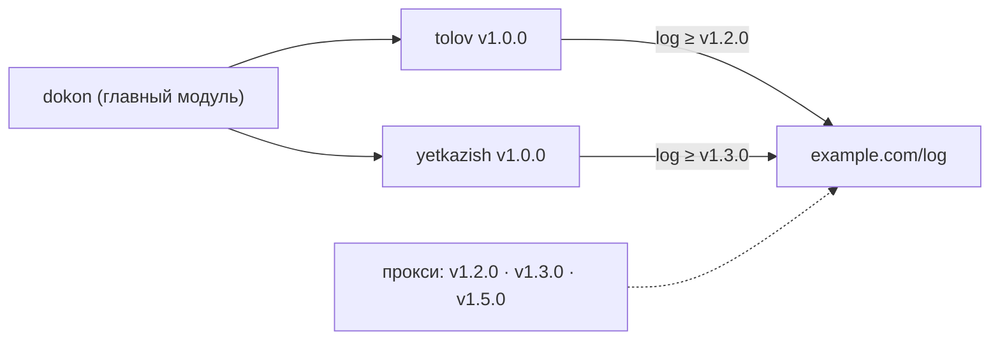

<div lang="ru">

🌐 [Oʻzbekcha](/lab/youtube/go/go-1-16) · **Русский** · [English](/lab/youtube/go/go-1-16/en)  
Урок GO-1.16 · [Go: 0 → Guru](/lab/youtube/go#go-1-16) · ▶️ видео скоро · 💻 [GitHub](https://github.com/abdurahmon27/go-backend-uz/tree/main/lessons/016-go-mod)

> Это полная письменная версия видеоурока: по ней можно учиться, не смотря (и не слушая) видео. Само видео на узбекском языке.

## Что вы узнаете

Вы не трогали код роутера и не обновляли Go. Вы только добавили одну библиотеку. После этого API стал отвечать на
`GET /salom` кодом 200 вместо 404. Как добавление библиотеки меняет поведение роутера? Ответ — в одной строке файла
`go.mod`: `go 1.21`.

**Одна идея:** строка `go` в `go.mod` — не украшение. Она решает три вещи: с какой версией языка компилируется код
этого модуля, с какими значениями настроек GODEBUG по умолчанию работает вся программа и какой версией Go она
собирается. А строки `require` — это список минимальных версий: MVS берёт не самую новую, а самую маленькую из
нужных, а go.sum проверяет, что код не подменили.

К концу урока вы:

- различите три задачи строки `go` и перед её повышением увидите, что изменится, с помощью
  `go list -f '{{.DefaultGODEBUG}}'`;
- вернёте старое поведение, не трогая строку `go` (строка `godebug`, переменная окружения `GODEBUG`);
- заранее скажете, какую версию выберет MVS, и объясните, чем это отличается от npm и pip;
- будете знать, зачем нужны go.sum, папка `internal/` и директива `tool`.

Три главных новых слова урока:

| Слово | Простой смысл | По-английски |
|---|---|---|
| настройка GODEBUG | ключ одного поведения стандартной библиотеки: `httpmuxgo121=1` — старый роутер | GODEBUG setting |
| toolchain | сам Go: команда `go`, компилятор и стандартная библиотека одной версии | toolchain |
| MVS | для каждого модуля взять наибольшую из запрошенных версий | minimal version selection |

По пути встретятся два вспомогательных слова: **главный модуль** (*main module*, модуль, который вы собираете) и
**хеш** (SHA-256-отпечаток файла, из них состоит go.sum). Оба объясним на месте.

## Что нужно знать заранее

- [GO-1.01 · Go nega bor? go build ichida nima bor](/lab/youtube/go/go-1-01/ru): `go run` и `go build`, компилятор
  переводит пакеты по одному.
- [GO-1.05 · Go'da while yoʻq: bitta for va uning hamma shakllari](/lab/youtube/go/go-1-05/ru): в модуле `go 1.21` цикл
  печатает `c.uz c.uz c.uz`, а начиная с `go 1.22` — `a.uz b.uz c.uz`. В том уроке было обещано разобрать эту
  строку «в GO-1.16». Это он.
- [GO-1.03 · Konstanta va iota: oʻzgarmas nomlar, time.Sleep(2) va jim buziladigan raqamlar](/lab/youtube/go/go-1-03/ru):
  enum `Status` (`Unknown`, `New`, `Paid`, `Shipped`), он вернётся в разделе про `tool`.
- [GO-1.13 · Interface'lar: nil nega nil'ga teng emas?](/lab/youtube/go/go-1-13/ru): `fmt.Stringer`. Тип с методом
  `String() string` печатается в `Println` именем, а не числом.
- Этот урок не запустить на go.dev/play: каждый пример — отдельный модуль (со своим `go.mod`), некоторые скачивают
  другую версию Go. Нужен Go 1.26 на вашем компьютере. Откройте терминал в папке курса (`lessons/016-go-mod`), все
  команды запускаются оттуда. `cd eski && …` сначала переходит в папку `eski`, потом выполняет команду.
- Модулей `example.com/...` нет в интернете, они лежат в папке `mvs/proxy`. В свежем клоне репозитория README
  просит один раз выполнить:

```bash
cd lessons/016-go-mod
export GOPROXY=file://$PWD/mvs/proxy,https://proxy.golang.org GONOSUMDB=example.com CGO_ENABLED=0
(cd mvs/dokon && go mod download)
```

- `GOTOOLCHAIN=go1.27.4` и `kelajak/` в первый раз скачивают Go 1.27.4: архив около 76 МБ.
- Результаты получены на `go1.26.8` и `go1.27.4` (`linux/amd64`).

Сначала вспомним прошлый урок. В `main` есть `recover` внутри `defer`, а `panic` случился в другой горутине.
Программа спасётся?

<details>
<summary>Ответ</summary>

**Нет, программа всё равно упадёт.** `panic` поднимается только по вызовам своей горутины и в другую горутину не
переходит. Его должен был поймать `recover` внутри той же горутины. Когда `panic` доходит до начала горутины, по
спецификации Go останавливается вся программа
([Go spec: Handling panics](https://go.dev/ref/spec#Handling_panics)).

</details>

## Загадка: одна библиотека изменила роутер

В папке `eski/` — HTTP-роутер с одним маршрутом. Программа не открывает сервер: она передаёт запрос прямо в роутер и
печатает код ответа.

```go filename="eski/main.go" showLineNumbers
package main

import (
	"fmt"
	"net/http"
	"net/http/httptest"
)

func main() {
	mux := http.NewServeMux()
	mux.HandleFunc("GET /salom", func(w http.ResponseWriter, r *http.Request) {
		fmt.Fprint(w, "salom!")
	})

	for _, method := range []string{"GET", "POST"} {
		w := httptest.NewRecorder()
		mux.ServeHTTP(w, httptest.NewRequest(method, "/salom", nil))
		fmt.Println(method, "/salom →", w.Code)
	}
}
```

| Строка | Код | Что делает |
|---|---|---|
| 4–6 | `"fmt"`, `"net/http"`, `"net/http/httptest"` | `httptest` — пакет, который делает фальшивые запрос и ответ для тестов |
| 10 | `mux := http.NewServeMux()` | роутер из стандартной библиотеки (`ServeMux`) |
| 11–13 | `mux.HandleFunc("GET /salom", …)` | шаблон пути (pattern) `"GET /salom"`: с Go 1.22 это «метод `GET` + путь `/salom`»; в ответ пишется `salom!` |
| 15 | `for _, method := range []string{"GET", "POST"}` | пробуем два метода |
| 16 | `w := httptest.NewRecorder()` | фальшивый ответ: сохраняет код статуса, который записал роутер |
| 17 | `mux.ServeHTTP(w, httptest.NewRequest(method, "/salom", nil))` | передаёт запрос прямо в роутер, без открытия порта |
| 18 | `fmt.Println(method, "/salom →", w.Code)` | метод и код статуса |

В Express метод — в имени функции: `app.get("/salom", …)`. В Laravel тоже: `Route::get('/salom', …)`. В Go 1.22
стандартный `ServeMux` начал принимать метод внутри шаблона (release notes: *"enhanced to accept methods and
wildcards"*).

Файл `go.mod` модуля:

```console
$ cat eski/go.mod
module eski

go 1.21
```

Теперь скрипт `mvs/yuksal.sh`. Он берёт временную копию `eski/`, запускает её, потом добавляет одну библиотеку и
запускает снова. Код роутера он не трогает, Go — тот же 1.26.8.

```bash
#!/usr/bin/env bash
# eski/ (go 1.21) ning nusxasiga go 1.22 talab qiladigan kutubxonani qo'shib, uni ishlatamiz.
# Router kodiga tegmaymiz. go get go.mod'dagi go qatorini o'zi ko'taradi va ServeMux xulqi o'zgaradi.
# Asl eski/ papkasi o'zgarmaydi: hammasi vaqtinchalik nusxada.
set -eu
proxy="file://$(cd "$(dirname "$0")" && pwd)/proxy"
nusxa=$(mktemp -d)
trap 'rm -rf "$nusxa"' EXIT
cp "$(dirname "$0")"/../eski/{go.mod,main.go} "$nusxa"
cd "$nusxa"
go run .
# yangi fayl: kutubxonani ishlatadi, router'ga tegmaydi
printf 'package main\n\nimport "example.com/ramka"\n\nvar _ = ramka.Nomi()\n' > ramka.go
GOPROXY="$proxy" GONOSUMDB=example.com go get example.com/ramka@v1.0.0 2>&1 | grep -v downloading
go run .
```

`ramka.go` — новый файл: он только импортирует и использует библиотеку `example.com/ramka`. Библиотека берётся из
локального прокси в папке (`GOPROXY="$proxy"`). В её `go.mod` есть одна важная строка:

```console
$ cat mvs/manba/ramka@v1.0.0/go.mod
module example.com/ramka

go 1.22
```

Подумайте: что вернёт `GET /salom` после добавления библиотеки?

**A)** снова 404: код роутера не менялся · **B)** 200 · **C)** ошибку сборки: библиотека требует `go 1.22`, а модуль
`go 1.21`

<details>
<summary>Ответ</summary>

**B: 200.** `go get` не выдаёт ошибку: он сам поднимает строку `go` модуля до `1.22`. А со строкой `go 1.22` Go
включает новый роутер. Если вы выбрали «A», вы думали, что поведение роутера зависит только от кода. Если «C» — вы
думали, что строка `go` только проверяется: `go get` поднимает её сам. Почему так, разбираем весь урок.

</details>

```console
$ mvs/yuksal.sh
GET /salom → 404
POST /salom → 404
go: upgraded go 1.21 => 1.22
go: added example.com/ramka v1.0.0
GET /salom → 200
POST /salom → 405
```

Посмотрите на одну строку: `go: upgraded go 1.21 => 1.22`. Библиотека требует `go 1.22`, поэтому `go get` поднял и
нашу строку `go`. В итоге:

| Строка `go` | Роутер | `GET /salom` | `POST /salom` |
|---|---|---|---|
| `go 1.21` | старый (как в Go 1.21) | 404 | 404 |
| `go 1.22` | новый: `GET` — метод | 200 | 405 (метод не подходит) |

Как старый роутер читает `"GET /salom"`? Его код в Go ещё есть (`net/http/servemux121.go`). Шаблон, который не
начинается с `/`, для него начинается с имени хоста: `if pattern[0] != '/' { mux.hosts = true }`. Значит, `"GET "` —
хост, `/salom` — путь. А хост запроса — `example.com` (его ставит `httptest.NewRequest`), а не `"GET "`. Ни один
запрос не подходит, поэтому оба метода получили 404.

На этот раз изменение было к лучшему. Но то же повышение молча меняет и другие вещи: это увидим в разделе про
GODEBUG.

## go.mod: это не package.json

**Модуль** (*module*) — набор пакетов, которые версионируются вместе. Близкие аналоги — один пакет в npm, один
пакет в Composer или один проект на PyPI. В корне модуля лежит файл `go.mod`. Полный пример посмотрим в `asbob/`:

```console
$ cat asbob/go.mod
module asbob

go 1.26.0

tool golang.org/x/tools/cmd/stringer

require (
	golang.org/x/mod v0.43.0 // indirect
	golang.org/x/sync v0.25.0 // indirect
	golang.org/x/tools v0.53.0 // indirect
)
```

| Строка | Код | Что делает |
|---|---|---|
| 1 | `module asbob` | имя модуля; пакеты внутри него импортируются по этому пути (`asbob/...`) |
| 3 | `go 1.26.0` | строка `go` — главная тема урока |
| 5 | `tool golang.org/x/tools/cmd/stringer` | программа, которой пользуется проект (Go 1.24+); вернёмся в конце |
| 7–11 | `require (…)` | нужные модули и их **минимальные** версии |
| 8–10 | `// indirect` | ни один пакет главного модуля не импортирует этот модуль напрямую |

С `go 1.17` `go.mod` записывает и косвенно нужные модули: они помечены комментарием `// indirect`.
`require x v0.53.0` значит не «ровно v0.53.0», а «не ниже v0.53.0». Это увидим в разделе про MVS.

Рядом с похожими файлами других языков:

| Что | Go | npm | Python | PHP (Composer) |
|---|---|---|---|---|
| имя | `module asbob` | `"name"` | `[project] name` (`pyproject.toml`) | `"name"` |
| какая версия языка/рантайма | `go 1.26.0` | `"engines": {"node": …}` | `requires-python` | `"require": {"php": …}` |
| зависимости | `require x v0.53.0` — не ниже этой версии | `"x": "^0.53.0"` — диапазон | `x>=0.53` — диапазон | `"x": "^0.53"` — диапазон |
| инструменты проекта | `tool …` | `devDependencies` | — | `require-dev` |
| файл с зафиксированными версиями | нет, не нужен (MVS) | `package-lock.json` | вывод `pip freeze` | `composer.lock` |
| хеши кода | `go.sum` | `integrity` в `package-lock.json` | режим `--require-hashes` | — |

Есть два отличия, и урок именно о них. Во-первых, строка `go` — не совет, как `engines`: она меняет то, как код
компилируется и работает. Во-вторых, в Go нет lock-файла, и это сделано намеренно.

## Три задачи строки go

| # | Задача | На что влияет | Чья строка `go` учитывается |
|---|---|---|---|
| 1 | версия языка (флаг компилятора `-lang`) | пакеты этого модуля | каждого модуля своя |
| 2 | значения настроек GODEBUG по умолчанию | вся программа | только главного модуля (или `go.work`) |
| 3 | минимальная версия Go | сборка | с Go 1.21 обязательное требование; раньше было только советом |

Документ Go Toolchains: *"Go 1.21 changed the go line to be a mandatory requirement instead"* — «Go 1.21 сделал
строку `go` обязательным требованием». Раньше старый Go всё равно пытался собрать новый модуль и при неудаче только
печатал заметку о несовпадении версий. Разберём все три задачи по очереди.

## 1. Версия языка: флаг компилятора -lang

`go build -n` не выполняет команды, а только печатает их. Среди них `grep`-ом выделим флаг `-lang`, который
передаётся компилятору:

```console
$ cd eski && go build -n . 2>&1 | grep -o -- '-lang=go[0-9.]*'
-lang=go1.21
```

```console
$ cd yangi && go build -n . 2>&1 | grep -o -- '-lang=go[0-9.]*'
-lang=go1.26
```

Значение `-lang` берётся из строки `go` (`cmd/go/internal/work/gc.go`: `-lang=go` + `p.Module.GoVersion`). Цикл из
[GO-1.05](/lab/youtube/go/go-1-05/ru) смотрит именно на этот флаг: новая переменная на каждой итерации появляется только при
`-lang=go1.22` и выше.

От него же зависит новый синтаксис. Модуль `til/` — `go 1.21`, а в коде `range` по целому числу, который появился
в Go 1.22:

```go filename="til/main.go" showLineNumbers
package main

import "fmt"

func main() {
	for i := range 3 { // Go 1.22 dan beri: butun son ustida range
		fmt.Print(i, " ")
	}
	fmt.Println()
}
```

| Строка | Код | Что делает |
|---|---|---|
| 6 | `for i := range 3 {` | с Go 1.22: `i` принимает значения 0, 1, 2 (как `for (let i = 0; i < 3; i++)` в JS) |
| 7 | `fmt.Print(i, " ")` | печатает число и пробел |
| 9 | `fmt.Println()` | конец строки |

Подумайте: что сделает `go run .`? На компьютере Go 1.26.8, он этот синтаксис знает.

**A)** `0 1 2` · **B)** ошибку компиляции · **C)** программа запустится, но ничего не напечатает

<details>
<summary>Ответ</summary>

**B.** Компилятор — Go 1.26.8, но модуль он компилирует с `-lang=go1.21` и отвергает синтаксис, которого нет в
Go 1.21. Если вы выбрали «A», вы думали, что всё решает версия компилятора.

</details>

```console
$ cd til && go run .
# til
./main.go:6:17: cannot range over 3 (untyped int constant): requires go1.22 or later (-lang was set to go1.21; check go.mod)
```

Читаем ошибку: `./main.go:6:17` — файл, строка 6, столбец 17 (`3`). *cannot range over 3 (untyped int constant):
requires go1.22 or later* — «нельзя делать range по 3: нужен go1.22 или новее». В скобках причина:
*-lang was set to go1.21; check go.mod* — «`-lang` установлен в go1.21; проверьте go.mod».

Исправление: поднимите строку `go` до `go 1.22` или выше. А для одного файла версию языка поднимает строка
`//go:build go1.22` в начале файла (гуру-задание из [GO-1.05](/lab/youtube/go/go-1-05/ru)).

## 2. GODEBUG: настройки старого поведения

У Go 1 есть обещание совместимости: старый код должен работать и с новым Go. Но иногда команде Go нужно поменять
поведение: новый роутер, более безопасный TLS, GOMAXPROCS с учётом контейнера. Если такое изменение может сломать
старый код, команда Go добавляет **настройку GODEBUG** (*GODEBUG setting*), которая возвращает старое поведение.
Настройка имеет вид `ключ=значение`: например, `httpmuxgo121=1` возвращает роутер из Go 1.21.

Когда новый Go видит старую строку `go`, он **для таких настроек** выбирает поведение той версии. Документ про
GODEBUG: *"the Go toolchain amends its defaults to match that older Go version as closely as possible"* —
«toolchain подгоняет значения по умолчанию под ту старую версию настолько близко, насколько возможно». Остальные
исправления и улучшения рантайма всё равно работают: речь только об изменениях, у которых есть настройка.

`go list -f '{{.DefaultGODEBUG}}' .` печатает настройки, которые запишутся в программу при сборке: только те, что
отличаются от текущих значений Go по умолчанию, через запятую. `tr , '\n'` разбивает их по строкам, `wc -l`
считает:

```console
$ cd eski && go list -f '{{.DefaultGODEBUG}}' . | tr , '\n' | wc -l
30
```

В `eski/` со строкой `go 1.21` 30 настроек в старом состоянии. Четыре из них:

```console
$ cd eski && go list -f '{{.DefaultGODEBUG}}' . | tr , '\n' | grep -E 'mux|tls10|maxprocs'
containermaxprocs=0
httpmuxgo121=1
tls10server=1
updatemaxprocs=0
```

| Настройка | Что происходит при старой строке `go` |
|---|---|
| `httpmuxgo121=1` | роутер из Go 1.21: 404 из загадки |
| `tls10server=1` | сервер принимает и клиентов с TLS 1.0 (новое значение по умолчанию: не ниже TLS 1.2) |
| `containermaxprocs=0` | GOMAXPROCS (сколько ядер одновременно выполняют Go-код) не учитывает лимит CPU контейнера |
| `updatemaxprocs=0` | GOMAXPROCS не пересчитывается, даже если лимит CPU изменился |

Последние две появились в Go 1.25. Сервис в Docker с `--cpus=2` и строкой `go 1.21` берёт GOMAXPROCS не по лимиту
контейнера, а по числу ядер машины. А `go get` из загадки молча выключил и `tls10server`: клиенты с TLS 1.0 больше не
подключатся к серверу.

Сколько настроек остаётся в старом состоянии для каждой строки `go` (Go 1.26.8, измерено не в папке курса, а в
отдельных модулях с пустым пакетом `main`; результаты совпадают с README):

| Строка `go` | 1.21 | 1.22 | 1.23 | 1.24 | 1.25 | 1.26 |
|---|---|---|---|---|---|---|
| настроек в старом состоянии | 30 | 25 | 17 | 8 | 3 | 0 |

Перед повышением строки `go` и после него выведите этот список и сравните: разница — это список поведения, которое
молча изменится в вашем сервисе.

## Две задачи, две разные строки go

Теперь посмотрим на две задачи вместе. `qoida/ilova` (`go 1.26`) использует модуль `qoida/kutubxona` (`go 1.21`):

```console
$ cat qoida/ilova/go.mod
module ilova

go 1.26

require example.com/kutubxona v0.0.0

replace example.com/kutubxona => ../kutubxona
```

```console
$ cat qoida/kutubxona/go.mod
module example.com/kutubxona

go 1.21
```

Строка `replace` говорит брать библиотеку не из интернета, а из соседней папки (похоже на `"file:../kutubxona"` в
npm). `require … v0.0.0` — условная версия для `replace`.

```go filename="qoida/kutubxona/kutubxona.go" showLineNumbers
// Package kutubxona: go.mod'ida "go 1.21". Uni go 1.26 dagi ilova ishlatadi.
package kutubxona

import (
	"fmt"
	"net/http"
)

// Router "GET /salom" ni roʻyxatga oladi.
// Qaysi router ishlashini (GODEBUG) ilovaning go qatori hal qiladi.
func Router() *http.ServeMux {
	mux := http.NewServeMux()
	mux.HandleFunc("GET /salom", func(w http.ResponseWriter, r *http.Request) {
		fmt.Fprint(w, "salom!")
	})
	return mux
}

// Domenlar 5-darsdagi sikl: har qadamda d ning manzilini saqlaydi.
// Til versiyasi (-lang) shu modulning go qatoridan olinadi: go 1.21.
func Domenlar() string {
	var navbat []*string
	for _, d := range []string{"a.uz", "b.uz", "c.uz"} {
		navbat = append(navbat, &d)
	}
	s := ""
	for _, p := range navbat {
		s += *p + " "
	}
	return s
}
```

| Строка | Код | Что делает |
|---|---|---|
| 11–17 | `func Router() *http.ServeMux` | создаёт и возвращает роутер `"GET /salom"` из загадки |
| 21–31 | `func Domenlar() string` | `Domenlar` («домены»): цикл из [GO-1.05](/lab/youtube/go/go-1-05/ru): на каждой итерации добавляет в список адрес `d` (`&d`), потом читает их все |
| 22 | `var navbat []*string` | слайс указателей на строки (`*string` — указатель на строку; [GO-1.11](/lab/youtube/go/go-1-11/ru)) |
| 28 | `s += *p + " "` | `*p` — строка, на которую указывает указатель |

```go filename="qoida/ilova/main.go" showLineNumbers
package main

import (
	"fmt"
	"net/http/httptest"

	"example.com/kutubxona"
)

// ilova: go 1.26. kutubxona: go 1.21.
func main() {
	w := httptest.NewRecorder()
	kutubxona.Router().ServeHTTP(w, httptest.NewRequest("GET", "/salom", nil))
	fmt.Println("kutubxona router:", w.Code)
	fmt.Println("kutubxona sikl:  ", kutubxona.Domenlar())
	fmt.Println("ilova sikl:      ", domenlar())
}

// domenlar kutubxonadagi bilan bir xil sikl, lekin go 1.26 modulda.
func domenlar() string {
	var navbat []*string
	for _, d := range []string{"a.uz", "b.uz", "c.uz"} {
		navbat = append(navbat, &d)
	}
	s := ""
	for _, p := range navbat {
		s += *p + " "
	}
	return s
}
```

| Строка | Код | Что делает |
|---|---|---|
| 7 | `"example.com/kutubxona"` | импортирует библиотеку |
| 12–14 | `kutubxona.Router().ServeHTTP(…)` | отправляет `GET /salom` в роутер библиотеки |
| 15 | `kutubxona.Domenlar()` | цикл в библиотеке (в модуле `go 1.21`) |
| 16, 20–30 | `domenlar()` | буква в букву тот же цикл, но в модуле `go 1.26` |

Подумайте: что напечатает `go run .`?

**A)** роутер 404; оба цикла `c.uz c.uz c.uz` · **B)** роутер 200; цикл библиотеки `c.uz c.uz c.uz`, цикл приложения
`a.uz b.uz c.uz` · **C)** роутер 200; оба цикла `a.uz b.uz c.uz`

<details>
<summary>Ответ</summary>

**B.** Две задачи смотрят на разные строки `go`. Версия языка — у каждого модуля своя: библиотека компилируется с
`-lang=go1.21`, поэтому в её цикле одна `d`. А GODEBUG — только из строки главного модуля (`ilova`, `go 1.26`):
роутер новый. Если вы выбрали «A», вы думали, что всё берётся из строки `go` библиотеки. Если «C» — что всё
берётся из строки приложения.

</details>

Посмотрим, какой `-lang` получает компилятор для каждого пакета. `-a` пересобирает все пакеты, не глядя в кэш,
поэтому команда печатается для обоих; `-p` — путь импорта пакета:

```console
$ cd qoida/ilova && go build -a -n . 2>&1 | grep -oE -- '-p (main|example.com/kutubxona) -lang=go[0-9.]*'
-p example.com/kutubxona -lang=go1.21
-p main -lang=go1.26
```

```console
$ cd qoida/ilova && go run .
kutubxona router: 200
kutubxona sikl:   c.uz c.uz c.uz 
ilova sikl:       a.uz b.uz c.uz 
```

| Что | Из какой строки `go` | Результат |
|---|---|---|
| цикл библиотеки (`-lang`) | библиотеки: `go 1.21` | `c.uz c.uz c.uz` |
| цикл приложения (`-lang`) | приложения: `go 1.26` | `a.uz b.uz c.uz` |
| роутер в библиотеке (GODEBUG) | приложения: `go 1.26` | 200 |

Значения GODEBUG записываются в бинарник один раз, для всей программы. Команда `go` берёт их из строки главного
модуля (`cmd/go/internal/load/godebug.go`: `MainModules.GoVersion`). **Главный модуль** (*main module*) — модуль,
внутри которого вы запустили `go build` или `go run`. Если вы используете workspace (файл `go.work`, сборка
нескольких модулей вместе), значения берутся из `go.work`.

Практический вывод: исправление цикла из Go 1.22 не доходит до библиотек со старой строкой `go`, пока их строку
`go` не поднимут.

## Как поменять одну настройку GODEBUG

Если поднимать строку `go` сразу страшно (30 настроек меняются разом), можно поменять одну настройку отдельно. В
`sozlama/` осталась `go 1.21`, но строка `godebug` включает новый роутер:

```console
$ cat sozlama/go.mod
module sozlama

go 1.21

godebug httpmuxgo121=0
```

`main.go` — такой же, как в загадке.

```console
$ cd sozlama && go run .
GET /salom → 200
POST /salom → 405
```

200, хотя `go 1.21`: `godebug httpmuxgo121=0` обновил только роутер, остальные 29 настроек — в старом состоянии.
Эту строку понимают только Go 1.23 и новее (старые выдают ошибку, увидим в разделе «Частые ошибки»). Строки
`godebug` в `go.mod` тоже читаются только у главного модуля.

Есть и обратный вариант: `godebug default=go1.21`. Тогда версия языка берётся из строки `go` (например, 1.26), а
значения GODEBUG по умолчанию остаются как в Go 1.21. Документ про GODEBUG: *"This allows setting the GODEBUG
defaults separately from the Go language version"* — «это позволяет задавать значения GODEBUG по умолчанию отдельно
от версии языка Go».

А при запуске программы переменная окружения `GODEBUG` главнее всего:

```console
$ cd sozlama && GODEBUG=httpmuxgo121=1 go run .
GET /salom → 404
POST /salom → 404
```

| Уровень | Где | Когда действует |
|---|---|---|
| 1 | строка `go` главного модуля | при сборке, значение по умолчанию для всех настроек |
| 2 | строки `godebug` главного модуля (Go 1.23+) | при сборке, переопределяют уровень 1 |
| 3 | переменная окружения `GODEBUG` | при запуске программы, главнее всего |

Есть ещё один способ: его вы найдёте сами в домашнем задании.

## Настройки не вечны: Go 1.27

Старая строка `go` не хранит старое поведение вечно. Документ про GODEBUG: настройки *"maintained for a minimum of
two years (four Go releases)"* — «поддерживаются минимум два года (четыре релиза Go)». Потом их могут удалить.

Модуль `taymer/` — `go 1.22`:

```go filename="taymer/main.go" showLineNumbers
package main

import (
	"fmt"
	"runtime"
	"time"
)

func main() {
	t := time.NewTimer(time.Millisecond)
	time.Sleep(20 * time.Millisecond) // taymer allaqachon ishladi
	t.Reset(time.Hour)                // endi bir soat kutishi kerak

	select {
	case <-t.C:
		fmt.Println(runtime.Version(), "→ eski signal keldi")
	default:
		fmt.Println(runtime.Version(), "→ kanal boʻsh")
	}
}
```

| Строка | Код | Что делает |
|---|---|---|
| 10 | `t := time.NewTimer(time.Millisecond)` | таймер, который сработает через 1 мс; сигнал отправляет в канал `t.C` |
| 11 | `time.Sleep(20 * time.Millisecond)` | ждём 20 мс: таймер уже сработал |
| 12 | `t.Reset(time.Hour)` | перезапускаем таймер: теперь он должен ждать час |
| 14–19 | `select { case <-t.C: … default: … }` | если в канале есть сигнал, забирает его; если нет, сразу уходит в `default` |
| 16, 18 | `runtime.Version()` | печатает, какой Go собрал программу |

Канал (*channel*) — очередь, через которую горутины передают значения. Подробно каналы в [GO-1.21](/lab/youtube/go#go-1-21),
а `select` — в [GO-3.03](/lab/youtube/go#go-3-03). Здесь важно одно: остался ли старый сигнал в канале после `Reset`.

До Go 1.23 в канале таймера было одно место (буфер). Сигнал сработавшего таймера оставался там и после `Reset`.
Go 1.23 ввёл новое поведение: после `Reset` и `Stop` старый сигнал не приходит. Для старого поведения добавили и
настройку: `asynctimerchan=1`. Для строки `go 1.22` Go 1.26 выбирает именно её.

Подумайте: что напечатают `go run .` (Go 1.26.8) и `GOTOOLCHAIN=go1.27.4 go run .`? `GOTOOLCHAIN` говорит команде
`go`, какую версию Go использовать.

**A)** оба `eski signal keldi` · **B)** Go 1.26.8 — `eski signal keldi`, Go 1.27.4 — `kanal boʻsh` ·
**C)** оба `kanal boʻsh`

<details>
<summary>Ответ</summary>

**B.** Go 1.26.8 для строки `go 1.22` выбирает `asynctimerchan=1`, и старый сигнал остаётся в канале
(`eski signal keldi` — «пришёл старый сигнал»). А Go 1.27 удалил эту настройку совсем: от Go 1.23 до 1.27 ровно
четыре релиза. Старое поведение не вернуть, канал пуст (`kanal boʻsh`). Если вы выбрали «A», вы думали, что старая
строка `go` хранит старое поведение вечно.

</details>

```console
$ cd taymer && go run .
go1.26.8 → eski signal keldi
```

```console
$ cd taymer && GOTOOLCHAIN=go1.27.4 go run .
go1.27.4 → kanal boʻsh
```

Не изменились ни код, ни строка `go` — только версия Go. Go 1.27 release notes: *"The asynctimerchan GODEBUG
setting … has been removed permanently"*. Настройку TLS 1.0 (`tls10server`) тоже удалили. На Go 1.27.4 `go list`
для `eski/` печатает уже не 30, а 26 настроек.

Строка `go` меняется молча. А если старое значение явно записано в `go.mod`, Go 1.27 останавливает сборку. Так в
`homework/guru`:

```console
$ cat homework/guru/go.mod
module guru

go 1.22

godebug asynctimerchan=1
```

`2>&1 | tail -1` показывает только последнюю строку ошибки:

```console
$ cd homework/guru && GOTOOLCHAIN=go1.27.4 go run . 2>&1 | tail -1
go.mod:5: removed GODEBUG "asynctimerchan" set to old value "1" (https://go.dev/doc/godebug#go-127)
```

*removed GODEBUG "asynctimerchan" set to old value "1"* — «удалённая настройка GODEBUG выставлена в старое
значение "1"». Это хорошо: лучше остановленная сборка, чем программа, которая молча работает по-другому.
Исправление — гуру-задача в домашнем задании.

## 3. Toolchain: нужный Go скачивается сам

Третья задача: строка `go` — самая низкая версия Go, которая может собрать модуль. **Toolchain** — сам Go: команда
`go`, компилятор и стандартная библиотека. Модуль `kelajak/` требует Go новее, чем на компьютере:

```console
$ grep '^go ' kelajak/go.mod
go 1.27.4
```

На компьютере Go 1.26.8. Первый `go run .`:

```console
$ cd kelajak && go run .
go: downloading go1.27.4 (linux/amd64)
ishlayapti: go1.27.4
```

Команда `go` сама скачала нужный Go и запустила программу им (`ishlayapti` — «работает»). Режим по умолчанию —
`GOTOOLCHAIN=auto`: Go 1.27.4 берётся из прокси как модуль `golang.org/toolchain` и, как обычный модуль,
проверяется по контрольной сумме. Со второго запуска строки `go: downloading` нет: Go лежит в кэше. Сколько места он
занимает?

```console
$ cd $(go env GOMODCACHE) && du -sh --si --apparent-size cache/download/golang.org/toolchain/@v/*go1.27.4*.zip golang.org/toolchain@*go1.27.4*
76M	cache/download/golang.org/toolchain/@v/v0.0.1-go1.27.4.linux-amd64.zip
228M	golang.org/toolchain@v0.0.1-go1.27.4.linux-amd64
```

Архив около 76 МБ, после распаковки 228 МБ (`--si` — мегабайты по 1000, `--apparent-size` — собственный размер
файлов). С `GOTOOLCHAIN=local` команда `go` ничего не скачивает и выдаёт понятную ошибку:

```console
$ cd kelajak && GOTOOLCHAIN=local go run .
go: go.mod requires go >= 1.27.4 (running go 1.26.8; GOTOOLCHAIN=local)
```

*go.mod requires go >= 1.27.4 (running go 1.26.8; GOTOOLCHAIN=local)* — «go.mod требует go >= 1.27.4 (запущен
go 1.26.8; GOTOOLCHAIN=local)».

Сравните с `engines` в npm. Документация npm: если не включён `engine-strict`, это поле *"is advisory only and will
only produce warnings"* — «только совет и выдаёт только предупреждения». Мы проверили (Node 24.10.0, npm 11.6.1, не
в папке курса): если у зависимости `"engines": { "node": ">=99" }`, `npm install` предупредил
`npm warn EBADENGINE Unsupported engine` и всё равно установил пакет. Только с `--engine-strict` появилось
`npm error code EBADENGINE`. До Go 1.21 строка `go` тоже была таким советом. Теперь это требование: Go скачивает
нужную версию или отказывается.

В `go.mod` может быть и отдельная строка `toolchain`, например `toolchain go1.27.4`. Это рекомендация: если Go
старше, он переключается на эту версию, а в режиме `local` строка игнорируется. Читается только строка `toolchain`
главного модуля.

Теперь вернёмся к загадке. С Go 1.21 строка `go` модуля не может быть ниже, чем у его зависимостей. `ramka`
требовала `go 1.22`, поэтому `go get` поднял нашу строку до `1.22`, и роутер изменился. В `asbob/` случилось то же:
в `go.mod` модуля `golang.org/x/tools v0.53.0` стоит `go 1.26.0`, поэтому в `asbob/go.mod` не `go 1.26`, а
`go 1.26.0`.

Если пишете библиотеку, держите строку `go` как можно ниже: она поднимает строку `go` у всех, кто пользуется вашей
библиотекой. А `go mod init` по умолчанию пишет полную версию текущего Go (в разделе «Частые ошибки»).

## require и MVS: какая версия попадёт в сборку?

Теперь строки `require`. Модуль `mvs/dokon` зависит от двух библиотек:

```console
$ cat mvs/dokon/go.mod
module dokon

go 1.26

require (
	example.com/tolov v1.0.0
	example.com/yetkazish v1.0.0
)

require example.com/log v1.3.0 // indirect
```

```go filename="mvs/dokon/main.go" showLineNumbers
package main

import (
	"fmt"

	"example.com/tolov"
	"example.com/yetkazish"
)

// tolov v1.0.0 example.com/log v1.2.0 ni, yetkazish v1.0.0 esa v1.3.0 ni talab qiladi.
// Eng yangisi v1.5.0. Build'ga qaysi biri kiradi?
func main() {
	fmt.Println("tolov ichidagi log:    ", tolov.Log())
	fmt.Println("yetkazish ichidagi log:", yetkazish.Log())
}
```

`tolov.Log()` и `yetkazish.Log()` («оплата» и «доставка») внутри обе вызывают функцию `Versiya()` модуля
`example.com/log`: она говорит, какая версия `log` попала в сборку. `go.mod` библиотек:

```console
$ cat mvs/manba/tolov@v1.0.0/go.mod
module example.com/tolov

go 1.21

require example.com/log v1.2.0
```

```console
$ cat mvs/manba/yetkazish@v1.0.0/go.mod
module example.com/yetkazish

go 1.21

require example.com/log v1.3.0
```

В прокси (`mvs/proxy`, папка на месте сервера, с которого Go скачивает модули) три версии `log`:

```console
$ cat mvs/proxy/example.com/log/@v/list
v1.2.0
v1.3.0
v1.5.0
```



Go применяет к этому графу алгоритм **MVS** (*minimal version selection*).

Вопрос: какая версия `log` попадёт в сборку?

**A)** v1.2.0 · **B)** v1.3.0 · **C)** v1.5.0, самая новая

<details>
<summary>Ответ</summary>

**B: v1.3.0.** MVS для каждого модуля берёт наибольшую из запрошенных версий: из v1.2.0 и v1.3.0 — v1.3.0. Это
наименьшая версия, которая удовлетворяет всем требованиям. v1.5.0 никто не просил, поэтому она не попадает. Если вы
выбрали «A», вы забыли требование `yetkazish`: v1.2.0 не удовлетворяет «не ниже v1.3.0». Если «C» — вы думали
как npm или pip (сравним ниже).

</details>

`GOPROXY=file://$PWD/../proxy` — брать модули не из `proxy.golang.org`, а из локальной папки (`$PWD` — текущая
папка). `go mod graph` печатает рёбра графа: «кто → кого требует». `grep -v ^dokon` убирает строки самого главного
модуля:

```console
$ cd mvs/dokon && GOPROXY=file://$PWD/../proxy go mod graph | grep -v ^dokon | grep ' example.com/log@'
example.com/tolov@v1.0.0 example.com/log@v1.2.0
example.com/yetkazish@v1.0.0 example.com/log@v1.3.0
```

```console
$ cd mvs/dokon && GOPROXY=file://$PWD/../proxy go run .
tolov ichidagi log:     v1.3.0
yetkazish ichidagi log: v1.3.0
```

Обе библиотеки получили v1.3.0: в бинарнике одна версия `log`.

**Сравним с npm и pip.** Те же три пакета (log 1.2.0, 1.3.0, 1.5.0; `tolov` требует `log` не ниже 1.2.0,
`yetkazish` — не ниже 1.3.0) мы положили в локальный npm-registry и в локальную папку Python-пакетов (не в папке
курса, запускали отдельно):

| Инструмент | Требования | Выбранный log |
|---|---|---|
| npm 11.6.1 (`npm install`) | `"log": "^1.2.0"`, `"log": "^1.3.0"` | 1.5.0 |
| uv 0.11.21 (`uv pip compile`, резолвер, совместимый с pip) | `log>=1.2.0`, `log>=1.3.0` | 1.5.0 |
| Go 1.26.8 (MVS) | `require example.com/log v1.2.0`, `… v1.3.0` | v1.3.0 |

npm и pip берут **самую новую** версию, подходящую под диапазон. Поэтому результат зависит от дня установки: если
завтра выйдет log 1.6.0, новый `npm install` возьмёт её. Для воспроизводимой сборки они пишут lock-файл:
`package-lock.json`, `composer.lock`, список из `pip freeze`. А Go Modules Reference пишет: *"Unlike other
dependency management systems, the build list is not saved in a "lock" file. MVS is deterministic, and the build
list doesn't change when new versions of dependencies are released"* — «в отличие от других систем, список сборки
не хранится в lock-файле. MVS детерминирован: список сборки не меняется, когда выходят новые версии зависимостей».

Версии меняются, только когда вы делаете `go get` или добавляете новый импорт (`go mod tidy` записывает новый
модуль с самой новой на тот момент версией). Мажорная версия (`v2` и выше) — другой путь импорта
(`example.com/log/v2`), то есть для MVS другой модуль.

## go.sum: ловим подменённый код

Версия определена. Но тот ли код отдал прокси? Это проверяет `go.sum`:

```console
$ grep log mvs/dokon/go.sum
example.com/log v1.3.0 h1:jtLzF0d3cKr1ihfE0BawA7k/zEgug+2kxGS3dBm4J3M=
example.com/log v1.3.0/go.mod h1:RUfJNjFPRI6tqrT6oiqycOZSUh5GZuxUqKeqkpkD9gM=
```

В каждой строке модуль, версия и **хеш** (SHA-256-отпечаток файла). Обычно у модуля две строки: одна для архива
всего кода, другая (с `/go.mod`) только для его файла `go.mod`. `h1:` — SHA-256 в base64.

go.sum — не lock-файл: он не выбирает версии (версии берутся из `go.mod` через MVS), а только проверяет скачанный
код. В npm обе задачи в одном файле: `package-lock.json` и фиксирует версии, и хранит хеш в поле `integrity`. В pip
проверка хешей включается только в режиме `--require-hashes`.

Теперь попробуем атаку. `mvs/zaharli/` («отравленный») — копия прокси, где код log v1.3.0 **подменён**, а номер
версии тот же. `mvs/hujum.sh` («атака»):

```bash
#!/usr/bin/env bash
# Hujum mashqi: zaharli/ proxy'da example.com/log v1.3.0 ning kodi almashtirilgan,
# versiya raqami esa o'sha. dokon'ni toza module cache bilan (yangi kompyuterdagidek)
# build qilamiz: avval zaharli/, topilmasa proxy/ dan yuklanadi.
# go.sum'dagi hash mos kelmaydi va go build to'xtaydi.
set -u
cd "$(dirname "$0")/dokon"
kesh=$(mktemp -d)
GOFLAGS=-modcacherw GOMODCACHE="$kesh" GONOSUMDB=example.com \
	GOPROXY="file://$(cd .. && pwd)/zaharli,file://$(cd .. && pwd)/proxy" \
	go build -o /dev/null .
kod=$?
rm -rf "$kesh"
exit $kod
```

Скрипт собирает `dokon` с чистым кэшем модулей (`GOMODCACHE="$kesh"` — пустая временная папка), как на новом
компьютере или в CI. В `GOPROXY` сначала `zaharli`, потом `proxy`. `grep -E` выделяет нужные строки:

```console
$ mvs/hujum.sh 2>&1 | grep -E 'mismatch|downloaded|go.sum:|SECURITY'
verifying example.com/log@v1.3.0: checksum mismatch
	downloaded: h1:Jd4sA3vV+K6bvDLKgdPZFUlO3LCcZQ48avOZ1TR2bDs=
	go.sum:     h1:jtLzF0d3cKr1ihfE0BawA7k/zEgug+2kxGS3dBm4J3M=
SECURITY ERROR
```

*verifying example.com/log@v1.3.0: checksum mismatch* — «проверка example.com/log@v1.3.0: хеш не совпадает».
`downloaded:` — хеш скачанного кода, `go.sum:` — закоммиченный хеш. Они различаются, и `go` останавливает сборку с
*SECURITY ERROR*.

Открытые модули, которых ещё нет в go.sum (при добавлении новой зависимости), проверяет база контрольных сумм
`sum.golang.org`. Go Modules Reference: она *"makes untrusted proxies possible since they can't serve the wrong code
without it going unnoticed"* — «делает возможными недоверенные прокси, потому что они не могут незаметно отдать не
тот код». Наши модули `example.com` не открытые, поэтому README исключает их из этой проверки через
`GONOSUMDB=example.com`.

## internal/: импорт снаружи запрещён

Папка `internal` закрывает код. Правило: пакет `.../a/internal/b` может импортировать только код внутри `.../a/`.
Модуль `ichki/`:

```console
$ cd ichki && find . -name '*.go' | sort
./kassa/main.go
./ombor/hisob/hisob.go
./ombor/internal/narx/narx.go
```

```go filename="ichki/ombor/internal/narx/narx.go" showLineNumbers
// Package narx faqat ombor/ va uning ichidagi paketlar uchun.
package narx

// QQS bilan narx (12 foiz).
func QQS(som int) int { return som * 112 / 100 }
```

```go filename="ichki/ombor/hisob/hisob.go" showLineNumbers
// Package hisob ombor/ ichida: internal/narx ni import qila oladi.
package hisob

import "ichki/ombor/internal/narx"

func Jami(som int) int { return narx.QQS(som) }
```

```go filename="ichki/kassa/main.go" showLineNumbers
// kassa ombor/ dan tashqarida: internal/narx ni import qila olmaydi.
package main

import (
	"fmt"

	"ichki/ombor/internal/narx"
)

func main() {
	fmt.Println(narx.QQS(1000))
}
```

`narx` («цена») — внутри `ombor/internal/` («склад»), значит, импортировать его может только код под `ombor/`.
`hisob` («расчёт») — `ombor/hisob`, внутри. `kassa` («касса») — снаружи `ombor/`. `som * 112 / 100` — цена с НДС
12 % (`QQS`).

```console
$ cd ichki && go build ./ombor/... && echo ombor: ok
ombor: ok
```

```console
$ cd ichki && go build ./kassa
package ichki/kassa
	kassa/main.go:7:2: use of internal package ichki/ombor/internal/narx not allowed
```

*use of internal package ichki/ombor/internal/narx not allowed* — «использование внутреннего пакета не
разрешено». Это правило `go build`, а не договорённость.

Зачем это нужно: другие не начнут зависеть от вашего внутреннего кода, а вы спокойно его меняете. В Node близкий
инструмент — поле `"exports"` в `package.json`: файлы, которых там нет, нельзя импортировать снаружи пакета. В
Python `_имя` — только соглашение: PEP 8 называет его *"weak "internal use" indicator"* — «слабый признак
"внутреннего использования"», импорт всё равно работает.

## Директива tool: stringer в go.mod

Последняя директива — `tool`. В `asbob/` тип `Status` из [GO-1.03](/lab/youtube/go/go-1-03/ru):

```go filename="asbob/main.go" showLineNumbers
package main

import "fmt"

//go:generate go tool stringer -type=Status

// Status — 3-darsdagi enum: zero value maʼnoli holat emas (Unknown).
type Status int

const (
	Unknown Status = iota
	New
	Paid
	Shipped
)

func main() {
	fmt.Println(Unknown, New, Paid, Shipped)
}
```

| Строка | Код | Что делает |
|---|---|---|
| 5 | `//go:generate go tool stringer -type=Status` | `go generate` выполняет эту команду |
| 8–15 | `type Status int` и `iota` | enum из GO-1.03: `Unknown` = 0 (zero value), `New` = 1, `Paid` = 2, `Shipped` = 3 |
| 18 | `fmt.Println(Unknown, New, Paid, Shipped)` | печатает четыре состояния |

`stringer` — программа команды Go: она пишет для `Status` метод `String() string` (`status_string.go`). Тип с методом
`String()` реализует `fmt.Stringer` и печатается в `Println` своим именем ([GO-1.13](/lab/youtube/go/go-1-13/ru)).

Подумайте: что напечатает запуск только `main.go`, без `status_string.go`?

**A)** `Unknown New Paid Shipped` · **B)** `0 1 2 3` · **C)** ошибку компиляции

<details>
<summary>Ответ</summary>

**B.** Без метода `String()` `Status` печатается как обычный `int`. Если вы выбрали «A», вы думали, что Go сам
хранит имена констант: нет, имена хранит код, который написал `stringer`.

</details>

`go run main.go` берёт из пакета только этот файл:

```console
$ cd asbob && go run main.go
0 1 2 3
```

Откуда берётся `stringer`? С Go 1.24 `go get -tool golang.org/x/tools/cmd/stringer` записывает его в `go.mod`
строкой `tool` (версия — в `require`):

```console
$ cd asbob && grep -n stringer main.go go.mod
main.go:5://go:generate go tool stringer -type=Status
go.mod:5:tool golang.org/x/tools/cmd/stringer
```

Раньше для этого писали вспомогательный файл `tools.go`: `//go:build tools` и пустой (blank) импорт программы.
Теперь `go tool stringer` запускает ровно ту версию, что в `go.mod`. В npm близкий аналог — `devDependencies` и
`npx`, который запускает программу из `node_modules/.bin`.

```console
$ cd asbob && go generate && go run .
Unknown New Paid Shipped
```

`go generate` перезаписал `status_string.go` (файл не изменился), а `go run .` со всеми файлами пакета напечатал
имена состояний.

## Итоги

- Строка `go` = версия языка (у каждого модуля своя) + значения GODEBUG по умолчанию (главного модуля) +
  минимальная версия Go.
- Поднимайте её осознанно: прогоните тесты и сравните `go list -f '{{.DefaultGODEBUG}}' .` до и после.
- Если пишете библиотеку, держите строку `go` как можно ниже: она поднимает строку `go` и у пользователей.
- MVS берёт не самую новую, а самую маленькую из нужных; новый релиз сборку не меняет.
- Всегда коммитьте go.sum вместе с `go.mod` (Go wiki: Modules FAQ).

## Частые ошибки

**1. Считать строку `go` украшением.** Самое распространённое представление: `go 1.21` — «пометка, на каком Go
написано». На деле её повышение (вами или через `go get`) — это молчаливое изменение поведения: роутер из загадки,
`tls10server`, GOMAXPROCS. Ошибки нет, меняется результат. Смотрите разделы «Загадка» и «2. GODEBUG».
Исправление: перед повышением и после него сравните `go list -f '{{.DefaultGODEBUG}}' .`, прогоните тесты, следите
за строкой `go: upgraded go …`, которую печатает `go get`.

**2. Новый синтаксис в старом модуле.** `for i := range 3` в модуле `go 1.21` → `requires go1.22 or later (-lang
was set to go1.21; check go.mod)`. Видели в разделе «1. Версия языка». Исправление: поднимите строку `go` или
поставьте в файл `//go:build go1.22`.

**3. Строка `godebug` и старый Go.** Строку `godebug` понимают только Go 1.23 и новее. Запустим `sozlama/` на
Go 1.22.12:

```console
$ cd sozlama && GOTOOLCHAIN=go1.22.12 go run .
go: errors parsing go.mod:
go.mod:5: unknown directive: godebug
```

*errors parsing go.mod … unknown directive: godebug* — «ошибки при разборе go.mod: в строке 5 неизвестная
директива godebug». Исправление: пусть все в команде (и CI) используют Go 1.23+, или задайте настройку через
переменную окружения `GODEBUG`.

**4. Старое значение удалённой настройки.** `godebug asynctimerchan=1` на Go 1.27 останавливает сборку (раздел
«Настройки не вечны»). Исправление: удалите строку или поставьте `asynctimerchan=0` и подстройте код под новое
поведение (гуру-задача в домашнем задании).

**5. Не коммитить go.sum.** Если добавить go.sum в `.gitignore`, у коллеги после клонирования сборка остановится.
Копия `mvs/dokon` без go.sum (не в папке курса, запускали отдельно, `GOPROXY` направлен на локальный прокси):

```console
$ go run .
main.go:6:2: missing go.sum entry for module providing package example.com/tolov (imported by dokon); to add:
	go get dokon
main.go:7:2: missing go.sum entry for module providing package example.com/yetkazish (imported by dokon); to add:
	go get dokon
```

*missing go.sum entry for module providing package example.com/tolov* — «в go.sum нет записи для модуля, который
даёт пакет `example.com/tolov`». `go get` или `go mod tidy` создадут запись заново, но на этот раз поверят тому, что
прокси отдаёт сейчас: защита из `hujum.sh` пропадает. Исправление: коммитьте go.sum вместе с `go.mod`. По той же
причине не «чините» checksum mismatch удалением go.sum.

**6. Высокая строка `go` в библиотеке.** `go mod init` пишет полную версию текущего Go (в отдельной пустой папке):

```console
$ go mod init x && cat go.mod
go: creating new go.mod: module x
module x

go 1.26.8
```

Для приложения это нормально. А в библиотеке `go 1.26.8` поднимет каждый модуль, который её использует, минимум до
`go 1.26.8` (`go: upgraded go …` из загадки). Исправление: в библиотеке опустите строку `go` до самой низкой
версии, которая действительно нужна вашему коду.

**7. Импорт пакета `internal` снаружи.** `use of internal package … not allowed` (видели в разделе «internal/»).
Исправление: вынесите пакет из `internal/` (теперь это открытый API) или перенесите использующий его код под
родительскую папку `internal`.

## Проверьте себя

**1.** `ilova` (`go 1.26`) использует библиотеку со строкой `go 1.21`. С какой версией языка компилируется код
библиотеки? С какими значениями GODEBUG работает роутер в библиотеке?

<details>
<summary>Ответ</summary>

Версия языка — от самой библиотеки: `-lang=go1.21`. А GODEBUG — только из строки `go` главного модуля (`ilova`):
значения по умолчанию Go 1.26, роутер новый (200).

</details>

**2.** Завтра в прокси вышел `example.com/log v1.6.0`. Что напечатает `go run .` в `mvs/dokon`, если ничего не
менять?

<details>
<summary>Ответ</summary>

Снова `v1.3.0` в обеих строках. MVS смотрит только на запрошенные версии, v1.6.0 никто не просил. Новый релиз сборку
не меняет. Он попадёт только через `go get example.com/log@latest` (или через зависимость, которая поднимет
требование).

</details>

**3.** `go.mod` модуля такой, а на компьютере Go 1.26.8:

```text
module tc

go 1.26

toolchain go1.27.4
```

`main.go` — такой же, как в `kelajak/` (печатает `runtime.Version()`). Что напечатают `go run .` и
`GOTOOLCHAIN=local go run .`?

<details>
<summary>Ответ</summary>

Требование `go 1.26` Go 1.26.8 выполняет. Но есть рекомендация `toolchain go1.27.4`, и в режиме по умолчанию `auto`
Go, если он старше, переключается на эту версию. В режиме `local` рекомендация игнорируется. Не в папке курса,
запускали в отдельном модуле:

```console
$ go run .
ishlayapti: go1.27.4
$ GOTOOLCHAIN=local go run .
ishlayapti: go1.26.8
```

</details>

**4.** Коллега говорит: «go.sum — это package-lock.json для Go, если его удалить, версии изменятся». Прав ли он?

<details>
<summary>Ответ</summary>

Нет. Версии решают `require` в `go.mod` и MVS. go.sum только хранит и проверяет хеши скачанного кода и файлов
`go.mod`. Если его удалить, версии не изменятся, но сборка остановится с «missing go.sum entry», и пропадёт защита
от подменённого кода.

</details>

**5.** Из [GO-1.05](/lab/youtube/go/go-1-05/ru): почему в `qoida/` цикл библиотеки печатает `c.uz c.uz c.uz`, а тот же цикл в
приложении — `a.uz b.uz c.uz`?

<details>
<summary>Ответ</summary>

С Go 1.22 в цикле `for` на каждой итерации новая переменная, но только в модулях `go 1.22` и выше. Библиотека
компилируется с `-lang=go1.21`: одна `d` на весь цикл, все три `&d` — один адрес, последнее значение `c.uz`.
Приложение — `-lang=go1.26`: на каждой итерации новая `d`.

</details>

**6.** Может ли новый пакет `ichki/ombor/hisob/hisobot` внутри `ichki/ombor/hisob/` импортировать
`ichki/ombor/internal/narx`? А пакет `ichki/kassa/chek`?

<details>
<summary>Ответ</summary>

`hisob/hisobot` — да: он под `ichki/ombor/`, а родительская папка `internal` — `ichki/ombor/`. `kassa/chek` — нет:
он снаружи `ombor/`, `go build` скажет `use of internal package … not allowed`.

</details>

## Домашнее задание

Задания четырёх уровней. Все файлы — в папке урока на GitHub:
[lessons/016-go-mod](https://github.com/abdurahmon27/go-backend-uz/tree/main/lessons/016-go-mod). Ответы — в папке
[homework/](https://github.com/abdurahmon27/go-backend-uz/tree/main/lessons/016-go-mod/homework). Сначала
попробуйте сами.

🟢 **Легко:** запустите `go list -f '{{.DefaultGODEBUG}}' .` в своём проекте. Если вывод пустой — почему?

<details>
<summary>Ответ</summary>

Команда печатает только настройки, которые **отличаются** от текущих значений Go по умолчанию. Если строка `go`
совпадает с toolchain (`go 1.26` + Go 1.26), список пуст. Так в `yangi/` (`go 1.26`), команда ничего не печатает:

```console
$ cd yangi && go list -f '{{.DefaultGODEBUG}}' .
```

В `eski/` (`go 1.21`) их 30. Описание каждой: [go.dev/doc/godebug#history](https://go.dev/doc/godebug#history).

</details>

🟡 **Средне:** переключите `yangi/` на старый роутер, не трогая строку `go`. Найдите и способ, о котором в уроке
не говорилось.

<details>
<summary>Ответ</summary>

Четыре способа, не трогая строку `go 1.26`:

1. Строка `godebug httpmuxgo121=1` в `go.mod` (нужен Go 1.23+).
2. Строка `godebug default=go1.21` в `go.mod`: версия языка остаётся 1.26, а значения GODEBUG по умолчанию — как в
   1.21 (30 настроек, в том числе `httpmuxgo121=1`).
3. **Способ, о котором в уроке не говорилось:** комментарий `//go:debug httpmuxgo121=1` в самом начале файла пакета
   `main`, до `package`. Работает с Go 1.21.
4. При запуске: `GODEBUG=httpmuxgo121=1 go run .`.

Способ 3 — в `homework/orta/main.go`:

```go filename="homework/orta/main.go" showLineNumbers
//go:debug httpmuxgo121=1

package main

import (
	"fmt"
	"net/http"
	"net/http/httptest"
)

func main() {
	mux := http.NewServeMux()
	mux.HandleFunc("GET /salom", func(w http.ResponseWriter, r *http.Request) {
		fmt.Fprint(w, "salom!")
	})

	for _, method := range []string{"GET", "POST"} {
		w := httptest.NewRecorder()
		mux.ServeHTTP(w, httptest.NewRequest(method, "/salom", nil))
		fmt.Println(method, "/salom →", w.Code)
	}
}
```

```console
$ cd homework/orta && go run .
GET /salom → 404
POST /salom → 404
```

```console
$ cd homework/orta && go list -f '{{.DefaultGODEBUG}}' .
httpmuxgo121=1
```

Хотя в `go.mod` стоит `go 1.26`, `//go:debug` записал настройку в бинарник.

</details>

🟠 **Сложно:** выполните `go get example.com/log@v1.2.0` в `mvs/dokon`. Что станет с `yetkazish` и почему?

<details>
<summary>Ответ</summary>

`homework/qiyin/qiyin.sh` делает это во временной копии `dokon`:

```console
$ homework/qiyin/qiyin.sh
go: downgraded example.com/log v1.3.0 => v1.2.0
go: removed example.com/yetkazish v1.0.0
--- go.mod:
module dokon

go 1.26

require example.com/tolov v1.0.0

require example.com/log v1.2.0 // indirect
--- go build:
main.go:7:2: no required module provides package example.com/yetkazish; to add it:
	go get example.com/yetkazish
```

`yetkazish v1.0.0` требует `log` не ниже v1.3.0. Чтобы опустить `log` до v1.2.0, `go get` ищет старую версию
`yetkazish`, которая работает с log ≤ v1.2.0. Такой нет, поэтому он удаляет `yetkazish`
(`go: removed example.com/yetkazish v1.0.0`). А код его всё ещё импортирует, и сборка останавливается. MVS никогда не
выбирает версию **ниже** требования.

</details>

🔴 **Гуру:** сделайте так, чтобы `homework/guru` (`go 1.22` + `godebug asynctimerchan=1`) собирался на Go 1.27, и
подстройте код под новое поведение таймера.

<details>
<summary>Ответ</summary>

Сейчас:

```console
$ cd homework/guru && go run .
go1.26.8 → eski signal keldi
```

```console
$ cd homework/guru && GOTOOLCHAIN=go1.27.4 go run .
go: error loading go.mod:
go.mod:5: removed GODEBUG "asynctimerchan" set to old value "1" (https://go.dev/doc/godebug#go-127)
```

Go 1.27 release notes: удалённая настройка, записанная с последним значением по умолчанию (`asynctimerchan=0`),
принимается; со старым значением (`=1`) команда `go` выдаёт ошибку. Исправление: удалите строку `godebug` или
поставьте `asynctimerchan=0`. Мы проверили `=0` в копии: и Go 1.26.8, и Go 1.27.4 печатают `kanal boʻsh`. Потом
подстройте код под новое поведение: ручная очистка канала после `Reset`/`Stop`
(`select { case <-t.C: default: }`) больше не нужна. Сама строка `go 1.22` (без строки `godebug`) на Go 1.27 ошибки
не даёт, просто работает с новым поведением (`taymer/` из урока).

</details>

## Источники

- [Go Modules Reference](https://go.dev/ref/mod): [go.mod files](https://go.dev/ref/mod#go-mod-file),
  [Minimal version selection](https://go.dev/ref/mod#minimal-version-selection),
  [go.sum files](https://go.dev/ref/mod#go-sum-files), [Checksum database](https://go.dev/ref/mod#checksum-database)
- [Go Toolchains](https://go.dev/doc/toolchain) (строки `go` и `toolchain`, `GOTOOLCHAIN`)
- [Go, Backwards Compatibility, and GODEBUG](https://go.dev/doc/godebug) (строки `godebug`, `default=`, минимум два
  года, [история настроек](https://go.dev/doc/godebug#history))
- Release notes: [Go 1.22: Enhanced routing patterns](https://go.dev/doc/go1.22#enhanced_routing_patterns),
  [Go 1.23](https://go.dev/doc/go1.23) (таймеры), [Go 1.24: tool](https://go.dev/doc/go1.24#tools),
  [Go 1.27](https://go.dev/doc/go1.27) (удалённые настройки)
- Исходный код Go (go1.26.8): [cmd/go/internal/work/gc.go](https://github.com/golang/go/blob/go1.26.8/src/cmd/go/internal/work/gc.go#L69-L80)
  (`-lang`), [cmd/go/internal/load/godebug.go](https://github.com/golang/go/blob/go1.26.8/src/cmd/go/internal/load/godebug.go#L48-L62)
  (главный модуль), [net/http/servemux121.go](https://github.com/golang/go/blob/go1.26.8/src/net/http/servemux121.go#L75-L76)
  (старый роутер)
- [Internal Directories](https://pkg.go.dev/cmd/go#hdr-Internal_Directories) (`go help gopath`)
- [Go wiki: Should I commit my go.sum file](https://go.dev/wiki/Modules#should-i-commit-my-gosum-file-as-well-as-my-gomod-file)
- Russ Cox: [Minimal Version Selection](https://research.swtch.com/vgo-mvs) (2018),
  [Backward Compatibility, Go 1.21, and Go 2](https://go.dev/blog/compat),
  [Forward Compatibility and Toolchain Management in Go 1.21](https://go.dev/blog/toolchain) (2023)
- [Go spec: Handling panics](https://go.dev/ref/spec#Handling_panics) (вопрос на повторение)
- Другие языки: [npm: package.json engines](https://docs.npmjs.com/cli/v11/configuring-npm/package-json#engines),
  [npm: package-lock.json](https://docs.npmjs.com/cli/v11/configuring-npm/package-lock-json),
  [Node.js: package entry points (exports)](https://nodejs.org/api/packages.html#package-entry-points),
  [pip: hash-checking mode](https://pip.pypa.io/en/stable/topics/secure-installs/),
  [PEP 8: naming styles](https://peps.python.org/pep-0008/#descriptive-naming-styles),
  [Composer: composer.lock](https://getcomposer.org/doc/01-basic-usage.md#commit-your-composer-lock-file-to-version-control)
- Все результаты Go получены на `go1.26.8 linux/amd64` и `go1.27.4 linux/amd64` (Intel i5-12450H) 2026-11-26;
  старый Go — через `GOTOOLCHAIN=go1.22.12`. Для сравнения: Node.js v24.10.0, npm 11.6.1, uv 0.11.21.

## Видео и код

▶️ Видео скоро выйдет. Эта страница объясняет урок полностью, ждать видео не обязательно.

💻 [Код и ответы к домашнему заданию на GitHub](https://github.com/abdurahmon27/go-backend-uz/tree/main/lessons/016-go-mod)

---

← Предыдущий урок: [GO-1.15](/lab/youtube/go/go-1-15/ru) · Следующий урок: [GO-1.17](/lab/youtube/go#go-1-17) → · [Все уроки](/lab/youtube/go)

</div>
