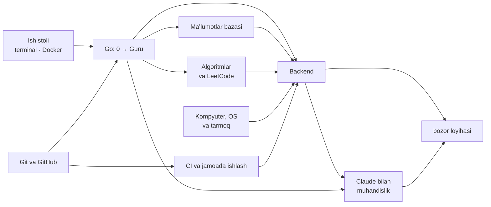

Bu sahifa kanal atrofidagi hamma narsani bir joyga yigʻadi: videolar qayerda chiqadi, savolni qayerga yozasiz,
kod qayerda turadi va kanalni qanday qoʻllab-quvvatlash mumkin. Kanal **hech narsa sotmaydi**: darslar, kod va
dars sahifalari doim bepul.

## Qayerda kuzatish mumkin

| Qayerda | Havola | Nima uchun |
|---|---|---|
| **Telegram kanal** (asosiy joy) | [@abdurahmon_official](https://t.me/abdurahmon_official) | Har yangi video, LeetCode va IT yangiliklar shu yerda birinchi eʼlon qilinadi. Soʻrovnomalar, keyingi mavzu tanlovi, xato topsangiz shu yerga yozing. |
| **YouTube** | [@bekzotovich](https://www.youtube.com/@bekzotovich) | Darslar, Shorts, LeetCode, IT yangiliklar. Qoʻngʻiroqchani bosing: LeetCode videosining kuni belgilanmagan. |
| **gopher.uz** | [gopher.uz](https://gopher.uz) | Go oʻzbek tilida: Go darslarining oʻqiladigan matni. |
| **GitHub** | [abdurahmon27](https://github.com/abdurahmon27) | Har darsning kodi va uy vazifasi: [go-backend-uz](https://github.com/abdurahmon27/go-backend-uz). Xato topsangiz, issue yoki PR oching. |
| **Kurs rejasi** | [haywan.uz/lab/youtube](/lab/youtube/reja) | Barcha yoʻnalishlar, har dars nimaga tayanishi va keyin qayerda ishlatilishi. |
| **Donat** | [haywan.uz/donate](https://haywan.uz/donate) | Ixtiyoriy. Darslar bunga bogʻliq emas. |

Har bir video tavsifida ham shu havolalar turadi: Telegram, gopher.uz, GitHub, dars sahifasi va donat.

## Qayerdan boshlash kerak

- **Dasturlashni endi boshlagan boʻlsangiz**: YouTube'dagi *Shu yerdan boshlang* playlist'i, keyin
  [Go asoslari](/lab/youtube/go#go-1) va [terminal](/lab/youtube/sys#sys-0) hamda [git](/lab/youtube/git#git-1)
  darslari. Bu 1-mavsum.
- **Boshqa tilda ishlaydigan dasturchi boʻlsangiz**: Go asoslarini tezroq koʻrib chiqing, keyin
  [Backend](/lab/youtube/backend) va [Maʼlumotlar bazasi](/lab/youtube/databases).
- **AI'dan toʻgʻri foydalanishni oʻrganmoqchi boʻlsangiz**: [Claude bilan muhandislik](/lab/youtube/claude#cl-1)
  ning birinchi beshta darsi alohida ham tushunarli.
- **Intervyuga tayyorlanayotgan boʻlsangiz**: haftalik LeetCode va har mavsum oxiridagi mock intervyu.

## Kurslar qanday bogʻlangan

Hammasi bitta yoʻl. Har dars nimaga tayanishi va keyin qayerda ishlatilishi uning sahifasida koʻrsatilgan.
Barcha amaliy ish bitta loyihada oʻsadi: **bozor** (mahalliy marketplace).

- **Git** birinchi mavsumdan boshlanadi (commit, branch, PR) va har mavsumda bir qadam chuqurlashadi: conflict
  va rebase, jamoa qoidalari, GitHub Actions'da CI, xavfsizlik. Reja: [Git va GitHub](/lab/youtube/git).
- **Claude** 2-mavsumda AI bilan toʻgʻri oʻrganishdan boshlanadi, 4-mavsumda Claude Code bilan bozor ustida
  ishlaymiz, 6–7-mavsumlarda Claude API'ni Go'dan chaqiramiz va oʻz agent'imizni quramiz. Reja:
  [Claude bilan muhandislik](/lab/youtube/claude).
- Toʻliq xarita va mavsumlar: [Kurs rejasi](/lab/youtube/reja). Har video qanday tayyorlanadi:
  [Videolar qanday tayyorlanadi](/lab/youtube/jarayon).

## Chiqish ritmi

- **Darslar**: mavsum tartibida, Go va backend asosiy yoʻl.
- **LeetCode**: haftada bitta, kuni belgilanmagan. Telegram'da eʼlon qilinadi.
- **IT yangiliklar**: haftada bir marta, shanba kuni.
- **Shorts**: har darsdan bitta qisqa video; u toʻliq darsga havola beradi.

## Pulsiz qanday yordam berish mumkin

- Videoni bitta dostingizga yuboring, ayniqsa oʻqiyotgan yoki ish qidirayotgan boʻlsa.
- Darsda xato topsangiz, Telegram'da yoki GitHub'da yozing: tuzatish shu sahifalarda eʼlon qilinadi.
- Keyingi mavzu boʻyicha soʻrovnomalarda ovoz bering: reja shu ovozlar bilan oʻzgaradi.
- [go-backend-uz](https://github.com/abdurahmon27/go-backend-uz) repo'siga yulduzcha qoʻying yoki uy vazifangiz
  yechimini PR qilib yuboring.

## Donat

[haywan.uz/donate](https://haywan.uz/donate). Ixtiyoriy va hech qanday imtiyoz bermaydi: darslar, kod va sahifalar
hamma uchun bir xil va bepul qoladi.
