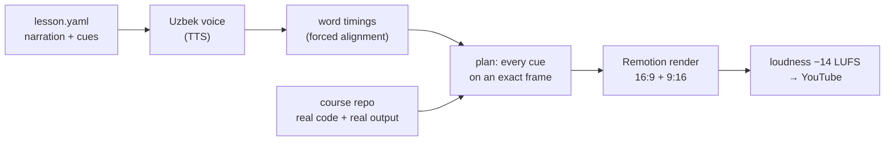
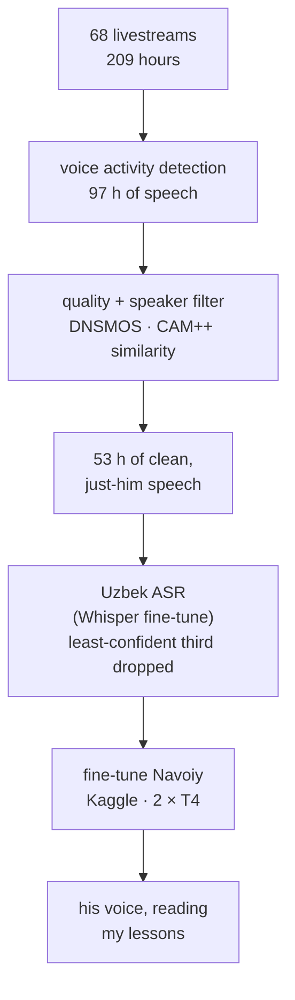

**Status: building.** No video is public yet. The plan, the engine and the
voice are being made right now, and this note is where the plan lives in the
open, so I can't quietly change it.

**The course itself, in Uzbek:** [the plan](/lab/youtube/reja) and one page per track, where every lesson
becomes a readable page with diagrams, code, sources and homework, plus the video once it's out.

**How each video is made** (research, AI critic, fact-check, tests, owner approval): [Videolar qanday tayyorlanadi](/lab/youtube/jarayon), in Uzbek.

## Who it's for

People who already learned to code (or are learning) and now look at AI
writing code and can't picture their own future. I want them to *find peace*
here, not more anxiety. The way out isn't to compete with AI at typing. It's
the things AI doesn't give you: **why** something works, what happens **under
the hood**, how to **debug** it, and how to decide between two designs.

I dropped out of university. This channel is partly the university course I
didn't finish, rebuilt in Uzbek, at the level I wanted then.

## What we'll launch

Four kinds of videos, one engine.

| Track | Length | Rhythm | What it is |
|---|---|---|---|
| **go: 0 → guru** | 8–12 min | the main track | A backend engineering course in Go, from `package main` to distributed systems |
| **LeetCode** | 6–10 min | every 5th lesson | One problem, the slow solution, then why the fast one is fast |
| **Mock intervyu** | 10–15 min | regularly | Junior → senior Go interview questions, answered out loud |
| **IT yangiliklar** | 3–6 min | weekly | Tech news in Uzbek, explained, with sources |
| **Shorts** | 30–60 s | daily | One idea cut from a lesson, vertical |

### The course

Every lesson has the same skeleton, because the skeleton is the teaching:

- a **hook** in the first seconds (*"7 lines of code. Why is the binary 2.3 MB?"*),
- the **why** before the how,
- a **pause task**: the video stops and asks you a question, with a countdown,
- a **debug exercise**: real broken code, real compiler output,
- **homework in four levels**, in the public repo
  [go-backend-uz](https://github.com/abdurahmon27/go-backend-uz).

The curriculum maps each module to a real university course: MIT 6.006
(algorithms), CMU 15-213 (systems), OSTEP (operating systems), Stanford CS144
(networking), CMU 15-445 (databases) and MIT 6.5840 (distributed systems).
Lesson 1 is *why Go, and what's inside `go build`*. It's written, and its code
and homework are in the repo.

## How a video gets made

There is no camera and no editing timeline. A lesson is a YAML file: what to
say, and what to show at which spoken word. The engine turns it into a video:

- Code types itself in an nvim-style window; the line being talked about lights up.
- Terminal output is **real**: the engine runs the commands from the course
  repo, so nothing on screen is made up.
- The look is flat Gruvbox, all monospace (Fira Code), one accent colour per
  frame, and no gradients. I tried glow and blur; it looked like an ad, so it's gone.
- A small cat mascot reacts to bugs, wins and *"pause and think"* moments,
  instead of meme stickers I don't have the rights to.

## The voice

This was the hard part, and still is.

The free Microsoft voice (Sardor) is fine in plain Uzbek, but it breaks on every
English term, and a backend course is half English terms. The multilingual voices
sound like an English speaker reading Uzbek. Paid voices cost money every
month, and the budget is **$0**.

So: an open model. [Navoiy TTS](https://huggingface.co/aisha-org/navoiy-tts) is
an Uzbek fine-tune of CosyVoice2, trained on about 600 hours of Uzbek. Out of
the box it clones a voice from a 15-second clip, but the clip has to be in
the right accent, and a generic clone still sounds generic.

The fix is to fine-tune it on one real person's voice. The best fit was
obvious: **Shaxzod aka** ([@shaxzodlab](https://www.youtube.com/@shaxzodlab)).
He streams Rust, Go and backend work for hours, in Uzbek, with exactly the
English terms this course needs. I asked him first whether I could train on his
streams and credit him in every video. His answer: *"Bemalol."* So every video
that uses the voice will say whose voice it is and link his channel.

What happened next, all on free hardware:

Some honest notes from the first day:

- **My laptop ran out of memory** decoding 9-hour streams in four workers at
  once. Now each stream is processed in 30-minute chunks, under a hard memory
  cap. Moving the audio-quality scorer to the GPU turned four hours of
  work into 45 minutes.
- **Eight short test runs on Kaggle so far**, each one finding the next wall: a
  newer Python, `torchaudio` changing how it loads audio, an unused `deepspeed`
  import, bf16 weights on a GPU that has no bf16, then GPU out-of-memory twice.
  Every test run is cheap on purpose, so the long run only starts once a
  short one passes.
- **Speech recognition on casual streams is messy.** Wrong transcripts teach a
  voice to mumble, so every clip now carries the recogniser's own confidence,
  and the least sure third is thrown away. With 53 hours, we can afford to.

This is also the gate for [maymun](/lab/ideas/maymun): an Uzbek voice good
enough that ten native speakers can't tell it from a person. This channel is
where I find out.

## What "done" looks like

1. The trained voice passes my own blind listen against Shaxzod's real clips.
2. Lesson 1 is rendered with it and uploaded **unlisted** for review.
3. The calendar starts: course lessons, LeetCode every fifth, weekly news, shorts
   in between.

Until then, this note is the status page. See [now](/lab/me/now) for everything
else.
