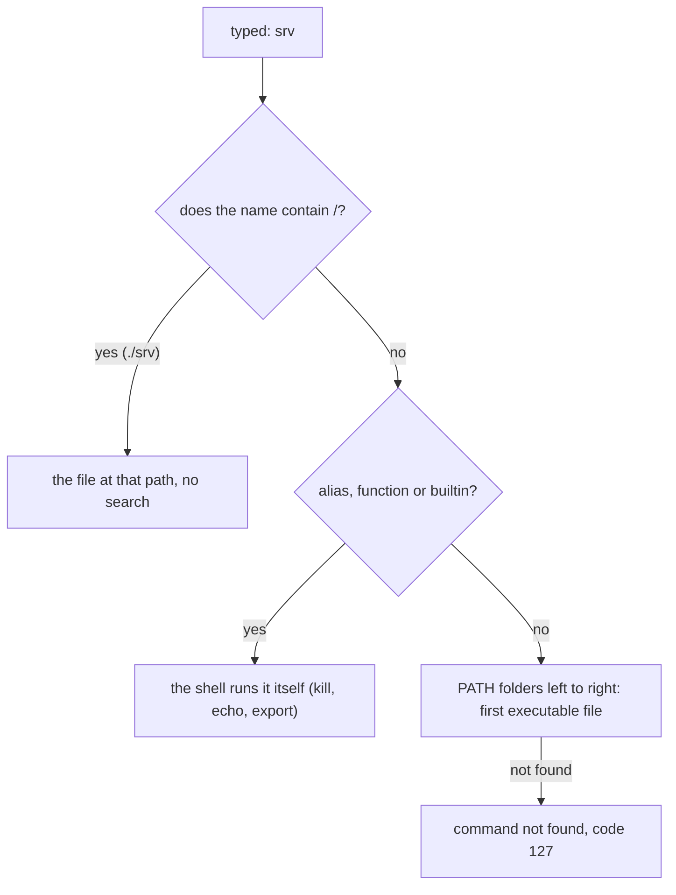

<div lang="en">

🌐 [Oʻzbekcha](/lab/youtube/sys/sys-0-02) · [Русский](/lab/youtube/sys/sys-0-02/ru) · **English**  
Lesson SYS-0.02 · [Kompyuter, OS va tarmoq](/lab/youtube/sys#sys-0-02) · ▶️ video coming soon · 💻 [GitHub](https://github.com/abdurahmon27/go-backend-uz/tree/main/lessons/sys-02-process-env)

> This is the full written version of the video lesson: you can learn from it without watching (or hearing) the video. The video itself is in Uzbek.

## What you will learn

One Go server, one slow request to it, and we stop the server in the middle of that request. Twice. The first time
the user gets the response and the server exits with code 0. The second time `curl` gets nothing and the server dies
with code 137. Same code, almost the same command. What is the difference? And where does 137 come from?

You have started servers with a `PORT` setting and pressed `Ctrl+C` thousands of times. This lesson is about the layer under all of that: how Linux starts a program, how it hands it
settings, and how it stops it.

**The one idea:** a running program is a **process**. It has a number (PID), a parent process and its own
**environment**. `kill` does not kill a process, it sends it a **signal**. What happens next is decided by the signal
and by the program itself. The environment is passed from parent to child as a **copy**, never the other way.

By the end of the lesson you will:

- find the process that holds a busy port with `ss` or `pgrep`, and stop it with `kill`;
- read exit codes like 137, 143 and 130 as `128 + signal number`;
- make a Go server finish its in-flight requests and stop cleanly when SIGTERM arrives;
- configure a program with environment variables and know how the shell finds a command through `$PATH`.

Today's three core new words:

| Word | Plain meaning | English term |
|---|---|---|
| process | a running program: it has a number (PID), a parent process, its own memory and its own environment | process |
| signal | a small message delivered to a process, mostly just a number (2, 9, 15) | signal |
| environment | the `NAME=value` pairs a process receives when it starts | environment |

Two helper words: **PID** (process ID) is the number of a process. **`$PATH`** is the list of folders where the shell
looks for commands. One pair in the environment is called an **environment variable**. You met it in GO-1.06.

## Before you start

- [SYS-0.01 · Terminal: pipes, `grep` and one-line solutions](/lab/youtube/sys/sys-0-01/en): the pipe `|`, `grep`, `wc -l`.
  In this lesson we pipe `ss`, `tr` and `grep` together.
- [GO-1.06 · Functions: two return values, closures and variadics](/lab/youtube/go/go-1-06/en): `PORT=9000 go run ./port` and
  `os.Getenv("PORT")`. Today we open up what is under it.
- [GO-X.01 · A 20-line HTTP API](/lab/youtube/go/go-x-01/en): `net/http`, a handler `func(w http.ResponseWriter, r *http.Request)`.
- [GO-X.03 · No try/catch: error values and defer](/lab/youtube/go/go-x-03/en): `if err != nil` and `defer`.
- [GO-X.04 · Copy or reference? Value semantics and pointers](/lab/youtube/go/go-x-04/en): the `&` in `&http.Server{…}`.

Two things in the server code are explained fully in later lessons: goroutines ([GO-1.21](/lab/youtube/go#go-1-21)) and
`context` ([GO-1.23](/lab/youtube/go#go-1-23)). Here one note on each is enough.

**How to run the code.** You need Linux (or WSL on Windows), `bash`, Go and `curl`. Clone the course repository and go
to the lesson folder:

```bash
git clone https://github.com/abdurahmon27/go-backend-uz
cd go-backend-uz/lessons/sys-02-process-env
```

All commands run from this folder. `./sinov.sh` also builds the server: a `./srv` file appears. `/proc` and `ss` exist
only on Linux. On macOS, `lsof -i :8077` shows the process that holds the port, and the `/proc` example does not work
there.

The outputs on this page were produced the way the video produces them: each command through `bash -c`, from the
lesson folder, with stdout and stderr together. PIDs differ on every run; everything else is identical. In an ordinary
terminal bash's own messages look slightly different: `bash: salom: command not found` instead of
`bash: line 1: salom: command not found`.

First, a question from SYS-0.01. In `grep -r TODO eslatmalar | wc -l`, what does `wc -l` count?

**A)** all lines in the `eslatmalar` folder · **B)** the lines `grep` wrote into the pipe · **C)** the number of files

<details>
<summary>Answer</summary>

**B.** The pipe `|` connects the output (stdout) of the command on the left to the input (stdin) of the command on the
right. `wc` never sees the folder: it counts only the lines that came through the pipe, that is, the number of lines
with `TODO`. Today we pipe the output of `ss` and `/proc` into `grep`.

</details>

## One server, two ways to stop it

The script `sinov.sh` ("test") in the lesson folder runs one experiment: it starts the server, sends it a slow request
and sends the server a signal in the middle of that request. The signal name is the first argument: `TERM` or `KILL`.

```bash filename="sinov.sh" showLineNumbers
#!/usr/bin/env bash
# ./sinov.sh TERM | KILL        (KUT=0 ./sinov.sh TERM: signal ushlanmaydi)
# Serverga 1 soniyalik soʻrov yuboramiz va soʻrov oʻrtasida signal joʻnatamiz.
exec 2>&1                                  # xatolar ham shu oqimda, tartib saqlansin
CGO_ENABLED=0 go build -o srv ./server     # C kompilyatorisiz, sof Go
./srv &
srv=$!
sleep 0.3
curl -sS localhost:8077 &
sleep 0.3
kill -s "$1" $srv
wait $srv 2>/dev/null                      # bash'ning "Killed" xabarisiz
echo "server chiqish kodi: $?"
wait
```

| Line | Code | What it does |
|---|---|---|
| 4 | `exec 2>&1` | sends the script's error stream (stderr) into normal output (stdout): all lines come out in one order |
| 5 | `CGO_ENABLED=0 go build -o srv ./server` | builds the `server/` folder into a binary called `srv`. `CGO_ENABLED=0` builds without a C compiler (the author's machine has no `gcc`). This is also configuration through an environment variable, more below |
| 6 | `./srv &` | starts the server. The `&` at the end means **in the background**: the shell does not wait for the server to finish and moves to the next line |
| 7 | `srv=$!` | `$!` is the PID of the last background process. We save it in the `srv` variable |
| 8 | `sleep 0.3` | waits 0.3 seconds so the server has time to open its port |
| 9 | `curl -sS localhost:8077 &` | a request to the server, also in the background. `-sS` means no progress bar, but still show errors |
| 10 | `sleep 0.3` | waits until the request has reached the server and is being handled |
| 11 | `kill -s "$1" $srv` | sends a signal to the server. `$1` is the script's first argument (`TERM` or `KILL`) |
| 12 | `wait $srv 2>/dev/null` | waits for the server process to end. `2>/dev/null` hides bash's `Killed` message |
| 13 | `echo "server chiqish kodi: $?"` | `$?` is the exit code of the last command. For `wait` that is the exit code of the process it waited for ("server chiqish kodi" = "server exit code") |
| 14 | `wait` | waits for the remaining background process (`curl`) too |

Predict before you run it. When the server gets `TERM`, what does `curl` get?

**A)** the response (`javob: Salom!`) · **B)** nothing at all · **C)** an error saying "server stopped"

<details>
<summary>Answer</summary>

**A**, but only for our server: it catches SIGTERM and finishes the request it has started. How it does that is in
the section "Catching SIGTERM". For a server that does not catch the signal the answer would be **B**. This lesson
proves that too. **C** does not exist: a server that has died cannot write anything to anyone.

</details>

```console
$ ./sinov.sh TERM
server: :8077 da tinglayapman
server: signal keldi, boshlangan soʻrovlarni tugatyapman
javob: Salom!
server: xayr
server chiqish kodi: 0
```

The server's messages in Uzbek: "listening on :8077", "signal received, finishing the requests in progress",
"response: Hello!", "bye", "server exit code: 0". Now `KILL`:

```console
$ ./sinov.sh KILL
server: :8077 da tinglayapman
curl: (52) Empty reply from server
server chiqish kodi: 137
```

`curl: (52) Empty reply from server`: the connection was open, but the server closed it without writing anything.
More precisely, the kernel stopped the server, and the kernel also closed the process's open connections.

On a timeline (from the `sleep`s in the script, approximately):

| Time | `TERM` | `KILL` |
|---|---|---|
| 0.0 s | server started | server started |
| 0.3 s | `curl` sent the request, the handler works for 1 second | the same |
| 0.6 s | the signal arrived: the server accepts no new connections and waits for the started one | the kernel stopped the process, the connection was closed |
| 1.3 s | the handler wrote the response, `curl` printed it, the server said `xayr` and exited | — |
| result | the user got the response, exit code 0 | the user got nothing, exit code 137 |

The difference is which signal arrived and how the program received it. We open these two things in order: first the
process, then the signal, then the server code.

## A process: PID and parent process

A **process** is a running program. The CMU 15-213 definition: *"an instance of a running program"*. The `srv` file
on disk is a program. Start it twice and you have two processes.

Every process has:

| What | Meaning |
|---|---|
| PID | the number of the process (process ID) |
| PPID | the number of the **parent process** that started it |
| memory | its own memory: another process cannot see it directly |
| environment | its own environment variables (the "Environment" section below) |

Let's look. We start the server in the background and ask `ps` about two processes: the shell itself and the server.

```console
$ ./srv & sleep 0.3; ps -o pid,ppid,stat,comm -p $$,$!; kill $!; wait
server: :8077 da tinglayapman
    PID    PPID STAT COMMAND
  26525   26312 S    bash
  26526   26525 Sl   srv
server: signal keldi, boshlangan soʻrovlarni tugatyapman
server: xayr
```

The parts of the command:

| Part | What it does |
|---|---|
| `./srv &` | starts the server in the background |
| `;` | separates commands: the next one runs after the previous one ends |
| `sleep 0.3` | gives the server time to open its port |
| `ps -o pid,ppid,stat,comm` | `ps` lists processes, `-o` chooses which columns to show |
| `-p $$,$!` | only these PIDs: `$$` is the shell itself, `$!` is the last background process (`srv`) |
| `kill $!` | stops the server (details in the next sections) |
| `wait` | waits for the background process to end, so its messages are printed too |

Reading the output:

- The PPID of `srv` (`26525`) is the PID of `bash`. This shell started the server; it is the parent process.
- The `S` in the `STAT` column is *interruptible sleep*: the server is waiting for an event (a new request).
- The lowercase `l` means the process has several threads (*multi-threaded*). The Go runtime uses several OS threads.

Your numbers will differ. What matters is the link: the child's PPID equals the parent's PID.

```text
bash   PID 26525
 └─ srv   PID 26526, PPID 26525   (STAT Sl: sleeping, multi-threaded)
```

## Port in use: finding the process

In real life you usually don't know the PID. A typical case: the server does not start because the port is taken.
Someone left an old server running. The second `srv` says exactly that:

```console
$ ./srv & sleep 0.3; ./srv; ss -ltnpH 'sport = :8077' | grep -o 'users.*'; kill $(pgrep -x srv); wait
server: :8077 da tinglayapman
server: listen tcp :8077: bind: address already in use
users:(("srv",pid=26575,fd=3))
server: signal keldi, boshlangan soʻrovlarni tugatyapman
server: xayr
```

The error on the second line: `listen tcp :8077` is "listen on TCP port 8077", `bind: address already in use` is
"the address is already taken". The server did not lie: it did not say "listening", it exited with an error. How the
code does that is in the section "The server code".

Who holds the port? We find it in two ways:

| Command | What it does |
|---|---|
| `ss -ltnpH 'sport = :8077'` | `ss` shows network sockets. `-l` listening, `-t` TCP, `-n` numbers (not names), `-p` also show the process, `-H` no header. `'sport = :8077'` means only port 8077 |
| `grep -o 'users.*'` | keeps only the part of the line that starts at `users`: the process name, `pid` and `fd` (file descriptor) |
| `pgrep -x srv` | prints the PIDs of processes whose name is exactly `srv` (`-x` means the whole name must match) |
| `$(…)` | the output of the inner command is put in its place: `kill $(pgrep -x srv)` → `kill 26575` |

`ss` leads from the port to the process: `users:(("srv",pid=26575,fd=3))`. For your own processes you don't need
`root`. If you know the name, `pgrep` gives the PID by name, and we pass it straight to `kill`.

A common habit is `ps aux | grep srv`. But it also finds `grep srv` itself: `grep` is a process too, and its command
line contains `srv`. That is why `pgrep` is handier. For an interactive view there are `top` and `htop`.

## A signal: what `kill` really does

The name `kill` is misleading. It does not kill the process, it sends a **signal**. What happens next is decided by
the signal and by the program itself.

A **signal** is a small message delivered to a process. CMU 15-213: *"A signal is a small message that notifies a
process that an event of some type has occurred"*. It carries mostly just a number: which signal arrived. (On Linux,
with `SA_SIGINFO` the sender's PID comes along too, but this lesson doesn't need it.) A program can ask to receive a
signal and handle it itself instead of the default action; `kut.go` below does that.

The three signals of this lesson (numbers for x86 and ARM Linux; `kill -l` prints the full list):

| Signal | Number | Who sends it | Can it be caught |
|---|---|---|---|
| SIGINT | 2 | `Ctrl+C`: the kernel sends it to the foreground processes | yes |
| SIGTERM | 15 | `kill` (without a signal name): the default signal | yes |
| SIGKILL | 9 | `kill -9` | no |

A program can catch SIGTERM, finish its work and exit. If it doesn't catch it, it simply stops: the default action of
SIGTERM is also "terminate". SIGKILL can be neither caught nor ignored (signal(7): *"The signals SIGKILL and SIGSTOP
cannot be caught, blocked, or ignored"*). The program itself can do nothing; the kernel stops the process. That was
the `KILL` result in the opening experiment.

## Exit codes: 137 = 128 + 9

The 137 from the opening experiment is not a random number. bash(1): when a process is stopped by signal number N,
bash reports the exit code as `128 + N`.

Predict: if we stop `sleep 9` with a plain `kill`, what does `echo $?` print?

**A)** `0` · **B)** `15` · **C)** `143`

<details>
<summary>Answer</summary>

**C: `143`** = 128 + 15. `kill` without a signal name sends SIGTERM (15); `sleep` does not catch it and stops. If you
chose **B**, you thought the signal number itself comes back: bash adds 128 to it. **A** happens only when the
program finishes successfully on its own.

</details>

```console
$ sleep 9 & kill $!; wait $!; echo $?
143
```

`wait $!` waits for that background process and returns its exit code; `$?` prints it. Now with `-9`:

```console
$ sleep 9 & kill -9 $!; wait $!; echo $?
bash: line 1: 26595 Killed                     sleep 9
137
```

137 = 128 + 9. bash also wrote `Killed` (to stderr, with the PID). The other direction: `kill -l` turns a code back
into a signal name:

```console
$ kill -l 143 137
TERM
KILL
```

| Exit code | Sum | Signal |
|---|---|---|
| 130 | 128 + 2 | SIGINT (`Ctrl+C`) |
| 137 | 128 + 9 | SIGKILL |
| 143 | 128 + 15 | SIGTERM |

If you see 137, SIGKILL almost always arrived. Three usual causes:

- someone ran `kill -9`;
- the `docker stop` (or Kubernetes) grace period ran out and SIGKILL was sent (the "In production" section);
- memory ran out and the Linux kernel's **OOM killer** killed the process (in `mm/oom_kill.c` it sends exactly
  SIGKILL).

"Almost", because a program that calls `exit(137)` itself also ends with 137, but that is rare.

## The server code: the port comes from the environment, a busy port is an error

Now our server. It is in three files: `main.go`, `sekin.go` ("slow", the handler) and `kut.go` ("wait", waiting for
the signal). First `main.go`:

```go filename="server/main.go" showLineNumbers
package main

import (
	"fmt"
	"net"
	"net/http"
	"os"
)

func main() {
	port := os.Getenv("PORT") // sozlama muhitdan keladi
	if port == "" {
		port = "8077"
	}
	ln, err := net.Listen("tcp", ":"+port)
	if err != nil {
		fmt.Println("server:", err) // port band: yolgʻon gapirmaymiz
		os.Exit(1)
	}
	srv := &http.Server{Handler: http.HandlerFunc(sekin)}
	go srv.Serve(ln)
	fmt.Println("server: :" + port + " da tinglayapman")
	if os.Getenv("KUT") == "0" {
		select {} // signal ushlanmaydi: Go odatdagidek darhol chiqadi
	}
	kut(srv)
}
```

| Line | Code | What it does |
|---|---|---|
| 11 | `port := os.Getenv("PORT")` | reads the `PORT` environment variable. If it is not set, the result is the empty string `""` |
| 12–14 | `if port == "" { port = "8077" }` | if empty, the default 8077 |
| 15 | `ln, err := net.Listen("tcp", ":"+port)` | takes the TCP port and starts listening. `":8077"` means port 8077 on all of the machine's addresses |
| 16–19 | `if err != nil { … os.Exit(1) }` | if the port is taken, prints the error and exits with code 1. It does not falsely claim "listening" |
| 20 | `srv := &http.Server{Handler: http.HandlerFunc(sekin)}` | the server value. `http.HandlerFunc(sekin)` turns a plain function into a handler: every request goes to `sekin`. `&` is a pointer, because `kut` stops this very server |
| 21 | `go srv.Serve(ln)` | accepts connections on `ln` and answers requests. The word `go` starts this in a separate **goroutine**: `main` does not wait and moves to the next line (goroutines are in GO-1.21) |
| 22 | `fmt.Println("server: :" + port + " da tinglayapman")` | this message ("listening on :8077") appears only after the port is really open |
| 23–25 | `if os.Getenv("KUT") == "0" { select {} }` | with `KUT=0` the signal is not caught. An empty `select {}` blocks forever (Go spec), so the server runs until a signal arrives. We use this in the section "Catching SIGTERM" |
| 26 | `kut(srv)` | waits for a signal and stops the server cleanly (`kut.go`) |

Why a separate `net.Listen` and not `http.ListenAndServe`? If we ran `go http.ListenAndServe(…)` in a goroutine and
then printed "listening", the message would appear even when the port is taken: the error would be lost inside the
goroutine. That was the trap of the lying log in GO-1.06. `net.Listen` takes the port first and returns the error
right away.

The handler (`sekin.go`) deliberately holds every request for 1 second, to stand in for slow work such as a payment:

```go filename="server/sekin.go" showLineNumbers
package main

import (
	"fmt"
	"net/http"
	"time"
)

// sekin: har bir soʻrov 1 soniya, masalan toʻlov.
func sekin(w http.ResponseWriter, r *http.Request) {
	time.Sleep(time.Second)
	fmt.Fprintln(w, "javob: Salom!")
}
```

| Line | Code | What it does |
|---|---|---|
| 11 | `time.Sleep(time.Second)` | waits 1 second |
| 12 | `fmt.Fprintln(w, "javob: Salom!")` | writes text to the response body (`w` is the response, as in GO-X.01) |

## Catching SIGTERM: `kut.go`

By default a Go program exits right away when SIGTERM, SIGINT or SIGHUP arrives. The `os/signal` docs: *"A SIGHUP,
SIGINT, or SIGTERM signal causes the program to exit."* Such an exit gives code 143 (128 + 15), as with `sleep` above. To finish the request first,
the program has to catch the signal itself. In Go:

```go filename="server/kut.go" showLineNumbers
package main

import (
	"context"
	"fmt"
	"net/http"
	"os"
	"os/signal"
	"syscall"
	"time"
)

// kut signal kelguncha kutadi, keyin serverni toza toʻxtatadi.
func kut(srv *http.Server) {
	ctx, stop := signal.NotifyContext(context.Background(), syscall.SIGTERM, os.Interrupt)
	defer stop()
	<-ctx.Done()
	fmt.Println("server: signal keldi, boshlangan soʻrovlarni tugatyapman")

	ctx, cancel := context.WithTimeout(context.Background(), 5*time.Second)
	defer cancel()
	if err := srv.Shutdown(ctx); err != nil {
		fmt.Println("server: ulgurmadi:", err) // 5 soniya tugadi: yolgʻon gapirmaymiz
	}
	fmt.Println("server: xayr")
}
```

A **context** (`context.Context`) is a value that carries a "stop" message. GO-1.23 explains it fully. Here one thing
is enough: `ctx.Done()` "opens" when the context is cancelled.

| Line | Code | What it does |
|---|---|---|
| 15 | `signal.NotifyContext(context.Background(), syscall.SIGTERM, os.Interrupt)` | returns a context that is cancelled when SIGTERM or SIGINT (`os.Interrupt`) arrives. From now on Go no longer exits on these two signals by itself. `stop` is a function that gives the signals back |
| 16 | `defer stop()` | when `kut` returns, unregisters the signals (`defer` is from GO-X.03) |
| 17 | `<-ctx.Done()` | waits here until a signal arrives. `<-` means waiting for a value from a channel (GO-1.21) |
| 18 | `fmt.Println(…)` | the signal has arrived |
| 20 | `context.WithTimeout(context.Background(), 5*time.Second)` | a new context that cancels itself after 5 seconds: a limit for the shutdown |
| 21 | `defer cancel()` | releases the context's timer |
| 22 | `srv.Shutdown(ctx)` | the server stops accepting new connections and waits for started requests to finish, but no longer than 5 seconds |
| 22–24 | `if err := …; err != nil { … }` | if time runs out, `Shutdown` returns the context's error, and we don't hide it ("ulgurmadi" = "didn't make it") |
| 25 | `fmt.Println("server: xayr")` | `kut` returns, `main` returns, the program exits with code 0 |

You can now read the `TERM` result of the opening experiment line by line: line 17 waited for the signal, line 18
printed the message, line 22 waited for the 1-second request to finish (`javob: Salom!`), line 25 said `xayr`. The
code is 0 because `main` returned normally. With SIGKILL not a single line of this code runs.

Now let's check what happens without this code. With `KUT=0`, `main` does not call `kut` (lines 23–25). Predict: in
`KUT=0 ./sinov.sh TERM`, what does `curl` get and what is the exit code?

**A)** the response and 0 · **B)** nothing and 143 · **C)** nothing and 137

<details>
<summary>Answer</summary>

**B.** The signal is not caught: Go exits right away with its default behaviour, code 128 + 15 = 143. **A** would
happen with `kut`. **C** happens only with SIGKILL: here the signal was SIGTERM.

</details>

```console
$ KUT=0 ./sinov.sh TERM
server: :8077 da tinglayapman
curl: (52) Empty reply from server
server chiqish kodi: 143
```

`KUT=0` is an environment variable written in front of the command: it went from `sinov.sh` to `srv`. How that works
is the next section.

The conclusion: for the user, a server that does not catch SIGTERM and a server killed with `kill -9` are the same:
the request is cut off. The only difference is the code: 143 or 137.

## The environment: `NAME=value` and `os.Getenv`

The **environment** is the set of `NAME=value` pairs a process receives when it starts. Each pair is an **environment
variable**. In Go `os.Getenv` reads them. The source is
the environment Linux gave the process when it started.

The `salom` ("hello") program reads the `ISM` ("name") variable:

```go filename="salom/main.go" showLineNumbers
package main

import (
	"fmt"
	"os"
)

func main() {
	ism := os.Getenv("ISM")
	if ism == "" {
		ism = "dunyo"
	}
	fmt.Println("Salom,", ism)
}
```

`ism` is an ordinary Go variable, `ISM` is the environment variable. Line 9 reads it, lines 10–12 put `dunyo` ("world")
if it is empty, line 13 says hello.

```console
$ go run ./salom
Salom, dunyo
```

Now we write `ISM=Aziz` in front of the command. Predict: what does the following `echo "[$ISM]"` print?

**A)** `[Aziz]` · **B)** `[]`

<details>
<summary>Answer</summary>

**B: `[]`.** `NAME=value` in front of a command gives the value **to that command only** (bash(1), ENVIRONMENT).
`ISM` stays empty in the shell itself. The brackets `[]` make an empty value visible. If you chose **A**, you thought
`ISM=Aziz` was an ordinary variable set in the shell.

</details>

```console
$ ISM=Aziz go run ./salom; echo "[$ISM]"
Salom, Aziz
[]
```

Configuring the program with `PORT=9000` in GO-1.06 was exactly the same mechanism. So is `KUT=0 ./sinov.sh TERM`
from the opening experiment.

`go run` is a separate process too: it builds `salom` and starts it as its own child. The environment reached both of
them, as the output shows.

## The environment of a running process: `/proc/PID/environ`

You can also see the environment of a running process, or more precisely, the environment it had when it started.
Linux shows it in the file `/proc/<PID>/environ`. The entries in it are separated not by newlines but by **null
bytes** (`\0`) (proc_pid_environ(5)). That is why `tr '\0' '\n'` replaces every null byte with a newline.

At this point the video says "just like print zero (`-print0`) in the previous lesson". That refers to an older
version of SYS-0.01, where `find -print0` also separated file names with null bytes. The new SYS-0.01 has no
`-print0`, so this page explains the null byte right here.

```console
$ PORT=9090 ./srv & sleep 0.3; tr '\0' '\n' < /proc/$!/environ | grep ^PORT=; kill $!; wait
server: :9090 da tinglayapman
PORT=9090
server: signal keldi, boshlangan soʻrovlarni tugatyapman
server: xayr
```

| Part | What it does |
|---|---|
| `PORT=9090 ./srv &` | starts the server in the background with `PORT=9090` in its environment |
| `tr '\0' '\n' < /proc/$!/environ` | `<` feeds the file into `tr`. `tr` replaces null bytes with newlines |
| `grep ^PORT=` | only the line that starts with `PORT=` (`^` is the start of the line). A plain `grep PORT` would also match other variables that contain the word `PORT` |

The server listens on port 9090, and `PORT=9090` is in its environment. Two important details:

- The file shows the environment **at start**. If the program changes its own environment later, this file does not
  show it.
- Other programs running as the same user can usually read this file too (a ptrace access check decides). So be
  careful with passwords and keys in the environment: they are not secret from that user.

## Shell variables and `export`

Predict: we wrote `ISM=Vali` on its own, put a semicolon, then ran `salom`. What is printed?

```bash
ISM=Vali; go run ./salom
```

**A)** `Salom, Vali` · **B)** `Salom, dunyo`

<details>
<summary>Answer</summary>

**B: `Salom, dunyo`.** `ISM=Vali` written on its own is a **shell variable**: it lives only inside the shell and is
not passed to child processes. That is the difference from `ISM=Aziz go run …` in front of a command: there the value
is added to that command's environment, here it is added nowhere.

</details>

```console
$ ISM=Vali; go run ./salom
Salom, dunyo
```

`export` adds a shell variable to the environment: every process started after it gets the variable.

```console
$ export ISM=Vali; go run ./salom
Salom, Vali
```

The other direction does not exist at all. Even if we `export` a `SHAHAR` ("city") variable inside a child `bash`,
it does not appear in the parent shell:

```console
$ bash -c 'export SHAHAR=Toshkent'; echo "[$SHAHAR]"
[]
```

The reason is in environ(7): a child process gets a **copy** of its parent's environment. Changing the copy does not
touch the original.

```text
parent bash
  ISM=Vali (shell variable)      ──✗──>     child: no ISM              → Salom, dunyo
  export ISM=Vali (environment)  ──copy──>  child: ISM=Vali            → Salom, Vali
  parent: no SHAHAR              <──✗──     child: export SHAHAR=…     → parent doesn't see it
```

A note: in the video every command runs in its own `bash -c`, so the earlier `export ISM=Vali` does not carry over to
the next step. If you type the commands one after another in one terminal, the exported `ISM` stays until you close
that terminal.

## `$PATH`: where a command is found

A question: why did we write `./srv` and not just `srv`?

If a command name contains no slash `/`, bash first checks aliases, functions and its own internal commands
(**builtins**: `kill`, `echo`, `export`, `type`). If it finds nothing, it searches the folders in the `PATH`
environment variable. **`$PATH`** is a list of folders separated by colons `:`, for example
`/usr/local/bin:/usr/bin:/bin`. The shell walks them from left to right and runs the first executable file it finds.
If the name contains `/`, there is no search at all (POSIX XBD 8.3): `./srv` is the file in this folder. The current
folder is usually not in `PATH`.



Let's try it. `type` shows where a command is found:

```console
$ type kill curl
kill is a shell builtin
curl is /usr/bin/curl
```

`kill` is a bash builtin, `curl` is a file on disk. That is why `kill -l 143 137` worked with bash's `kill`. The
`/usr/bin/kill` on disk is a different program and understands this command differently (`type -a kill` shows them
all).

Predict: if we type `salom`, what does `echo $?` print?

**A)** `0` · **B)** `1` · **C)** `127`

<details>
<summary>Answer</summary>

**C: `127`.** `salom` has no `/` in its name, it is not a builtin, and it is not in `PATH`. bash(1): if a command is
not found, the code is 127. **A** would mean the program ran, **B** that it ran and exited with an error. Here the
program never started.

</details>

```console
$ salom; echo $?
bash: line 1: salom: command not found
127
```

`go install` builds the program and installs it into the `GOBIN` folder. If `GOBIN` is not set, that is
`$GOPATH/bin`, usually `go/bin` in your home folder (`go help install`). We point it at this lesson's `bin` folder.
`$PWD` is the current folder.

```console
$ GOBIN=$PWD/bin go install ./salom; ls bin
salom
```

Now we add this folder to the **end** of `PATH`:

```console
$ PATH="$PATH:$PWD/bin" salom
Salom, dunyo
```

`salom` is found. This setting is for this one command only (the `NAME=value command` rule). To make it permanent,
you put an `export` line into `~/.bashrc` or `~/.zshrc`. The Go installation guide recommends exactly that:

```bash
export PATH="$PATH:$(go env GOPATH)/bin"
```

Why at the end? A file in a folder placed at the start of `PATH` can "shadow" the system's `ls` or `sudo`: the shell
runs the first one it finds.

## In production

You need this knowledge in production every day:

| Where | What happens |
|---|---|
| `docker stop` | SIGTERM to the main process in the container, SIGKILL after 10 seconds (the default for Linux containers) |
| Kubernetes | SIGTERM when a Pod is stopped, a default grace period of 30 seconds, then SIGKILL |
| Twelve-Factor App, rule III | keep configuration separate from code, in environment variables |

That is why a server must catch SIGTERM and finish its work cleanly. Otherwise users' requests are cut off on every
deploy (the `KUT=0` result), and when the grace period runs out you see 137 in the logs. The trap where the signal
never reaches the main process at all is in the Docker lesson ([SYS-0.05](/lab/youtube/sys/sys-0-05/en)).

Twelve-Factor rule III is line 11 of `server/main.go`: the port is not in the code, it is in the environment. One
binary works with `PORT=8077` and with `PORT=9090`.

## Common mistakes

**1. "`kill` kills", so straight to `kill -9`.** This is the classic mistake of this topic. `kill` sends a signal.
`kill -9` gives the program no chance to finish its work: started requests and writes are cut off halfway, `defer`s
don't run. The result is the `KILL` line of the opening experiment: `curl: (52) Empty reply from server`, code 137.
The fix: first a plain `kill` (SIGTERM), wait with `wait`. Use `-9` only if the program does not stop within a few
seconds. `docker stop` works exactly that way.

**2. A server that does not catch SIGTERM.** No error message, everything "works". But on every deploy the started
requests are cut off, code 143. The `KUT=0` result in the section "Catching SIGTERM" is exactly this. The fix:
`signal.NotifyContext` and `srv.Shutdown(ctx)` from `kut.go`, with a context that has a time limit.

**3. A shell variable without `export`.** `ISM=Vali; go run ./salom` → `Salom, dunyo`, no error. The program doesn't
see the setting and runs with the default. See the section "Shell variables and `export`". The fix:
`export ISM=Vali`, or for a single command `ISM=Vali go run ./salom`.

**4. Port in use.** The output from the section "Port in use":

```console
$ ./srv & sleep 0.3; ./srv; ss -ltnpH 'sport = :8077' | grep -o 'users.*'; kill $(pgrep -x srv); wait
server: :8077 da tinglayapman
server: listen tcp :8077: bind: address already in use
users:(("srv",pid=26575,fd=3))
server: signal keldi, boshlangan soʻrovlarni tugatyapman
server: xayr
```

How to read it: `listen tcp :8077` is which port, `bind: address already in use` is "the address is already taken".
The fix: find the owner with `ss` or `pgrep` and stop it, or start the second copy on another port
(`PORT=9090 ./srv`). A related mistake is printing "listening" after `go func() { http.ListenAndServe(…) }()`: the log
lies even when the port is taken. Call `net.Listen` first (the section "The server code").

**5. `command not found` (127).** Typing `srv` or `salom` without `./`: the shell searches `PATH` for them and finds
nothing. The output in the "`$PATH`" section: `bash: line 1: salom: command not found`, code 127. The fix: `./srv`
(the file in this folder), or add the folder to the **end** of `PATH`.

**6. Assuming nobody else can read a secret in the environment.** Other programs of the same user can usually read
`/proc/<PID>/environ` too (the section "The environment of a running process"). The environment is a convenient place
for configuration, but don't treat it as a hidden vault.

## Check yourself

**1.** You ran `kill` on your server, and `wait $!; echo $?` printed `143`. Does this server catch SIGTERM?

<details>
<summary>Answer</summary>

No. 143 = 128 + 15: the default action of SIGTERM stopped the process. A server that catches the signal and stops
cleanly returns from `main` normally, and the code is 0 (as in `./sinov.sh TERM`). 143 is the `KUT=0` case.

</details>

**2.** Predict. We wrote `PORT=9191` on its own line, then started the server. Which port does the server listen on?

```bash
PORT=9191; ./srv & sleep 0.3; kill $!; wait
```

<details>
<summary>Answer</summary>

**8077.** `PORT=9191;` is a shell variable: it is not exported and does not get into the environment of `srv`.
`os.Getenv` returns `""` and the default 8077 is used.

```console
$ PORT=9191; ./srv & sleep 0.3; kill $!; wait
server: :8077 da tinglayapman
server: signal keldi, boshlangan soʻrovlarni tugatyapman
server: xayr
```

</details>

**3.** Predict: what does `export ISM=Vali; ISM=Aziz go run ./salom` print?

<details>
<summary>Answer</summary>

`Salom, Aziz`. `ISM=Aziz` in front of the command overrides the value in the environment for that command.

```console
$ export ISM=Vali; ISM=Aziz go run ./salom
Salom, Aziz
```

</details>

**4.** Why do we write `./srv` and not `srv`? And why does `kill -l 143 137` work even though `kill` is not a file
found through PATH?

<details>
<summary>Answer</summary>

If the name contains `/`, the shell does not search `PATH`: `./srv` is the file in the current folder. The current
folder is usually not in `PATH`, so `srv` gives `command not found`. `kill` is a bash builtin: it is found before the
`PATH` search (`type kill` → `kill is a shell builtin`).

</details>

**5.** If a Go program also passes `syscall.SIGKILL` to `signal.NotifyContext`, will it manage to save its data after
`kill -9`?

<details>
<summary>Answer</summary>

No. SIGKILL can be neither caught nor ignored (signal(7)). The kernel stops the process; not a single line of the
program runs. That is why a clean shutdown works only with SIGTERM (and SIGINT), and why both `docker stop` and
Kubernetes send SIGTERM and wait before SIGKILL.

</details>

**6.** From GO-1.06: what does `os.Getenv("PORT")` return if `PORT` is not set? And if `PORT=` (empty) is set?

<details>
<summary>Answer</summary>

The empty string `""` in both cases. `os.Getenv` cannot tell them apart (pkg.go.dev/os#Getenv). To tell them apart
there is `os.LookupEnv`: its second return value says whether the variable exists. That is today's 🟠 homework.

</details>

## Homework

Tasks and answers are in the lesson folder on GitHub:
[lessons/sys-02-process-env](https://github.com/abdurahmon27/go-backend-uz/tree/main/lessons/sys-02-process-env).
The answers are in
[homework/](https://github.com/abdurahmon27/go-backend-uz/tree/main/lessons/sys-02-process-env/homework):
`bash homework/javoblar.sh` ("answers") runs them all. Try on your own first.

- 🟢 **Easy:** stop `sleep 100` with `Ctrl+C` and run `echo $?`. Which number, and why?
- 🟡 **Medium:** start the server with `PORT=9191`, `curl localhost:9191` from a second terminal, then `kill`.
- 🟠 **Hard:** make `salom` tell an `ISM` set to an empty value (`ISM=`) apart from `ISM` not set at all.
- 🔴 **Guru:** on the first `Ctrl+C` the server waits for requests; on the second `Ctrl+C` it exits immediately.

<details>
<summary>Answer</summary>

The full output of the answers script (from the lesson folder):

```console
$ bash homework/javoblar.sh
== Oson: sleep 100 ni Ctrl+C (SIGINT, 2) bilan toʻxtatish
chiqish kodi: 130 (128 + 2)
== Oʻrta: PORT=9191
server: :9191 da tinglayapman
javob: Salom!
server: signal keldi, boshlangan soʻrovlarni tugatyapman
server: xayr
== Qiyin: os.LookupEnv
ISM berilmagan: Salom, dunyo
ISM bor, lekin boʻsh: Salom, kim?
Salom, Aziz
== Guru: ikkinchi SIGINT darhol chiqaradi
server: :8077 da tinglayapman
server: signal keldi, kutyapman (yana bir marta bossangiz, darhol chiqaman)
curl: (52) Empty reply from server
server chiqish kodi: 130 (128 + 2: Shutdown kutilmadi)
```

🟢 **130** = 128 + 2: `Ctrl+C` sends SIGINT (2). A script cannot press `Ctrl+C`, so it sends the same signal with
`kill -INT`.

🟡 The server took `PORT` from the environment (`:9191 da tinglayapman`), `curl` got the response, and after a plain
`kill` (SIGTERM) the server stopped cleanly.

🟠 `os.LookupEnv` returns two values: the value and whether the variable exists (`bor`, "exists"). `os.Getenv` gives
`""` in both cases.

```go filename="homework/qiyin/main.go" showLineNumbers
package main

import (
	"fmt"
	"os"
)

func main() {
	ism, bor := os.LookupEnv("ISM")
	switch {
	case !bor:
		fmt.Println("ISM berilmagan: Salom, dunyo")
	case ism == "":
		fmt.Println("ISM bor, lekin boʻsh: Salom, kim?")
	default:
		fmt.Println("Salom,", ism)
	}
}
```

The script runs it three times: without `ISM`, with `ISM=`, and with `ISM=Aziz`. Those are the three lines of output
("ISM not set", "ISM exists but is empty: Hello, who?", "Hello, Aziz").

🔴 Right after the signal arrives, `stop()` is called (line 24). According to the `NotifyContext` docs, `stop`
unregisters the signals and restores the default behaviour. Now a second SIGINT stops the Go program immediately:
code 130, and the 3-second request is cut off (`curl: (52)`). Real servers often use this: if the operator presses
twice, the server doesn't wait.

```go filename="homework/guru/main.go" showLineNumbers
package main

import (
	"context"
	"fmt"
	"net/http"
	"os"
	"os/signal"
	"syscall"
	"time"
)

func main() {
	http.HandleFunc("/", func(w http.ResponseWriter, r *http.Request) {
		time.Sleep(3 * time.Second)
		fmt.Fprintln(w, "javob: Salom!")
	})
	srv := &http.Server{Addr: ":8077"}
	go srv.ListenAndServe()
	fmt.Println("server: :8077 da tinglayapman")

	ctx, stop := signal.NotifyContext(context.Background(), syscall.SIGTERM, os.Interrupt)
	<-ctx.Done()
	stop() // signal'ni qaytarib beramiz: ikkinchi Ctrl+C / SIGTERM endi dasturni darhol toʻxtatadi
	fmt.Println("server: signal keldi, kutyapman (yana bir marta bossangiz, darhol chiqaman)")

	ctx, cancel := context.WithTimeout(context.Background(), 10*time.Second)
	defer cancel()
	srv.Shutdown(ctx)
	fmt.Println("server: xayr")
}
```

A subtle point (from the README): in a non-interactive shell, background processes ignore SIGINT (bash(1)). Go's
`Notify` turns the signal back on, but after `stop()` it returns to the "ignored" state. That is why `javoblar.sh` uses
`set -m`: background processes then start the same way as in an interactive terminal.

</details>

## Sources

- CMU 15-213: [Processes](https://www.cs.cmu.edu/~213/lectures/16-processes.pdf),
  [Exceptional Control Flow](https://www.cs.cmu.edu/~213/lectures/17-ecf.pdf) (definitions of process and signal)
- man pages: [signal(7)](https://man7.org/linux/man-pages/man7/signal.7.html),
  [kill(1)](https://man7.org/linux/man-pages/man1/kill.1.html),
  [bash(1)](https://man7.org/linux/man-pages/man1/bash.1.html) (EXIT STATUS: 128+N and 127, ENVIRONMENT, COMMAND
  EXECUTION), [ps(1)](https://man7.org/linux/man-pages/man1/ps.1.html) (PROCESS STATE CODES),
  [environ(7)](https://man7.org/linux/man-pages/man7/environ.7.html),
  [proc_pid_environ(5)](https://man7.org/linux/man-pages/man5/proc_pid_environ.5.html),
  [ss(8)](https://man7.org/linux/man-pages/man8/ss.8.html),
  [pgrep(1)](https://man7.org/linux/man-pages/man1/pgrep.1.html),
  [termios(3)](https://man7.org/linux/man-pages/man3/termios.3.html) (VINTR → SIGINT),
  [sigaction(2)](https://man7.org/linux/man-pages/man2/sigaction.2.html) (SA_SIGINFO)
- [POSIX.1-2024 XBD 8.3: PATH](https://pubs.opengroup.org/onlinepubs/9799919799/basedefs/V1_chap08.html)
- Linux [mm/oom_kill.c](https://github.com/torvalds/linux/blob/master/mm/oom_kill.c) (the OOM killer sends SIGKILL)
- Go: [os/signal](https://pkg.go.dev/os/signal), [net/http Server.Shutdown](https://pkg.go.dev/net/http#Server.Shutdown),
  [os.Getenv](https://pkg.go.dev/os#Getenv), [os.LookupEnv](https://pkg.go.dev/os#LookupEnv),
  [net.Listen](https://pkg.go.dev/net#Listen), [Go spec: Select statements](https://go.dev/ref/spec#Select_statements),
  `go help install`, [go.dev/doc/install](https://go.dev/doc/install) (adding `$(go env GOPATH)/bin` to `PATH`)
- [docker stop](https://docs.docker.com/reference/cli/docker/container/stop/),
  [Kubernetes: Pod lifecycle](https://kubernetes.io/docs/concepts/workloads/pods/pod-lifecycle/),
  [The Twelve-Factor App: III. Config](https://12factor.net/config)
- MIT Missing Semester: [Command-line Environment](https://missing.csail.mit.edu/2026/command-line-environment/)
  (job control: `jobs`, `fg`, `bg`, `Ctrl+Z`; not covered in this lesson)
- Course folder and README: [lessons/sys-02-process-env](https://github.com/abdurahmon27/go-backend-uz/tree/main/lessons/sys-02-process-env)
- All outputs from `go1.26.8 linux/amd64`, GNU bash 5.3.9, procps-ng 4.0.6 (`ps`), curl 8.22.0,
  Linux 6.18, on 2026-11-26.

## Video and code

▶️ The video is coming soon. This page teaches the whole lesson, so you don't have to wait for it.

💻 [Code and homework answers on GitHub](https://github.com/abdurahmon27/go-backend-uz/tree/main/lessons/sys-02-process-env)

---

← Previous lesson: [SYS-0.01](/lab/youtube/sys/sys-0-01/en) · Next lesson: [SYS-4.01](/lab/youtube/sys#sys-4-01) → · [All lessons](/lab/youtube/sys)

</div>
