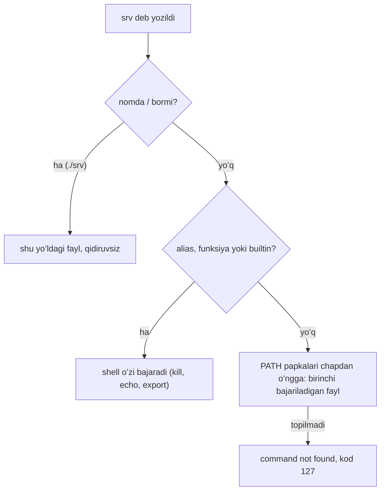

<div lang="uz">

🌐 **Oʻzbekcha** · [Русский](/lab/youtube/sys/sys-0-02/ru) · [English](/lab/youtube/sys/sys-0-02/en)  
Dars SYS-0.02 · [Kompyuter, OS va tarmoq](/lab/youtube/sys#sys-0-02) · ▶️ video tez orada · 💻 [GitHub](https://github.com/abdurahmon27/go-backend-uz/tree/main/lessons/sys-02-process-env)

> Bu sahifa videodagi darsning toʻliq yozma shakli: videoni koʻrmasdan (yoki eshitmasdan) ham shu yerdan oʻrganish mumkin.

## Nimani oʻrganasiz

Bitta Go server, unga bitta sekin soʻrov, va soʻrov oʻrtasida serverni toʻxtatamiz. Ikki marta. Birinchi marta
foydalanuvchi javobini oladi, server esa 0 kodi bilan chiqadi. Ikkinchi marta `curl` hech narsa olmaydi, server
esa 137 kodi bilan oʻladi. Kod bir xil, buyruq deyarli bir xil. Farq nimada? Va 137 qayerdan chiqdi?

Siz serverlarni `PORT` sozlamasi bilan ishga tushirgansiz, `Ctrl+C` ni ham
minglab marta bosgansiz. Bu dars shularning ostidagi qatlam haqida: Linux dasturni qanday ishga tushiradi, unga
sozlamani qanday beradi va qanday toʻxtatadi.

**Bitta gʻoya:** ishlayotgan dastur — bu **jarayon**. Uning raqami (PID), ota jarayoni va oʻz **muhiti** bor.
`kill` jarayonni oʻldirmaydi, unga **signal** yuboradi. Keyin nima boʻlishini signal va dasturning oʻzi hal qiladi.
Muhit esa ota jarayondan bolaga **nusxa** boʻlib oʻtadi, teskari yoʻnalishda emas.

Dars oxirida siz:

- port band boʻlsa, uni egallagan jarayonni `ss` yoki `pgrep` bilan topib, `kill` bilan toʻxtatasiz;
- 137, 143, 130 kabi chiqish kodlarini `128 + signal raqami` deb oʻqiysiz;
- Go serverni SIGTERM kelganda boshlangan soʻrovlarni tugatib, toza toʻxtaydigan qilasiz;
- dasturni muhit oʻzgaruvchilari bilan sozlaysiz va shell buyruqni `$PATH` dan qanday topishini bilasiz.

Bugungi uchta asosiy yangi soʻz:

| Soʻz | Oddiy maʼnosi | Inglizcha |
|---|---|---|
| jarayon | ishlayotgan dastur: raqami (PID), ota jarayoni, oʻz xotirasi va oʻz muhiti bor | process |
| signal | jarayonga keladigan kichik xabar, asosan faqat raqamdan iborat (2, 9, 15) | signal |
| muhit | jarayonga ishga tushganda beriladigan `NOM=qiymat` juftliklari | environment |

Ikkita yordamchi soʻz: **PID** (process ID) — jarayonning raqami. **`$PATH`** — shell buyruqlarni qidiradigan
papkalar roʻyxati. Muhitdagi bitta juftlik **muhit oʻzgaruvchisi** (environment variable) deyiladi. Siz uni
GO-1.06 da koʻrgansiz.

## Oldin bilish kerak

- [SYS-0.01 · Terminal: pipe, `grep` va bitta qatorda yechiladigan ishlar](/lab/youtube/sys/sys-0-01): pipe `|`, `grep`,
  `wc -l`. Bu darsda pipe bilan `ss`, `tr` va `grep` ni ulaymiz.
- [GO-1.06 · Funksiyalar: ikki qiymat qaytarish, closure va variadic](/lab/youtube/go/go-1-06): `PORT=9000 go run ./port`
  va `os.Getenv("PORT")`. Bugun bu yoʻlning ostini ochamiz.
- [GO-X.01 · 20 qatorlik HTTP API](/lab/youtube/go/go-x-01): `net/http`, handler `func(w http.ResponseWriter, r *http.Request)`.
- [GO-X.03 · try/catch yoʻq: error qiymat va defer](/lab/youtube/go/go-x-03): `if err != nil` va `defer`.
- [GO-X.04 · Nusxa yoki havola? Qiymat semantikasi va pointer](/lab/youtube/go/go-x-04): `&http.Server{…}` dagi `&`.

Server kodida ikkita narsa keyingi darslarda toʻliq ochiladi: goroutine ([GO-1.21](/lab/youtube/go#go-1-21)) va `context`
([GO-1.23](/lab/youtube/go#go-1-23)). Bu yerda ular uchun bittadan izoh yetarli.

**Kodni qanday ishga tushirish.** Sizga Linux (yoki Windows'da WSL), `bash`, Go va `curl` kerak. Kurs repository'sini
yuklab oling va dars papkasiga oʻting:

```bash
git clone https://github.com/abdurahmon27/go-backend-uz
cd go-backend-uz/lessons/sys-02-process-env
```

Hamma buyruqlar shu papkadan ishga tushiriladi. `./sinov.sh` serverni ham yigʻadi: `./srv` fayli paydo boʻladi.
`/proc` va `ss` faqat Linux'da bor. macOS'da portni egallagan jarayonni `lsof -i :8077` koʻrsatadi, `/proc` misoli esa
u yerda ishlamaydi.

Sahifadagi natijalar videodagi kabi olingan: har bir buyruq `bash -c` orqali, dars papkasidan, stdout va stderr
birga. PID raqamlari har safar boshqacha boʻladi, qolgan hamma narsa bir xil. Oddiy terminalda bash'ning xabarlari
biroz boshqacha koʻrinadi: `bash: line 1: salom: command not found` oʻrniga `bash: salom: command not found`.

Avval SYS-0.01 dan bitta savol. `grep -r TODO eslatmalar | wc -l` da `wc -l` nimani sanaydi?

**A)** `eslatmalar` papkasidagi hamma qatorlarni · **B)** `grep` pipe'ga yozgan qatorlarni · **C)** fayllar sonini

<details>
<summary>Javob</summary>

**B.** Pipe `|` chapdagi buyruqning natijasini (stdout) oʻngdagi buyruqning kirishiga (stdin) ulaydi. `wc` papkani
umuman koʻrmaydi: u faqat pipe orqali kelgan qatorlarni sanaydi, yaʼni `TODO` bor qatorlar sonini. Bugun pipe
bilan `ss` va `/proc` natijasini `grep` ga uzatamiz.

</details>

## Bitta server, ikki xil toʻxtatish

Dars papkasidagi `sinov.sh` skripti bitta tajribani bajaradi: serverni ishga tushiradi, unga sekin soʻrov yuboradi va
soʻrov oʻrtasida serverga signal joʻnatadi. Signal nomi birinchi argumentda: `TERM` yoki `KILL`.

```bash filename="sinov.sh" showLineNumbers
#!/usr/bin/env bash
# ./sinov.sh TERM | KILL        (KUT=0 ./sinov.sh TERM: signal ushlanmaydi)
# Serverga 1 soniyalik soʻrov yuboramiz va soʻrov oʻrtasida signal joʻnatamiz.
exec 2>&1                                  # xatolar ham shu oqimda, tartib saqlansin
CGO_ENABLED=0 go build -o srv ./server     # C kompilyatorisiz, sof Go
./srv &
srv=$!
sleep 0.3
curl -sS localhost:8077 &
sleep 0.3
kill -s "$1" $srv
wait $srv 2>/dev/null                      # bash'ning "Killed" xabarisiz
echo "server chiqish kodi: $?"
wait
```

| Qator | Kod | Nima qiladi |
|---|---|---|
| 4 | `exec 2>&1` | skriptning xato oqimini (stderr) oddiy natijaga (stdout) qoʻshadi: hamma qatorlar bitta tartibda chiqadi |
| 5 | `CGO_ENABLED=0 go build -o srv ./server` | `server/` papkasini `srv` degan binary'ga yigʻadi. `CGO_ENABLED=0` — C kompilyatorisiz yigʻish (muallifning kompyuterida `gcc` yoʻq). Bu ham muhit oʻzgaruvchisi bilan sozlash, pastda koʻramiz |
| 6 | `./srv &` | serverni ishga tushiradi. Oxiridagi `&` — **fonda**: shell server tugashini kutmay, keyingi qatorga oʻtadi |
| 7 | `srv=$!` | `$!` — oxirgi fon jarayonining PID'i. Uni `srv` oʻzgaruvchisiga saqlaymiz |
| 8 | `sleep 0.3` | server portni ochib ulgurishi uchun 0.3 soniya kutish |
| 9 | `curl -sS localhost:8077 &` | serverga soʻrov, u ham fonda. `-sS` — progress chizigʻisiz, lekin xatoni koʻrsatadi |
| 10 | `sleep 0.3` | soʻrov serverga yetib borib, ishlanayotgan paytni kutish |
| 11 | `kill -s "$1" $srv` | serverga signal yuborish. `$1` — skriptning birinchi argumenti (`TERM` yoki `KILL`) |
| 12 | `wait $srv 2>/dev/null` | server jarayoni tugashini kutadi. `2>/dev/null` bash'ning `Killed` xabarini yashiradi |
| 13 | `echo "server chiqish kodi: $?"` | `$?` — oxirgi buyruqning chiqish kodi. `wait` uchun bu kutilgan jarayonning kodi |
| 14 | `wait` | qolgan fon jarayonini (`curl`) ham kutadi |

Ishga tushirishdan oldin taxmin qiling. Server `TERM` olganda `curl` nima oladi?

**A)** javobni (`javob: Salom!`) · **B)** hech narsa olmaydi · **C)** «server toʻxtatildi» degan xatoni

<details>
<summary>Javob</summary>

**A**, lekin faqat bizning server uchun: u SIGTERM'ni ushlaydi va boshlangan soʻrovni tugatadi. Buni qanday
qilishini «SIGTERM'ni ushlash» boʻlimida koʻramiz. Signalni ushlamaydigan server uchun javob **B** boʻlardi. Bu
ham shu darsda isbotlanadi. **C** yoʻq: server oʻlganda u hech kimga hech narsa yoza olmaydi.

</details>

```console
$ ./sinov.sh TERM
server: :8077 da tinglayapman
server: signal keldi, boshlangan soʻrovlarni tugatyapman
javob: Salom!
server: xayr
server chiqish kodi: 0
```

Endi `KILL`:

```console
$ ./sinov.sh KILL
server: :8077 da tinglayapman
curl: (52) Empty reply from server
server chiqish kodi: 137
```

`curl: (52) Empty reply from server` — «serverdan boʻsh javob»: ulanish ochilgan edi, lekin server hech narsa
yozmay uni yopdi. Aniqrogʻi, serverni yadro toʻxtatdi, jarayonning ochiq ulanishlarini ham yadro yopdi.

Vaqt boʻyicha (skriptdagi `sleep` larga koʻra, taxminan):

| Vaqt | `TERM` | `KILL` |
|---|---|---|
| 0.0 s | server ishga tushdi | server ishga tushdi |
| 0.3 s | `curl` soʻrov yubordi, handler 1 soniya ishlaydi | xuddi shunday |
| 0.6 s | signal keldi: server yangi ulanishlarni olmaydi, boshlanganini kutadi | yadro jarayonni toʻxtatdi, ulanish yopildi |
| 1.3 s | handler javob yozdi, `curl` uni chiqardi, server `xayr` deb chiqdi | — |
| natija | foydalanuvchi javob oldi, chiqish kodi 0 | foydalanuvchi hech narsa olmadi, chiqish kodi 137 |

Farq qaysi signal kelganida va dastur uni qanday kutib olganida. Shu ikki narsani tartib bilan ochamiz: avval jarayon,
keyin signal, keyin server kodi.

## Jarayon: PID va ota jarayon

**Jarayon** (process) — ishlayotgan dastur. CMU 15-213 kursining taʼrifi: *"an instance of a running program"*.
Diskdagi `srv` fayli — dastur. Uni ikki marta ishga tushirsangiz, ikkita jarayon boʻladi.

Har bir jarayonda:

| Nima | Maʼnosi |
|---|---|
| PID | jarayonning raqami (process ID) |
| PPID | uni ishga tushirgan **ota jarayon**ning (parent process) raqami |
| xotira | oʻz xotirasi: boshqa jarayon uni toʻgʻridan-toʻgʻri koʻrmaydi |
| muhit | oʻz muhit oʻzgaruvchilari (pastdagi «Muhit» boʻlimida) |

Koʻramiz. Serverni fonda ishga tushiramiz va `ps` bilan ikki jarayonni soʻraymiz: shell'ning oʻzi va server.

```console
$ ./srv & sleep 0.3; ps -o pid,ppid,stat,comm -p $$,$!; kill $!; wait
server: :8077 da tinglayapman
    PID    PPID STAT COMMAND
  26525   26312 S    bash
  26526   26525 Sl   srv
server: signal keldi, boshlangan soʻrovlarni tugatyapman
server: xayr
```

Buyruq qismlari:

| Qism | Nima qiladi |
|---|---|
| `./srv &` | serverni fonda ishga tushiradi |
| `;` | buyruqlarni ketma-ket ajratadi: avvalgisi tugagach keyingisi |
| `sleep 0.3` | server portni ochib ulgursin |
| `ps -o pid,ppid,stat,comm` | `ps` jarayonlar roʻyxatini chiqaradi, `-o` qaysi ustunlarni koʻrsatishni tanlaydi |
| `-p $$,$!` | faqat shu PID'lar: `$$` — shell'ning oʻzi, `$!` — oxirgi fon jarayoni (`srv`) |
| `kill $!` | serverni toʻxtatamiz (keyingi boʻlimlarda batafsil) |
| `wait` | fon jarayoni tugashini kutadi, shunda uning xabarlari ham chiqadi |

Natijani oʻqiymiz:

- `srv` ning PPID'i (`26525`) — `bash` ning PID'i. Serverni shu shell ishga tushirdi, u — ota jarayon.
- `STAT` ustunidagi `S` — *interruptible sleep*, yaʼni «uxlayapti»: server hodisa kutyapti (yangi soʻrov).
- Kichik `l` — jarayonda bir nechta thread bor (*multi-threaded*). Go runtime bir nechta OS thread ishlatadi.

Sizda raqamlar boshqacha boʻladi. Muhimi bogʻlanish: bolaning PPID'i otaning PID'iga teng.

```text
bash   PID 26525
 └─ srv   PID 26526, PPID 26525   (STAT Sl: uxlayapti, koʻp thread)
```

## Port band: jarayonni topish

Hayotda PID'ni odatda bilmaysiz. Tipik holat: server ishga tushmaydi, chunki port band. Kimdir eski serverni
yopmay qoldirgan. Ikkinchi `srv` aynan shuni aytadi:

```console
$ ./srv & sleep 0.3; ./srv; ss -ltnpH 'sport = :8077' | grep -o 'users.*'; kill $(pgrep -x srv); wait
server: :8077 da tinglayapman
server: listen tcp :8077: bind: address already in use
users:(("srv",pid=26575,fd=3))
server: signal keldi, boshlangan soʻrovlarni tugatyapman
server: xayr
```

Ikkinchi qatordagi xato: `listen tcp :8077` — «TCP 8077 portini tinglash», `bind: address already in use` —
«manzil allaqachon band». Server yolgʻon gapirmadi: «tinglayapman» demadi, xato bilan chiqdi. Bu kod tomonidan
qanday qilingani «Server kodi» boʻlimida.

Portni kim egallagan? Buni ikki yoʻl bilan topamiz:

| Buyruq | Nima qiladi |
|---|---|
| `ss -ltnpH 'sport = :8077'` | `ss` — tarmoq ulanishlarini koʻrsatadi. `-l` tinglayotganlar, `-t` TCP, `-n` raqamlar (nom emas), `-p` jarayonni ham koʻrsat, `-H` sarlavhasiz. `'sport = :8077'` — faqat 8077 port |
| `grep -o 'users.*'` | qatorning faqat `users` dan boshlangan qismini qoldiradi: jarayon nomi, `pid` va `fd` (fayl deskriptori) |
| `pgrep -x srv` | nomi aynan `srv` boʻlgan jarayonlarning PID'ini chiqaradi (`-x` — nom toʻliq mos kelsin) |
| `$(…)` | ichidagi buyruqning natijasi shu joyga qoʻyiladi: `kill $(pgrep -x srv)` → `kill 26575` |

`ss` portdan jarayonga olib boradi: `users:(("srv",pid=26575,fd=3))`. Oʻz jarayonlaringiz uchun `root` kerak
emas. Nomini bilsangiz, `pgrep` nom boʻyicha PID beradi va uni toʻgʻridan-toʻgʻri `kill` ga uzatamiz.

Koʻp uchraydigan usul — `ps aux | grep srv`. Lekin u `grep srv` ning oʻzini ham topadi: `grep` ham jarayon, uning
buyruq qatorida ham `srv` bor. `pgrep` shu sababli qulay. Interaktiv koʻrish uchun `top` yoki `htop` bor.

## Signal: `kill` aslida nima qiladi

`kill` nomi aldaydi. U jarayonni oʻldirmaydi, **signal** yuboradi. Keyin nima boʻlishini signal va dasturning oʻzi
hal qiladi.

**Signal** (signal) — jarayonga keladigan kichik xabar. CMU 15-213: *"A signal is a small message that notifies a
process that an event of some type has occurred"*. Unda asosan faqat raqam bor: qaysi signal kelgani. (Linux'da
`SA_SIGINFO` bilan yuboruvchining PID'i ham keladi, lekin bu darsda kerak emas.) Dastur signalga obuna boʻlib,
standart harakat oʻrniga uni oʻzi qayta ishlashi mumkin; quyidagi `kut.go` shunday qiladi.

Bu darsning uchta signali (raqamlar x86 va ARM Linux uchun, `kill -l` toʻliq roʻyxatni beradi):

| Signal | Raqam | Kim yuboradi | Ushlab boʻladimi |
|---|---|---|---|
| SIGINT | 2 | `Ctrl+C`: yadro oldingi plandagi jarayonlarga yuboradi | ha |
| SIGTERM | 15 | `kill` (signal nomisiz): odatdagi signal | ha |
| SIGKILL | 9 | `kill -9` | yoʻq |

SIGTERM'ni dastur ushlab, ishini tugatib chiqishi mumkin. Ushlamasa, shunchaki toʻxtaydi: SIGTERM'ning standart
harakati ham «tugatish». SIGKILL'ni esa ushlab ham, eʼtiborsiz qoldirib ham boʻlmaydi (signal(7): *"The signals
SIGKILL and SIGSTOP cannot be caught, blocked, or ignored"*). Dasturning oʻzi hech narsa qila olmaydi, jarayonni
yadro toʻxtatadi. Hook'dagi `KILL` natijasi shu edi.

## Chiqish kodlari: 137 = 128 + 9

Hook'dagi 137 tasodifiy raqam emas. bash(1): jarayon N raqamli signal bilan toʻxtatilsa, bash chiqish kodini
`128 + N` qilib beradi.

Taxmin qiling: `sleep 9` ni oddiy `kill` bilan toʻxtatsak, `echo $?` nima chiqaradi?

**A)** `0` · **B)** `15` · **C)** `143`

<details>
<summary>Javob</summary>

**C: `143`** = 128 + 15. Signal nomisiz `kill` SIGTERM (15) yuboradi, `sleep` uni ushlamaydi va toʻxtaydi.
**B** ni tanlagan boʻlsangiz, signal raqamining oʻzi qaytadi deb oʻylagansiz: bash unga 128 qoʻshadi. **A** —
dastur oʻzi muvaffaqiyatli tugagandagina boʻladi.

</details>

```console
$ sleep 9 & kill $!; wait $!; echo $?
143
```

`wait $!` shu fon jarayonini kutadi va uning kodini qaytaradi, `$?` uni chiqaradi. Endi `-9` bilan:

```console
$ sleep 9 & kill -9 $!; wait $!; echo $?
bash: line 1: 26595 Killed                     sleep 9
137
```

137 = 128 + 9. bash buni `Killed` deb ham yozdi (stderr'ga, PID bilan). Teskari yoʻnalish: `kill -l` kodni signal
nomiga qaytaradi:

```console
$ kill -l 143 137
TERM
KILL
```

| Chiqish kodi | Hisob | Signal |
|---|---|---|
| 130 | 128 + 2 | SIGINT (`Ctrl+C`) |
| 137 | 128 + 9 | SIGKILL |
| 143 | 128 + 15 | SIGTERM |

137 ni koʻrsangiz, deyarli har doim SIGKILL kelgan. Uchta odatiy sabab:

- kimdir `kill -9` qilgan;
- `docker stop` (yoki Kubernetes) kutish vaqti tugagan va SIGKILL yuborgan («Prodakshnda» boʻlimi);
- xotira tugagan va Linux yadrosining **OOM killer**'i jarayonni oʻldirgan (`mm/oom_kill.c` da u aynan SIGKILL
  yuboradi).

«Deyarli», chunki dastur oʻzi `exit(137)` qilsa ham 137 chiqadi, lekin bu kam uchraydi.

## Server kodi: port muhitdan, port band boʻlsa — xato

Endi serverimiz. U uchta faylda: `main.go`, `sekin.go` (handler) va `kut.go` (signal kutish). Avval `main.go`:

```go filename="server/main.go" showLineNumbers
package main

import (
	"fmt"
	"net"
	"net/http"
	"os"
)

func main() {
	port := os.Getenv("PORT") // sozlama muhitdan keladi
	if port == "" {
		port = "8077"
	}
	ln, err := net.Listen("tcp", ":"+port)
	if err != nil {
		fmt.Println("server:", err) // port band: yolgʻon gapirmaymiz
		os.Exit(1)
	}
	srv := &http.Server{Handler: http.HandlerFunc(sekin)}
	go srv.Serve(ln)
	fmt.Println("server: :" + port + " da tinglayapman")
	if os.Getenv("KUT") == "0" {
		select {} // signal ushlanmaydi: Go odatdagidek darhol chiqadi
	}
	kut(srv)
}
```

| Qator | Kod | Nima qiladi |
|---|---|---|
| 11 | `port := os.Getenv("PORT")` | `PORT` muhit oʻzgaruvchisini oʻqiydi. Berilmagan boʻlsa — boʻsh matn `""` |
| 12–14 | `if port == "" { port = "8077" }` | boʻsh boʻlsa, standart qiymat 8077 |
| 15 | `ln, err := net.Listen("tcp", ":"+port)` | TCP portni egallab, tinglashni boshlaydi. `":8077"` — kompyuterning hamma manzillarida 8077 port |
| 16–19 | `if err != nil { … os.Exit(1) }` | port band boʻlsa, xatoni chiqarib, 1 kodi bilan chiqadi. «Tinglayapman» deb yolgʻon gapirmaydi |
| 20 | `srv := &http.Server{Handler: http.HandlerFunc(sekin)}` | server qiymati. `http.HandlerFunc(sekin)` oddiy funksiyani handler'ga aylantiradi: hamma soʻrovlar `sekin` ga boradi. `&` — pointer, chunki `kut` shu bitta serverni toʻxtatadi |
| 21 | `go srv.Serve(ln)` | `ln` dagi ulanishlarni qabul qilib, soʻrovlarga javob beradi. `go` soʻzi buni alohida **goroutine**'da ishga tushiradi: `main` kutmay keyingi qatorga oʻtadi (goroutine — GO-1.21 da) |
| 22 | `fmt.Println("server: :" + port + " da tinglayapman")` | port haqiqatan ochilgandan keyingina shu xabar chiqadi |
| 23–25 | `if os.Getenv("KUT") == "0" { select {} }` | `KUT=0` boʻlsa, signal ushlanmaydi. Boʻsh `select {}` abadiy kutadi (Go spec), shuning uchun server signal kelguncha ishlaydi. Buni «SIGTERM'ni ushlash» boʻlimida ishlatamiz |
| 26 | `kut(srv)` | signal kelguncha kutadi va serverni toza toʻxtatadi (`kut.go`) |

Nega `http.ListenAndServe` emas, alohida `net.Listen`? `go http.ListenAndServe(…)` ni goroutine'da ishga tushirib,
keyin «tinglayapman» deb yozsak, port band boʻlganda ham xabar chiqardi: xato goroutine ichida yoʻqolardi. GO-1.06
dagi yolgʻon log shunday tuzoq edi. `net.Listen` avval portni egallaydi va xatoni darhol qaytaradi.

Handler (`sekin.go`) har soʻrovni ataylab 1 soniya ushlab turadi, toʻlov kabi sekin ishni koʻrsatish uchun:

```go filename="server/sekin.go" showLineNumbers
package main

import (
	"fmt"
	"net/http"
	"time"
)

// sekin: har bir soʻrov 1 soniya, masalan toʻlov.
func sekin(w http.ResponseWriter, r *http.Request) {
	time.Sleep(time.Second)
	fmt.Fprintln(w, "javob: Salom!")
}
```

| Qator | Kod | Nima qiladi |
|---|---|---|
| 11 | `time.Sleep(time.Second)` | 1 soniya kutadi |
| 12 | `fmt.Fprintln(w, "javob: Salom!")` | javob tanasiga matn yozadi (`w` — javob, GO-X.01 dagi kabi) |

## SIGTERM'ni ushlash: `kut.go`

Go dasturi odatda SIGTERM, SIGINT yoki SIGHUP kelganda darhol chiqadi. `os/signal` hujjati: *"A SIGHUP, SIGINT, or
SIGTERM signal causes the program to exit."* Bunday chiqish 143 (128 + 15) kodini beradi, yuqoridagi `sleep` kabi. Avval soʻrovni
tugatish uchun dastur signalni oʻzi ushlashi kerak. Go'da:

```go filename="server/kut.go" showLineNumbers
package main

import (
	"context"
	"fmt"
	"net/http"
	"os"
	"os/signal"
	"syscall"
	"time"
)

// kut signal kelguncha kutadi, keyin serverni toza toʻxtatadi.
func kut(srv *http.Server) {
	ctx, stop := signal.NotifyContext(context.Background(), syscall.SIGTERM, os.Interrupt)
	defer stop()
	<-ctx.Done()
	fmt.Println("server: signal keldi, boshlangan soʻrovlarni tugatyapman")

	ctx, cancel := context.WithTimeout(context.Background(), 5*time.Second)
	defer cancel()
	if err := srv.Shutdown(ctx); err != nil {
		fmt.Println("server: ulgurmadi:", err) // 5 soniya tugadi: yolgʻon gapirmaymiz
	}
	fmt.Println("server: xayr")
}
```

**Context** (`context.Context`) — «toʻxta» degan xabarni tashiydigan qiymat. U GO-1.23 da toʻliq ochiladi. Bu yerda
bitta narsa yetarli: `ctx.Done()` context bekor qilinganda «ochiladi».

| Qator | Kod | Nima qiladi |
|---|---|---|
| 15 | `signal.NotifyContext(context.Background(), syscall.SIGTERM, os.Interrupt)` | SIGTERM yoki SIGINT (`os.Interrupt`) kelganda bekor qilinadigan context qaytaradi. Shu paytdan Go bu ikki signalda oʻzi chiqmaydi. `stop` — signallarni qaytarib beradigan funksiya |
| 16 | `defer stop()` | `kut` tugaganda signallarni roʻyxatdan chiqaradi (`defer` — GO-X.03) |
| 17 | `<-ctx.Done()` | signal kelguncha shu yerda kutadi. `<-` — kanaldan qiymat kutish (GO-1.21) |
| 18 | `fmt.Println(…)` | signal keldi |
| 20 | `context.WithTimeout(context.Background(), 5*time.Second)` | 5 soniyadan keyin oʻzi bekor boʻladigan yangi context: toʻxtashga chegara |
| 21 | `defer cancel()` | context'ning taymerini boʻshatadi |
| 22 | `srv.Shutdown(ctx)` | server yangi ulanishlarni qabul qilmaydi va boshlangan soʻrovlar tugashini kutadi, lekin 5 soniyadan koʻp emas |
| 22–24 | `if err := …; err != nil { … }` | ulgurmasa, `Shutdown` context xatosini qaytaradi va biz uni yashirmaymiz |
| 25 | `fmt.Println("server: xayr")` | `kut` tugaydi, `main` tugaydi, dastur 0 kodi bilan chiqadi |

Hook'dagi `TERM` natijasini endi qatorma-qator oʻqish mumkin: 17-qator signalni kutdi, 18-qator xabarni yozdi,
22-qator 1 soniyalik soʻrov tugashini kutdi (`javob: Salom!`), 25-qator `xayr` dedi. Kod 0, chunki `main` oddiy
tugadi. SIGKILL'da esa bu kodning birorta qatori ham ishlamaydi.

Endi bu kodsiz nima boʻlishini tekshiramiz. `KUT=0` boʻlsa, `main` `kut` ni chaqirmaydi (23–25-qatorlar). Taxmin
qiling: `KUT=0 ./sinov.sh TERM` da `curl` nima oladi va chiqish kodi qancha?

**A)** javob va 0 · **B)** hech narsa va 143 · **C)** hech narsa va 137

<details>
<summary>Javob</summary>

**B.** Signal ushlanmagan: Go standart xulqi bilan darhol chiqadi, kod 128 + 15 = 143. **A** — `kut` bilan
boʻlardi. **C** — faqat SIGKILL'da: bu yerda signal SIGTERM edi.

</details>

```console
$ KUT=0 ./sinov.sh TERM
server: :8077 da tinglayapman
curl: (52) Empty reply from server
server chiqish kodi: 143
```

`KUT=0` — buyruq oldiga yozilgan muhit oʻzgaruvchisi: `sinov.sh` dan `srv` ga oʻtdi. Bu qanday ishlashini keyingi
boʻlimda koʻramiz.

Xulosa: SIGTERM'ni ushlamagan server ham, `kill -9` bilan oʻldirilgan server ham foydalanuvchi uchun bir xil — soʻrov
uziladi. Farqi faqat kodda: 143 yoki 137.

## Muhit: `NOM=qiymat` va `os.Getenv`

**Muhit** (environment) — jarayonga ishga tushganda beriladigan `NOM=qiymat` juftliklari. Har bir juftlik — **muhit
oʻzgaruvchisi** (environment variable). Go'da ularni `os.Getenv` oʻqiydi. Manba —
Linux jarayonga ishga tushganda bergan muhit.

`salom` dasturi `ISM` oʻzgaruvchisini oʻqiydi:

```go filename="salom/main.go" showLineNumbers
package main

import (
	"fmt"
	"os"
)

func main() {
	ism := os.Getenv("ISM")
	if ism == "" {
		ism = "dunyo"
	}
	fmt.Println("Salom,", ism)
}
```

`ism` — Go'dagi oddiy oʻzgaruvchi, `ISM` — muhit oʻzgaruvchisi. 9-qator uni oʻqiydi, 10–12-qatorlar boʻsh boʻlsa `dunyo`
qoʻyadi, 13-qator salomlashadi.

```console
$ go run ./salom
Salom, dunyo
```

Endi buyruq oldiga `ISM=Aziz` yozamiz. Taxmin qiling: keyingi `echo "[$ISM]"` nima chiqaradi?

**A)** `[Aziz]` · **B)** `[]`

<details>
<summary>Javob</summary>

**B: `[]`.** Buyruq oldidagi `NOM=qiymat` qiymatni **faqat shu buyruqqa** beradi (bash(1), ENVIRONMENT). Shell'ning
oʻzida `ISM` boʻsh qoladi. Qavslar `[]` boʻsh qiymatni koʻrinadigan qilish uchun. **A** ni tanlagan boʻlsangiz,
`ISM=Aziz` ni shell'ga yozilgan oddiy oʻzgaruvchi deb oʻylagansiz.

</details>

```console
$ ISM=Aziz go run ./salom; echo "[$ISM]"
Salom, Aziz
[]
```

GO-1.06 da dasturni `PORT=9000` bilan sozlaganimiz ham xuddi shu yoʻl edi. Hook'dagi `KUT=0 ./sinov.sh TERM` ham.

`go run` ham alohida jarayon: u `salom` ni yigʻadi va oʻz bolasi sifatida ishga tushiradi. Muhit ikkalasiga ham
oʻtdi — natija buni koʻrsatadi.

## Ishlayotgan jarayonning muhiti: `/proc/PID/environ`

Ishlayotgan jarayonning muhitini ham koʻrish mumkin, aniqrogʻi, u ishga tushgandagi muhitni. Linux uni
`/proc/<PID>/environ` faylida koʻrsatadi. Undagi yozuvlar yangi qator bilan emas, **nol bayt** (`\0`) bilan
ajratilgan (proc_pid_environ(5)). Shuning uchun `tr '\0' '\n'` har bir nol baytni yangi qatorga almashtiradi.

Videoda bu yerda «xuddi oʻtgan darsdagi print nol kabi» deyiladi. Bu SYS-0.01 ning eski variantiga ishora: u yerda
`find -print0` ham fayl nomlarini nol bayt bilan ajratgan edi. Yangi SYS-0.01 da `-print0` yoʻq, shuning uchun bu
sahifa nol baytni shu yerning oʻzida tushuntiradi.

```console
$ PORT=9090 ./srv & sleep 0.3; tr '\0' '\n' < /proc/$!/environ | grep ^PORT=; kill $!; wait
server: :9090 da tinglayapman
PORT=9090
server: signal keldi, boshlangan soʻrovlarni tugatyapman
server: xayr
```

| Qism | Nima qiladi |
|---|---|
| `PORT=9090 ./srv &` | serverni fonda, `PORT=9090` muhiti bilan ishga tushiradi |
| `tr '\0' '\n' < /proc/$!/environ` | `<` faylni `tr` ning kirishiga beradi. `tr` nol baytlarni yangi qatorga almashtiradi |
| `grep ^PORT=` | faqat `PORT=` bilan boshlangan qator (`^` — qator boshi). Oddiy `grep PORT` ichida `PORT` soʻzi bor boshqa oʻzgaruvchilarni ham topardi |

Server 9090 portida tinglayapti, `PORT=9090` esa uning muhitida. Ikkita muhim tafsilot:

- Fayl jarayon **ishga tushgandagi** muhitni koʻrsatadi. Dastur keyin oʻz muhitini oʻzgartirsa, bu faylda koʻrinmaydi.
- Bu faylni odatda shu foydalanuvchi nomidan ishlayotgan boshqa dasturlar ham oʻqiy oladi (ruxsatni ptrace tekshiruvi
  belgilaydi). Shuning uchun muhitdagi parol va kalitlarga ehtiyot boʻling: ular shu foydalanuvchi uchun sir emas.

## Shell oʻzgaruvchisi va `export`

Taxmin qiling: `ISM=Vali` ni alohida yozdik, nuqtali vergul qoʻydik, keyin `salom` ni ishga tushirdik. Nima chiqadi?

```bash
ISM=Vali; go run ./salom
```

**A)** `Salom, Vali` · **B)** `Salom, dunyo`

<details>
<summary>Javob</summary>

**B: `Salom, dunyo`.** Alohida yozilgan `ISM=Vali` — bu **shell oʻzgaruvchisi** (shell variable): u faqat shell'ning
ichida yashaydi va bola jarayonlarga oʻtmaydi. Buyruq oldiga yozilgan `ISM=Aziz go run …` dan farqi shu: u yerda
qiymat shu buyruqning muhitiga qoʻshiladi, bu yerda esa hech qayerga qoʻshilmaydi.

</details>

```console
$ ISM=Vali; go run ./salom
Salom, dunyo
```

`export` shell oʻzgaruvchisini muhitga qoʻshadi: endi undan keyin ishga tushadigan har bir jarayon uni oladi.

```console
$ export ISM=Vali; go run ./salom
Salom, Vali
```

Teskari yoʻl esa umuman yoʻq. Bola `bash` ichida `SHAHAR` («shahar») oʻzgaruvchisini `export` qilsak ham, ota shell'da
u paydo boʻlmaydi:

```console
$ bash -c 'export SHAHAR=Toshkent'; echo "[$SHAHAR]"
[]
```

Sababi environ(7) da: bola jarayon ota-onasining muhitidan **nusxa** oladi. Nusxani oʻzgartirish asl nusxaga taʼsir
qilmaydi.

```text
ota bash
  ISM=Vali (shell oʻzgaruvchisi)  ──✗──>  bola: ISM yoʻq          → Salom, dunyo
  export ISM=Vali (muhitda)       ──nusxa──>  bola: ISM=Vali      → Salom, Vali
  ota: SHAHAR yoʻq                <──✗──  bola: export SHAHAR=…   → ota koʻrmaydi
```

Eslatma: videoda har bir buyruq alohida `bash -c` da ishlaydi, shuning uchun oldingi `export ISM=Vali` keyingi qadamga
oʻtmaydi. Bitta terminalda ketma-ket yozsangiz, `export` qilingan `ISM` shu terminal yopilguncha qoladi.

## `$PATH`: buyruq qayerdan topiladi

Savol: nega `./srv` deb yozdik, shunchaki `srv` emas?

Buyruq nomida qiya chiziq `/` boʻlmasa, bash avval alias, funksiya va oʻzining ichki buyruqlarini (**builtin**:
`kill`, `echo`, `export`, `type`) tekshiradi. Topmasa, `PATH` muhit oʻzgaruvchisidagi papkalardan qidiradi. **`$PATH`**
— ikki nuqta `:` bilan ajratilgan papkalar roʻyxati, masalan `/usr/local/bin:/usr/bin:/bin`. Shell ularni chapdan
oʻngga koʻrib chiqadi va birinchi topilgan bajariladigan faylni ishga tushiradi. Nomda `/` boʻlsa, qidiruv umuman
boʻlmaydi (POSIX XBD 8.3): `./srv` — shu papkadagi fayl. Joriy papka `PATH` da odatda yoʻq.



Sinab koʻramiz. `type` buyruq qayerdan topilishini koʻrsatadi:

```console
$ type kill curl
kill is a shell builtin
curl is /usr/bin/curl
```

`kill` — bash'ning ichki buyrugʻi, `curl` — diskdagi fayl. Shuning uchun `kill -l 143 137` bash'ning `kill` i bilan
ishladi. Diskdagi `/usr/bin/kill` boshqa dastur va bu buyruqni boshqacha tushunadi (`type -a kill` hammasini koʻrsatadi).

Taxmin qiling: `salom` deb yozsak, `echo $?` nima chiqaradi?

**A)** `0` · **B)** `1` · **C)** `127`

<details>
<summary>Javob</summary>

**C: `127`.** `salom` nomida `/` yoʻq, builtin emas, `PATH` da ham yoʻq. bash(1): buyruq topilmasa, kod 127. **A**
— dastur ishlagan boʻlardi, **B** — dastur ishlab, xato bilan chiqqan boʻlardi. Bu yerda dastur umuman ishga
tushmadi.

</details>

```console
$ salom; echo $?
bash: line 1: salom: command not found
127
```

`go install` dasturni yigʻib, `GOBIN` papkasiga oʻrnatadi. `GOBIN` berilmagan boʻlsa, `$GOPATH/bin`, odatda uy
papkangizdagi `go/bin` (`go help install`). Biz uni shu darsning `bin` papkasiga yoʻnaltiramiz. `$PWD` — joriy papka.

```console
$ GOBIN=$PWD/bin go install ./salom; ls bin
salom
```

Endi bu papkani `PATH` **oxiriga** qoʻshamiz:

```console
$ PATH="$PATH:$PWD/bin" salom
Salom, dunyo
```

`salom` topildi. Bu yozuv faqat shu bitta buyruq uchun (`NOM=qiymat buyruq` qoidasi). Doimiy qilish uchun `export`
qatorini `~/.bashrc` yoki `~/.zshrc` fayliga yozasiz. Go'ni oʻrnatish hujjati aynan shuni maslahat beradi:

```bash
export PATH="$PATH:$(go env GOPATH)/bin"
```

Nega oxiriga? `PATH` boshiga qoʻyilgan papkadagi fayl tizimning `ls` yoki `sudo` sini «yashirib» qoʻyishi mumkin:
shell birinchi topganini ishga tushiradi.

## Prodakshnda

Bu bilimlar prodakshnda har kuni kerak:

| Qayerda | Nima boʻladi |
|---|---|
| `docker stop` | konteynerdagi asosiy jarayonga SIGTERM, 10 soniyadan keyin SIGKILL (Linux konteynerlari uchun standart) |
| Kubernetes | Pod toʻxtatilganda SIGTERM, standart 30 soniya kutish, keyin SIGKILL |
| Twelve-Factor App, III qoida | sozlamani koddan ajratib, muhit oʻzgaruvchilarida saqlang |

Shuning uchun server SIGTERM'ni ushlab, ishini toza tugatishi shart. Aks holda har deploy'da foydalanuvchilarning
soʻrovlari uziladi (`KUT=0` natijasi), kutish vaqti tugasa esa logda 137 koʻrasiz. Signal asosiy jarayonga umuman
yetib bormaydigan tuzoqni Docker darsida ([SYS-0.05](/lab/youtube/sys/sys-0-05)) koʻramiz.

Twelve-Factor'ning III qoidasi esa `server/main.go` ning 11-qatori: port kodda emas, muhitda. Bitta binary
`PORT=8077` bilan ham, `PORT=9090` bilan ham ishlaydi.

## Koʻp uchraydigan xatolar

**1. «`kill` oʻldiradi», shuning uchun darrov `kill -9`.** Bu mavzuning eng klassik xatosi. `kill` signal yuboradi.
`kill -9` esa dasturga ishini tugatish imkonini bermaydi: boshlangan soʻrovlar va yozuvlar yarimda uziladi,
`defer` lar ishlamaydi. Natija hook'dagi `KILL` qatorida: `curl: (52) Empty reply from server`, kod 137.
Tuzatish: avval oddiy `kill` (SIGTERM), `wait` bilan kuting. `-9` — faqat dastur bir necha soniyada toʻxtamasa.
`docker stop` ham aynan shunday ishlaydi.

**2. SIGTERM'ni ushlamaydigan server.** Xato xabari yoʻq, hamma narsa «ishlaydi». Lekin har deploy'da boshlangan
soʻrovlar uziladi, kod 143. «SIGTERM'ni ushlash» boʻlimidagi `KUT=0` natijasi aynan shu. Tuzatish: `kut.go` dagi
`signal.NotifyContext` va `srv.Shutdown(ctx)`, chegarali context bilan.

**3. `export` siz shell oʻzgaruvchisi.** `ISM=Vali; go run ./salom` → `Salom, dunyo`, xato yoʻq. Dastur sozlamani
koʻrmaydi, standart qiymat bilan ishlaydi. «Shell oʻzgaruvchisi va `export`» boʻlimiga qarang. Tuzatish:
`export ISM=Vali` yoki bitta buyruq uchun `ISM=Vali go run ./salom`.

**4. Port band.** «Port band» boʻlimidagi natija:

```console
$ ./srv & sleep 0.3; ./srv; ss -ltnpH 'sport = :8077' | grep -o 'users.*'; kill $(pgrep -x srv); wait
server: :8077 da tinglayapman
server: listen tcp :8077: bind: address already in use
users:(("srv",pid=26575,fd=3))
server: signal keldi, boshlangan soʻrovlarni tugatyapman
server: xayr
```

Oʻqish: `listen tcp :8077` — qaysi port, `bind: address already in use` — «manzil allaqachon band». Tuzatish: `ss` yoki
`pgrep` bilan egasini toping va toʻxtating, yoki ikkinchi nusxani boshqa port bilan ishga tushiring
(`PORT=9090 ./srv`). Yana bir xato — `go func() { http.ListenAndServe(…) }()` dan keyin «tinglayapman» yozish: port band
boʻlsa ham log yolgʻon gapiradi. `net.Listen` ni avval chaqiring («Server kodi» boʻlimi).

**5. `command not found` (127).** `srv` yoki `salom` ni `./` siz yozish: shell ularni `PATH` dan qidiradi va topmaydi.
«`$PATH`» boʻlimidagi natija: `bash: line 1: salom: command not found`, kod 127. Tuzatish: `./srv` (shu papkadagi
fayl) yoki papkani `PATH` **oxiriga** qoʻshish.

**6. Muhitdagi sirni hamma oʻqiy olmaydi deb oʻylash.** `/proc/<PID>/environ` ni shu foydalanuvchining boshqa
dasturlari ham odatda oʻqiy oladi («Ishlayotgan jarayonning muhiti» boʻlimi). Muhit — sozlama uchun qulay joy, lekin
uni «yashirin ombor» deb hisoblamang.

## Oʻzingizni tekshiring

**1.** Serveringizni `kill` qildingiz, `wait $!; echo $?` esa `143` chiqardi. Bu server SIGTERM'ni ushlaydimi?

<details>
<summary>Javob</summary>

Yoʻq. 143 = 128 + 15: jarayonni SIGTERM'ning standart harakati toʻxtatdi. Signalni ushlab, toza toʻxtagan server
`main` dan oddiy qaytadi va kod 0 boʻladi (`./sinov.sh TERM` dagi kabi). 143 — `KUT=0` holati.

</details>

**2.** Taxmin qiling. `PORT=9191` ni alohida qatorda yozdik, keyin serverni ishga tushirdik. Server qaysi portda
tinglaydi?

```bash
PORT=9191; ./srv & sleep 0.3; kill $!; wait
```

<details>
<summary>Javob</summary>

**8077.** `PORT=9191;` — shell oʻzgaruvchisi, u `export` qilinmagan va `srv` ning muhitiga tushmaydi. `os.Getenv`
`""` qaytaradi va standart 8077 olinadi.

```console
$ PORT=9191; ./srv & sleep 0.3; kill $!; wait
server: :8077 da tinglayapman
server: signal keldi, boshlangan soʻrovlarni tugatyapman
server: xayr
```

</details>

**3.** Taxmin qiling: `export ISM=Vali; ISM=Aziz go run ./salom` nima chiqaradi?

<details>
<summary>Javob</summary>

`Salom, Aziz`. Buyruq oldidagi `ISM=Aziz` shu buyruq uchun muhitdagi qiymatning ustidan yozadi.

```console
$ export ISM=Vali; ISM=Aziz go run ./salom
Salom, Aziz
```

</details>

**4.** Nega `./srv` deb yozamiz, `srv` emas? Va nega `kill -l 143 137` ishlaydi, garchi `kill` PATH'dagi fayl boʻlmasa ham?

<details>
<summary>Javob</summary>

Nomda `/` boʻlsa, shell `PATH` dan qidirmaydi: `./srv` — joriy papkadagi fayl. Joriy papka esa `PATH` da odatda yoʻq,
shuning uchun `srv` → `command not found`. `kill` esa bash'ning ichki buyrugʻi (builtin): u `PATH` qidiruvidan oldin
topiladi (`type kill` → `kill is a shell builtin`).

</details>

**5.** Go dasturi `signal.NotifyContext` ga `syscall.SIGKILL` ni ham bersa, `kill -9` dan keyin maʼlumotni saqlab
ulguradimi?

<details>
<summary>Javob</summary>

Yoʻq. SIGKILL'ni ushlab ham, eʼtiborsiz qoldirib ham boʻlmaydi (signal(7)). Jarayonni yadro toʻxtatadi, dasturning
birorta qatori ishlamaydi. Shuning uchun toza toʻxtash faqat SIGTERM (va SIGINT) bilan ishlaydi, va `docker stop`
ham, Kubernetes ham SIGKILL'dan oldin SIGTERM yuborib, kutadi.

</details>

**6.** GO-1.06 dan: `os.Getenv("PORT")` `PORT` berilmagan boʻlsa nima qaytaradi? `PORT=` (boʻsh) berilganda-chi?

<details>
<summary>Javob</summary>

Ikkala holatda ham boʻsh matn `""`. `os.Getenv` bu ikkisini farqlay olmaydi (pkg.go.dev/os#Getenv). Farqlash uchun
`os.LookupEnv` bor: u ikkinchi qiymat sifatida oʻzgaruvchi bor-yoʻqligini qaytaradi. Bu — bugungi 🟠 uy vazifasi.

</details>

## Uy vazifasi

Shartlar va javoblar GitHub'dagi dars papkasida:
[lessons/sys-02-process-env](https://github.com/abdurahmon27/go-backend-uz/tree/main/lessons/sys-02-process-env).
Javoblar [homework/](https://github.com/abdurahmon27/go-backend-uz/tree/main/lessons/sys-02-process-env/homework)
papkasida: `bash homework/javoblar.sh` hammasini ishga tushiradi. Avval oʻzingiz urinib koʻring.

- 🟢 **Oson:** `sleep 100` ni `Ctrl+C` bilan toʻxtating va `echo $?`. Qaysi raqam va nega?
- 🟡 **Oʻrta:** serverni `PORT=9191` bilan ishga tushiring, ikkinchi terminaldan `curl localhost:9191`, keyin `kill`.
- 🟠 **Qiyin:** `salom` `ISM` boʻsh qiymat bilan berilganini (`ISM=`) va umuman berilmaganini farqlasin.
- 🔴 **Guru:** birinchi `Ctrl+C` da server soʻrovlarni kutsin, ikkinchi `Ctrl+C` da darhol chiqsin.

<details>
<summary>Javob</summary>

Javoblar skriptining toʻliq natijasi (dars papkasidan):

```console
$ bash homework/javoblar.sh
== Oson: sleep 100 ni Ctrl+C (SIGINT, 2) bilan toʻxtatish
chiqish kodi: 130 (128 + 2)
== Oʻrta: PORT=9191
server: :9191 da tinglayapman
javob: Salom!
server: signal keldi, boshlangan soʻrovlarni tugatyapman
server: xayr
== Qiyin: os.LookupEnv
ISM berilmagan: Salom, dunyo
ISM bor, lekin boʻsh: Salom, kim?
Salom, Aziz
== Guru: ikkinchi SIGINT darhol chiqaradi
server: :8077 da tinglayapman
server: signal keldi, kutyapman (yana bir marta bossangiz, darhol chiqaman)
curl: (52) Empty reply from server
server chiqish kodi: 130 (128 + 2: Shutdown kutilmadi)
```

🟢 **130** = 128 + 2: `Ctrl+C` SIGINT (2) yuboradi. Skript `Ctrl+C` ni bosa olmaydi, shuning uchun xuddi shu
signalni `kill -INT` bilan yuboradi.

🟡 Server `PORT` ni muhitdan oldi (`:9191 da tinglayapman`), `curl` javob oldi, oddiy `kill` (SIGTERM) dan keyin
server toza toʻxtadi.

🟠 `os.LookupEnv` ikki qiymat qaytaradi: qiymat va oʻzgaruvchi bormi (`bor`). `os.Getenv` ikkala holatda ham `""`
beradi.

```go filename="homework/qiyin/main.go" showLineNumbers
package main

import (
	"fmt"
	"os"
)

func main() {
	ism, bor := os.LookupEnv("ISM")
	switch {
	case !bor:
		fmt.Println("ISM berilmagan: Salom, dunyo")
	case ism == "":
		fmt.Println("ISM bor, lekin boʻsh: Salom, kim?")
	default:
		fmt.Println("Salom,", ism)
	}
}
```

Skript uni uch marta ishga tushiradi: `ISM` siz, `ISM=` bilan va `ISM=Aziz` bilan. Natijadagi uchta qator shu.

🔴 Signal kelgach, darhol `stop()` chaqiriladi (24-qator). `NotifyContext` hujjatiga koʻra `stop` signallarni
roʻyxatdan chiqaradi va standart xulqni qaytaradi. Endi ikkinchi SIGINT Go dasturini darhol toʻxtatadi: kod 130,
3 soniyalik soʻrov uziladi (`curl: (52)`). Haqiqiy serverlarda shu usul koʻp ishlatiladi: operator ikkinchi marta
bossa, kutmaydi.

```go filename="homework/guru/main.go" showLineNumbers
package main

import (
	"context"
	"fmt"
	"net/http"
	"os"
	"os/signal"
	"syscall"
	"time"
)

func main() {
	http.HandleFunc("/", func(w http.ResponseWriter, r *http.Request) {
		time.Sleep(3 * time.Second)
		fmt.Fprintln(w, "javob: Salom!")
	})
	srv := &http.Server{Addr: ":8077"}
	go srv.ListenAndServe()
	fmt.Println("server: :8077 da tinglayapman")

	ctx, stop := signal.NotifyContext(context.Background(), syscall.SIGTERM, os.Interrupt)
	<-ctx.Done()
	stop() // signal'ni qaytarib beramiz: ikkinchi Ctrl+C / SIGTERM endi dasturni darhol toʻxtatadi
	fmt.Println("server: signal keldi, kutyapman (yana bir marta bossangiz, darhol chiqaman)")

	ctx, cancel := context.WithTimeout(context.Background(), 10*time.Second)
	defer cancel()
	srv.Shutdown(ctx)
	fmt.Println("server: xayr")
}
```

Nozik joy (README'dan): interaktiv boʻlmagan shell'da fon jarayonlari SIGINT'ni eʼtiborsiz qoldiradi (bash(1)). Go'ning
`Notify` i bu signalni qayta yoqadi, lekin `stop()` dan keyin u yana «eʼtiborsiz» holatiga qaytadi. Shuning uchun
`javoblar.sh` `set -m` ishlatadi: fon jarayonlari interaktiv terminaldagi kabi ishga tushadi.

</details>

## Manbalar

- CMU 15-213: [Processes](https://www.cs.cmu.edu/~213/lectures/16-processes.pdf),
  [Exceptional Control Flow](https://www.cs.cmu.edu/~213/lectures/17-ecf.pdf) (jarayon va signal taʼriflari)
- man sahifalari: [signal(7)](https://man7.org/linux/man-pages/man7/signal.7.html),
  [kill(1)](https://man7.org/linux/man-pages/man1/kill.1.html),
  [bash(1)](https://man7.org/linux/man-pages/man1/bash.1.html) (EXIT STATUS: 128+N va 127, ENVIRONMENT, COMMAND
  EXECUTION), [ps(1)](https://man7.org/linux/man-pages/man1/ps.1.html) (PROCESS STATE CODES),
  [environ(7)](https://man7.org/linux/man-pages/man7/environ.7.html),
  [proc_pid_environ(5)](https://man7.org/linux/man-pages/man5/proc_pid_environ.5.html),
  [ss(8)](https://man7.org/linux/man-pages/man8/ss.8.html),
  [pgrep(1)](https://man7.org/linux/man-pages/man1/pgrep.1.html),
  [termios(3)](https://man7.org/linux/man-pages/man3/termios.3.html) (VINTR → SIGINT),
  [sigaction(2)](https://man7.org/linux/man-pages/man2/sigaction.2.html) (SA_SIGINFO)
- [POSIX.1-2024 XBD 8.3: PATH](https://pubs.opengroup.org/onlinepubs/9799919799/basedefs/V1_chap08.html)
- Linux [mm/oom_kill.c](https://github.com/torvalds/linux/blob/master/mm/oom_kill.c) (OOM killer SIGKILL yuboradi)
- Go: [os/signal](https://pkg.go.dev/os/signal), [net/http Server.Shutdown](https://pkg.go.dev/net/http#Server.Shutdown),
  [os.Getenv](https://pkg.go.dev/os#Getenv), [os.LookupEnv](https://pkg.go.dev/os#LookupEnv),
  [net.Listen](https://pkg.go.dev/net#Listen), [Go spec: Select statements](https://go.dev/ref/spec#Select_statements),
  `go help install`, [go.dev/doc/install](https://go.dev/doc/install) (`PATH` ga `$(go env GOPATH)/bin` qoʻshish)
- [docker stop](https://docs.docker.com/reference/cli/docker/container/stop/),
  [Kubernetes: Pod lifecycle](https://kubernetes.io/docs/concepts/workloads/pods/pod-lifecycle/),
  [The Twelve-Factor App: III. Config](https://12factor.net/config)
- MIT Missing Semester: [Command-line Environment](https://missing.csail.mit.edu/2026/command-line-environment/)
  (job control: `jobs`, `fg`, `bg`, `Ctrl+Z` — bu darsda yoʻq)
- Kurs papkasi va README: [lessons/sys-02-process-env](https://github.com/abdurahmon27/go-backend-uz/tree/main/lessons/sys-02-process-env)
- Hamma natijalar `go1.26.8 linux/amd64`, GNU bash 5.3.9, procps-ng 4.0.6 (`ps`), curl 8.22.0,
  Linux 6.18 da, 2026-11-26 kuni olingan.

## Video va kod

▶️ Video tez orada chiqadi. Bu sahifa darsni toʻliq oʻrgatadi, videoni kutish shart emas.

💻 [Kod va uy vazifasi javoblari GitHub'da](https://github.com/abdurahmon27/go-backend-uz/tree/main/lessons/sys-02-process-env)

---

← Oldingi dars: [SYS-0.01](/lab/youtube/sys/sys-0-01) · Keyingi dars: [SYS-4.01](/lab/youtube/sys#sys-4-01) → · [Barcha darslar](/lab/youtube/sys)

</div>
