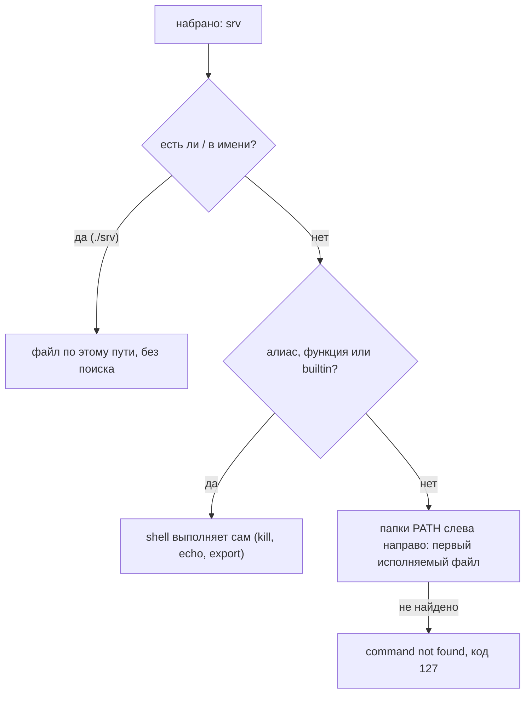

<div lang="ru">

🌐 [Oʻzbekcha](/lab/youtube/sys/sys-0-02) · **Русский** · [English](/lab/youtube/sys/sys-0-02/en)  
Урок SYS-0.02 · [Kompyuter, OS va tarmoq](/lab/youtube/sys#sys-0-02) · ▶️ видео скоро · 💻 [GitHub](https://github.com/abdurahmon27/go-backend-uz/tree/main/lessons/sys-02-process-env)

> Это полная письменная версия видеоурока: по ней можно учиться, не смотря (и не слушая) видео. Само видео на узбекском языке.

## Что вы узнаете

Один Go-сервер, один медленный запрос к нему, и посреди запроса мы останавливаем сервер. Дважды. В первый раз
пользователь получает ответ, а сервер завершается с кодом 0. Во второй раз `curl` не получает ничего, а сервер
погибает с кодом 137. Код тот же, команда почти та же. В чём разница? И откуда взялось 137?

В Node вы читали `process.env.PORT`, в Python — `os.environ`, в PHP — `getenv()`. `Ctrl+C` вы нажимали тысячи раз.
Этот урок — о слое под всем этим: как Linux запускает программу, как передаёт ей настройки и как её останавливает.

**Одна идея:** работающая программа — это **процесс**. У него есть номер (PID), родительский процесс и собственное
**окружение**. `kill` не убивает процесс, а посылает ему **сигнал**. Что будет дальше, решают сигнал и сама
программа. Окружение передаётся от родителя к потомку **копией**, и никогда в обратную сторону.

К концу урока вы сможете:

- найти процесс, занявший порт, с помощью `ss` или `pgrep` и остановить его через `kill`;
- читать коды выхода 137, 143, 130 как `128 + номер сигнала`;
- сделать так, чтобы Go-сервер по SIGTERM дорабатывал начатые запросы и останавливался корректно;
- настраивать программу переменными окружения и понимать, как shell находит команду через `$PATH`.

Три главных новых слова урока:

| Слово | Простой смысл | По-английски |
|---|---|---|
| процесс | работающая программа: у неё есть номер (PID), родительский процесс, своя память и своё окружение | process |
| сигнал | короткое сообщение процессу, по сути только номер (2, 9, 15) | signal |
| окружение | пары `ИМЯ=значение`, которые процесс получает при запуске | environment |

Два вспомогательных слова: **PID** (process ID) — номер процесса. **`$PATH`** — список папок, в которых shell ищет
команды. Одна пара в окружении называется **переменной окружения** (environment variable). Вы встречали её в GO-1.06.

## Что нужно знать заранее

- [SYS-0.01 · Терминал: pipe, `grep` и задачи в одну строку](/lab/youtube/sys/sys-0-01/ru): pipe `|`, `grep`, `wc -l`. В этом
  уроке мы соединяем через pipe `ss`, `tr` и `grep`.
- [GO-1.06 · Функции: два возвращаемых значения, замыкания и variadic](/lab/youtube/go/go-1-06/ru): `PORT=9000 go run ./port` и
  `os.Getenv("PORT")`. Сегодня разберём, что под этим лежит.
- [GO-X.01 · HTTP API в 20 строк](/lab/youtube/go/go-x-01/ru): `net/http`, обработчик (handler)
  `func(w http.ResponseWriter, r *http.Request)`.
- [GO-X.03 · Без try/catch: ошибка как значение и defer](/lab/youtube/go/go-x-03/ru): `if err != nil` и `defer`.
- [GO-X.04 · Копия или ссылка? Семантика значений и указатели](/lab/youtube/go/go-x-04/ru): `&` в `&http.Server{…}`.

Две вещи в коде сервера подробно разбираются в следующих уроках: горутины ([GO-1.21](/lab/youtube/go#go-1-21)) и `context`
([GO-1.23](/lab/youtube/go#go-1-23)). Здесь достаточно одного пояснения для каждой.

**Как запускать код.** Нужны Linux (или WSL в Windows), `bash`, Go и `curl`. Склонируйте репозиторий курса и
перейдите в папку урока:

```bash
git clone https://github.com/abdurahmon27/go-backend-uz
cd go-backend-uz/lessons/sys-02-process-env
```

Все команды запускаются из этой папки. `./sinov.sh` заодно собирает сервер: появляется файл `./srv`. `/proc` и `ss`
есть только в Linux. В macOS процесс, занявший порт, покажет `lsof -i :8077`, а пример с `/proc` там не работает.

Выводы на этой странице получены так же, как в видео: каждая команда через `bash -c`, из папки урока, stdout и stderr
вместе. PID при каждом запуске другие, всё остальное совпадает. В обычном терминале сообщения самого bash выглядят
чуть иначе: `bash: salom: command not found` вместо `bash: line 1: salom: command not found`.

Сначала вопрос из SYS-0.01. Что считает `wc -l` в `grep -r TODO eslatmalar | wc -l`?

**A)** все строки в папке `eslatmalar` · **B)** строки, которые `grep` записал в pipe · **C)** число файлов

<details>
<summary>Ответ</summary>

**B.** Pipe `|` соединяет вывод (stdout) левой команды со входом (stdin) правой. `wc` папку вообще не видит: он
считает только строки, пришедшие через pipe, то есть число строк с `TODO`. Сегодня мы через pipe передадим в `grep`
вывод `ss` и `/proc`.

</details>

## Один сервер, две остановки

Скрипт `sinov.sh` («проверка») в папке урока ставит один эксперимент: запускает сервер, отправляет ему медленный
запрос и посреди этого запроса посылает серверу сигнал. Имя сигнала — первый аргумент: `TERM` или `KILL`.

```bash filename="sinov.sh" showLineNumbers
#!/usr/bin/env bash
# ./sinov.sh TERM | KILL        (KUT=0 ./sinov.sh TERM: signal ushlanmaydi)
# Serverga 1 soniyalik soʻrov yuboramiz va soʻrov oʻrtasida signal joʻnatamiz.
exec 2>&1                                  # xatolar ham shu oqimda, tartib saqlansin
CGO_ENABLED=0 go build -o srv ./server     # C kompilyatorisiz, sof Go
./srv &
srv=$!
sleep 0.3
curl -sS localhost:8077 &
sleep 0.3
kill -s "$1" $srv
wait $srv 2>/dev/null                      # bash'ning "Killed" xabarisiz
echo "server chiqish kodi: $?"
wait
```

| Строка | Код | Что делает |
|---|---|---|
| 4 | `exec 2>&1` | направляет поток ошибок скрипта (stderr) в обычный вывод (stdout): все строки выходят в одном порядке |
| 5 | `CGO_ENABLED=0 go build -o srv ./server` | собирает папку `server/` в бинарник `srv`. `CGO_ENABLED=0` — сборка без компилятора C (на компьютере автора нет `gcc`). Это тоже настройка через переменную окружения, о ней ниже |
| 6 | `./srv &` | запускает сервер. `&` в конце — **в фоне**: shell не ждёт завершения сервера и переходит к следующей строке |
| 7 | `srv=$!` | `$!` — PID последнего фонового процесса. Сохраняем его в переменную `srv` |
| 8 | `sleep 0.3` | ждём 0.3 секунды, чтобы сервер успел открыть порт |
| 9 | `curl -sS localhost:8077 &` | запрос к серверу, тоже в фоне. `-sS` — без индикатора прогресса, но ошибки показывать |
| 10 | `sleep 0.3` | ждём, пока запрос дойдёт до сервера и начнёт обрабатываться |
| 11 | `kill -s "$1" $srv` | посылаем серверу сигнал. `$1` — первый аргумент скрипта (`TERM` или `KILL`) |
| 12 | `wait $srv 2>/dev/null` | ждёт завершения процесса сервера. `2>/dev/null` прячет сообщение bash `Killed` |
| 13 | `echo "server chiqish kodi: $?"` | `$?` — код выхода последней команды. Для `wait` это код того процесса, которого ждали («server chiqish kodi» = «код выхода сервера») |
| 14 | `wait` | ждёт и оставшийся фоновый процесс (`curl`) |

Прежде чем запускать, попробуйте предсказать. Что получит `curl`, когда сервер получит `TERM`?

**A)** ответ (`javob: Salom!`) · **B)** ничего · **C)** ошибку «сервер остановлен»

<details>
<summary>Ответ</summary>

**A**, но только для нашего сервера: он перехватывает SIGTERM и дорабатывает начатый запрос. Как он это делает —
в разделе «Перехват SIGTERM». Для сервера, который сигнал не перехватывает, ответ был бы **B**. Это мы тоже докажем
в этом уроке. **C** не бывает: погибший сервер уже никому ничего не напишет.

</details>

```console
$ ./sinov.sh TERM
server: :8077 da tinglayapman
server: signal keldi, boshlangan soʻrovlarni tugatyapman
javob: Salom!
server: xayr
server chiqish kodi: 0
```

Сообщения сервера по-узбекски: «слушаю :8077», «пришёл сигнал, дорабатываю начатые запросы», «ответ: Привет!»,
«пока», «код выхода сервера: 0». Теперь `KILL`:

```console
$ ./sinov.sh KILL
server: :8077 da tinglayapman
curl: (52) Empty reply from server
server chiqish kodi: 137
```

`curl: (52) Empty reply from server` — «пустой ответ от сервера»: соединение было открыто, но сервер закрыл его, ничего
не записав. Точнее, сервер остановило ядро, и открытые соединения процесса тоже закрыло ядро.

По времени (по `sleep` в скрипте, примерно):

| Время | `TERM` | `KILL` |
|---|---|---|
| 0.0 с | сервер запущен | сервер запущен |
| 0.3 с | `curl` отправил запрос, обработчик работает 1 секунду | так же |
| 0.6 с | пришёл сигнал: сервер не принимает новые соединения и ждёт начатое | ядро остановило процесс, соединение закрыто |
| 1.3 с | обработчик записал ответ, `curl` его вывел, сервер сказал `xayr` и завершился | — |
| итог | пользователь получил ответ, код выхода 0 | пользователь ничего не получил, код выхода 137 |

Разница в том, какой сигнал пришёл и как программа его встретила. Разберём это по порядку: сначала процесс, потом
сигнал, потом код сервера.

## Процесс: PID и родительский процесс

**Процесс** (process) — работающая программа. Определение из курса CMU 15-213: *"an instance of a running program"*.
Файл `srv` на диске — программа. Запустите его дважды — будет два процесса. Когда вы запускаете `node server.js` в
двух терминалах, происходит ровно это: один файл, два процесса.

У каждого процесса есть:

| Что | Значение |
|---|---|
| PID | номер процесса (process ID) |
| PPID | номер **родительского процесса** (parent process), который его запустил |
| память | своя память: другой процесс не видит её напрямую |
| окружение | свои переменные окружения (раздел «Окружение» ниже) |

Посмотрим. Запускаем сервер в фоне и спрашиваем `ps` о двух процессах: о самом shell и о сервере.

```console
$ ./srv & sleep 0.3; ps -o pid,ppid,stat,comm -p $$,$!; kill $!; wait
server: :8077 da tinglayapman
    PID    PPID STAT COMMAND
  26525   26312 S    bash
  26526   26525 Sl   srv
server: signal keldi, boshlangan soʻrovlarni tugatyapman
server: xayr
```

Части команды:

| Часть | Что делает |
|---|---|
| `./srv &` | запускает сервер в фоне |
| `;` | разделяет команды: следующая запускается после завершения предыдущей |
| `sleep 0.3` | даём серверу время открыть порт |
| `ps -o pid,ppid,stat,comm` | `ps` выводит список процессов, `-o` выбирает столбцы |
| `-p $$,$!` | только эти PID: `$$` — сам shell, `$!` — последний фоновый процесс (`srv`) |
| `kill $!` | останавливаем сервер (подробно — в следующих разделах) |
| `wait` | ждёт завершения фонового процесса, чтобы его сообщения тоже вывелись |

Читаем вывод:

- PPID процесса `srv` (`26525`) равен PID процесса `bash`. Сервер запустил этот shell, он — родительский процесс.
- `S` в столбце `STAT` — *interruptible sleep*, «спит»: сервер ждёт события (нового запроса).
- Маленькая `l` — в процессе несколько потоков (*multi-threaded*). Go runtime использует несколько потоков ОС.

У вас номера будут другими. Важна связь: PPID потомка равен PID родителя.

```text
bash   PID 26525
 └─ srv   PID 26526, PPID 26525   (STAT Sl: спит, несколько потоков)
```

## Порт занят: ищем процесс

В жизни PID обычно неизвестен. Типичная ситуация: сервер не запускается, потому что порт занят. Кто-то не закрыл
старый сервер. Второй `srv` сообщает именно это:

```console
$ ./srv & sleep 0.3; ./srv; ss -ltnpH 'sport = :8077' | grep -o 'users.*'; kill $(pgrep -x srv); wait
server: :8077 da tinglayapman
server: listen tcp :8077: bind: address already in use
users:(("srv",pid=26575,fd=3))
server: signal keldi, boshlangan soʻrovlarni tugatyapman
server: xayr
```

Ошибка во второй строке: `listen tcp :8077` — «слушать TCP-порт 8077», `bind: address already in use` — «адрес уже
занят». Сервер не соврал: он не написал «слушаю», а завершился с ошибкой. Как это сделано в коде — в разделе
«Код сервера».

Кто занял порт? Находим двумя способами:

| Команда | Что делает |
|---|---|
| `ss -ltnpH 'sport = :8077'` | `ss` показывает сетевые сокеты. `-l` слушающие, `-t` TCP, `-n` числа (не имена), `-p` показать и процесс, `-H` без заголовка. `'sport = :8077'` — только порт 8077 |
| `grep -o 'users.*'` | оставляет только часть строки, начиная с `users`: имя процесса, `pid` и `fd` (файловый дескриптор) |
| `pgrep -x srv` | выводит PID процессов с именем ровно `srv` (`-x` — имя должно совпасть целиком) |
| `$(…)` | вывод внутренней команды подставляется на это место: `kill $(pgrep -x srv)` → `kill 26575` |

`ss` ведёт от порта к процессу: `users:(("srv",pid=26575,fd=3))`. Для своих процессов `root` не нужен. Если имя
известно, `pgrep` даёт PID по имени, и мы передаём его прямо в `kill`.

Частая привычка — `ps aux | grep srv`. Но она находит и сам `grep srv`: `grep` тоже процесс, и в его командной
строке тоже есть `srv`. Поэтому `pgrep` удобнее. Для интерактивного просмотра есть `top` и `htop`.

## Сигнал: что на самом деле делает `kill`

Имя `kill` обманывает. Он не убивает процесс, а посылает **сигнал**. Что будет дальше, решают сигнал и сама
программа.

**Сигнал** (signal) — короткое сообщение процессу. CMU 15-213: *"A signal is a small message that notifies a process
that an event of some type has occurred"*. В нём, по сути, только номер: какой сигнал пришёл. (В Linux с
`SA_SIGINFO` приходит ещё и PID отправителя, но в этом уроке это не нужно.) Похоже на события в JavaScript:
`process.on('SIGTERM', …)` в Node — подписка ровно на этот сигнал.

Три сигнала этого урока (номера для Linux на x86 и ARM, полный список даёт `kill -l`):

| Сигнал | Номер | Кто посылает | Можно перехватить |
|---|---|---|---|
| SIGINT | 2 | `Ctrl+C`: ядро посылает его процессам переднего плана | да |
| SIGTERM | 15 | `kill` (без имени сигнала): сигнал по умолчанию | да |
| SIGKILL | 9 | `kill -9` | нет |

SIGTERM программа может перехватить, доделать работу и выйти. Если не перехватит — просто остановится: действие
SIGTERM по умолчанию тоже «завершить». SIGKILL нельзя ни перехватить, ни проигнорировать (signal(7): *"The signals
SIGKILL and SIGSTOP cannot be caught, blocked, or ignored"*). Сама программа ничего сделать не может, процесс
останавливает ядро. Это и был результат `KILL` в начальном эксперименте.

## Коды выхода: 137 = 128 + 9

137 из начального эксперимента — не случайное число. bash(1): если процесс остановлен сигналом с номером N, bash
выставляет код выхода `128 + N`.

Предскажите: если остановить `sleep 9` обычным `kill`, что выведет `echo $?`?

**A)** `0` · **B)** `15` · **C)** `143`

<details>
<summary>Ответ</summary>

**C: `143`** = 128 + 15. `kill` без имени сигнала посылает SIGTERM (15), `sleep` его не перехватывает и
останавливается. Если вы выбрали **B**, вы думали, что возвращается сам номер сигнала: bash прибавляет к нему 128.
**A** бывает, только если программа сама успешно завершилась.

</details>

```console
$ sleep 9 & kill $!; wait $!; echo $?
143
```

`wait $!` ждёт этот фоновый процесс и возвращает его код, `$?` его выводит. Теперь с `-9`:

```console
$ sleep 9 & kill -9 $!; wait $!; echo $?
bash: line 1: 26595 Killed                     sleep 9
137
```

137 = 128 + 9. bash ещё и написал `Killed` (в stderr, с PID). Обратное направление: `kill -l` превращает код обратно
в имя сигнала:

```console
$ kill -l 143 137
TERM
KILL
```

| Код выхода | Сумма | Сигнал |
|---|---|---|
| 130 | 128 + 2 | SIGINT (`Ctrl+C`) |
| 137 | 128 + 9 | SIGKILL |
| 143 | 128 + 15 | SIGTERM |

Если видите 137, почти всегда пришёл SIGKILL. Три обычные причины:

- кто-то выполнил `kill -9`;
- у `docker stop` (или Kubernetes) истекло время ожидания, и он послал SIGKILL (раздел «В продакшне»);
- кончилась память, и **OOM killer** ядра Linux убил процесс (в `mm/oom_kill.c` он посылает именно SIGKILL).

«Почти», потому что программа, сама вызвавшая `exit(137)`, тоже завершится с 137, но это редкость.

## Код сервера: порт из окружения, занятый порт — ошибка

Теперь наш сервер. Он в трёх файлах: `main.go`, `sekin.go` («медленно», обработчик) и `kut.go` («жди», ожидание
сигнала). Сначала `main.go`:

```go filename="server/main.go" showLineNumbers
package main

import (
	"fmt"
	"net"
	"net/http"
	"os"
)

func main() {
	port := os.Getenv("PORT") // sozlama muhitdan keladi
	if port == "" {
		port = "8077"
	}
	ln, err := net.Listen("tcp", ":"+port)
	if err != nil {
		fmt.Println("server:", err) // port band: yolgʻon gapirmaymiz
		os.Exit(1)
	}
	srv := &http.Server{Handler: http.HandlerFunc(sekin)}
	go srv.Serve(ln)
	fmt.Println("server: :" + port + " da tinglayapman")
	if os.Getenv("KUT") == "0" {
		select {} // signal ushlanmaydi: Go odatdagidek darhol chiqadi
	}
	kut(srv)
}
```

| Строка | Код | Что делает |
|---|---|---|
| 11 | `port := os.Getenv("PORT")` | читает переменную окружения `PORT`. Если она не задана — пустая строка `""` (в Node было бы `undefined`, в Python у `os.environ.get` — `None`) |
| 12–14 | `if port == "" { port = "8077" }` | если пусто — значение по умолчанию 8077 |
| 15 | `ln, err := net.Listen("tcp", ":"+port)` | занимает TCP-порт и начинает слушать. `":8077"` — порт 8077 на всех адресах машины |
| 16–19 | `if err != nil { … os.Exit(1) }` | если порт занят, выводит ошибку и выходит с кодом 1. Не врёт «слушаю» |
| 20 | `srv := &http.Server{Handler: http.HandlerFunc(sekin)}` | значение сервера. `http.HandlerFunc(sekin)` превращает обычную функцию в обработчик: все запросы идут в `sekin`. `&` — указатель, потому что `kut` останавливает именно этот сервер |
| 21 | `go srv.Serve(ln)` | принимает соединения на `ln` и отвечает на запросы. Слово `go` запускает это в отдельной **горутине**: `main` не ждёт и идёт к следующей строке (горутины — в GO-1.21) |
| 22 | `fmt.Println("server: :" + port + " da tinglayapman")` | это сообщение («слушаю :8077») появляется только после того, как порт действительно открыт |
| 23–25 | `if os.Getenv("KUT") == "0" { select {} }` | при `KUT=0` сигнал не перехватывается. Пустой `select {}` ждёт вечно (Go spec), поэтому сервер работает, пока не придёт сигнал. Используем это в разделе «Перехват SIGTERM» |
| 26 | `kut(srv)` | ждёт сигнала и корректно останавливает сервер (`kut.go`) |

Почему отдельный `net.Listen`, а не `http.ListenAndServe`? Если запустить `go http.ListenAndServe(…)` в горутине и
потом написать «слушаю», сообщение появилось бы и при занятом порте: ошибка потерялась бы внутри горутины. Это была
ловушка с лживым логом в GO-1.06. `net.Listen` сначала занимает порт и сразу возвращает ошибку.

Обработчик (`sekin.go`) нарочно держит каждый запрос 1 секунду — как медленная операция, например оплата:

```go filename="server/sekin.go" showLineNumbers
package main

import (
	"fmt"
	"net/http"
	"time"
)

// sekin: har bir soʻrov 1 soniya, masalan toʻlov.
func sekin(w http.ResponseWriter, r *http.Request) {
	time.Sleep(time.Second)
	fmt.Fprintln(w, "javob: Salom!")
}
```

| Строка | Код | Что делает |
|---|---|---|
| 11 | `time.Sleep(time.Second)` | ждёт 1 секунду |
| 12 | `fmt.Fprintln(w, "javob: Salom!")` | пишет текст в тело ответа (`w` — ответ, как в GO-X.01) |

## Перехват SIGTERM: `kut.go`

По умолчанию Go-программа сразу завершается, когда приходит SIGTERM, SIGINT или SIGHUP. Документация `os/signal`:
*"A SIGHUP, SIGINT, or SIGTERM signal causes the program to exit."* Node и Python ведут себя так же. Этого нет в
папке курса, но для сравнения это запускалось (Node v24.10.0, Python 3.13.15):

```console
$ node -e "setInterval(() => {}, 1000)" & sleep 0.5; kill $!; wait $!; echo $?
143
$ python3 -c "import time; time.sleep(9)" & sleep 0.5; kill $!; wait $!; echo $?
143
```

В Node, если добавить `process.on('SIGTERM', …)`, выход по умолчанию отключается, и `server.close()` вы вызываете
сами. В Python это делает `signal.signal(signal.SIGTERM, …)`. В Go:

```go filename="server/kut.go" showLineNumbers
package main

import (
	"context"
	"fmt"
	"net/http"
	"os"
	"os/signal"
	"syscall"
	"time"
)

// kut signal kelguncha kutadi, keyin serverni toza toʻxtatadi.
func kut(srv *http.Server) {
	ctx, stop := signal.NotifyContext(context.Background(), syscall.SIGTERM, os.Interrupt)
	defer stop()
	<-ctx.Done()
	fmt.Println("server: signal keldi, boshlangan soʻrovlarni tugatyapman")

	ctx, cancel := context.WithTimeout(context.Background(), 5*time.Second)
	defer cancel()
	if err := srv.Shutdown(ctx); err != nil {
		fmt.Println("server: ulgurmadi:", err) // 5 soniya tugadi: yolgʻon gapirmaymiz
	}
	fmt.Println("server: xayr")
}
```

**Context** (`context.Context`) — значение, которое несёт сообщение «стоп». Подробно он разбирается в GO-1.23. Здесь
достаточно одного: `ctx.Done()` «открывается», когда context отменён.

| Строка | Код | Что делает |
|---|---|---|
| 15 | `signal.NotifyContext(context.Background(), syscall.SIGTERM, os.Interrupt)` | возвращает context, который отменяется, когда приходит SIGTERM или SIGINT (`os.Interrupt`). С этого момента Go сам не завершается по этим двум сигналам. `stop` — функция, которая возвращает сигналы обратно |
| 16 | `defer stop()` | когда `kut` завершится, снимает подписку на сигналы (`defer` — из GO-X.03) |
| 17 | `<-ctx.Done()` | ждёт здесь, пока не придёт сигнал. `<-` — ожидание значения из канала (GO-1.21) |
| 18 | `fmt.Println(…)` | сигнал пришёл |
| 20 | `context.WithTimeout(context.Background(), 5*time.Second)` | новый context, который сам отменится через 5 секунд: предел для остановки |
| 21 | `defer cancel()` | освобождает таймер context |
| 22 | `srv.Shutdown(ctx)` | сервер перестаёт принимать новые соединения и ждёт завершения начатых запросов, но не дольше 5 секунд |
| 22–24 | `if err := …; err != nil { … }` | если не успел, `Shutdown` возвращает ошибку context, и мы её не прячем («ulgurmadi» = «не успел») |
| 25 | `fmt.Println("server: xayr")` | `kut` завершается, `main` завершается, программа выходит с кодом 0 |

Теперь результат `TERM` из начального эксперимента можно прочитать построчно: строка 17 дождалась сигнала, строка 18
написала сообщение, строка 22 дождалась окончания секундного запроса (`javob: Salom!`), строка 25 сказала `xayr`. Код
0, потому что `main` завершилась обычно. При SIGKILL не выполняется ни одна строка этого кода.

Теперь проверим, что будет без этого кода. При `KUT=0` `main` не вызывает `kut` (строки 23–25). Предскажите: что
получит `curl` в `KUT=0 ./sinov.sh TERM` и какой будет код выхода?

**A)** ответ и 0 · **B)** ничего и 143 · **C)** ничего и 137

<details>
<summary>Ответ</summary>

**B.** Сигнал не перехвачен: Go сразу выходит с поведением по умолчанию, код 128 + 15 = 143. **A** было бы с `kut`.
**C** — только при SIGKILL, а здесь сигнал был SIGTERM.

</details>

```console
$ KUT=0 ./sinov.sh TERM
server: :8077 da tinglayapman
curl: (52) Empty reply from server
server chiqish kodi: 143
```

`KUT=0` — переменная окружения, записанная перед командой: она перешла от `sinov.sh` к `srv`. Как это работает —
в следующем разделе.

Вывод: для пользователя сервер, не перехватывающий SIGTERM, и сервер, убитый через `kill -9`, одинаковы — запрос
обрывается. Разница только в коде: 143 или 137.

## Окружение: `ИМЯ=значение` и `os.Getenv`

**Окружение** (environment) — пары `ИМЯ=значение`, которые процесс получает при запуске. Каждая пара — **переменная
окружения** (environment variable). В Go их читает `os.Getenv`, в Node — `process.env`, в Python — `os.environ`, в
PHP — `getenv()`. Все они читают один источник: окружение, которое Linux передал процессу.

Программа `salom` («привет») читает переменную `ISM` («имя»):

```go filename="salom/main.go" showLineNumbers
package main

import (
	"fmt"
	"os"
)

func main() {
	ism := os.Getenv("ISM")
	if ism == "" {
		ism = "dunyo"
	}
	fmt.Println("Salom,", ism)
}
```

`ism` — обычная переменная Go, `ISM` — переменная окружения. Строка 9 её читает, строки 10–12 подставляют `dunyo`
(«мир»), если она пуста, строка 13 здоровается.

```console
$ go run ./salom
Salom, dunyo
```

Теперь напишем `ISM=Aziz` перед командой. Предскажите: что выведет следующий `echo "[$ISM]"`?

**A)** `[Aziz]` · **B)** `[]`

<details>
<summary>Ответ</summary>

**B: `[]`.** `ИМЯ=значение` перед командой передаёт значение **только этой команде** (bash(1), ENVIRONMENT). В
самом shell `ISM` остаётся пустой. Скобки `[]` делают пустое значение видимым. Если вы выбрали **A**, вы думали, что
`ISM=Aziz` — обычная переменная, заданная в shell.

</details>

```console
$ ISM=Aziz go run ./salom; echo "[$ISM]"
Salom, Aziz
[]
```

Настройка программы через `PORT=9000` в GO-1.06 была ровно этим же механизмом. Как и `KUT=0 ./sinov.sh TERM` из
начального эксперимента.

`go run` — тоже отдельный процесс: он собирает `salom` и запускает его как своего потомка. Окружение дошло до обоих,
что и видно по выводу.

## Окружение работающего процесса: `/proc/PID/environ`

Можно увидеть и окружение работающего процесса, точнее, то окружение, с которым он запустился. Linux показывает его в
файле `/proc/<PID>/environ`. Записи в нём разделены не переводом строки, а **нулевым байтом** (`\0`)
(proc_pid_environ(5)). Поэтому `tr '\0' '\n'` заменяет каждый нулевой байт переводом строки.

В видео в этом месте звучит «как print ноль (`-print0`) в прошлом уроке». Это отсылка к старой версии SYS-0.01, где
`find -print0` тоже разделял имена файлов нулевыми байтами. В новом SYS-0.01 `-print0` нет, поэтому эта страница
объясняет нулевой байт прямо здесь.

```console
$ PORT=9090 ./srv & sleep 0.3; tr '\0' '\n' < /proc/$!/environ | grep ^PORT=; kill $!; wait
server: :9090 da tinglayapman
PORT=9090
server: signal keldi, boshlangan soʻrovlarni tugatyapman
server: xayr
```

| Часть | Что делает |
|---|---|
| `PORT=9090 ./srv &` | запускает сервер в фоне с `PORT=9090` в окружении |
| `tr '\0' '\n' < /proc/$!/environ` | `<` подаёт файл на вход `tr`. `tr` заменяет нулевые байты переводами строк |
| `grep ^PORT=` | только строка, начинающаяся с `PORT=` (`^` — начало строки). Обычный `grep PORT` нашёл бы и другие переменные, в которых есть слово `PORT` |

Сервер слушает порт 9090, а `PORT=9090` — в его окружении. Две важные детали:

- Файл показывает окружение **на момент запуска**. Если программа потом изменит своё окружение, в этом файле этого не
  будет.
- Этот файл обычно могут прочитать и другие программы, запущенные от того же пользователя (решает проверка доступа
  ptrace). Поэтому осторожнее с паролями и ключами в окружении: для этого пользователя они не секрет.

## Переменная оболочки и `export`

Предскажите: мы написали `ISM=Vali` отдельно, поставили точку с запятой, потом запустили `salom`. Что выведется?

```bash
ISM=Vali; go run ./salom
```

**A)** `Salom, Vali` · **B)** `Salom, dunyo`

<details>
<summary>Ответ</summary>

**B: `Salom, dunyo`.** Отдельно записанный `ISM=Vali` — это **переменная оболочки** (shell variable): она живёт
только внутри shell и не передаётся дочерним процессам. В этом отличие от `ISM=Aziz go run …` перед командой: там
значение добавляется в окружение этой команды, а здесь — никуда. Похоже на `const ISM = "Vali"` в Node: она есть
только в вашем скрипте, а не в программе, запущенной через `child_process`.

</details>

```console
$ ISM=Vali; go run ./salom
Salom, dunyo
```

`export` добавляет переменную оболочки в окружение: теперь её получает каждый процесс, запущенный после этого.

```console
$ export ISM=Vali; go run ./salom
Salom, Vali
```

Обратного пути нет вообще. Даже если внутри дочернего `bash` сделать `export` переменной `SHAHAR` («город»), в
родительском shell она не появится:

```console
$ bash -c 'export SHAHAR=Toshkent'; echo "[$SHAHAR]"
[]
```

Причина — в environ(7): дочерний процесс получает **копию** окружения родителя. Изменение копии не трогает оригинал.

```text
родительский bash
  ISM=Vali (переменная оболочки)  ──✗──>     потомок: ISM нет              → Salom, dunyo
  export ISM=Vali (в окружении)   ──копия──> потомок: ISM=Vali             → Salom, Vali
  родитель: SHAHAR нет            <──✗──     потомок: export SHAHAR=…      → родитель не видит
```

Замечание: в видео каждая команда выполняется в отдельном `bash -c`, поэтому предыдущий `export ISM=Vali` не
переходит в следующий шаг. Если набирать команды подряд в одном терминале, экспортированная `ISM` останется до
закрытия этого терминала.

## `$PATH`: где находится команда

Вопрос: почему мы писали `./srv`, а не просто `srv`?

Если в имени команды нет косой черты `/`, bash сначала проверяет алиасы, функции и свои **встроенные команды**
(builtin: `kill`, `echo`, `export`, `type`). Если не нашёл — ищет в папках из переменной окружения `PATH`.
**`$PATH`** — список папок через двоеточие `:`, например `/usr/local/bin:/usr/bin:/bin`. Shell просматривает их слева
направо и запускает первый найденный исполняемый файл. Если в имени есть `/`, поиска нет вообще (POSIX XBD 8.3):
`./srv` — это файл в текущей папке. Текущей папки в `PATH` обычно нет.



По той же причине команды из `node_modules/.bin` вы запускаете через `npx` или `npm run`: этой папки нет в `PATH`, и
`npm run` на время скрипта добавляет её в `PATH`.

Проверим. `type` показывает, где находится команда:

```console
$ type kill curl
kill is a shell builtin
curl is /usr/bin/curl
```

`kill` — встроенная команда bash, `curl` — файл на диске. Поэтому `kill -l 143 137` сработал с `kill` из bash.
`/usr/bin/kill` на диске — другая программа, и эту команду она понимает иначе (`type -a kill` покажет все варианты).

Предскажите: если набрать `salom`, что выведет `echo $?`?

**A)** `0` · **B)** `1` · **C)** `127`

<details>
<summary>Ответ</summary>

**C: `127`.** В имени `salom` нет `/`, это не встроенная команда, и в `PATH` её тоже нет. bash(1): если команда не
найдена, код 127. **A** означало бы, что программа отработала, **B** — что она отработала и вышла с ошибкой. Здесь
программа вообще не запустилась.

</details>

```console
$ salom; echo $?
bash: line 1: salom: command not found
127
```

`go install` собирает программу и устанавливает её в папку `GOBIN`. Если `GOBIN` не задан — в `$GOPATH/bin`, обычно
это `go/bin` в домашней папке (`go help install`). Мы направляем её в папку `bin` этого урока. `$PWD` — текущая папка.

```console
$ GOBIN=$PWD/bin go install ./salom; ls bin
salom
```

Теперь добавим эту папку в **конец** `PATH`:

```console
$ PATH="$PATH:$PWD/bin" salom
Salom, dunyo
```

`salom` нашёлся. Эта запись действует только для одной команды (правило `ИМЯ=значение команда`). Чтобы сделать её
постоянной, строку с `export` пишут в `~/.bashrc` или `~/.zshrc`. Именно это советует руководство по установке Go:

```bash
export PATH="$PATH:$(go env GOPATH)/bin"
```

Почему в конец? Файл из папки, поставленной в начало `PATH`, может «заслонить» системные `ls` или `sudo`: shell
запускает первый найденный.

## В продакшне

Эти знания нужны в продакшне каждый день:

| Где | Что происходит |
|---|---|
| `docker stop` | SIGTERM главному процессу контейнера, через 10 секунд SIGKILL (по умолчанию для Linux-контейнеров) |
| Kubernetes | SIGTERM при остановке Pod, по умолчанию 30 секунд ожидания, потом SIGKILL |
| Twelve-Factor App, правило III | храните конфигурацию отдельно от кода, в переменных окружения |

Поэтому сервер обязан перехватывать SIGTERM и корректно завершать работу. Иначе при каждом деплое запросы
пользователей обрываются (результат `KUT=0`), а если истечёт время ожидания, в логах будет 137. Ловушку, когда сигнал
вообще не доходит до главного процесса, разберём в уроке про Docker ([SYS-0.05](/lab/youtube/sys/sys-0-05/ru)).

Правило III Twelve-Factor — это строка 11 в `server/main.go`: порт не в коде, а в окружении. Один бинарник работает
и с `PORT=8077`, и с `PORT=9090`.

## Частые ошибки

**1. «`kill` убивает», значит, сразу `kill -9`.** Это классическая ошибка темы. `kill` посылает сигнал. А `kill -9`
не даёт программе доделать работу: начатые запросы и записи обрываются на середине, `defer` не выполняются. Результат —
строка `KILL` из начального эксперимента: `curl: (52) Empty reply from server`, код 137. Исправление: сначала обычный
`kill` (SIGTERM), подождите через `wait`. `-9` — только если программа не остановилась за несколько секунд. Именно так
работает и `docker stop`.

**2. Сервер, который не перехватывает SIGTERM.** Сообщения об ошибке нет, всё «работает». Но при каждом деплое
начатые запросы обрываются, код 143. Результат `KUT=0` из раздела «Перехват SIGTERM» — ровно это. Исправление:
`signal.NotifyContext` и `srv.Shutdown(ctx)` из `kut.go`, с context с ограничением по времени.

**3. Переменная оболочки без `export`.** `ISM=Vali; go run ./salom` → `Salom, dunyo`, без ошибки. Программа не видит
настройку и работает со значением по умолчанию. См. раздел «Переменная оболочки и `export`». Исправление:
`export ISM=Vali` или для одной команды `ISM=Vali go run ./salom`.

**4. Порт занят.** Вывод из раздела «Порт занят»:

```console
$ ./srv & sleep 0.3; ./srv; ss -ltnpH 'sport = :8077' | grep -o 'users.*'; kill $(pgrep -x srv); wait
server: :8077 da tinglayapman
server: listen tcp :8077: bind: address already in use
users:(("srv",pid=26575,fd=3))
server: signal keldi, boshlangan soʻrovlarni tugatyapman
server: xayr
```

Как читать: `listen tcp :8077` — какой порт, `bind: address already in use` — «адрес уже занят». Исправление: найдите
владельца через `ss` или `pgrep` и остановите его, или запустите вторую копию на другом порте (`PORT=9090 ./srv`).
Родственная ошибка — писать «слушаю» после `go func() { http.ListenAndServe(…) }()`: лог врёт, даже когда порт занят.
Сначала вызывайте `net.Listen` (раздел «Код сервера»).

**5. `command not found` (127).** `srv` или `salom` без `./`: shell ищет их в `PATH` и не находит. Вывод в разделе
«`$PATH`»: `bash: line 1: salom: command not found`, код 127. Исправление: `./srv` (файл в этой папке) или добавить
папку в **конец** `PATH`.

**6. Думать, что секрет в окружении никто не прочитает.** `/proc/<PID>/environ` обычно могут прочитать и другие
программы того же пользователя (раздел «Окружение работающего процесса»). Окружение — удобное место для конфигурации,
но не считайте его тайным хранилищем.

## Проверьте себя

**1.** Вы сделали `kill` вашему серверу, а `wait $!; echo $?` вывел `143`. Перехватывает ли этот сервер SIGTERM?

<details>
<summary>Ответ</summary>

Нет. 143 = 128 + 15: процесс остановило действие SIGTERM по умолчанию. Сервер, который перехватил сигнал и корректно
остановился, обычно возвращается из `main`, и код равен 0 (как в `./sinov.sh TERM`). 143 — это случай `KUT=0`.

</details>

**2.** Предскажите. Мы написали `PORT=9191` отдельной командой, потом запустили сервер. На каком порте он будет
слушать?

```bash
PORT=9191; ./srv & sleep 0.3; kill $!; wait
```

<details>
<summary>Ответ</summary>

**8077.** `PORT=9191;` — переменная оболочки: она не экспортирована и не попадает в окружение `srv`. `os.Getenv`
возвращает `""`, и берётся значение по умолчанию 8077.

```console
$ PORT=9191; ./srv & sleep 0.3; kill $!; wait
server: :8077 da tinglayapman
server: signal keldi, boshlangan soʻrovlarni tugatyapman
server: xayr
```

</details>

**3.** Предскажите: что выведет `export ISM=Vali; ISM=Aziz go run ./salom`?

<details>
<summary>Ответ</summary>

`Salom, Aziz`. `ISM=Aziz` перед командой перекрывает значение из окружения для этой команды.

```console
$ export ISM=Vali; ISM=Aziz go run ./salom
Salom, Aziz
```

</details>

**4.** Почему мы пишем `./srv`, а не `srv`? И почему `kill -l 143 137` работает, хотя `kill` — не файл из PATH?

<details>
<summary>Ответ</summary>

Если в имени есть `/`, shell не ищет в `PATH`: `./srv` — файл в текущей папке. Текущей папки в `PATH` обычно нет,
поэтому `srv` даёт `command not found`. А `kill` — встроенная команда bash: она находится раньше поиска по `PATH`
(`type kill` → `kill is a shell builtin`).

</details>

**5.** Если Go-программа передаст в `signal.NotifyContext` ещё и `syscall.SIGKILL`, успеет ли она сохранить данные
после `kill -9`?

<details>
<summary>Ответ</summary>

Нет. SIGKILL нельзя ни перехватить, ни проигнорировать (signal(7)). Процесс останавливает ядро, ни одна строка
программы не выполняется. Поэтому корректная остановка работает только с SIGTERM (и SIGINT), и поэтому и
`docker stop`, и Kubernetes перед SIGKILL посылают SIGTERM и ждут.

</details>

**6.** Из GO-1.06: что вернёт `os.Getenv("PORT")`, если `PORT` не задан? А если задан `PORT=` (пустой)?

<details>
<summary>Ответ</summary>

В обоих случаях пустую строку `""`. `os.Getenv` не может их различить (pkg.go.dev/os#Getenv). Для этого есть
`os.LookupEnv`: вторым значением он возвращает, существует ли переменная. Это сегодняшнее 🟠 домашнее задание.

</details>

## Домашнее задание

Условия и ответы — в папке урока на GitHub:
[lessons/sys-02-process-env](https://github.com/abdurahmon27/go-backend-uz/tree/main/lessons/sys-02-process-env).
Ответы — в папке
[homework/](https://github.com/abdurahmon27/go-backend-uz/tree/main/lessons/sys-02-process-env/homework):
`bash homework/javoblar.sh` («ответы») запускает все. Сначала попробуйте сами.

- 🟢 **Легко:** остановите `sleep 100` через `Ctrl+C` и выполните `echo $?`. Какое число и почему?
- 🟡 **Средне:** запустите сервер с `PORT=9191`, из второго терминала `curl localhost:9191`, потом `kill`.
- 🟠 **Сложно:** пусть `salom` отличает `ISM`, заданную пустым значением (`ISM=`), от `ISM`, не заданной вовсе.
- 🔴 **Гуру:** на первый `Ctrl+C` сервер ждёт запросы, на второй `Ctrl+C` выходит сразу.

<details>
<summary>Ответ</summary>

Полный вывод скрипта с ответами (из папки урока):

```console
$ bash homework/javoblar.sh
== Oson: sleep 100 ni Ctrl+C (SIGINT, 2) bilan toʻxtatish
chiqish kodi: 130 (128 + 2)
== Oʻrta: PORT=9191
server: :9191 da tinglayapman
javob: Salom!
server: signal keldi, boshlangan soʻrovlarni tugatyapman
server: xayr
== Qiyin: os.LookupEnv
ISM berilmagan: Salom, dunyo
ISM bor, lekin boʻsh: Salom, kim?
Salom, Aziz
== Guru: ikkinchi SIGINT darhol chiqaradi
server: :8077 da tinglayapman
server: signal keldi, kutyapman (yana bir marta bossangiz, darhol chiqaman)
curl: (52) Empty reply from server
server chiqish kodi: 130 (128 + 2: Shutdown kutilmadi)
```

🟢 **130** = 128 + 2: `Ctrl+C` посылает SIGINT (2). Скрипт не может нажать `Ctrl+C`, поэтому посылает тот же сигнал
через `kill -INT`.

🟡 Сервер взял `PORT` из окружения (`:9191 da tinglayapman`), `curl` получил ответ, после обычного `kill` (SIGTERM)
сервер корректно остановился.

🟠 `os.LookupEnv` возвращает два значения: само значение и признак, существует ли переменная (`bor`, «есть»).
`os.Getenv` в обоих случаях даёт `""`.

```go filename="homework/qiyin/main.go" showLineNumbers
package main

import (
	"fmt"
	"os"
)

func main() {
	ism, bor := os.LookupEnv("ISM")
	switch {
	case !bor:
		fmt.Println("ISM berilmagan: Salom, dunyo")
	case ism == "":
		fmt.Println("ISM bor, lekin boʻsh: Salom, kim?")
	default:
		fmt.Println("Salom,", ism)
	}
}
```

Скрипт запускает её трижды: без `ISM`, с `ISM=` и с `ISM=Aziz`. Это и есть три строки вывода («ISM не задана»,
«ISM есть, но пустая: Привет, кто?», «Привет, Aziz»).

🔴 Сразу после прихода сигнала вызывается `stop()` (строка 24). По документации `NotifyContext`, `stop` снимает
подписку на сигналы и восстанавливает поведение по умолчанию. Теперь второй SIGINT сразу останавливает Go-программу:
код 130, трёхсекундный запрос обрывается (`curl: (52)`). Реальные серверы часто так делают: если оператор нажал второй
раз, сервер не ждёт.

```go filename="homework/guru/main.go" showLineNumbers
package main

import (
	"context"
	"fmt"
	"net/http"
	"os"
	"os/signal"
	"syscall"
	"time"
)

func main() {
	http.HandleFunc("/", func(w http.ResponseWriter, r *http.Request) {
		time.Sleep(3 * time.Second)
		fmt.Fprintln(w, "javob: Salom!")
	})
	srv := &http.Server{Addr: ":8077"}
	go srv.ListenAndServe()
	fmt.Println("server: :8077 da tinglayapman")

	ctx, stop := signal.NotifyContext(context.Background(), syscall.SIGTERM, os.Interrupt)
	<-ctx.Done()
	stop() // signal'ni qaytarib beramiz: ikkinchi Ctrl+C / SIGTERM endi dasturni darhol toʻxtatadi
	fmt.Println("server: signal keldi, kutyapman (yana bir marta bossangiz, darhol chiqaman)")

	ctx, cancel := context.WithTimeout(context.Background(), 10*time.Second)
	defer cancel()
	srv.Shutdown(ctx)
	fmt.Println("server: xayr")
}
```

Тонкий момент (из README): в неинтерактивном shell фоновые процессы игнорируют SIGINT (bash(1)). `Notify` в Go снова
включает этот сигнал, но после `stop()` он возвращается в состояние «игнорируется». Поэтому `javoblar.sh` использует
`set -m`: фоновые процессы тогда запускаются так же, как в интерактивном терминале.

</details>

## Источники

- CMU 15-213: [Processes](https://www.cs.cmu.edu/~213/lectures/16-processes.pdf),
  [Exceptional Control Flow](https://www.cs.cmu.edu/~213/lectures/17-ecf.pdf) (определения процесса и сигнала)
- man-страницы: [signal(7)](https://man7.org/linux/man-pages/man7/signal.7.html),
  [kill(1)](https://man7.org/linux/man-pages/man1/kill.1.html),
  [bash(1)](https://man7.org/linux/man-pages/man1/bash.1.html) (EXIT STATUS: 128+N и 127, ENVIRONMENT, COMMAND
  EXECUTION), [ps(1)](https://man7.org/linux/man-pages/man1/ps.1.html) (PROCESS STATE CODES),
  [environ(7)](https://man7.org/linux/man-pages/man7/environ.7.html),
  [proc_pid_environ(5)](https://man7.org/linux/man-pages/man5/proc_pid_environ.5.html),
  [ss(8)](https://man7.org/linux/man-pages/man8/ss.8.html),
  [pgrep(1)](https://man7.org/linux/man-pages/man1/pgrep.1.html),
  [termios(3)](https://man7.org/linux/man-pages/man3/termios.3.html) (VINTR → SIGINT),
  [sigaction(2)](https://man7.org/linux/man-pages/man2/sigaction.2.html) (SA_SIGINFO)
- [POSIX.1-2024 XBD 8.3: PATH](https://pubs.opengroup.org/onlinepubs/9799919799/basedefs/V1_chap08.html)
- Linux [mm/oom_kill.c](https://github.com/torvalds/linux/blob/master/mm/oom_kill.c) (OOM killer посылает SIGKILL)
- Go: [os/signal](https://pkg.go.dev/os/signal), [net/http Server.Shutdown](https://pkg.go.dev/net/http#Server.Shutdown),
  [os.Getenv](https://pkg.go.dev/os#Getenv), [os.LookupEnv](https://pkg.go.dev/os#LookupEnv),
  [net.Listen](https://pkg.go.dev/net#Listen), [Go spec: Select statements](https://go.dev/ref/spec#Select_statements),
  `go help install`, [go.dev/doc/install](https://go.dev/doc/install) (добавить `$(go env GOPATH)/bin` в `PATH`)
- Node: [process: signal events](https://nodejs.org/api/process.html#signal-events),
  [npm run-script](https://docs.npmjs.com/cli/v10/commands/npm-run-script) (добавляет `node_modules/.bin` в `PATH`) ·
  Python: [signal](https://docs.python.org/3/library/signal.html)
- [docker stop](https://docs.docker.com/reference/cli/docker/container/stop/),
  [Kubernetes: Pod lifecycle](https://kubernetes.io/docs/concepts/workloads/pods/pod-lifecycle/),
  [The Twelve-Factor App: III. Config](https://12factor.net/config)
- MIT Missing Semester: [Command-line Environment](https://missing.csail.mit.edu/2026/command-line-environment/)
  (управление заданиями: `jobs`, `fg`, `bg`, `Ctrl+Z` — в этом уроке не рассматривается)
- Папка курса и README: [lessons/sys-02-process-env](https://github.com/abdurahmon27/go-backend-uz/tree/main/lessons/sys-02-process-env)
- Все результаты получены на `go1.26.8 linux/amd64`, GNU bash 5.3.9, procps-ng 4.0.6 (`ps`), curl 8.22.0,
  Node v24.10.0, Python 3.13.15, Linux 6.18, 2026-11-26.

## Видео и код

▶️ Видео скоро выйдет. Эта страница объясняет урок полностью, ждать видео не обязательно.

💻 [Код и ответы к домашнему заданию на GitHub](https://github.com/abdurahmon27/go-backend-uz/tree/main/lessons/sys-02-process-env)

---

← Предыдущий урок: [SYS-0.01](/lab/youtube/sys/sys-0-01/ru) · Следующий урок: [SYS-0.05](/lab/youtube/sys/sys-0-05/ru) → · [Все уроки](/lab/youtube/sys)

</div>
